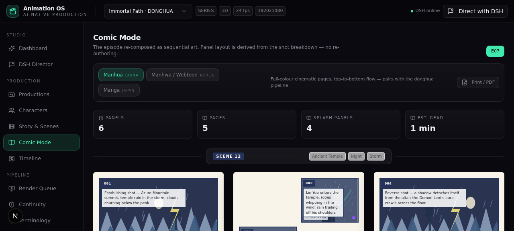
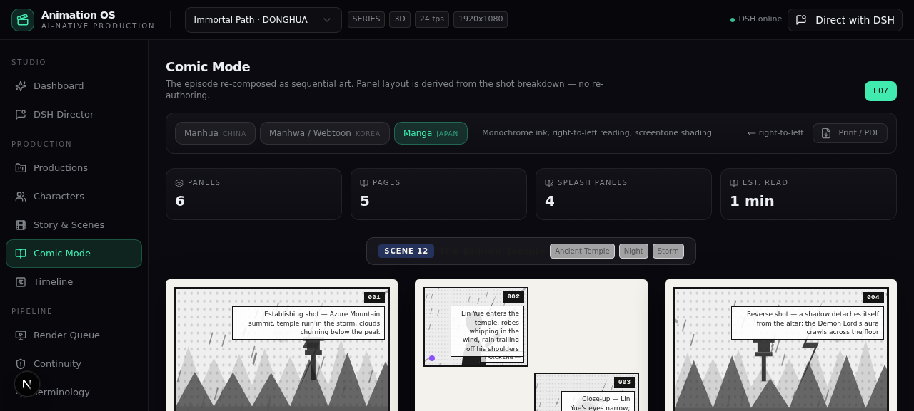
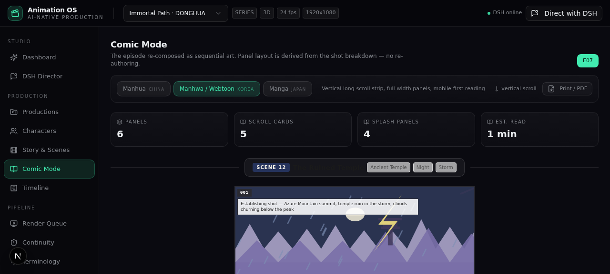
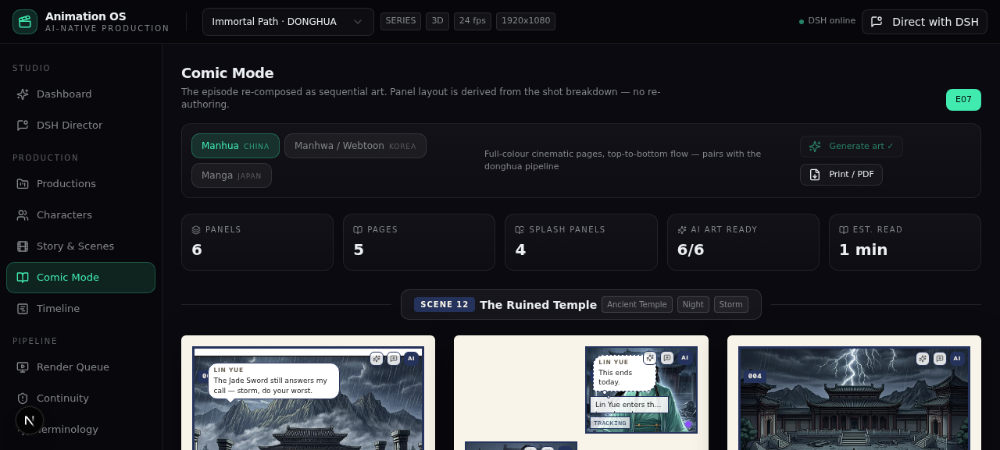
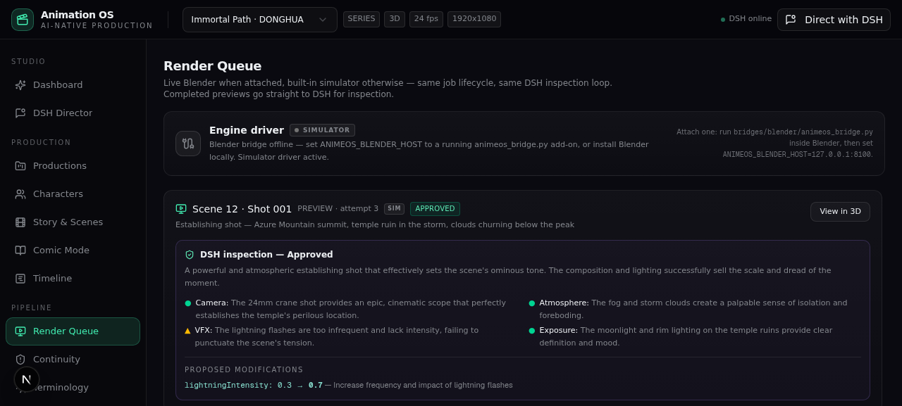
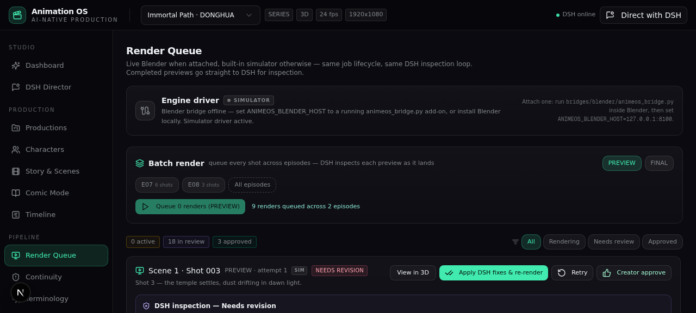
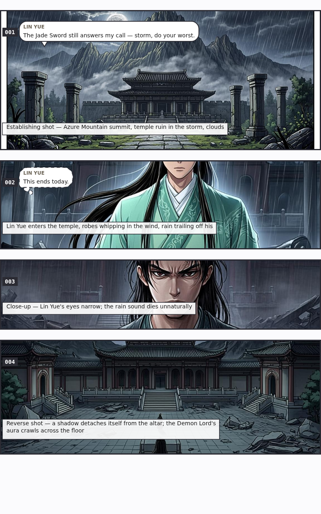

# AnimeOS - AI-Native Animation Production Platform

> **DSH decides · Tools execute · Engine builds · State remembers**

AnimeOS is an AI-native production studio for animated and illustrated storytelling. It natively supports **donghua**, **anime**, **manhua/manhwa (comics)** and adjacent formats through one unified, stateful production pipeline - designed so an AI director (DSH) drives the studio through tools, not ad-hoc chat.

## Core thesis

```
DSH decides → tools execute → engine builds → render → DSH evaluates → revise → approve
```

Every step writes to a persistent production universe: projects, seasons, episodes, scenes, shots, characters (with episode-resolved states), relationships, assets, terminology and continuity events. Nothing lives only in a chat log.

## Feature map

| Area | What it does |
|------|--------------|
| **DSH Director** | 88-tool production API behind a 4-round INTENT → PLAN → EXECUTE → OBSERVE orchestrator. Mid-turn project switching, full execution trace rendered in the console. The director authors **dialogue** (`set_shot_dialogue`), **panel art** (`generate_panel_art`), **character model sheets** (`generate_model_sheet`), the **art style direction** (`set_art_style`), **scene staffing** (`auto_assign_scene_team` - specialism-aware artist routing + content-matched LoRA attachment, load-balanced), **voice direction** (`direct_voice_takes` - state-aware delivery for every VOICE cue) and **voice casting** (`cast_voice_actor` - roster artists speak for characters) itself, pins **state arcs** across a shot range or across whole scenes of an episode (`set_state_arc`, `scope:'episode'`), paints **reusable arc templates** over a range in one call (`apply_arc_template` - the built-ins plus the production's saved shapes AND the studio library), **suggests a template** when the creator describes a beat in prose (`suggest_arc_template` ranks the registry against their words and hands back the apply framing), steers **per-state pose presets** (`set_state_poses` - a development state's body language, auto-resolved from the label on `create_character_state`), and proposes the webtoon export pre-flight in the same turn a diff detects staleness. **Ensemble beats**: pass `characters:[{name, stateLabel?}]` and one template lands on several speakers in ONE batch (per-speaker state overrides, unresolvable speakers skipped and reported, one combined Direction impact). The arc tools report the **direction impact** they just caused (which takes went stale) so DSH offers the re-render in the same turn, attach **playable arc chips** to the trace (the reply itself streams the arc's stored takes in story order), render **same-turn auditions** (one proposed read per engaged speaker of the exact stamped line, A/B against the stored take) and record **per-scope usage counts** so the registry shows which shapes each show actually applies. **Cadence scheduler**: `create_schedule` arms recurring studio work (a PLAN_RUN walks an approved plan a few steps per fire, the nightly-breakdown pattern; a REPAINT_QUEUE watch ticks render jobs and starts a supervised re-paint pass when the universe queue is dirty) fired by an in-process minute loop between conversations, every fire landing as a production event the creator audits from the scheduler panel (`steer_schedule` runs/enables/disables/deletes). **Art-aware continuity**: `check_art_continuity` scans for panel art that predates the state or anchor it should carry and can run a vision comparison of a hero panel against the character's canonical model sheet, filing ART_DRIFT / ART_VERIFIED events automatically. **Universe-facts vision checks**: `add_universe_fact` registers the world's canon rules (glowing blade spirits, two moons over the arena, the mask that never comes off) and `check_universe_facts` runs a vision model over a hero panel against every active fact - a holds/confidence verdict per fact lands as FACT_HELD / FACT_BROKEN events, and confident violations rank into the re-render queue in the Continuity view for a one-click panel re-render and re-check. **Per-episode plan templates**: `land_episode_plan` instantiates a shaped plan (beat-breakdown, panel-pass, render-pass, canon-audit) for one episode with its real scene/shot numbers resolved at landing time, PROPOSED for the creator's review gate - and any **creator-authored variation** saved in the plans panel (cloned from a built-in, reshaped row by row, `{episode}`/`{latestScene}`/`{title}` tokens resolving at landing, tools validated against the registry on save, PROJECT or STUDIO scope, usage-counted) lands by name or id the same way. **Identity scoring**: `score_panel_identity` vision-scores a panel (or, source:'render', a frame of the shot's FINISHED CLIP) against EVERY featured character's model sheet (0..1 per character plus per-aspect scores), targeted, worst-first batch, or defaulting to the worst artifact; the bar is the SOURCE's bar - storyboard panels repaint below 60%, but the SHIPPING PIXELS answer at 70% (THE BAR IS MEASURED: `measure_identity_bar` walks the finished renders, vision-scores each against the same sheets, and reads the honest distribution - cleared / average / worst / the repaint queue), `cast_identity_pass` reads the standing BY NAME (THE CAST ANSWERS THE BAR: every member's real per-character readings roll into one standing - CLEARING, BELOW with the worst shot ref named (the re-render queue by name), UNTESTED (anchored, never measured), UNANCHORED (no sheet - nothing to answer to yet)), a worst below the source's bar earns the re-paint (panel) or re-render (shipping pixels) offer in the result itself, and `reanchor_character` RE-ANCHORS a character whose drift curve declines because the design itself moved - the canonical sheet regenerates from the current design text, an IDENTITY_REANCHOR event restarts the curve's baseline, and recent panels re-score against the new sheet. **The studio writes to the creator**: a DAILY_DIGEST schedule posts a digest of the last 24 hours (renders, plan steps, schedule fires, canon and identity-drift headlines, queue pressure) as a production event the digest panel shows, and `post_digest` lands one on demand; `create_schedule` accepts `webhookUrl` / `digestEmail` so the digest DELIVERS itself beyond the studio (webhook POST, SMTP email via `ANIMEOS_SMTP_URL`), with every delivery outcome recorded on the digest and targets steerable any time; and since iteration 71 the push is PER-MEMBER (the My outbound panel subscribes each member's own webhook/email channels; digest posts and release slates fan out to the subscribed crew + OWNERs; every attempt lands on the NotificationDelivery ledger - SENT, REFUSED or FAILED with the detail). **And it ships**: `publish_cut` stages a platform publish package on the delivery spine (YOUTUBE, BILIBILI, DOUYIN, TIKTOK, STUDIO_INGEST) - the episode's latest cut is probed and conformance-checked against the preset (a 16:9 cut honestly FAILS a 9:16 platform), the package carries clamped metadata, a provenance credits line and an SRT built from the episode's dialogue, and the integration status is honest (credentials present, or a manual hand-off) - no network upload ever happens silently; `upload_package` then runs the platform's REAL upload adapter when the creator's credentials are set (YOUTUBE's resumable init+PUT, TIKTOK/DOUYIN's init-then-put, BILIBILI's multipart submit), with every outcome - OK or the honest FAILED naming the missing env key - appended to the package's PUBLISH event. **Voice cloning**: `train_voice_clone` trains a character's own voice from their rendered takes through the configured cloning provider (`ANIMEOS_VOICE_CLONE_URL`) and persists the trained voice id on the character - their lines then perform with THEIR voice wherever the provider can render it (state voice variants still deliberately override; the catalog voice stays the honest fallback). **Localization with memory**: `translate_subtitles` translates an episode's dialogue (or a pasted SRT) into any language with the Terminology memory ENFORCED - canonical renderings ride every batch prompt and a deterministic post-pass re-writes any cue the model drifted from, unknown-but-consistent renderings come back as suggestions to adopt (`create_terminology` grows the memory), and the translated SRT lands in `public/subtitles/` as a TRANSLATION event. **Native Blender designer**: `blender_asset_build` designs a character or environment as a versioned .blend LIBRARY ASSET from the production's design text, `blender_asset_inspect` vision-scores the asset preview against the canonical sheet, `blender_exec` runs raw bpy refinement passes in the studio's own runtime, `blender_viewport_shot` refreshes previews, `blender_asset_library` reads what exists - READY assets ride every matching render payload (design once, render many), and the whole DESIGN FACILITY stands behind it - named design laws (materials, lighting, motion, variation, sculpt, fx, physics), a self-correcting design loop (design_audit -> design_fix -> re-audit), learned craft memory (learned retopo flows, vision-guided sculpt plans, and LEARNED MOTION FLOWS - `learn_motion_flow` adopts a shot's VERIFIED keyed performance as the production's named memory of how a pose transition is performed for a dramatic register, and `set_shot_choreography` re-performs the verified timing on any shot, every application and every passing review growing the flow's applied/verified record), sequence programs that cut whole episodes with named grammars (per-slot fx and physics bindings, a per-slot WIND call the robes ride, a per-slot CLOTH call and FLESH call that scale the cloth and soft-body solvers' answers for the whole shot, and a per-slot MOTION call that CHAINS A PERFORMANCE - a choreography preset, a built-in, or a LEARNED MOTION FLOW whose verified timing re-performs on every shot the slot stamps, so the whole sentence re-performs end to end: lens, air, solvers, world AND body) plus LEARNED SEQUENCE FLOWS the studio directs from per dramatic register (`learn_sequence_flow` adoption, `direct_sequence register:'<register>'` consult - the consult itself names the verified programs no flow carries yet, and the chain rides the consult too) and `stage_battle` points the chain at EPISODE-SCALE battles (THE BATTLE IS STAGED: an arc of register legs - BATTLE > PURSUIT > RESOLVE - each leg consults the register's best-proven flow, the episode's shots are allocated across the legs by each sentence's own weight, EVERY leg pre-flights before a single shot is stamped, and the chained performances ride the slots) and the **Manifest** call-sheet panel, and pixel-level render judgement (review_render -> render_fix -> render_redirection). |
| **Render pipeline** | **Real animated shots, not stills**: every render job finishes as a sequenced h264 clip driven by the shot's camera grammar (movement, shot type, lens, lighting) and the scene's live parameters (fog veil, deterministic lightning flashes, energy pulses, rim contrast) - plus **character motion inside the frame**: shots carry start/end POSES (STANCE, WALK, LUNGE, SLASH, CAST, DRAW, BLOCK, LEAP, CROUCH, FALL, RISE, BOW, POINT) that the engines interpolate across the clip, so the character performs the beat, not just the lens. Blender is a NATIVE capability now: the studio provisions its own binary when missing, runs a resident headless bridge server it health-checks and restarts, and designs a versioned ASSET LIBRARY (.blend characters and environments with previews and honest identity scores) that render jobs load instead of rebuilding procedural stand-ins. Two engines produce those clips behind one job lifecycle: a **headless Blender worker pool** (a locally installed `blender` binary is auto-detected; each job spawns a fresh Cycles-CPU worker and `ANIMEOS_RENDER_WORKERS` slots render CONCURRENTLY - when the pool is full a PREVIEW overflows to MOTION while a FINAL parks in a priority wait queue with an honest 3D-WAIT stage) and the **built-in MOTION engine** (ffmpeg camera program over the shot's AI key art, or a procedural gradient plate when no art exists yet; overflow renders fall here while the 3D pool is busy). A workstation Blender can still attach over HTTP (`ANIMEOS_BLENDER_HOST`); without any engine a wall-clock simulator keeps the lifecycle intact. An **opt-in img2vid PREVIZ slot** (demoted to default-off: the output is designed, not AI-generated) lets pose-carrying hero shots preview their beat as an interpolation animatic when explicitly enabled (`ANIMEOS_IMG2VID=on`) or a host is attached (`ANIMEOS_IMG2VID_HOST`) - a previz pass and a motion benchmark, never the final render path; its job cards read PREVIZ. **Per-state pose presets** give the vocabulary muscle memory: every development state carries a start/end pair (`create_character_state` auto-lands the library preset matching the label - a furious state performs STANCE → LUNGE, a grieving one folds STANCE → CROUCH - and `set_state_poses` steers it), landed on any shot in one click (panel inspector's *Use state poses*, or the shots API `applyStatePoses`). The mouth program carries a **neural viseme pass**: an LLM plans the phoneme-level shapes (the mouth identity no envelope can recover) and conforms them onto the audio envelope (which keeps ownership of openness and timing), so consonants land where the words put them - and an **acoustic-model slot** (deterministic local DSP, `ANIMEOS_ACOUSTIC=off` disables) re-times the plan from the REAL WAV: the take is segmented into speech runs, silences and syllable anchors, spoken units redistribute over the real speech time (a unit interrupted by a pause continues after it), boundaries snap to the acoustic valleys between syllables, and coverage stops where the voice stopped instead of where the script ended - and a **neural rung** (`ANIMEOS_ACOUSTIC=neural`) adds an ASR pass that HEARS the take and collapses the units of words the voice skipped, so the mouth never performs unspoken words (the transcript is word evidence; the DSP warp still owns the timing). Clips play inline in the queue (every finished job card carries a video player), DSH's `render_shot` result names the engine and the camera move, and **Episode cut export** concatenates every shot's clip in story order, grades the episode's sound SERVER-SIDE - the cues land on KIND BUSES (VOICE / SFX / BGM / AMBIENCE) under a fixed gain law, the BGM ducks under the voice through a real sidechain compressor, the master is measured to the -16 LUFS target (EBU R128, the before/after numbers and the applied gain land in the manifest) and every bus stem persists beside the cut as its own WAV - and muxes video + audio into one distributable mp4 with a JSON manifest - and the **publishing panel** stages that cut for a platform with conformance checks, metadata and subtitle sidecars (packages land as PUBLISH events, upload stays a credential-gated or manual hand-off). Same LLM render evaluator with *bounded* parameter fixes, apply-fixes → auto re-render, approve → FINAL, batch rendering with throttled DSH inspections. **The world answers the beats**: a shot's directed grammar drives the worker's FX pass (TRAIL/BURST/AURA/MOTES emissive rigs bound to grammar beats), the physics pass (KNOCK/DEBRIS/SWAY rigid bodies that ground, roll under friction and settle to rest) and the REACTION pass (the figure staggers, dips and buckles away from the impact while the cloth whips with it) - and the finished clip is JUDGED: a pixel review measures the frame locally and reads it against the shot's directed intent, the fix loop applies the parameter fix each issue kind calls for and re-judges on the fresh pixels, and a graduated re-direction proposes grammar/fx ops when parameters are exhausted - all judged by the same fresh review. |
| **Blender design facility** | The studio designs like a 3D facility: a four-kind ASSET LIBRARY (CHARACTER / ENVIRONMENT / PROP / CREATURE - spirit swords, artifacts, vessels, quadruped/serpent/bird beasts) built from the production's design text into versioned .blends with lit previews and animated loops; NAMED DESIGN LAWS reused by name and usage-counted (design_material Principled BSDF recipes, design_lighting rigs, design_motion performances, design_variation Geometry Nodes scatters and arrays, design_sculpt seeded value-noise carves, design_fx spectacle programs, design_physics body laws); the SELF-CORRECTING DESIGN LOOP (design_audit's deterministic local audit + vision critique lands per-criterion scores and a concrete issue registry; design_fix runs a real bpy refinement pass, saves a new version and re-audits - an issue closes only when the re-audit agrees); LEARNED CRAFT MEMORY (learn_retopo_flow remembers verified topology runs - adoption, consult, reinforcement; plan_sculpt's surface probe + vision read plans the carve before it happens and the named SculptPlan grows its measured record; learn_sequence_flow adopts a verified sequence program as a dramatic register's named flow - direct_sequence consults the best-proven one, every application that lands whole with a clean read earns a clear, and the consult itself names the proven-but-unadopted programs so the memory grows on proposal); SCULPT AND BUDGET (per-kind triangle budgets, blender_retopo collapse-decimate with verified drift); and GLB/FBX ROUND-TRIP (blender_export re-imports every export and verifies it PER-CHECK: mesh, material and bone NAMES, the action's frame range, UV sets, bounded bbox/tri drift - an unverified export is a hope, not a deliverable). |
| **Style direction** | Per-production **art style tuning**: a custom style directive (overrides the visual-style preset), palette tokens and extra negative tokens - compiled into every panel-art and model-sheet prompt, tunable from the studio UI or by DSH itself. |
| **Casting consistency** | Per-character **AI model sheets** (turnaround reference images) plus a stored **canonical visual anchor** - the exact prompt tokens re-injected into every panel featuring that character, keeping faces/wardrobe coherent across panels and episodes. |
| **Continuity engine** | Universe-level conflict detection (e.g. destroyed artefact reappearing in Ep 29) with proposed resolutions, missing-capability analysis per scene, and **art-aware continuity**: a deterministic scan flags panel art that predates the episode-active state it should carry or the current model-sheet anchor (stale art), plus featured characters without an anchor; a **VLM deep check** sends a hero panel against the character's canonical model sheet and lands ART_DRIFT / ART_VERIFIED continuity events; **universe-facts vision checks** judge panels against the production's canon rules with a per-fact confidence (FACT_HELD / FACT_BROKEN events) feeding a worst-first re-render queue; and **identity-similarity scoring** puts a number on each panel's resemblance to its cast's model sheets (IDENTITY_VERIFIED / IDENTITY_DRIFT events, a below-bar re-paint queue on the Continuity view) - all surfaced in the Continuity view and to DSH via `check_art_continuity` / `check_universe_facts` / `score_panel_identity`. |
| **Comic Mode** | Shot breakdowns re-composed as sequential art - **manhua** pages, **manhwa/webtoon** vertical scroll, **manga** right-to-left pages. Deterministic panel-layout engine, **AI-generated panel artwork** (style-aware prompts seeded with shot type, environment, weather and character states), **speech-bubble authoring** (speech / thought / SFX, RTL-aware placement), print/PDF export, and **webtoon slice export** - the strip re-rendered at 800px and packed boundary-aware into platform-ready PNG slices, each scored slice carrying an **audio stem** (16-bit WAV, cues re-timed onto the slice timeline) that mixes **real TTS voice renders** for dialogue cues (**per-artist voice casting**: a character's cast roster artist performs the line; uncast speakers fall back to deterministic casting; **per-character-state delivery**: AUTO resolves the speaker's episode state, e.g. a battle-damaged Lin Yue reads strained and slow while an excited read rushes at 1.18x; a **line-level delivery** authored per dialogue line outranks scene direction, so one shot can play neutral then injured mid-performance; and a pinned standing direction overrides the state; a **state arc** (dialogue-editor arrow buttons or DSH `set_state_arc`) stamps one state onto the speaker's every following line across the scene, or across scene boundaries through the end of the episode (`scope:'episode'`), so a whole beat performs possessed without line-by-line edits, and each shot card carries violet **arc-span chips** (with the full span shown in the panel inspector's State arcs section: range, cross-scene badge, position and the covered lines); **state speed/pitch hints** bend pace and voice depth on top, so a possessed read can be slower and deeper without anyone re-pinning a register) with the synthesized SFX/BGM/ambience beds, plus a manifest with artists, LoRA metadata, voice takes (cast artist, delivery, direction + resolved state per take) and audio timing. The manifest also tags every voice stem and take with its **direction currency** (fresh / stale / unrendered against the current direction, per stem and per take, so downstream tooling knows which speech needs a re-render), and an **export pre-flight** names each stale or blocked take before the ZIP downloads, with an explicit export-anyway override. A **direction diff** board re-resolves what every VOICE cue in an episode would render as today, diffs it against the snapshot each take was made with, and re-renders only the affected takes. **Arc storytelling at season scale**: a **season-wide arc ruler** draws every state arc as a violet bar over an episode axis with **one lane per speaker** (a labeled gutter row per character, spans that survive an episode boundary merged into ONE season arc, click a bar to open that episode, clickable episode labels focus the ruler per episode), and **arc templates** (built-ins "possession spread", "full takeover", "recovery arc" plus **user-defined shapes saved per production or in the studio library**, with shape **versioning** that archives every replaced shape) paint a reusable beat shape onto one speaker's lines - or onto SEVERAL speakers as one parallel beat - from a dialog with a live dry-run preview, a **version diff** and a **cross-scope diff** (any two shapes across built-in / production / studio side by side with a human "what moved" list, plus **per-scope usage counts** on every saved shape). The same shapes are paintable and suggestable inside DSH via `apply_arc_template` / `suggest_arc_template`. **Everything with stored takes plays**: arc cards and ensemble clusters in the panel inspector (a cluster shows the merged story-order queue and streams the whole beat), ▶ chips on the ruler bars, and playable arc chips inside the DSH reply itself - all fed by one per-episode playback feed. |
| **Multi-artist studio** | **Style LoRA registry** (per-adapter trigger tokens, strength, base model) with **per-shot fine-tuning** from the panel inspector and **simulated LoRA training runs** distilled from approved panels (live steps, decayed loss curve, milestone log, TRAINED badge) plus a **Train all** batch button that fine-tunes every idle adapter in one pass; an **artist roster** with per-shot assignment, bulk assignment, a **workload-balance view** (production-wide spread badge, per-artist bars, **affinity-first pool distribution**: LoRA-bound panels route to the artist with the highest style affinity for that adapter, unbound panels rotate by load, **per-artist style affinity** scoring which LoRA each artist delivered with) and **per-artist voice casting** (each artist carries a TTS voice; characters bound to an artist via the casting board or DSH's `cast_voice_actor` are performed by that artist's voice everywhere), plus **per-state voice variants**: a development state can bind a different TTS voice (DSH `set_state_voice_variant` or the character sheet picker), so a possessed / transformed / battle-damaged Lin Yue is performed by a different voice entirely while that state is episode-effective; each state can also carry **speed/pitch hints** (character sheet selects or DSH `set_state_voice_variant` args) that bend the take's pace and pitch while the state is effective and flag older takes stale. The casting board **auditions** any roster voice on a throwaway TTS render - a custom line, or the character's own first dialogue line - in a chosen register before anything is cast, **auditions a whole state** (its variant voice plus its speed/pitch hints, before binding anything), runs **ensemble try rows** (one batch call renders every picked speaker as an A/B row with a per-row compare and a cast-order sequence play), and keeps a **per-state audition history**: every proposed read (DSH variant binds, ensemble applies, board state tries) lands in a timestamped, replayable, removable list with its performance snapshot (voice, register, speed/pitch, duration, the line, the date) pruned to the latest 12, and **any two recorded reads chain back to back** - pick sides A and B, hit compare, swap the order, hear them one after the other. DSH can staff whole scenes autonomously via `auto_assign_scene_team`. |
| **3D cinematic preview** | Three.js blocking preview built from the production's DESIGN DNA - the same compiled character and environment structures the Blender worker renders from: the cast figure carries the character's hair, robes, accent and weapon energy, the set is the scene's environment (terrace / peak / forest / gorge / temple terrain, moons, pagoda, bell, banners, bamboo, cloud sea, weather particles, time-of-day sky), plus live scene parameters and shot camera presets (movement-aware) with auto shot advance. |
| **Studio UI** | Dashboard, Productions, Characters (states / relationships / derivatives), Story & Scenes, Comic Mode, Timeline, Manifest (the director's call sheet: sequence programs, learned flows, and every shot's beats, poses, world bindings and render state), Render Queue, Reviews, Continuity, Terminology, Subtitles, History. |
| **Multi-user studio** | Shared-workspace auth with **role-gated writes**: register (first account becomes OWNER automatically), sign in at `/signin`, and every member sees the same productions while the role gates WRITES - VIEWER is read-only (the route gate refuses every mutating API call with an honest 403), EDITOR directs DSH and edits productions, OWNER manages the roster (the header user menu's Studio roster panel: members, liveness readouts, role selects) with the last OWNER protected. Two enforcement layers: the Next 16 proxy gates pages behind a session and mutating APIs behind a role above VIEWER, and sensitive routes re-read the user row fresh from the DB so role changes land immediately. **And the workplace landed**: comment threads anchor to episodes, scenes, shots (a comic panel IS its shot), voice takes and canon facts - the anchor row resolves the project server-side, EVERY signed-in member may speak (VIEWERs ride a one-path proxy allowlist: speaking is not directing), the thread's author or EDITOR+ resolves, and each comment lands a COMMENT event. The **human approval gate** (OWNER policy toggle on the Render Queue) turns DSH's APPROVED inspection into a recommendation: the render parks at awaiting-creator until an EDITOR+ approve releases it to FINAL, or a reject sends it back with a required note that lands in the shot's thread as a first-class comment; the **Reviews** view gathers what waits on people (gate-held renders with one-click approve/reject, open crew threads), and the DSH context's workplace line carries the gate state and the open threads so the director reads the room before it directs. **Per-production memory boundaries**: DSH directs one production at a time - its conversation, canon and events stay bounded to it; a mid-turn create_project keeps the conversation on the home production, opens the newborn's history with an origin event and seats its maker on the newborn crew. **Invite links**: the OWNER's keyring cuts single-use codes that register a newcomer with a carried role (EDITOR/VIEWER) and an optional crew seat with craft lens - spent keys, revoked keys and expired keys all open nothing. |

## Screenshots

**Comic Mode** - the same episode re-composed as manhua (LTR, colour), manga (RTL, monochrome + screentone) and manhwa/webtoon (vertical scroll) pages:

| Manhua | Manga (RTL) | Webtoon |
|--------|-------------|---------|
|  |  |  |

**Casting consistency & the live bridge** - Lin Yue's AI model sheet (turnaround anchor), DSH-authored dialogue rendered as bubbles over anchor-consistent AI art, and the engine-driver card:

| Model sheet | DSH-authored art + thought bubble | Engine driver |
|--------|-------------|---------|
|  |  |  |

**Batch pipeline & slice export** - the cross-episode batch render card in the queue, and platform-ready 800px webtoon slices cut from the strip (bubbles, captions, chips re-drawn at export resolution):

| Batch render | Webtoon slice (800px) |
|--------|-------------|
|  |  |

## Native format support

| Format | Pipeline posture |
|--------|------------------|
| **Donghua** | Style preset with zh-CN terminology defaults, cultivation-state character modelling, ink-wash flavoured panel art, xianxia demo universe. |
| **Anime** | Cel-shading posture, anime timing stage in the render ladder, ja-JP terminology defaults. |
| **Manhwa** | Manhwa-inspired framing preset (ko-KR) + webtoon vertical-scroll Comic Mode. |
| **Manhua / Manga** | First-class Comic Mode layouts with correct reading direction (LTR / RTL / vertical). |

## Architecture

```
src/
├── app/
│   ├── api/            # 15 route handlers (projects, characters, scenes, shots,
│   │                   #   render-jobs, dsh, panel-art, character-sheet, bridge, …)
│   └── page.tsx        # single-route studio SPA
├── components/
│   ├── views/          # studio views (dashboard, dsh-console, comic, …)
│   ├── preview/        # three.js cinematic preview
│   └── studio/         # app shell (zustand + TanStack Query)
└── lib/
    ├── dsh/            # tools, prompts, orchestrator, evaluator
    ├── ai/             # art service: panel art + character model sheets
    ├── bridge/         # MOTION engine (ffmpeg camera grammar) + Blender bridge
    ├── blender/        # NATIVE runtime (provisioning + resident server + exec) + asset library
    ├── engine/         # render pipeline (Blender ⇄ MOTION ⇄ simulator drivers)
    ├── comic/          # panel layout, dialogue model, stems, episode cut builder
    ├── continuity.ts   # conflict + capability checking
    └── seed.ts         # "Immortal Path" demo universe
bridges/blender/       # animeos_bridge.py - worker-mode renderer + attachable server
```

**Stack:** Next.js 16 · TypeScript · Prisma/SQLite · TanStack Query · zustand · Tailwind · shadcn/ui · Three.js.

Per the replaceability principle, the render engine is a **pluggable driver** chain: headless Blender workers when a `blender` binary exists, the built-in MOTION engine (ffmpeg) otherwise, a wall-clock simulator as the last resort - the production state machine, queue and DSH evaluation loop are identical.

### Render engines

- **Headless Blender (auto-detected).** If a `blender` binary is on the machine (or `ANIMEOS_BLENDER_BIN` points at one), each render job spawns a fresh worker: `blender -b -P bridges/blender/animeos_bridge.py -- --worker --job <file>`. Since v4.0 the worker renders the DESIGNED pass: AnimeOS compiles the production's design text (model-sheet anchors, appearance notes, wardrobe/weapon states, environment briefs) into design DNA (`src/lib/animation/design.ts`) and sends it with every job, so the worker builds the DESIGNED character (stylized smooth figure, layered robes with sleeves, cuffs, sash and skirt panels, hairstyle per DNA - topknot / ponytail / braid / long / short, per-DNA weapon - sword / staff / spear - with the character's energy color, high collar, glowing stylized eyes) on a DESIGNED set (terrain per environment - terrace / peak / forest / gorge / temple - plus features: two moons, pagoda silhouette, bronze bell, wind banners, pillar stubs, bamboo, sea of clouds, lanterns, waterfall and stream, with a time-of-day sky and key light; a second detected character blocks across the set). A prop-scale camera table frames the 0.9m figure properly (chest/face-height targets, 1.9x distances). Without DNA the worker falls back to the v3.3 stand-in figure and set. It builds the set and drives a camera rig through the shot's movement grammar frame by frame, applies the AnimeOS scene parameters, renders with Cycles CPU and encodes h264 (system ffmpeg, or Blender's own FFMPEG writer). Shots carrying a pose program get an **articulated stand-in figure** whose joints interpolate between the start/end poses with eased timing - lunges, casts, walk cycles with stride swing and root bob - and the rig follows the subject's travel so the body stays framed. And since iteration 74 the body can PERFORM instead of slide: a keyed choreography program (design_choreography / set_shot_choreography - built-ins The Combo, The Draw Storm, The Rising Fang) replaces the two-pose interpolation with keys - anticipation earns the strike, the strike explodes, the hold sells the read, the follow-through settles - while a REAL impact light flares and the camera takes a decaying punch on the strike frame and the striking limb smears up to 1.35x on the fastest frames (the keys own the body; the lens, the cloth, the flesh and the physics still answer it). The v3.2 rig adds a **face and hands**: emissive eyes that squint and blink on a deterministic schedule, brows that knit angry or lift surprised, a mouth that opens with effort, and on each arm a palm, four fingers and a thumb that curl into grips, spread to channel energy or extend an index to point - every pose carries a 7-channel face/hand row eased between the endpoints exactly like the joints, and tight shot types aim the camera at the head so closeups frame the performance. The v3.3 rig makes the face **speak**: a shot with SPEECH dialogue and a tight framing arrives with a millisecond viseme program and the mouth performs the lines frame by frame - vowels open, m/b/p press shut, "ee" spreads, "oo" purses, and the pose's effort mouth stays as the floor. The program is **audio-driven over the real TTS take**: the take's WAV is analyzed frame by frame (RMS energy opens the mouth, zero-crossing rate separates voiced vowels from wide fricative hisses, silence closes), so the lips match the audio the viewer hears; the v3.4 program adds the **neural viseme pass**: an LLM plans the dialogue's phoneme-level mouth shapes (a 15-entry vocabulary - round oo, wide ee, lips-shut stops - weights clamped, cached per line set) and the plan's identity is CONFORMED onto the audio envelope, which keeps ownership of openness and timing, so consonants land where the words put them; without a take the plan performs the line itself, and a refused model degrades to the audio-only then text pass without blocking the render. Since iteration 75 the workers form a POOL (`ANIMEOS_RENDER_WORKERS`, default 2, clamped 1..4, read live): two Cycles workers render CONCURRENTLY, and when the pool is full a PREVIEW overflows to the MOTION engine while a FINAL PARKS in a priority wait queue (FINAL over PREVIEW, older first, an honest 3D-WAIT stage line) until a slot frees - the tick pumps the queue within one poll, and a waiter lost to a server restart fails honestly instead of hanging.
- **MOTION engine (built-in).** A deterministic camera program (per-movement zoom/pan/tilt profiles x shot-type framing x lens character x lighting grade x fog/lightning/energy) is animated over the shot's key art with ffmpeg zoompan - or over a procedural gradient plate when no art exists - and encoded at the project's fps. Pose pairs play here as a blocking approximation: the program notes them and lands an impact beat at the end pose. Speaking closeups get a blocking speech beat per spoken line (a soft shimmer over each line's window) so the cut still reads as "someone is talking here".
- **img2vid previz slot (opt-in, default off).** Demoted: the studio's output is designed, not generated, so the interpolation model is previz and benchmark only. When explicitly enabled (`ANIMEOS_IMG2VID=on|zai|previz`) or a host is attached, pose-carrying hero shots route to it: the shot's key art (inlined as a data URL) plus a pose/camera program go to the async video-generation API; on a speaking closeup the prompt also carries the lines as explicit speech direction; the finished animatic downloads back into `public/renders/` and plays in the same queue behind a PREVIZ chip. An attached host wins (`ANIMEOS_IMG2VID_HOST` speaking the tiny jobs protocol); unset flag and no host means the slot is invisible and the designed engines (Blender, MOTION) take every job. A provider lost mid-job degrades to the MOTION engine transparently (and rebuilds the speech program so the takeover keeps the lip-sync).
- **Native Blender runtime + asset library (v4.1).** The studio owns its Blender: `src/lib/blender/runtime.ts` detects the binary, auto-provisions the pinned release (Blender 5.2.2 LTS from download.blender.org since iteration 72 - the proven 4.3.2 stays as a fallback candidate) when a workspace reset wipes it, starts a RESIDENT headless bridge on :8101 that it health-probes and restarts with backoff (the per-job spawn path stays as fallback), and exposes an exec sandbox (`blender_exec`) where the DSH designer runs real bpy passes. The design-time library (`src/lib/blender/assets.ts` + `bridges/blender/asset_builder.py`): one design DNA in, one versioned .blend + a lit 512px Cycles preview out (`assets/blender/`, previews served from `/assets-blender/`), a `BlenderAsset` row per character/environment carrying version, build log, DNA audit and an honest vision identity score vs the canonical sheet. READY assets ride every render payload; the worker appends the .blend and resolves the SAME v3.x/v4.0 rig contract by base object name, so poses, lip-sync and camera math are untouched - a missing file falls back to the procedural DNA builders honestly, and the worker state reports `figureSource` / `setSource` so every job's asset decision is auditable.
- **Workstation attach.** Run the bridge server inside any Blender (GUI or headless) and point `ANIMEOS_BLENDER_HOST` at it: jobs go over HTTP and the finished clip returns as base64.

```bash
# inside any Blender ≥ 3.x (GUI or headless):
blender -b -P bridges/blender/animeos_bridge.py -- --port 8100
# then point the studio at it and restart the dev server:
ANIMEOS_BLENDER_HOST=127.0.0.1:8100 bun run dev
```

The add-on exposes `GET /status`, `GET /progress`, `POST /render`, `POST /ping` on `127.0.0.1`. Every engine maps the tunable scene parameters (fog, lightning, energy, rim light, camera distance) onto its own equivalents, honors the shot grammar (ESTABLISHING→24mm wide … EXTREME_CLOSEUP→100mm), streams per-frame progress into the same queue UI, and lands an mp4 in `public/renders/`. If an attached bridge drops mid-job the driver chain takes over transparently.

## Run it

```bash
bun install
cp .env.example .env      # DATABASE_URL=file:./db/custom.db
bun x prisma db push
bun run dev               # http://localhost:3000
```

The database auto-seeds on first request with the **Immortal Path** demo production: a donghua universe with character development states, a six-shot Scene 12 breakdown, a seeded continuity conflict (Jade Sword destroyed in Ep 29) and terminology entries.

### Try the loop

1. Open **Render Queue**, trigger a render on any shot - the **Engine driver** card shows whether headless Blender workers or the built-in MOTION engine is driving; the job badge shows `BLENDER`, `PREVIZ` (the opt-in previz slot) or `MOTION`. Watch progress stream per frame, then **play the finished clip right on the job card** - a dolly-in on a closeup dollies, a pan pans. Give the shot a **pose program** first (panel inspector > Motion poses, or DSH `set_shot_poses`) and the clip shows the character performing: the Blender stand-in lunges, casts or walks between the start and end poses. Or skip the authoring: hit the panel inspector's **Use state poses** and the featured character's episode-active state lands its preset (a furious state performs STANCE → LUNGE).
2. Same view, pick an episode in **Episode cut** and hit *Export cut (mp4)*: the episode's clips concatenate in story order, the stems synthesize server-side (real TTS takes included) and video + audio mux into one downloadable cut with its manifest. Then pick the episode in **Publishing** and hit *Stage package*: the cut is conformance-checked against the platform preset (try Douyin with a 16:9 cut for the honest FAIL), and the package carries the title/description/tags, the SRT subtitle sidecar and the upload checklist.
3. Watch the evaluation come back `NEEDS_REVISION` with bounded parameter fixes → **Apply fixes** auto-queues attempt 2.
4. Open **DSH Director** and talk to the studio: *"For scene 12 shot 3: author the dialogue, generate a model sheet for any new character, then paint the panel in manhua style"* - the 81-tool trace shows the director doing it itself. Ask it to *"shift to a cold moonlit silver-blue palette"* and it retunes the production's style direction itself. Ask it to *"land the beat breakdown for episode 1"* and a per-episode template lands as a proposal in the plans panel. Ask *"how is the studio doing?"* and `studio_pulse` answers with the canon score, identity standing, drift curves, schedule outcomes and queue pressure. Ask *"catch me up"* and `post_digest` lands a digest of the last 24 hours in the studio digest panel.
5. Open **Characters** - hit ✦ on a character to generate their **model sheet**; the stored anchor then steers every panel they appear in (cards show an `ANCHOR` badge once locked).
6. Open **Comic Mode** and flip the same episode between manhua / webtoon / manga layouts. Bubbles (speech / thought / SFX) place themselves around the art - mirrored for manga RTL - **Print / PDF** exports pages with chrome hidden, and in webtoon format **Export slices** downloads a ZIP of 800px platform-ready strips whose audio stems mix real TTS voice takes into the score.
7. In **Comic Mode**, open **Motion sound** on a motion panel: auto-score the timeline, hit **Render voices** to give every dialogue cue a real TTS take performed by the speaker's cast artist in the speaker's current character state (or pick a voice, speed and an explicit excited / injured delivery per cue, plus a directorial note), and preview - exported stems use the same takes. Author **line-level delivery** in the dialogue editor (the ✎ on any panel) to play one shot's lines in mixed registers; the motion-sound board shows which line direction outranks the standing one.
8. Open **Artists** to run **voice casting**: give each roster artist a TTS voice, then bind characters to the artist who speaks for them. **Audition** any voice first - the board renders a throwaway sample (your line, or the character's own first line, in a chosen register) without saving a take - or pick a development state under a character and hear exactly how that state performs (variant voice + speed/pitch hints). Every proposed read lands in the state's **audition history** (replayable, removable), and **any two recorded reads chain back to back**: pick sides A and B, hit *compare A · B*, and hear them one after the other. Select several characters for an **ensemble try** and DSH or the board renders an A/B row per speaker with a sequence play. Ask DSH to do the same with `cast_voice_actor`, and to set standing deliveries scene-wide with `direct_voice_takes`.
9. After a state beat or a line edit, open **Direction diff** in the Comic Mode toolbar: every take is compared against today's direction and **Re-render affected** touches only the stale ones (fresh takes are never re-rendered).
10. Open **LoRA** and hit **Train all** to batch-fine-tune every idle adapter from the approved panels (each run shows a live loss curve), or **Train** a single one; then open **Workload** and hit **Distribute pool (affinity-first)** to route unassigned panels to the artist whose style affinity is highest for each panel's adapter.
11. Back in **Render Queue**, use **Batch render**: tick two episodes, hit *Queue N renders*, and watch the queue fill, DSH inspect each preview (throttled per poll), and the stats row track active / review / approved. Finished cards carry the **per-provider readout** ("MOTION 12.4s (built-in ffmpeg)", ~credits when a hosted provider billed) and the **provider ledger** aggregates latency and cost per engine above the queue.
12. Open **Continuity** and scroll to **Identity similarity**: after panel art exists for sheeted characters, *Score worst 3* vision-scores the panels against every featured character's model sheet - rows show per-character percentages, anything below the 60% identity bar lands in the re-paint queue with a one-click *Re-paint + re-score*, and the *Affinity pass* button embeds every panel and sheet locally (block-robust region hashes + palette histograms, instant and provider-free) to keep a drift tripwire alive when the vision provider is down. When a character's drift curve DECLINES because the design itself moved, press **Re-anchor** on their curve row: the canonical sheet regenerates, an IDENTITY_REANCHOR event marks the baseline restart (the dashed violet marker on the sparkline), and their recent panels re-score against the new sheet. Just below, **Canon health** rolls the universe-facts verdict history into a score with per-fact status rows. In **DSH Director**, the plans panel's **Per-episode templates** section lands a shaped plan (beat breakdown, panel pass, render pass, canon audit) for the picked episode - approve it, run it by hand, or arm a nightly schedule and the studio breaks the episode down while you sleep - and asking DSH for a `studio_pulse` reads the whole studio's health (canon score, identity and affinity, 14-day schedule outcomes, queue pressure) in one instant line.
13. Sign in as a second member (register from `/signin` - they start VIEWER) and the studio becomes a WORKPLACE: every render card's **Discuss** button opens the shot's comment thread where any signed-in member can speak (VIEWERs included - speaking is not directing), the thread's author or EDITOR+ resolves, and the new **Reviews** view collects the crew's open threads. Arm the **Human gate** (OWNER toggle on the Render Queue): DSH's APPROVED inspection then PARKS the render at awaiting-creator with a HELD badge and an *awaiting approval* counter until a person approves it into FINAL or rejects it with a note that lands in the shot's thread - and the DSH context's workplace line carries the gate state and the open threads, so the director reads the room before it directs.

## Status

The full thesis runs end-to-end: DSH directs dialogue, panel art, model sheets, style direction, scene staffing, voice casting and state-aware voice direction through 80 production tools (including the NATIVE BLENDER DESIGNER: the studio's own auto-provisioned Blender runtime with a resident health-checked server, a design-time asset library of versioned .blend characters/environments built from the design text, previews, and honest vision identity scores - ready assets ride every render payload so the worker loads the DESIGNED asset instead of rebuilding procedural stand-ins, including the supervised auto re-paint runner, the universe-facts loop with reword-or-retire suggestions, cross-turn plans, per-episode plan templates plus creator-authored variations, the cadence scheduler with a daily digest, identity scoring with per-character drift curves, and the studio_pulse health readout); the acoustic-model slot's evidence is now PERSISTED per take (a one-click acoustic audit records the speech runs, syllable anchors and the neural rung's ASR word evidence on the cue row, badged on the sound timeline), reworded facts close their own loop (a reword records the old wording, and the drift sweep re-audits every pending fact in one pass, clearing the marker when the loop closes), publish packages now write their HAND-OFF FOLDERS to disk (package.json + SRT + checklist next to the cut) and a PUBLISH_RUN schedule stages an episode's package on a cadence, and identity vision-scoring now judges the SHIPPING PIXELS too: a frame pulled from each finished render clip is scored against the cast's model sheets alongside the storyboard panel, so the panel-versus-render identity gap is measured, not guessed; renders are real animated clips - a headless Blender worker pool or the built-in MOTION engine animates every shot's camera grammar into an h264 cut that plays straight on the queue card, speaking closeups lip-sync their lines on the stand-in's mouth rig with the program derived from the real TTS take's audio and CONFORMED to a neural phoneme plan (the LLM plans the phoneme-level mouth shapes - round oo, wide ee, lips-shut stops - the audio envelope keeps ownership of the timing, and iteration 67's FORCED ALIGNER places every phone to the millisecond (words land on the take's measured syllable anchors, each phoneme window measures its own openness from the audio, and the plan's closed stops cap the mouth in their exact windows - persisted per take on the acoustic audit's phoneme timeline; without a take the plan performs the line itself, and a refused model degrades to the audio-only then text pass), and episode exports mux those clips with server-synthesized stems into one distributable mp4; work that outlives a turn lands as a resumable plan the creator approves in the review panel and DSH executes step by step across conversations, recurring work runs on a cadence without anyone clicking - nightly plan fires land the breakdown steps, a render-queue watch starts re-paint passes when the universe queue is dirty, and every fire is auditable as a production event - the studio's engines report per-provider latency and estimated cost on every queue card with a ledger per engine, and the studio reports its own health and writes to the creator: a canon score over the fact verdict history with reword-or-retire suggestions for facts whose audits keep failing, per-character identity drift curves AND per-fact confidence drift curves over episode order, a 14-day schedule digest with overdue and error-streak flags, a provider-free embedding tripwire (block-robust region hashes + palette histograms per panel vs every sheet - a reframe moves the global hash but not the blocks) under the vision identity scores, and a daily digest (scheduled or on demand) that lands the last window of studio activity as one readable message and DELIVERS itself beyond the studio - POSTing to a webhook and mailing via SMTP when ANIMEOS_SMTP_URL is configured, every outcome recorded on the digest; Comic Mode produces AI-illustrated, dialogue-authored, casting-consistent pages in all three native formats, directs voices line by line inside a shot, auditions cast choices and whole character states before committing them, remembers every proposed read per state with a replayable A/B-chainable history, exports webtoon platform slices whose audio stems carry cast-artist, character-state-shaped TTS voice takes over the synthesized score, diffs every episode's direction and re-renders only the takes that moved, measures the whole season's state arcs on a cross-episode ruler with one lane per speaker, paints beats from reusable arc templates (saved per production or in the studio library, versioned, usage-counted, diffable across scopes), lands ensemble beats on several speakers in one batch with same-turn auditions and playable arc chips in the reply itself, batch-trains style adapters from approved panels, and routes the panel pool affinity-first while ranking per-artist style affinity, and the queue swallows whole episodes in one batch; and the studio is a WORKPLACE now - comment threads hang off episodes, scenes, shots, voice takes and facts with every signed-in member able to speak (VIEWERs included, through a one-path allowlist) and the author or EDITOR+ resolving, an OWNER-armed human approval gate turns DSH's APPROVED inspection into a recommendation that waits for a person (a reject's required note lands in the shot's thread), a Reviews view gathers what waits on humans, and the director's context carries the gate state and the open threads so it reads the room before it directs. The Blender frontiers turned the studio into a DESIGN FACILITY (iterations 51-61): the asset library grew to four kinds with designed material/lighting/motion/variation/sculpt recipes, the self-correcting design loop audits and fixes every design with persisted per-criterion evidence, per-beat secondary motion hangs every figure's cloth and hair on the directed grammar beats - and iteration 65 graduated the CLOTH to the real Blender solver: the wind calls, beat-boundary impulses and the body's stagger steer each part's anchor bone and the Armature-Subsurf-Cloth stack answers with real folds and lag no spring can fake (hair keeps the springs; the render state names which ran), and iteration 66 dressed the render from the sheet itself: the canonical sheet's measured palette is COLOR LAW over the DNA defaults (a bounded 35% pull on robe/accent/hair/boots, honest skips, the state's identity line), named FX programs ignite the beats (trail, burst, aura, motes), named physics programs answer them with real gravity, bounce and settle, REACTION staggers the body away from the violence, sequence programs cut whole scenes with named grammars (now whole episodes, with per-slot fx and physics bindings), the finished render is JUDGED by a pixel review that measures the frame and reads it against the shot's directed intent, the fix loop closes on the fresh pixels and graduates to cited grammar/fx re-direction when parameters run out, and the craft is LEARNED: verified retopo runs become named flows, and the surface probe + vision read plan every sculpt carve before it happens.

## Roadmap - what is not achieved yet, and how we will get there

The plan's destination is an AI-native studio that takes a story from prose to published, animated episodes with zero manual coordination. The thesis loop is closed, but these parts of the vision are still open:

1. **Performance-grade character motion.** Characters move inside the frame: shots carry start/end pose chips (13-pose vocabulary), every development state carries a **pose preset** (auto-resolved from the label, steerable per state, landable on shots in one click), the Blender worker articulates a stand-in between the poses with a **full face and hand rig** (blinking emissive eyes, tilting brows, an effort mouth, and fingers that grip the blade, spread to channel or extend to point, with blade follow-through), the **img2vid previz slot is DEMOTED to opt-in previz** (default-off: the output is designed, not AI-generated; `ANIMEOS_IMG2VID=on` or an attached host previews a pose beat as an animatic behind a PREVIZ chip, never as the deliverable), the MOTION engine plays an impact-beat approximation, and **speaking closeups lip-sync**: the mouth rig performs a viseme program **derived from the real TTS take's audio** (RMS energy opens the mouth, zero-crossing rate separates voiced vowels from wide fricatives, silence closes; the dialogue-text program remains the fallback when a take is missing), the img2vid prompt gets the lines as speech direction, and MOTION lands a blocking speech beat. The **neural viseme pass** landed: an LLM plans the dialogue's phoneme-level viseme score (a 15-entry mouth-shape vocabulary, weights clamped, cached per line set) and the audio path CONFORMS to it - openness stays audio-owned while wide/round identity and closed-stop placement come from the plan; without a take the plan performs the line itself (a strict upgrade over the per-character table), and a refused model degrades to the audio-only then text pass without blocking the render. And the **acoustic-model slot landed**: the take is segmented deterministically into speech runs, real silences and syllable anchors, the plan's units re-time over the real speech (a unit a pause interrupts continues after it, boundaries snap to acoustic valleys, coverage stops where the voice stopped), so the mouth shapes land where the VOICE put the words - `ANIMEOS_ACOUSTIC=off` keeps the plan's even spread. What is still missing: learned interpolation quality on par with the best closed video models (timestamped phoneme alignment landed in iteration 67: a deterministic forced aligner places every phone to the millisecond from the plan's shapes, the take's measured energy and the DSP's syllable anchors - words spend the anchors their vowels demand, and a bilabial stop the plan placed closes the mouth in its exact window)). And **solver-grade FLESH landed** (iterations 65 + 68 + 69): the robes are SOLVED (the real Blender cloth solver under the directed air, its per-shot CLOTH call scaling the answer) and the flesh layer itself is now SOFT BODIES - the trunk and face volumes run the real Blender soft-body solver (probed before it shipped: storm lag 141x the calm hold, bit-exact determinism, bounded, settling), driven by the same beat clock, with the per-shot FLESH call directable beside the cloth one. What remains open here is learned interpolation quality on par with the best closed video models.
2. **Continuity checking that sees the universe, not just the sheet.** The art layer joined the continuity engine: a deterministic scan flags stale art (panel predates the episode-active state or the current model-sheet anchor) and missing anchors, a **VLM deep check** compares a hero panel against the character's canonical model sheet (ART_DRIFT / ART_VERIFIED events), and **universe-facts vision checks** judge every panel against the production's canon rules with a confidence per fact - confident violations rank into a worst-first re-render queue. The loop now CLOSES ITSELF: every panel prompt carries the production's active canon (**fact-aware art prompts**), the **supervised auto re-paint runner** walks the queue worst-first without the clicks - each step re-paints with the flagged facts restated as corrections, re-checks with the vision model, records FIXED / STILL_BROKEN / ERROR, and still-broken panels stop retrying and wait for the director (pause / resume / abort between steps, run state persisted and streamed to the Continuity view) - panels carry an **identity score**: one vision call scores the panel against EVERY featured character's model sheet (0..1 per character plus face/hair/wardrobe/weapon/palette/style aspects), persists per shot, and a worst below the 60% identity bar queues the panel for a one-click re-paint + re-score (IDENTITY_VERIFIED / IDENTITY_DRIFT events, DSH `score_panel_identity` targeted, worst-first batch or default-to-worst) - and the whole history reads back as a HEALTH READOUT: the **canon health** panel rolls the fact verdict history into a 0..1 score (0.4 coverage + 0.6 hold rate over active facts, an unchecked canon is not a healthy canon) with per-fact status rows (HELD / VIOLATED / UNVERIFIED, worst-first) - and the panel now SUGGESTS ITS OWN FIX: a fact audited on 3+ panels whose hold rate fell under a third earns an **auto-retire suggestion** (worst first, the reason names the counts and the reword-or-retire fork), with Reword (PATCH the text in place) and Retire (deactivate) buttons in the canon-health panel and the suggestion riding `studio_pulse` and the DSH context. The curves went FACT-LEVEL: every verdict becomes a point on a per-fact confidence curve over episode order (same trend bands as the character curves, steepest decline first), DECLINING facts surface in the canon-health panel with inline sparklines, `studio_pulse` and the DSH context name them - a fact losing verdict confidence across the show is headed for a violation streak, and the reword-or-retire suggestion is the exit - and the **reworded-fact re-audit helper** closed the loop: rewording a fact (Reword button, or the canon-health API) automatically re-runs the vision check on every panel that audited the OLD wording, so those same panels answer whether the NEW wording holds, the fresh verdicts feed the health score and the drift curves, art-less targets are reported as honestly skipped, and everything lands as a CONTINUITY event - and the suggestions are CURVE-AWARE now: a fact whose confidence curve DECLINES steadily across episodes earns the reword-or-retire suggestion even while its hold rate is still perfect, so the writing fix lands one episode earlier. The reword loop went SELF-SERVE: a reword records the OLD wording on the fact (`lastRewordedFrom`), and the **reword drift sweep** (canon-health panel button, `reaudit-drifted` action) re-audits every pending fact in one capped pass - a fact closes when its panels were actually re-checked under the new wording, or vacuously when nothing ever audited the old wording (a marker that could never serve would never clear). Next: a reword-aware curve break marker.
3. **DSH across turns and days.** The director used to reason only inside one 4-round turn. Now work that will not fit lands as a **cross-turn plan**: create_plan writes an ordered tool-call list (each step with a why, capped at 12) that starts PROPOSED in the creator's **plan review panel** on the DSH view; approving opens the runner and run_plan executes the next 1-3 steps per call through the real tool path (a failed step parks the plan AT that step for a retry), with pause/resume/abort steering and every result recorded on the plan plus production events - and the plan's progress rides the production context, so a LATER conversation picks it up exactly where it stopped. The studio now also RUNS ON A CADENCE: `create_schedule` arms recurring work (a PLAN_RUN walks an approved plan maxSteps per fire, so nightly breakdowns execute themselves once the plan is approved; a REPAINT_QUEUE watch ticks active render jobs and starts a supervised re-paint pass when the universe-facts queue is dirty and no run is live), an in-process minute loop fires due schedules between conversations, each fire claims its slot first (no double-runs) and lands a production event with its outcome (OK / SKIPPED with the reason / ERROR) on the row for the creator to audit, and DSH steers schedules with `create_schedule` / `steer_schedule`. The nightly-breakdown pattern now has a ONE-CLICK entry: the plans panel carries **per-episode plan templates** (beat-breakdown opens a fresh scene with a three-shot cinematography breakdown, panel-pass paints and scans a scene's first three panels, render-pass queues previews plus a direction diff, canon-audit vision-verdicts the hero panel against the facts); landing one resolves the episode's real scene/shot numbers into a PROPOSED plan the creator approves once and runs by hand or arms on a nightly schedule (UI, DSH `land_episode_plan`) - and the creator can now author VARIATIONS: the plans panel's author clones a built-in's resolved steps, reshapes every row (tool, args JSON, why), saves it to the production or the studio library with `{episode}`/`{latestScene}`/`{title}` tokens that resolve per episode at landing, and lands it by name or id exactly like a built-in (tools validated against the registry on save and again at landing, usage-counted). And every engine now reports **per-provider latency and estimated cost**: each render job records a telemetry span per provider that worked on it (takeover chains preserved), hosted providers bill documented per-clip-second credits while local compute bills zero, the queue card reads the chain back ("MOTION 12.4s (built-in ffmpeg)"), and a provider ledger aggregates jobs, average/total latency and credits per engine. The cadence also reports its health now: a **schedule-health digest** aggregates the 14-day fire history per schedule (OK / skipped / error counts, consecutive-error streaks, OVERDUE flags for armed schedules whose next fire slipped) into chips on the scheduler panel, a line in the DSH context and a `studio_pulse` segment. And the studio WRITES TO THE CREATOR: a **DAILY_DIGEST schedule** posts a digest of the last 24 hours (renders queued, plan steps executed, schedule fires with error counts, canon and identity-drift headlines, queue pressure) as a DIGEST production event the studio digest panel shows with its full section lines and history, `post_digest` lands one on demand, and the digest panel has a one-click Arm nightly digest shortcut. And the digest DELIVERS ITSELF BEYOND THE STUDIO now: a DAILY_DIGEST schedule carries `webhookUrl` / `digestEmail` targets (validated at registration, steerable any time via the digest panel's Delivery editor or a PATCH), every fire POSTs the digest JSON to the webhook and mails it via SMTP when `ANIMEOS_SMTP_URL` is configured, and every delivery outcome - OK or the honest FAILED, including "no SMTP transport configured" - is recorded on the digest event and rendered as chips on the digest cards. And the delivery spine grew a LAST MILE: `publish_cut` stages platform publish packages (YOUTUBE, BILIBILI, DOUYIN, TIKTOK, STUDIO_INGEST) - the episode's latest cut is probed and conformance-checked against the preset (duration cap, canvas/aspect - a 16:9 cut honestly FAILS a 9:16 platform, file size, frame rate, bitrate), the package carries clamped metadata, a provenance credits line and an SRT built from the episode's dialogue timed through the cut manifest, and the integration status is honest (credentials present, or a manual hand-off checklist) - NO network upload ever happens silently; packages land as PUBLISH events the render view's publishing panel lists, each staging now WRITES its hand-off folder to disk (`public/renders/cuts/packages/EP01/<platform>/`: package.json + the SRT + checklist.txt - the folder is what gets zipped for ingest or dragged onto an upload form), and the cadence scheduler gained a **PUBLISH_RUN** kind: a schedule pins an episode + platform and stages its package on a cadence (conformance checks and hand-off folder included, next fire computed, every outcome a production event). What is still missing: per-variation schedule presets and richer webhook templates; the adapters speak the platforms' documented upload flows and read credentials from the environment, so real-account OAuth walks are the remaining step.
4. **Voice scale and character voices.** TTS is a fixed catalog of voices with rate-limit ceilings (the E2E suite backs off on 429s), and voices are cast, not cloned - UNTIL NOW for the clone half: the **voice-clone slot** landed (`train_voice_clone`, the characters view's Train-voice button): a character's rendered takes (up to 6 of their real performed audio) go to the configured cloning provider (`ANIMEOS_VOICE_CLONE_URL`), the trained voice id persists on the character, and their lines perform with THEIR voice through the provider - a state voice variant still deliberately overrides, the catalog voice is the honest clone-fallback (stamped as such in the take's signature so diffs stay truthful), and every refusal (no provider, no takes, provider error) is reported instead of pretending. What is still missing: a provider abstraction with retry/backoff plus render caching keyed on voice + text + delivery + speed/pitch, and rate-limit headroom for the catalog.
5. **Evaluation that measures consistency.** Render evaluation is LLM-graded on composition, the vision-model identity score puts a number on each panel's resemblance to its cast's anchors, and a **provider-free embedding distance** now runs underneath it: every panel and sheet is embedded locally (a 64-bit dHash for structure plus a 4x4x4 palette histogram, through sharp, zero providers), compared by cosine + hamming into an affinity per character, persisted per shot and surfaced as chips on the identity rows, a rider on every DSH identity score, an instant *Affinity pass* button and a watch line when the vision provider is rate-limited (the tripwire honestly never replaces the vision verdict). **Per-character drift curves** now join the affinity history: every identity score becomes a point on a character's curve over episode order (story-ordered points, delta and trend band at 5 points - DECLINING / IMPROVING / STABLE / FLAT), the weakest aspect across the curve is named, declining characters surface as a watch in `studio_pulse` and the DSH context, and the identity panel draws each curve as an inline sparkline so a slide across the SHOW is visible at a glance. And identity scoring now looks at the SHIPPING PIXELS: every finished render clip donates a poster frame (ffmpeg, 40% into the clip, cached per job), and the same vision verdict path scores it against the cast's sheets as a separate RENDER-source row beside the PANEL score (drift curves stay panel-canonical so a shot does not double-count) - the storyboard passing while the render drifts is now a number the studio can see. What is still missing: a render path that carries the designed identity faithfully enough to clear the 60% bar (the v4.0 designed render pass - robes, hair, weapon and set compiled from the same design text the sheets were painted from - closes most of the stand-in gap; the stylized-procedural figure still scores low against painted sheets, honestly). Iteration 66 attacked the COLOR half of the gap: **THE SHEET DRESSES THE RENDER** - the hero's canonical model sheet is measured into a deterministic palette (quantized clusters, bit-stable across reads) and the figure's robe, accent, hair and boots pull a bounded 35% toward their nearest cluster before frame one (a color already true to the sheet skips with its name, a missing sheet is honestly absent, the render state reports the conformed materials and the law) - and FINAL renders now render with real light bounces instead of the flat zero-bounce look. The **design-time asset library** attacks the same gap from the other side: characters and environments are DESIGNED once into versioned .blend assets (with an asset-level vision score: build, inspect, refine, re-inspect - the design loop raised the cast's asset identity before a single render was spent) and every render loads the asset. The tripwire is now COMPOSITION-ROBUST: every panel and sheet carries, beside the global 64-bit dHash, a 3x3 grid of per-region 16-bit dHashes and 2x2 quadrant palette histograms; blocks whose neighbour-difference signal is below the flat gate abstain, the survivors vote and the vote pools by MEDIAN, so a reframe (a crop-shift, a subject that drifts a block over) holds at 100% block agreement where the global hash drops to 78% - proven in `scripts/check-block-affinity.ts` - while a real grade drift still reads clearly lower than a faithful panel. And the identity loop CLOSES ITSELF now: the **re-anchor workflow** (identity panel button, `reanchor_character`) regenerates a DECLINING character's canonical sheet from their CURRENT design text, lands an IDENTITY_REANCHOR event that restarts the curve's trend baseline (a dashed violet marker on the sparkline; old points stay as history), and re-scores their recent panels against the new sheet in the same call - re-paints fix panels, re-anchor fixes the reference, and doctrine rule 21 teaches DSH the difference. Iteration 59 landed THE RENDER IS JUDGED - the learned assist layer on the deterministic passes: a finished render is no longer inspected TEXT-ONLY, it is JUDGED. A pixel review (`review_render`, tool 75) pulls a representative frame from the finished clip (the ffmpeg poster, 40% through), MEASURES it locally with a deterministic sharp pass (luminance mean and spread, saturation, near-black and clipped-white fractions, a 16-bin histogram - the same bytes always land the same numbers, proven across runs), then shows the frame to the vision model TOGETHER WITH the shot's DIRECTED INTENT (the grammar beats, the fx and physics kinds the production put on the shot) - a cinematographer watching dailies, not a photo critic. The verdict is a persisted `RenderReview` row with per-criterion scores (exposure and contrast measured locally, readability/palette/intent/composition judged against the direction), concrete issues (EXPOSURE | CONTRAST | READABILITY | PALETTE | INTENT | COMPOSITION | STAGE, with severities and cited numbers), the provider named honestly (vision+local | vision | local), and ONE review per render job (the pixels do not change until a new attempt renders new ones - the second call reuses the same review). The DSH inspection (`runRenderEvaluation`) now runs the review FIRST and reads the pixel evidence in its prompt (EVIDENCE, not a gate - the inspection still decides), the review's MAJOR issues ride the inspection findings, the context gained a pixel line, and the render card grew a cyan PIXEL REVIEW strip (state, overall %, provider, criteria chips, the reviewed frame thumbnail beside the video). Doctrine grew THE RENDER IS JUDGED (the tenth design law) and rule 37 (JUDGE THE PIXELS - never approve what nobody watched). E2E `scripts/e2e-iter59-render-review.ts`: 61 checks ALL GREEN twice over the real runtime (synthetic dark/flat/gradient frames judged with cited numbers and bit-exact re-measurement, honest refusals with no clip, a REAL directed render reviewed - metrics measured, intent carried, provider honest, frame on disk, the SAME review reused, the inspection completing with the review as evidence, the queue API riding the review to the card, the role matrix with the OWNER unblocked, exact cleanup); regression suites iter49-58 ALL GREEN (51-55, 56-58 updated to registry 75); browser E2E: the directed job card shows the PIXEL REVIEW strip with a clean console.
6. **A studio with more than one person in it.** The door landed first (multi-user auth with role-gated writes: bcrypt accounts, first registration becomes OWNER, VIEWER read-only enforced by the Next 16 proxy on every mutating API call, EDITOR directs and edits, OWNER manages the roster from the header's Studio roster panel with last-OWNER protection, and sensitive routes re-read the role fresh from the DB so changes land immediately). And the WORKPLACE landed: comment threads anchor to episodes, scenes, shots (a comic panel IS its shot), voice takes and canon facts, with the anchor row resolving the project server-side (the client never declares it) - EVERY signed-in member may speak through a one-path proxy allowlist (speaking is not directing), the thread's author or EDITOR+ resolves, every comment lands a COMMENT event, and the DSH context's workplace line surfaces the open threads so the director reads the room before it directs. The HUMAN APPROVAL GATE joined the pipeline: an OWNER arms it per production (a DB-fresh policy toggle on the project PATCH), DSH's APPROVED inspection then PARKS the render at awaiting-creator (the evaluation persists, so the tick never re-claims it) until an EDITOR+ approve releases it to FINAL or a reject sends it back with a required note that lands in the shot's thread as a first-class comment; doctrine rule 25 teaches DSH the gate is human (never route around it - make the case in the reply instead), and the Reviews view gathers what waits on people: gate-held renders with one-click approve/reject beside the crew's open threads. And the studio grew PER-PROJECT MEMBERSHIP SCOPING: a ProjectMembership table (unique per project+user, cascade both ways) makes each production a SILO - a member sees exactly the productions whose crew they are on (the picker, the Productions cards and every project-scoped API route resolve through one DB-fresh `requireProjectAccess` gate, ~40 routes wired including child rows resolved through their relation chains), the OWNER carries NO row and passes BEFORE any membership lookup (implicit, global, unconditional - the studio's administrator is never blocked from any corner, proven by a 28-endpoint owner sweep with zero refusals), the project list filters itself per slate, a creator lands a DIRECTING membership on what they made, and the Crew panel on each production card lets an OWNER add/remove members and set each member's craft lens while members retune their own (the proxy's second deliberate exception - a lens is not a permission). And every dashboard now EMPHASIZES ITS READER: a new `/api/studio/emphasis` endpoint reads the real rows into a per-role payload (OWNER: the studio-wide overview - every production, the roster's liveness, the gate; DIRECTING: story funnel + DSH's latest direction; ART: identity drift + panel coverage; VOICE: casts + takes + auditions; REVIEW: approval queue + open threads), and the dashboard renders the caller's lens first with role/craft chips, honest empty states for a fresh VIEWER (nothing on your slate yet) and an unblockable OWNER. And the studio learned WALLS AND KEYS (Iteration 50): DSH's memory is bounded per production - doctrine rule 26 (ONE PRODUCTION, ONE MEMORY) teaches it, the orchestrator enforces it (a turn's conversation persists to the production it STARTED on even when create_project switches mid-turn, the newborn's history opens with an origin event naming who and where it came from instead of a borrowed half-conversation, and DSH-made productions seat their creator on the crew with a DIRECTING lens exactly like the API path does), and the studio grew DOORS THAT HAND OUT KEYS: an `Invite` table + `/api/invites` keyring (OWNER-only) cuts single-use codes that carry the role the newcomer arrives with - EDITOR or VIEWER; ownership is earned in the roster, never invited - and, when the key names a production, a crew seat with a craft lens; registration resolves the key BEFORE creating the user and spends it in the same transaction that seats the member, so revoked, expired and already-used keys open nothing (410); the OWNER cuts keys from the user menu's Invites panel or straight from a production's Crew panel, and `/signin?invite=CODE` pre-aims the sign-in form at registration with the banner up. Iteration 68 made the floor VISIBLE: every member-driven tool call now carries MEMBER ATTRIBUTION (an AsyncLocalStorage actor context stamps the session user onto the production-event ledger), **presence** classifies the roster into online / recent / away (polling IS the heartbeat - the session touch keeps the caller live), **member digests** build one honest footprint per member from their attributed events and their crew-thread comments (a quiet member is reported honestly - a digest is never invented; `post_digest member:'<name>'` posts one on demand), and the dashboard's **Studio floor** panel shows presence dots + digest lines per member, refreshed each minute. The auth stack migrated to **next-auth v5 (Auth.js)** (iteration 70) and the migration killed the last open advisory chain: nodemailer left the dependency graph as a bundled v4 dep and returned as the studio's own patched v10 email transport - `npm audit` reads **0 vulnerabilities** (24 with 2 criticals at the audit pass's start). And the still-missing line above is now landed too: **per-member outbound notifications** (iteration 71) - each member subscribes their own channels on the dashboard's *My outbound* panel (a public-webhook endpoint under the SSRF law, and/or email to their account over SMTP), digest posts and release slates fan out to the subscribed crew + OWNERs, and every attempt lands on the NotificationDelivery ledger (SENT / REFUSED / FAILED with the detail) - a notification nobody received is a row, not a silent drop.
7. **Distribution beyond the file.** Webtoon slices, page BOOKS (server-assembled **CBZ** with ComicInfo.xml carrying the manga RTL binding, and **PDF** with panels composed at their real grid placements and a ViewerPreferences Direction hint for right-to-left reading), print PDFs and episode cuts download locally, subtitles translate through the Terminology memory into any language (glossary-enforced, suggestions grow the memory), and the delivery spine STAGES platform publish packages (conformance checks, clamped metadata, SRT sidecars) and now UPLOADS them: `upload_package` runs each platform's real adapter (YOUTUBE resumable init+PUT, TIKTOK/DOUYIN init-then-put, BILIBILI multipart submit) when the environment carries the credential, with every outcome recorded on the package's PUBLISH event. Next: a release calendar and real-account OAuth walks.

8. **A DESIGNER with a Blender runtime, not a prompt with a render button.** The studio's Blender became a place the DSH DESIGNS in, at the depth a professional 3D facility would recognize: the asset library grew from two kinds to FOUR (characters, environments, and now PROPS - swords, sabers, spears, artifacts, vessels, relics built as named part hierarchies with emissive rune placement, and CREATURES - quadruped, serpent and bird archetypes with horns, spines, wings and glowing eyes), the studio's materials and lights are DESIGNED LAWS not per-build guesses (`design_material` registers Principled BSDF recipes that are law over the DNA defaults, `design_lighting` registers key/fill/rim/camera rigs that drive the preview render, both consumed by name and usage-counted), and the builder frames every preview by the asset's REAL bounding box (no more cropped swords or cameras inside serpents). THE SELF-CORRECTING DESIGN LOOP is the heart: `design_audit` judges a design against a quality bar (a deterministic local audit that always runs - hierarchy floors, preview content, designed-recipe presence, identity recency, version churn - plus a vision critique of the preview when the provider answers, landed as persisted per-criterion DesignReview rows and a concrete DesignIssue registry with severity), `design_fix` compiles a REAL bpy refinement pass from the open issues (finishing bevels + subsurf, normal and origin hygiene, roughness/metallic normalization, palette pull toward the accent), saves a new VERSION, re-renders the preview, RE-AUDITS, and marks an issue FIXED only when the re-audit stops raising it - the re-audit is the judge, honestly. `design_status` checks back on the whole standing, the DSH context carries a design line (library, presets, latest audit, open issues), doctrine rules 27-28 and a DESIGN MASTERY curriculum teach the craft (silhouette first, hierarchy of detail, material intent, palette discipline, light logic, genre production grammar, the quality bar), READY props and creatures ride every render whose shot text names them (the worker loads the .blend at a deterministic foreground anchor), and the render view's asset card grew the loop as UI: quality grades, open-issue chips and Audit/Fix buttons beside every preview. Iteration 55 gave the surfaces their finishing passes (item 10's sculpting/retopology frontier, now landed as the deterministic SCULPT + TOPOLOGY laws). The learned layers landed too (iterations 60-61: `learn_retopo_flow` memory + vision-guided `plan_sculpt`, see item 13) - what remains here is deeper ML assist (a vision model that edits geometry directly, learned UV packing).

9. **The designed assets PERFORM - a real rig, a real performance, a real loop.** Iteration 52 closed the biggest gap between "designed" and "production-grade": a statue is not a donghua asset. Every PROP and CREATURE now ships with a PERFORMANCE: `design_motion` registers named motion presets (the third design law beside materials and lighting - hover/spin/pulse for props, slither/flap/walk/prowl/breathe for creatures, with speed, amplitude and loop length), and `blender_asset_build` with `motion:'<name>'` runs the new motion rig (`bridges/blender/motion_rig.py`): a REAL Blender armature is laid out per archetype (a 7-bone chain along the serpent's coil plus neck and head bones, 4 two-bone legs in trot pairs plus spine, neck, head and tail for quadrupeds, twin wing bones plus body, neck, head and tail for birds, a PerfRoot bone under every prop), the asset's named part hierarchy is RIGIDLY BOUND to the bones (an empirical bind that parents, measures and compensates, so world positions survive no matter the pose-matrix conventions), and the performance is BAKED as pose-bone keyframes into a looping Action - whole wave cycles per loop, keys running to frame N+1 so the CYCLES fcurve modifier repeats with no seam, phase offsets down every chain (coils in sequence, legs in diagonal trot pairs, the head leading the neck), the spirit glow breathing on the emissive materials. The saved .blend carries the armature + Action to every consumer: the builder renders the ANIMATED PREVIEW LOOP beside the still (24 frames at 288px through the worker's proven ffmpeg chain, landed as `/assets-blender/{id}.mp4` and PLAYED on the asset card with a motion chip), the design loop grew the MOTION criterion (0.13 of the grade - a motionless prop or creature raises a MAJOR issue, and `design_fix` on it BAKES the archetype default performance for real: rig, bind, bake, loop, version bump, re-audit clears the issue only when it agrees), the DSH context's design line reports performing vs MOTIONLESS counts, doctrine grew the MOTION IS DESIGN craft rules and rule 29 (motion is judged by watching the loop, never by imagining it), and RIDING RENDERS carry the performance live: the worker anchors the rig's ROOT objects (never the bone-bound meshes, so bindings survive) and a shot naming a performing asset plays its designed move inside the frame. The v5.0 quadruped builder also had a latent material-shadowing bug (the Underbelly mesh shadowed its material, crashing every quadruped build) - caught by the motion probe and fixed. Iterations 53-54 closed this item's frontier (shot-level motion grammar, then per-beat secondary motion: cloth and hair RIDE the directed grammar beats), and Iteration 57 closed the last line: physics-accurate prop interaction - a directed KNOCK strikes a riding designed prop (or a declared vessel) with real gravity, bounce, friction and settle on the same beat clock (item 10).


10. **VARIATION, INTEROP, and a DIRECTED lens - the studio designs like a facility, ships like one, and blocks like one.** Iteration 53 landed the three remaining production-grade pillars. VARIATION IS DESIGN (the fourth law): `design_variation` registers named layout laws compiled into REAL Blender Geometry Nodes trees (`bridges/blender/variation_nodes.py`) - a seeded SCATTER across a carrier surface (Distribute Points on Faces, seeded, so the same spec always lands the same sixty DISTINCT rocks) or an ARRAY along a deterministic Python-generated spine (sword racks, colonnades, grids); `blender_asset_build` with `variation:'<name>'` attaches the tree INSIDE the .blend, the modifier travels to every render, the builder reports the VARIATION_SUMMARY (carrier, source, live instance count from an atomic depsgraph snapshot), the audit grew the VARIATION criterion (0.09 of the grade - a wallpaper environment raises a MAJOR issue and `design_fix` bakes the default environment scatter), and the design context line reports the varied standing. INTEROP IS DESIGN (the fifth law): `blender_export` exports any library asset to GLB or FBX and VERIFIES the round trip (`bridges/blender/roundtrip.py` exports, wipes the scene, re-imports the file and compares meshes, triangles, materials and bounding-box dimensions against the source) - every export lands a persisted AssetExport row (verified flag, drift %, the full report with honest format notes: glTF realizes the GN variation into geometry, GLB leaves lights/cameras behind by design, FBX re-triangulates ngons and cannot carry a GN tree so it exports the clean base meshes), the files serve from `/exports/`, and the render view's asset card grew an export strip (GLB / FBX buttons, a VER/UNVER chip, a live VERIFIED note with the numbers). THE GRAMMAR IS DIRECTED: a shot is no longer one camera move held for a whole clip - `design_grammar` registers named blocking language (2..6 camera beats over a 0..1 fraction, each beat one move from the worker's nine-move vocabulary, optionally carrying its own pose pair so the subject moves with the lens), `set_shot_grammar` applies a saved preset, a built-in (The Reveal, The Standoff, The Assault, The Ascent, The Withdrawal) or inline beats, and the worker plays the camera BEAT BY BEAT through a shared framing context (a beat never re-derives its framing) with eased crossfades into the next beat, per-beat poses on the beat clock while global poses keep the global clock, a corrupt grammar degrading honestly to the whole-clip move, and the worker state reporting the beats - the render view shows the beat chips on every directed job. Doctrine grew three curriculum laws (VARIATION IS DESIGN, INTEROP IS DESIGN, THE GRAMMAR IS DIRECTED) and rules 30-31. E2E `scripts/e2e-iter53-variation-roundtrip-grammar.ts`: 88 checks ALL GREEN three times over the real runtime (real GN builds with in-.blend node-tree + live-instance probes, GLB and FBX exports verified by re-import, the wallpaper audit -> fix -> re-audit-cleared lifecycle, a REAL directed render whose worker state reports the beats, and the HTTP role matrix with the OWNER unblocked). Iteration 54 landed the sequence scale: per-beat SECONDARY MOTION (every designed figure's cloth and hair hangs from pivot empties and rides a damped spring whose drive is the DIRECTED beat under the playhead - the beat's own WIND call, the blocking's implied motion energy, the body's pose velocity, and an impulse at every beat boundary so a pose jump across the cut whips the cloth) and SEQUENCE DIRECTING (`design_sequence` registers named cutting programs - ordered chains of grammar slots validated at design time; `direct_sequence` applies one across a scene's shots in order and reads the whole flow back: cut clashes, pose cuts, wind beats, untouched shots reported).

11. **SCULPT IS FINISHING - the surface is carved, the budget is law.** Iteration 55 landed the last deterministic frontier: `design_sculpt` registers the SIXTH design law, named sculpt recipes compiled into layered, seeded VALUE-NOISE DISPLACEMENT carved along the vertex normals (`bridges/blender/sculpt_pass.py`) - swell (broad organic mass), fold (ridged creases and striations), grain (fine tooth) over a single-threaded BMESH-GRID subdivision, deliberately NOT the SUBSURF modifier (OpenSubdiv's parallel evaluation is float-order nondeterministic in the last bits; the seed law demands bit-exact - and the probe proved the SUBSURF path drifted while the bmesh path is identical across runs; the first implementation also carried a latent salt bug: Python's `hash()` on layer names differs per process, handing every launch a different noise seed - replaced with fixed per-kind offsets). `blender_asset_build` with `sculpt:'<name>'` carves the recipe INTO the .blend before the save; the pass MEASURES its own evidence (mean/max displacement the carve applied, Laplacian roughness against the subdivided-but-uncarved SUBSTRATE, tris before/after) and the audit grew the SCULPT criterion (0.08 of the grade - a clean builder slab on an environment or creature raises a MAJOR issue and `design_fix` bakes the kind's default: terrain for environments, hide for creatures, robe folds for characters). TOPOLOGY is a budget, not a vibe: every kind carries a triangle budget (CHARACTER 80k, ENVIRONMENT 120k, PROP 20k, CREATURE 60k), the audit raises a MAJOR TOPOLOGY issue on anything over it, `blender_retopo` runs the collapse-decimate pass on demand and `design_fix` runs it from the issue - both VERIFY the shape survived (bbox drift measured, verified verdict lands with the tris before/after; a budget the ratio floor cannot honor is reported, never faked). A plain rebuild RESETS the sculpt claim (a column naming a carve the file does not carry would be a lie the audit believed). Doctrine grew the SCULPT IS FINISHING curriculum law and rule 33 (MEASURE THE SURFACE - report variance and drift numbers, never a vibe). E2E `scripts/e2e-iter55-sculpt-retopo.ts`: 56 checks ALL GREEN three times over the real runtime (real carves with measured evidence, the bit-exact determinism proof across rebuilds, a creature sculpted past its budget then decimated back to law with drift verified and the re-audit clearing, the audit -> fix -> re-audit lifecycle on both new criteria, the readouts, and the HTTP role matrix with the OWNER unblocked). The learned assist layers LANDED since (iterations 60-61: learned retopo flows + vision-guided sculpt plans, item 13). Iteration 57 closed the physics frontier (item 10): directed KNOCK/DEBRIS/SWAY body laws integrated under the probed bit-exact law.

12. **PHYSICS IS THE WORLD'S LAW - mass answers the beats.** Iteration 57 gave the directed world its solid ground: `design_physics` registers the EIGHTH design law, named body-law programs compiled into REAL rigid bodies integrated per frame (`bridges/blender/physics_pass.py`) under a law PROBED before it shipped (the probe caught a micro-vibration bug - a shallow impact used to bounce forever without settling - and proved bit-exact determinism across runs, the same standard that rejected OpenSubdiv in the sculpt pass). KNOCK strikes a prop when the playhead ENTERS a bound beat: the named DESIGNED prop (matched by name among the riding library assets' anchor empties - the whole prop group flies) or a declared stone vessel takes an impulse velocity away from the figure plus a seeded tumble, then gravity, bounce with restitution 0.32, impact friction, roll friction and settle to REST take over - a re-struck body relaunches, and the report names the frame the wreckage FINALLY settled (an intermediate rest is never passed off as the final one). DEBRIS seeds ten rubble chunks resting in a ring that get kicked radially on bound beats and LIE where they land (physics truth: debris never fades like fx). SWAY hangs a lantern on a damped pendulum driven by the beat's WIND call - the same driver the cloth hangs from - kicked at every beat boundary. The pass rides the SAME beat clock as the camera, the springs and the fx (the beat context is computed once per frame and shared), the seed law holds (mulberry32(fnv1a(job_id) ^ program index)), and the worker state reports the evidence: programs, kinds, boundBeats, strikes, bounces, maxSpeed, settleFrame, maxSwing. `set_shot_physics` applies a saved preset, a built-in (The Clash / The Ruin / The Windchime / The Shove) or an inline array; only KNOCK takes a target (a typo refuses at design time). DSH: tools 73-74 (registry 74); doctrine grew PHYSICS IS THE WORLD'S LAW and rule 35 (LET THE WORLD OBEY ITS OWN LAW - promise wreckage only when the state reports it). UI: the render view's job card grew emerald physics chips beside the amber fx chips. EVIDENCE: E2E scripts/e2e-iter57-physics.ts 72 checks ALL GREEN twice over the real runtime (a designed prop built and knocked by name with strikes/bounces/maxSpeed 5.15/settle reported, the lantern's swing, the cloth riding the same beats, a control render whose stage stays clean, the registry refusals, the context line, the HTTP role matrix with the OWNER unblocked, exact cleanup); regression suites iter49-56 ALL GREEN (51-56 updated to registry 74); browser E2E: the directed physics job card shows CRANE 0-50% W0.9 + DOLLY_IN 50-100% + TRAIL/AURA + DEBRIS/SWAY chips with a clean console; src tsc clean, eslint clean, em-dash clean, production build clean. Iteration 58 closed the ragdoll frontier - THE BODY ANSWERS THE WORLD: the REACTION kind (probed in real Blender first, 14 checks ALL GREEN: real displacement, honest settle with no micro-vibration, bit-exact across runs, Newton's third law, the merged body law, the honest skip) staggers the FIGURE itself on the beat it is bound to - an impulse drives a damped spring on the hero's root (stiffness 46, underdamped 8.5 on purpose: a stagger wobbles then rests), the body lurches AWAY from the beat's violence (when a KNOCK or DEBRIS program fires on the same beat the recoil points away from the struck body; otherwise a seeded dodge direction), dips, buckles (the spine folds, the head lags opposite) and the spring returns the body to its mark, settling to REST with the recover frame stamped honestly (a re-stagger forgets the earlier rest); multiple REACTION programs merge into ONE body law (the figure has one body); the wind has NO force on this law - the cloth answers the air, the body answers the violence. The stagger publishes its velocity on the figure every frame, and the frame loop runs the physics BEFORE the cloth so the robes and hair whip with the body the SAME frame (one body, one cloth - never a frame late). Built-ins grew: The Clash now staggers too, and The Recoil joins (a pure REACTION law). The worker state reports the body's evidence: reactions, maxOffset, maxLean, recoverFrame, boundBeats (a reaction that never fired reports 0). E2E scripts/e2e-iter58-reaction.ts: 64 checks ALL GREEN over the real runtime (the paired law KNOCK+REACTION on the SAME beat - the prop flies and the body staggers as cause and effect, maxOffset 0.067m, maxLean 3.7deg, recoverFrame 63, the cloth riding the same clock, a control render whose stage stays clean, the refusals, the role matrix with the OWNER unblocked, exact cleanup); regression suites iter49-57 ALL GREEN (56-57 updated to the four-kind vocabulary and the new frame order); browser E2E: the directed job card shows DOLLY_IN 0-50% W0.7 + ORBIT 50-100% + KNOCK + DEBRIS + REACTION chips with a clean console; src tsc clean, eslint clean, em-dash clean, production build clean.

13. **THE STUDIO JUDGES, CLOSES AND REMEMBERS - the render is judged, the fix returns to the pixels, the craft is learned.** Iterations 58-61 gave the studio its own eyes and memory. REACTION (the ninth law) staggers the FIGURE itself on the beat the violence lands: a damped spring drives the hero's root - lurch away from the impact, dip, buckle, recover and rest - with the same-frame cloth whip riding the stagger's velocity, and multiple REACTION programs merge into one body law. THE RENDER IS JUDGED (the tenth law): every finished render earns a pixel review (`review_render`) that MEASURES the frame locally (luma mean and spread, saturation, near-black and clipped-white fractions, a 16-bin histogram - bit-exact across runs) and shows it to the vision model TOGETHER WITH the shot's DIRECTED INTENT (the grammar beats with their wind calls, the fx and physics kinds), landing a persisted per-criterion verdict with concrete issues. THE FIX RETURNS TO THE PIXELS (iteration 60): `render_fix` applies the parameter fix each issue kind calls for and queues the new attempt whose fresh review is the judge - an issue is FIXED only when the new pixels stop raising it - and `learn_retopo_flow` turns a verified topology run into the kind's named LEARNED FLOW (adoption, consult, reinforcement - craft that compounds, consulted by design_fix before any budget pass). And iteration 61 read the surface before the carve and graduated the fix: `plan_sculpt` probes the asset's actual .blend (tris, Laplacian roughness, spread, density, a scale-free relative roughness folded into flatness), plans the treatment through the vision model WITH those numbers (an honest local fallback when the provider cannot), compiles through sculpt's boundary law into a named SculptPlan that every carve's measured evidence grows and every re-audit clear reinforces, and `render_redirection` proposes grammar/fx ops that CITE the issue (kind, severity, the review's number) once parameters are exhausted - judged by the same fresh-pixel law, with contrast and palette refusing escalation because they belong to the rig and the materials. Iteration 62 graduated both remaining frontiers: sequence programs now cut WHOLE EPISODES in story order (scope:'episode' allocates the slots across every scene, the flow read names the scene of every cut, and slots bind fx and physics programs so the world answers on the same sentence, validated at design time), and the round trip verifies PER-CHECK - mesh names, material names, armature bone names, the baked action's frame range, UV sets, bounded dims and tris - with the re-import purging orphaned source datablocks so the counts cannot lie (FBX exports with add_leaf_bones=False so bone names survive exactly). Iteration 63 made the studio remember its sentences and made the direction legible: `learn_sequence_flow` adopts a verified sequence program as the production's named flow for a dramatic REGISTER (BATTLE | PURSUIT | REVEAL | STANDOFF | RITUAL | INTRIGUE | RESOLVE), `direct_sequence register:'<register>'` with no program and no slots starts from the register's best-proven flow (a flow that never landed whole is never consulted), every application grows the flow's measured record (shots stamped, wind beats, pose cuts, move clashes, world bindings, renders queued - a direction that lands whole verifies, a clean read earns the clear), and the new **Manifest** view is the director's call sheet: the named programs, the learned flows with their runs and clears, and every shot's beat chain, pose pair, fx/physics bindings and render state, scene by scene, crew-readable. Iteration 64 taught the sequence sentence to call the AIR and the consult to name its teachers: a slot may carry a WIND call over its grammar's beats (a number drives every beat, an array is keyed per beat with null keeping the grammar's own gust and 0 a stillness call - validated at design time against the grammar's beat count, patched onto the shot's beats before the worker plays them, so a directed storm lands as robes and hair answering the sentence, not just the lens), every program-driven direction lands its measured record on the PROGRAM's own ledger (a redesigned sentence resets it - a new sentence is a new lesson), and the consult reads that ledger before it answers: a program that verified but was never adopted is named by the consult itself - in the refusal, in the success read, and in the context's sequenceAdoptions line - and the Manifest's program cards carry the record (runs, landed-whole, unadopted, the flow that carries them), so a proven sentence waits at the top of the call sheet instead of in oblivion. Iteration 65 solved the cloth itself: a real-Blender probe proved the pin convention, bit-exact determinism and a 22x storm-versus-calm tip swing BEFORE the worker adopted the solver; the sash, sleeves, cuffs and all eight skirt panels now run the Armature-Subsurf-Cloth stack with the studio's deterministic air model (wind calls, beat-boundary impulses, the body's stagger) rotating each part's anchor bone, hair keeps its springs, refusals fall back honestly, and the render state names the simmed parts, the springs, the maxAnchorSway and any fallback (the thirteenth design law - THE CLOTH IS SOLVED - and rule 43). Iteration 66 dressed the render from its judging anchor: the hero's canonical sheet is measured into a deterministic palette and the figure's named materials pull a bounded 35% toward the sheet's truth before frame one (skips named, absence honest, the state's identity line the audit), and FINAL renders gained real light bounces (the fourteenth design law - THE SHEET DRESSES THE RENDER - and rule 44). Iteration 67 taught the mouth the millisecond: a deterministic forced aligner maps the phoneme plan's units onto the words they belong to, spends the take's measured syllable anchors on the vowels that demand them, measures each phoneme window's openness from the real audio and caps the plan's closed stops in their exact windows (scarce anchors degrade to proportional placement and say so; the timeline persists on the acoustic audit) - rule 45: the plan owns the closure, the audio owns the energy, the anchors own the clock. Iteration 68 made the SOLVER itself directable and the studio legible to itself: the **CLOTH call** (one number 0..1 per shot or sequence slot) scales the cloth solver's ANSWER - the directed air, the beat impulse, the stagger sway - never its physics (0 stills the solver, absent leaves the full probed response, the render state names `secondary.solver.clothCall`; design-time validation refuses arrays and clamps ranges, a slot without a call clears a stale one, the learned flows keep the call in their sentence, and the render proves it: a storm render at cloth 0.2 still simms all 13 parts with the call stamped in state); **member attribution** rides an AsyncLocalStorage actor context so every production event a member causes names them (the digests are only as honest as their attribution); **presence + member digests** put the roster on the dashboard's Studio floor (online within 3 minutes, recent within an hour, a quiet member honestly quiet) and `/api/studio/digests` + `post_digest member:'<name>'` read what each member actually caused; and the **release calendar** slates episodes for their audience (`schedule_release`, tool 81 - registry 80 to 81, rules 45 to 46; `/api/releases` computes DUE/RELEASED at read time so nothing drifts; the Releases view plots the show on a month grid with a slate dialog for EDITOR+). Iterations 69 to 71 closed the run: **solver-grade FLESH** (the trunk and face volumes are soft bodies under the directed beats - the probed soft-body law answers the same beat clock one solver up from the cloth, with the per-shot FLESH call beside the CLOTH call; the manifest call sheet carries both), the **next-auth v5 (Auth.js) migration** (registry stays 81, rules 43 to 47, `npm audit` to 0), and **per-member outbound notifications** (`/api/notifications` self-service, the dashboard's My outbound panel, the honest delivery ledger). Iteration 72 moved the studio's own runtime up a major line: **Blender 4.3.2 → 5.2.2 LTS** - the pin (`runtime.ts`'s `BLENDER_VERSION_TAG`, the provisioner URL, the bridge's candidate list, the smoke/e2e binary paths), the whole surface re-proven under the new binary before the commit (the bridge worker renders the smoke clip with the v3.2 rig and the FLESH soft-body solver answering; the asset builder's node palette builds its .blend + lit preview clean; the iter-69 FLESH E2E runs ALL GREEN with real directed renders - both solver calls answered by the real Blender), and the resident bridge now runs 5.2.2 with the probed-law comments carrying their re-verification. Iterations 73 to 75 built the three frontiers to Solo Leveling / donghua grade, one thin verified slice each. **73 - THE SKIN IS PAINTED** (character fidelity, part one): every character / prop / creature library build ships painted - deterministic box-projection UVs written in pure Python, one 256x256 texture map per material role painted FROM the law colors (woven threads + dye noise + accent thread for cloth, warm mottle for skin, strand streaks for hair, grain + scuffs for leather and hide; fnv1a + mulberry32, bit-exact across rebuilds - the same DNA always paints the same map), the maps wired as base color and PACKED into the .blend, skin subsurface + cloth sheen where the Blender exposes them; and THE FINAL FRAME IS GRADED - a FINAL render leaves the compositor with bloom + the cool-lift/warm-gain room grade through the 5.x API (CompositorNodeTree on compositing_node_group, interface output + NodeGroupOutput, socket-set parameters, the CPU compositor device - the probe caught the old node_tree/composite-node API dying in 5.2.2 and the GPU compositor's GL requirement), PREVIEW honestly raw (rule 48, the sixteenth and seventeenth law texts). **74 - THE PERFORMANCE IS KEYED** (action performance): keyframe choreography (tool 82-83, registry 81 to 83) - a program of 2..8 keys (at, pose, kind: anticipation | strike | hold | follow | move) replaces the two-pose slide, with a REAL impact light flaring and a decaying camera punch on the strike frame and the striking limb smearing up to 1.35x on the fastest frames; three built-ins (The Combo, The Draw Storm, The Rising Fang); the keys own the body while the lens, the cloth, the flesh and the physics still answer it (rule 49). **75 - THE ECONOMICS** (scale): the serial render law is dead - a POOL of Cycles workers (`ANIMEOS_RENDER_WORKERS`, default 2, clamped 1..4, live-read) renders CONCURRENTLY; when full, a PREVIEW overflows to MOTION (unchanged) while a FINAL parks in a priority wait queue (FINAL over PREVIEW, oldest first, an honest 3D-WAIT stage) that the render tick pumps within one poll, and a waiter lost to a restart fails honestly instead of hanging. **76 - THE MIX IS GRADED** (the nineteenth law, rule 50): the episode cut's audio grew a real mixing console - every cue lands on its KIND BUS (VOICE / SFX / BGM / AMBIENCE) under a fixed gain law (1.0 / 0.9 / 0.55 / 0.4), the BGM bus DUCKS under the voice through a real sidechain compressor (threshold 0.04, ratio 6, attack 12ms, release 320ms), the raw master is MEASURED through EBU R128 and walked to the -16 LUFS target by an explicit clamped gain (+-12 dB) under an honest limiter ceiling, then measured AGAIN - lufsRaw, gainDb and lufsFinal land in the manifest, and every bus stem persists beside the cut as its own WAV plus the graded master; the silence fallback is a hidden intermediate (a cue-less cut does not wear a graded-mix deliverable) and a failed mix removes its stems - the same cue sheet rebuilds to the SAME measured LUFS numbers. **77 - THE MOTION IS LEARNED** (the twentieth law, rule 51, tool 84 - registry 83 to 84): a verified performance is a lesson - `learn_motion_flow` adopts a shot's keyed performance as a NAMED MOTION FLOW for a dramatic register after the ADOPTION GATE verifies it (a pixel review that PASSED its bar, or a human's APPROVED/FINAL - refusals name what is missing), keeping the exact keys, impact and smear that proved themselves; `set_shot_choreography` resolves learned flows beside presets and built-ins (marking the shot's choreo with the flow), every application grows the flow's applied record, and every passing review of a flow-carrying shot grows its verified record; the consult ranks verified evidence first, the refusal registry names the flows with their records, and the context's motionFlows line carries the vocabulary. The iteration's E2E also caught a latent iter-74 bug: an inline JSON choreography program was refused because the raw string never reached the compiler - inline programs parse now. **78 - THE BAR IS MEASURED + THE SENTENCE CALLS THE PERFORMANCE** (the twenty-first law, rule 52, tool 85 - registry 84 to 85): the identity bar is no longer one number for everything - a RENDER is the shipping promise and answers at 70% while the storyboard panels keep the 60% repaint line, and the raise is grounded in MEASUREMENT, not declaration: `measure_identity_bar` walks the production's finished renders, runs the REAL vision identity score on each (a frame from the clip judged against the same model sheets), and reads the honest distribution against the bar - cleared / average / worst / the repaint queue (the E2E measured the painted pipeline's real render-source score live and the tooling carries the number honestly, wherever it sits); a below-bar reading lands IDENTITY_DRIFT on the SHIPPING pixels and earns the re-render; the drift queue, the studio pulse and the Continuity panel all split by source now. And the two learned memories CHAIN: a sequence program's slot may carry a MOTION call (a choreography preset, a built-in, or a LEARNED MOTION FLOW), validated at design time, and `direct_sequence` stamps the shot with the grammar AND the performance through the same flow-aware path set_shot_choreography uses - the chained learned flow's applied record grows, its verified evidence rides the chain, and the consult re-performs the whole verified sentence end to end: lens, air, solvers, world and body. The cut card went through a real-browser E2E (login → episode select → export → the live mix line: measured LUFS, voice-ducked, stems, rendered-inline). **79 - THE CAST ANSWERS THE BAR + THE BATTLE IS STAGED** (the twenty-second and twenty-third laws, rules 53-54, tools 86-87 - registry 85 to 87): identity is answered BY NAME - `cast_identity_pass` rolls the production's real per-character vision readings into one standing per member (CLEARING, BELOW with the worst shot ref named - the re-render queue by name, UNTESTED for anchored-but-never-measured, UNANCHORED for the member with no sheet, who cannot answer at all until `generate_model_sheet` paints one), and the REAL pass ran on the Immortal Path cast: four real sheets generated and anchored, the three cast-bearing shots rendered through the real engine (sheet conformance riding the DNA), the REAL vision measurement landed (avg 8% against the 70% shipping bar - the honest read named Lin Yue BELOW at Sc12 S003 and Demon Lord Wei BELOW, Chen Hao and Elder Han untested, the clone unanchored: the standing IS the work order, the frontier-1 gap is now measured per name, not averaged away). And the chain points at EPISODE-SCALE battles - `stage_battle arc:'BATTLE > PURSUIT > RESOLVE'` consults each leg's best-proven learned sequence flow, allocates the episode's shots across the legs by each sentence's own weight (largest-remainder, deterministic, pure-law in `battles.ts`), PRE-FLIGHTS every leg before a single shot is stamped (a battle that fails at leg 3 leaves nothing half-staged), stamps the grammar + air + solver calls + world + chained performances through the exact resolver set direct_sequence obeys, and lands each leg's measured outcome on the flow's ledger (a leg that could not perform its whole sentence does not verify); the REAL battle staged on episode 7: all 6 shots directed across the three learned legs (coverage 6/6), two built-in performances chained into the clash, 5 cloth calls and 3 wind beats riding the arc, the ledger honestly recording the leg that ran shorter than its sentence. **80 - THE GAP IS REPAIRED + THE DNA ADHERES TO THE SHEET** (the twenty-fourth law, rule 55, tool 88 - registry 87 to 88): the standing's work order EXECUTES now - `identity_repair_pass` works the cast's BELOW list in two halves: (a) each below member's canonical sheet is READ into build DNA by the vision model (`src/lib/blender/adherence.ts` - hair style, exact hexes per material role, weapon, build, beard; cached on the character, staleness keyed on the sheet URL so a re-sheet invalidates it), the render path compiles EVERY detected cast member's DNA THROUGH that read (the sheet's truth wins field by field over the regex guesses; a guess build keeps the gentle 0.35 palette pull, a sheet-adherent build pulls 0.75), their worst named shots re-render over the real engine and the REAL vision channel re-scores them; (b) a member the re-render could not lift has their canonical sheet RE-ANCHORED (regenerated from the current design text) and the shots re-scored against the NEW sheet. The ledger is honest per shot - before -> after with the verdict the pair earns (REPAIRED / IMPROVED / UNCHANGED / WORSE / UNSCORED) - and the IDENTITY_REPAIR production event carries it. The REAL run on the Immortal Path cast worked the named below members: Lin Yue 0% -> 5% and Demon Lord Wei 0% -> 15% (both IMPROVED, both still below the 70% bar - the gap that remains is named, never averaged away), both proxies now built from their sheets' own measured DNA (8/8 fields read per sheet),  **81 - THE SILHOUETTE SHAPES THE MESH + THE SCORE MATCHES THE POSE** (the twenty-fifth law, rule 56, registry stays 88): Frontier 1 went deeper on both halves of the measured gap. The sheet read's silhouette sentence now compiles into a bounded shaping profile (`parseSilhouetteShape` in `src/lib/blender/adherence.ts` - height/shoulders/torso/sleeves/skirt/hair, the build field setting the prior, the note's own words pushing the traits, clamped on BOTH sides of the wire, `fields` naming only what the sheet itself described) and the Blender worker SCULPTS THE PROXY'S MESH with it - shoulder span and sleeve tops, torso/hips bulk, sleeve drop, skirt panels growing DOWN from the same waist line, hair mass, crown presence - mesh only, the rig anchors stay exactly where the framing math and the v3.x rig contract expect them; the render state names the applied factors and the sheet's own words, and a guess build keeps the neutral figure (no profile on the wire at all). And the re-score judges a POSE-MATCHED filmstrip instead of one arbitrary frame: `poseSampleTimestamps` samples the clip at the 22/40/62% marks (a clip too short degrades to one stamp), ffmpeg hstacks the strip, `buildIdentityPrompt` carries the pose-matching law (judge the frame whose pose most closely matches the sheet's canonical turnaround, name it), and the stored note names the artifact judged (`pose-matched over 3 frames; ...` vs `single frame (40% mark)`) - a mid-strike frame scored against a standing sheet measured the POSE, not the character. THE REAL LOOP ran again over the Immortal Path cast at shotsPerMember: 3 with the deepened adherence riding: Lin Yue's E7 Sc12 S002 rose 25% -> 35% and Demon Lord Wei's S004 15% -> 20% (both IMPROVED, shaped builds + pose-matched strips riding, both sheets re-anchored mid-loop with re-scores against the new sheets), S003 honestly WORSE (0%) and named; both members still BELOW the 70% bar - the remaining frontier-1 gap is a modeling-fidelity gap, and the ledger names exactly where it sits. E2E `scripts/e2e-iter81-shape.ts` ALL GREEN over the real runtime (68 checks: source + doctrine, the pure shaping/pose laws incl. clamps and determinism, the REAL sheet-DNA vision read, the deterministic shaped build over the engine with the render-state evidence, the widened loop with three REAL re-renders + three pose-matched REAL re-scores naming the strip, the filmstrip artifacts on disk, the viewer 403, exact cleanup); the Blender silhouette smoke (`scripts/blender-silhouette-smoke.py`) ALL GREEN over the real 5.2.2 worker (wild factors clamped, applied-traits evidence, the second figure's shaping, the guess build reporting none). Regression: iter65/66/67/68/69/71/73/74/76/77/78/79/80 ALL GREEN (three stale frozen assertions re-pointed to the current truth: iter66's per-member render path + worker suffix law, iter68's chained-performance clause, iter78's F4 now accepting the honest cleared branch, iter66's missing tmp mkdir). Gates: src tsc clean, eslint clean. both sheets re-anchored mid-loop with the shots re-scored against the new sheets. E2E `scripts/e2e-iter80-repair.ts` ALL GREEN over the real runtime (66 checks: source + doctrine, the pure parser/staleness/adherence/verdict laws, the REAL sheet-DNA vision read landing 8/8 fields and serving cached, the planted below standing, the REAL re-render finishing over the engine, the REAL re-score moving the row off the planted number, the IDENTITY_REPAIR event payload, the nothing-to-repair path, the re-anchor half firing with the stale cache invalidated by law, the viewer 403, exact cleanup). Regression: iter74/76/77/78/79/65 ALL GREEN (21 frozen suites bumped 87 to 88). Gates: src tsc clean, eslint clean. **82 - THE FACE IS SCULPTED, NOT ASSEMBLED** (the twenty-sixth law, rule 57, registry stays 88): Frontier 1 went deeper still - the likeness is won in the MESH. The head is no longer an assembled sphere: `sculpt_head_mesh` displaces a 642-vertex icosphere through eight deterministic bounded laws (jaw taper to the chin, the chin's forward settle, the brow ridge, the eye sockets, the cheekbones, the nose wedge, the skull dome, the ears) and the sheet read's NEW `faceShape` family (oval / round / angular - asked in the same vision read, enum-validated, null-safe) modulates the sculpt through a bounded face profile (`parseFaceProfile` - jawTaper/chinFwd/browFwd/cheekOut/noseLen/eyeScale, clamped on BOTH sides of the wire, the build nudging the jaw, the eye size riding eyeScale); the sphere hair masses became LOFTED strands and volumes per style (`loft_strand` - ring-by-ring spines with tapered tips: the topknot bun + tail, the ponytail sweep + flowing tail, interlocked braid lobes, the long curtain + side locks), all riding the silhouette's hair factor; the rig anchors never move, the render state names the family, the factors, the sculpted parts and the head mesh's DETERMINISTIC HASH (the same profile always lands the same sculpt; a different family lands a different mesh), and a guess build keeps the NEUTRAL sculpt, honestly named. THE REAL LOOP ran again over the Immortal Path cast with the sculpt riding: Lin Yue's worst shot rose 0% -> 20% IMPROVED (the sculpt's best single movement yet) and Demon Lord Wei's full sculpt rode (angular face + flowing sleeves + long hair read from his sheet) - both members still honestly BELOW the 70% bar, and the vision model's own notes name the remaining gap: the proxy now reads as a LOW-POLY MANNEQUIN, a material-fidelity gap, not a geometry one - the next Frontier 1 slice. E2E `scripts/e2e-iter82-sculpt.ts` ALL GREEN over the real runtime in two phases (63 checks: source + doctrine, the pure face-profile laws incl. clamps/determinism/the neutral-sculpt honesty, the REAL sheet-DNA vision read landing the face family, the deterministic SCULPTED build over the engine with the state evidence + hash, the widened loop at shotsPerMember: 3 with three REAL re-renders + three pose-matched REAL re-scores, the honest ledger naming the sculpt line, the IDENTITY_REPAIR event, the filmstrip artifacts, the viewer 403, exact cleanup); the Blender sculpt smoke (`scripts/blender-sculpt-smoke.py`) ALL GREEN over the real 5.2.2 worker (21 checks: wild factors clamped, the sculpted hair parts, the vertex counts, hash determinism A/B, oval vs angular vs guess hashing differently, the second figure's own family). Regression: iter65/66/67/68/69/71/73/74/76/77/78/79/80/81 ALL GREEN (two stale frozen assertions re-pointed: iter81's A6 to the sculpted-hair truth, its crafted SheetDnaRead literal gaining the faceShape field; iter81's suite split into the iter60 two-phase law). Gates: src tsc clean, eslint clean. **83 - THE SURFACE IS GRADED, NOT PAINTED** (the twenty-seventh law, rule 58, registry stays 88): Frontier 1 went deeper again - the vision model's own re-score notes named the remaining gap ("low-poly 3D mannequin"), a MATERIAL-fidelity gap, not a geometry one, so the likeness is now won in the SURFACE too. Every material is a layered surface built from ONE dye (the sheet read's own measured hex): skin carries subsurface (the soft terminator, radius scaled by the skin tone's own luminance), fine roughness breakup, warm zones (coarse noise pushing the dye toward the warm end) and a fresnel rim (Layer Weight lifting the grazing angle toward the lightened dye); cloth carries the gradient ramp (shadow/high ends derived from the same dye, medium-scale mottle mixing them), the fabric sheen and the weave bump; hair carries the tinted glint (sheen tinted toward the lifted dye) with a tight roughness breakup. The profile compiles from the read's own hexes through `parseMaterialProfile` (bounded: skinSss/skinRough/skinWarmth/rim/clothRamp/clothSheen/clothWeave/hairRough, clamped on BOTH sides of the wire - lighter skin scatters more, a dark robe earns more shadow/high separation, a saturated robe sheens like silk, black hair keeps a tighter glint; `fields` naming only the hexes the read itself owns) and the worker re-clamps against the same bounds (`material_profile`, one law two runtimes); the surface is ALWAYS graded now - a payload without a profile keeps the neutral grade, honestly named (the flat plastic was a pipeline defect, not a sheet trait). THE SHEET DRESSES THE RENDER meets the grade: the palette conformance re-sets a graded material's DYE (`regrade_material` - the whole tree rebuilds from the new hex, ramp ends and zones riding; a legacy flat material recolors its Principled exactly as before), the render state names the applied profile + fields + the DETERMINISTIC grade hash for the hero AND the second figure, and the repair ledger's DNA line grew the grade (`graded: skin sss 1.30 rough 0.48 rim 0.20; cloth ramp 0.24 sheen 0.35 (named by the sheet: skinTone, robeColor, hairColor)`). THE REAL LOOP ran again over the Immortal Path cast with the grade riding on top of the sculpt and the silhouette: Lin Yue's worst shot rose 20% -> 35% IMPROVED and Demon Lord Wei 0% -> 5% IMPROVED (both sheets re-read fresh mid-loop per the repair law, both re-anchored, both members still honestly BELOW the 70% bar - the remaining gap named by the model's own notes, the next Frontier 1 slice). E2E `scripts/e2e-iter83-material.ts` ALL GREEN over the real runtime in two phases (59 checks: source + doctrine, the pure material laws incl. hex derivations/clamps/determinism/the neutral honesty, the REAL sheet-DNA vision read, the deterministic GRADED build over the engine naming the profile + fields + hash with the sculpt still riding underneath, the widened loop at shotsPerMember: 3 with three REAL re-renders + three pose-matched REAL re-scores, the ledger naming the grade line, the IDENTITY_REPAIR event, the filmstrip artifacts, the viewer 403, exact cleanup); the Blender material smoke (`scripts/blender-material-smoke.py`) ALL GREEN over the real 5.2.2 worker in two halves (direct: wild factors clamped, the three graded trees wired, the regrade re-setting the dye and rebuilding clean, the legacy path intact, the hash deterministic A/B; render jobs: the state evidence for both figures, the conformance regrade landing, the guess build keeping the neutral grade). Regression: iter81 + iter82 ALL GREEN over the real runtime (one stale frozen assertion re-pointed to the current truth: iter82's D15 pinned the live model's face-family read - the repair loop re-reads the sheet fresh by law and the model judged the same sheet oval this pass - now family-agnostic and naming the grade line). Gates: src tsc clean, eslint clean, py_compile clean. Iteration 100 (THE COST IS NAMED) gave the renders their ledger: the pipeline had proven the FRAMES right for ninety-nine iterations and never named what they cost - every finished render job carried its measured wall clock and its per-provider telemetry spans and nothing read them back. The Performance Engine (`src/lib/engine/performance.ts`, DSH tool `performance_report`, registry 89 -> 90) earns every finished job a READING: the measured wall (queue, orchestration and render together - what the production actually waited), the frames the job owed by the WORKER'S OWN clamped frame law mirrored bit-exactly (duration 0.8-30s at the default 3.0 with the falsy-0 fallback, fps int-truncated and clamped 1-60 at the default 24, frames = max(2, round(duration * fps)) with Python's round-half-to-EVEN mirrored and cross-verified against the real Python law), the SECONDS PER FRAME spent, the telemetry's own totalMs and the difference named raw as the wait (a garbled telemetry reads honestly - no spans, no total, the wait null); and the budget is NEVER AN INVENTED CONSTANT: each job is judged against its own cohort (the finished jobs of the same driver and mode, comparable by construction) - HOLDS at 2x the cohort's median, SLOW to 3x (the tail, watched), OVER beyond (the regression names itself; a job alone holds its own budget - a regression needs a cohort to be a regression), with nearest-rank p10s riding the matrix's own percentile law; a FAILED attempt measures too (its wall was spent - the status and the fix lineage ride the reading). The E2E crafted a lab at the project's OWN fps 30 (the loader joins the project row) with an eight-job night - a FAILED attempt-2 regression at 9.00s/f named by ref with its 50s wait, a SLOW tail at 6.00, four readings holding, one unfinished job honestly absent - asserted cell-by-cell exact, then read the REAL production's finished jobs over the real night; two crafting bugs were caught by the E2E's own expectations (a 7-element median misread, and a JS half-UP rounding drift on a 37.5s wall the worker's half-EVEN law would never land - re-crafted integral). E2E `scripts/e2e-iter100-performance.ts` ALL GREEN in two phases, resume a->b ALL GREEN, neighbor phase-a halves re-run ALL GREEN (the registry assertions re-pointed 89 -> 90); gates: src tsc clean, eslint clean, py_compile clean. Iteration 99 (THE DISTRIBUTION IS THE RELEASE) gave the readings their SHAPE: the point statistics could answer average-and-worst, but not where the readings sat - forty at 85% and one at 5% carried the same 'worst 5%' headline as forty at 85% and one at 84%. The Distributional Identity matrix (`src/lib/identity-matrix.ts`, DSH tool `identity_matrix`, registry 88 -> 89) rolls the SAME persisted per-character vision readings the cast standing reads into the five axes the lens and the stage actually vary - framing (close/med/wide, the close list mirroring the groom's hero framings) x yaw (yawing/traveling/locked from the movement grammar) x expression (the eight emotions the payload's own parseExpressionClip derives) x lighting (the light families the words name, first-match-wins: storm, fire, dawn, dusk, night, day, shadow, emission, unlit) x state (the pose the body opens in, unset named) - every cell carrying its own n, mean, median, p10 (nearest-rank: the reading the worst tenth sits at or under, so ten or fewer readings degrade to the strict judge honestly), worst and best with the shot ref its worst came from, and the RELEASE FLOOR judged distributionally: RELEASE (p10 and mean clear the floor), HOLD (the body clears, the tail dips - the release waits, the dipping cells named, never averaged away), BELOW (the body itself sits under), UNSCORED (nothing measured, named). The standing law keeps its teeth beside the matrix (rule 69 untouched: any reading under the bar still puts its member BELOW with the work order) - the matrix is the RELEASE view: the E2E lab proved one member HOLDing overall while her closeup distribution RELEASEd and her medium framings sat BELOW (the exact diagnostic), and the production RELEASEd on p10 while the standing still named the dip - both truths named at once. E2E `scripts/e2e-iter99-identitymatrix.ts` ALL GREEN (44 checks: the pure bucket/distribution/verdict laws exact, the rollup and the honest line, the real-runtime lab cell-by-cell bit-exact over all five axes, the standing beside, the DSH tool reading the release answer, the panel source honestly unscored, viewer 403, exact cleanup); neighbor E2E phase-a halves re-run ALL GREEN (the registry assertions re-pointed 88 -> 89, the stale-assertion law); gates: src tsc clean, eslint clean, py_compile clean Iteration 101 (THE LEDGERS RIDE THE SPINE) wired both verdicts into the machinery that runs between conversations: the render-night supervision fire (REPAINT_QUEUE) now reads the cost ledger back EVERY fire - the night's finished jobs over the whole proven ledger, the ledger median/worst, and the OVER regressions NAMING WHAT RODE THE RENDER (`performanceCargo`/`performanceCargoLine`/`performanceNightLine` in engine/performance.ts): the shot's directed cargo (grammar beats, fx passes, solver calls, SPEECH lines, the submit's lip-sync note - a corrupt column counts as nothing named, an undirected shot reads the stock pass, never invented), the top telemetry spans worst-first, the wall/frames/wait and the fix lineage - the regression names what the extra seconds were SPENT ON, not just that they were spent; and the release spine now obeys the matrix: `episodeReleaseVerdict` rolls ONE episode's readings through the same five-axis law at the grain the spine publishes at, and `stagePublishPackage` gates on it - a HOLD distribution (the body clears, the tail dips) refuses with the dipping cells named as the work order, a BELOW distribution refuses with the body named, UNSCORED refuses honestly (nothing measured - the spine does not guess a release), and only RELEASE stages, carrying a new `identity distribution` conformance check and the verdict inside the PUBLISH event payload; the PUBLISH_RUN cadence skips on the refusal the same way, so an episode cannot publish on a HOLD distribution by hand OR by schedule. E2E `scripts/e2e-iter101-ledgers.ts` ALL GREEN in two phases over the real runtime (the cargo law + the OVER anatomy + the night window exact, a real three-episode lab: RELEASE staged with the check riding, HOLD refused with the cells named, UNSCORED refused, no events on refusals, the render-night fire reading its cost line with the cargo, the cadence skipping on HOLD, viewer 403, exact cleanup); neighbor phase-a halves re-run ALL GREEN; gates: src tsc clean, eslint clean, py_compile clean Iteration 102 (THE STEM IS REMEMBERED) built the Abstract Audio-Render Cache: a take is a PURE FUNCTION of its structure - the voice, the exact text, the delivery style and the speed/pitch hints - so the first take earned under a structure is remembered in `.cache/audio/` under that structure's composite sha256-16 (`src/lib/ai/audio-cache.ts`), and `renderVoiceTake` looks there BEFORE the provider: an unchanged structure instantly fetches the cached STEM (the post-DSP wav, byte-identical) and its VISEME MANIFEST (the whole-take mouth program stored beside the stem, served on the hit) instead of paying the rate-limited TTS call again; the result now carries the cache evidence (`cache: {key, hit}`) so the routes name what was remembered; a changed structure is a new key (one character of text is structural; sub-hint rounding is not - the take sig's own r2 law) - the cache never guesses a near-miss into a hit; corruption reads as a miss (every read validates the manifest's key, version and byte size against the stem); THE 429 LAW rides beside it: a provider rate limit backs off on the fixed doubling schedule (1s, 2s, 4s) before surfacing - `withRateLimitBackoff` wraps the TTS call, `isRateLimitError` matches the status or the wording and nothing else, and the counters (hits, misses, saves, corrupt reads, rate-limit waits) name the cache's own honesty; the VISEME side of the house got the same discipline: the neural pass's per-span mouth programs are memoized by the take's audio CONTENT + span window (`cachedSpanVisemes`), so re-rendering an unchanged take skips the repeated frame-by-frame DSP. E2E `scripts/e2e-iter102-audiocache.ts` ALL GREEN in two phases over the real runtime and the REAL TTS provider (the key law + the schedule + the matcher + the store round trip + corruption + the memo exact; the real lab: the first render earning the take over the provider, the re-render serving byte-identical audio with ZERO new provider calls, a changed line earning its own key, a SECOND CUE with the same line hitting the same remembered take - one take per structure, the studio never pays twice - and exact cleanup); neighbor phase-a halves re-run ALL GREEN; gates: src tsc clean, eslint clean, py_compile clean. Iteration 103 (THE WORKERS STAY WARM) rebuilt the resident bridge's worker model: v3 spawned a FRESH `blender -b` subprocess per job - a crashed worker could never poison the server and every job got a clean scene, but every job paid Blender's FULL cold boot before the first frame. The pool keeps WARM resident workers instead (`--pool N` on the bridge server, default 2 from `src/lib/blender/runtime.ts`, `ANIMEOS_BRIDGE_WORKERS` overrides, 0 = the cold-only law): each worker is a long-lived headless Blender that loads bpy ONCE, waits for job payloads on a private loopback socket (length-prefixed JSON, a ready-file proving the boot finished so a booting slot is never dispatched), renders through the SAME `worker_run` core the cold spawn uses (the per-frame progress JSON the /progress endpoint polls is unchanged), sends the outcome back BEFORE its clean-scene purge (the next job opens an empty factory scene - the clean-scene guarantee holds; the outcome must never be lost to a purge crash), and waits for the next payload. The server dispatches warm ABOVE the proven cold path: a free warm slot takes the job, a dispatch failure marks the slot dead AND falls back to the cold spawn for the same job file (a dead warm worker never loses a job), dead slots respawn bounded with their lifetime served count preserved; /status names the pool (size/alive/free/busy/served) and `busy` reads true only when no warm slot AND no cold slot is free. Smoke `scripts/blender-pool-smoke.py` ALL GREEN over real renders (one boot, served=2 on the SAME worker, the cold fallback completing a killed worker's job). E2E `scripts/e2e-iter103-warmworkers.ts` ALL GREEN in two phases over the real runtime (the resident respawns WITH the pool, three REAL renders complete, the second and third ride WARM workers - served 1 -> 2 - the boot paid once per worker lifetime, not once per shot; exact cleanup); neighbor phase-a halves re-run ALL GREEN; gates: src tsc clean, eslint clean, py_compile clean. Iteration 104 (THE SLATE IS SIGNED) hardened the webhook delivery end to end: every outbound webhook payload is a SLATE the receiving target must be able to VERIFY before executing on it - `X-AnimeOS-Signature: sha256=HMAC_SHA256(secret, '<ts>.<body>')` plus `X-AnimeOS-Timestamp` (the replay window is exactly 300s each side; a forged, edited or replayed slate reads refused with the reason named). The secret is the production's OWN: generated once, lazily, persisted on the project row (`webhookSecret`, 32 random bytes hex; `ANIMEOS_WEBHOOK_SECRET` overrides; a delivery without any secret reads honestly 'unsigned', never silently) - stable across fires, so a receiver verifies every slate against one enrolled key. Beside the signature stands the DOMAIN ALLOWLIST: `ANIMEOS_WEBHOOK_ALLOWLIST` names hosts (comma-separated, a leading dot admits subdomains, a `*.` entry too) and the network layer refuses any webhookUrl outside it - at the PEN (`create_schedule` refuses before the schedule even lands) and again at DELIVERY (`deliverDigest` records the refusal outcome without a network call - defense in depth, the same law the SSRF private-host guard obeys, which stands untouched beside it). The verification law (`verifyWebhookSignature`) is what a listening delivery target runs: constant-time comparison, the raw body, the timestamp window. E2E `scripts/e2e-iter104-signedslate.ts` ALL GREEN in two phases (the signature determinism + the tolerance boundaries at +/-300/301 exact; a REAL HTTP receiver on loopback capturing the POST: the slate verifies against the raw body with the persisted project secret, a tampered body fails, the second delivery verifies with the SAME secret, an off-allowlist target is refused with no network call, the pen refuses a private-range host; exact cleanup); neighbor phase-a halves re- The RENDER NIGHT DRILL (scripts/drill-render-night-gate.ts) burned the machinery for real on the standing production: six PREVIEW jobs over Immortal Path's EP07 shots rendered through the resident bridge + warm pool under the FIRE'S OWN supervision (a REPAINT_QUEUE cadence fired on a loop, its part-1 tick advancing every active job - ~2 hours of real Cycles wall, 739 frames, the solo re-render after a lost clip landing at 8.89s/f vs the contended 13.5-14.9s/f), and the fire's report carried THE REAL NIGHT COST LINE (8 finished in the last 24h, 119.8min wall, ledger median 11.46s/f, worst 14.87s/f - no regressions, every job holding its cohort's proven cost); then the gate was FELT: the staged publish refused while unscored (the spine does not guess), the featured cast anchored on REAL generated model sheets (Lin Yue, Demon Lord Wei), four shots scored by REAL vision calls over pose-matched filmstrips (the notes naming the truth: 'a low-poly 3D mannequin that bears no resemblance' - the stand-ins do not yet carry the cast's designs), the REAL verdict BELOW (mean 2%, p10 0%) refusing the staging AND the PUBLISH_RUN cadence with the under cells named as the work order and zero PUBLISH events. Honest seams caught for the queue: a same-second finish race can land a render REVIEW with the clip lost (the 903s wall still counted - the cost ledger reads it), a saturated pool can double-dispatch a finished job, and detectCast's substring match read 'coiling' as Lin Yue - all recorded, none hidden.run ALL GREEN; gates: src tsc clean, eslint clean, py_compile clean... Iteration 105 (THE CLIP-LOSS RACE IS CLOSED) closed the seam the render night caught: the warm dispatch's FLAT 900s socket wait gave up on a HEALTHY worker mid-render (the worker sends nothing until the render concludes), the finalize marked the mid-render job file done with NO error and NO clip, and the tick landed a clipless REVIEW that never re-ticks - a 903s wall counted while the clip was gone. The law, four layers: the wait WATCHES THE WORK (the job file's mtime is the liveness truth - fresh means keep waiting, quiet past WARM_STALE_S means the worker is gone; ANIMEOS_WARM_STALE_S overrides, default 600s), the finalize NEVER LIES (an unconcluded job lands done WITH an honest error - a named failure re-queues, a silent clipless done never does; warm AND cold), the cold budget SCALES WITH THE JOB (600s + 30s/frame from the payload's own clamps - no flat cap kills an honest long render), and the mp4 cache NEVER POISONS (a failed read retries, never a permanent clipless done) - and the spine's own belt: a done answer with no error and no bytes lands a NAMED FAILED, never a clipless REVIEW. The pool base now derives from the server's own port (the smoke on :8133 and the resident on :8101 had competed for the same 9410 workers). Proven over real renders: both warm workers killed MID-RENDER lose nothing (the stale law fires, the cold fallback finishes the SAME job, the clip lands), the worker AND its fallback killed conclude with an honest named failure, and the studio stays healthy after the carnage. THE BINDING REPAIR DRILL then executed the gate's own work order on the standing production: the three anchored members' REAL model sheets were read into build DNA with real vision calls (the production's sheetDna was null everywhere - the night's pixels were guess builds), every cast shot re-rendered with the sheet-adherent DNA riding (the job files prove it: namedBySheet 'oval face, lean jaw' / 'angular face, lean jaw' - the sculpt driven by the sheets' face families), the CharacterAssets re-versioned on the moved hash, the shots re-scored with real vision calls (the distribution MOVED: mean 2% -> 17-25%, median 0% -> 15-30%; the notes now read 'shares a color palette with the canonical sheets'), and the gate answered again through the real route: BELOW refused verbatim with the under cells named - the release honestly waits until the figure craft closes the remaining gap. Iteration 98 (THE SHOTDIRECTIVE COMPILER) gave the production its ONE canonical shot program: the payload assembly had grown program by program - grammar beats, fx bursts, physics laws, cloth and flesh calls, the expression clip, the comp profile, the cloth directive, the camera choreo, the speech program - but nothing NAMED what a shot DIRECTS, and nothing proved the studio's compiled intent and the worker's arrived payload agreed. The pure compiler (src/lib/shot-directive.ts, mirrored bit-exactly in the worker's shot_directive_hash - sha256-16 over the canonical directive key, versioned 98) turns a shot's directed intent into ONE canonical directive: the movement, the resolved pose pair (through the vocabulary's own aliases), the duration, the lighting, the grammar's NORMALIZED beats (the TS mirror of normalize_grammar - the same all-or-nothing degrade: one corrupt beat kills the grammar on both sides), the fx and physics program counts + sorted kinds, the cloth/flesh intensities, the speech lines, and the presence of the parsed sub-programs derived EXACTLY as the payload assembly derives it (the cast gate included) - never the deep content each sub-law already hashes for itself. The hash rides the payload; the worker re-compiles from the ARRIVED payload and names BOTH hashes in the state - the wire is what the studio compiled, or the mismatch names itself (a mangled expected hash names itself, a legacy payload without one names its own derivation honestly). Blender directive smoke ALL GREEN (22 direct + 8 render expects: the literal anchor keys, the degrade laws, the sensitivity law over ten probes, the mangled wire naming itself, the legacy payload honest), neighbor smokes re-run ALL GREEN, E2E scripts/e2e-iter98-directive.ts ALL GREEN in two phases (the REAL directed shot - grammar + fx + physics + cloth columns - rendering with the worker's match TRUE and the hash matching the TS law BIT-EXACTLY over the same shot row, a second shot hashing apart, the legIk evidence riding beside, viewer 403, exact cleanup). Gates: src tsc clean, eslint clean, py_compile clean. Iteration 97 (THE HAND CLOSES ON THE HILT) closed the hand-weapon pair the readings named: the designed sword built three DISCONNECTED pieces (a tilted blade slab, a straight-axis guard cube, a hilt cylinder floating near the elbow), so the fist curled around air while the weapon read as debris. The grip-contact law (src/lib/blender/grip.ts, mirrored bit-exactly in the worker's grip_hash - sha256-16 over the canonical law key, versioned 97) makes the pair STRUCTURAL: one GRIP ANCHOR (the fist's center at y -0.010, z -0.048, derived once from the hand rig's own geometry both figures share), one axis per weapon kind (the kind's own tilt preserved - the read stays), and every piece PLACED BY THE LAW along that axis through the anchor - the sword's hilt centered AT the anchor with the guard just past it and the blade meeting the guard, the staff/spear shafts THROUGH the fist at their own hold fractions, the stand-in's energy blade midpoint-gripped. All the pieces parent to one GRIP PIVOT empty at the anchor, so the weapon rides every pose frame through the hand and the follow-through pivots the WHOLE weapon around the fist (the physically honest flex) instead of re-tilting the blade slab away from its own hilt - an old asset .blend without the pivot falls back honestly, a weaponless DNA grips nothing, both named. The rig's grip evidence rides the state (kind, hand, anchor, hash, lawVersion, the contact flag). Blender grip smoke ALL GREEN (17 direct + 12 render expects: the independent key derivation, the sensitivity law, the axis law, the collinear pieces, the real stand-in and REAL DESIGNED sword builds with the matrix-world contact proof surviving a SLASH frame, the follow-through lag riding the pivot, the hash bit-exact over the sword and staff renders, A/B), neighbor smokes re-run ALL GREEN, E2E scripts/e2e-iter97-grip.ts ALL GREEN in two phases (the crafted sheet read landing the sword on the wire, the SLASH closeup with the structural contact and the hash matching the TS law BIT-EXACTLY, the WS landing the same law hash, the legIk evidence riding beside, viewer 403, exact cleanup). Gates: src tsc clean, eslint clean, py_compile clean. Iteration 96 (THE FEET STAY PLANTED) closed the crouch/RISE penetration frontier the readings named: the pose program dropped the root (CROUCH -0.40, RISE -0.25, FALL -0.62) while the legs kept the table's knee angles, so the boots sank through the ground plane exactly where the audience's eye measures the lie. The two-bone leg IK law (src/lib/animation/leg-ik.ts, mirrored bit-exactly in the worker's solve_leg_ik/leg_ik_hash - sha256-16 over the canonical per-pose solve table, versioned 96) keeps the pose table the INTENT and corrects the penetration only: a penetrating leg solves closed-form (law of cosines) with the thigh read PRESERVED and the shin taking the FOLD branch (a fired solve never lowers the knee below the table's angle - the IK folds, it never pops a crouch straight), clamped at KNEE_MAX 130; whatever survives the clamp the ROOT lifts (one root, the worse leg wins); a floating foot (the lunge heel, the leap tuck, the walk stride) is the pose's own read - named as clearance, never "fixed". apply_pose solves per frame with the EFFECTIVE thigh (table + walk swing) and the hip's height (built rest + rootY + bob); the rig's legIk evidence rides the state (the hash, the whole-vocabulary table with the penetration named before AND after, the applied report - frames, solvedFrames, maxKneeDelta, maxRootLift). Smoke blender-legik-smoke.py ALL GREEN (26 direct + 12 render expects: the independent derivation, the fold law over the preset pairs' interpolated grids, the clamp law over a synthetic deep pose, the apply_pose integration on a real stand-in rig, the hash bit-exact over real renders, A/B, the honest airborne), five neighbor smokes re-run ALL GREEN, E2E scripts/e2e-iter96-legik.ts ALL GREEN in two phases (the DETERMINED pair CROUCH->RISE over the real engine: the hash matching the TS law BIT-EXACTLY, every frame solved with ZERO residual, the WS landing the same law hash, the STANCE->LEAP clip staying honest, viewer 403, exact cleanup). Gates: src tsc clean, eslint clean, py_compile clean. Iteration 95 (THE CHARACTER IS ONE ASSET) opened AnimeOS 5.0 by making the Character Master Asset a first-class object: prisma gained the versioned CharacterAsset row (status COMPILED|VALIDATED, masterHash, manifest, bar, lastReadings) and a ten-section manifest law (canonicalIdentity, baseMesh, sculptLayers, maps, materials, facialRig, groom, wardrobe, lod, validationProfile) compiles from the sheet read's own DNA under one DETERMINISTIC MASTER HASH (sha256-16, versioned 95, mirrored bit-exactly in the worker) - the versioned .blend stays the container, the manifest is the production truth; the LENS RESOLVES the asset per shot and never rewrites it (the same master hash at every framing, proven over real renders, the per-shot tiers riding the evidence as fields never inside the key); a changed DNA re-versions the asset honestly (v2 with the standing reset); and the validation profile's judge is THE READINGS (rule 69): the repair pass writes its verdicts onto the row and the asset stays COMPILED until the readings clear the bar - the E2E's five phases proved the bit-exact hash over the real render, the framing-independence, the re-versioning and the honest judge (30%->0%, 35%->5%, 40%->15% WORSE named, the fidelity floor still the frontier). Blender character-asset smoke ALL GREEN (15 direct + 12 render expects over real renders), six neighbor smoke direct halves re-run ALL GREEN, E2E ALL GREEN in five phases, gates: src tsc clean, eslint clean, py_compile clean. **84 - THE FACE PERFORMS THE BEAT** (the twenty-eighth law, rule 59, registry stays 88): Frontier 1's Layer-A stack gained its performance layer - the vision model's own notes still read the graded, sculpted proxy as a mannequin in harsh framings, and a face that holds ONE neutral mask from first frame to last is the mannequin's last tell. The expression library (`src/lib/blender/expressions.ts`) authors eight code-authored expression clips (calm, alert, resolve, anger, grief, joy, fear, surprise) - each a bounded channel combination (brow delta, lid squint, mouth floor) plus four head-mesh shape-key weights (browKnit, cheekRaise, mouthCorner signed, jawOpen) - and the compiler reads the SHOT'S OWN DRAMA into one: the description's verbs (roars -> anger, smiles -> joy, tears -> grief, gasp -> surprise, steels -> resolve, dread -> fear, wary -> alert) and the staged pose pair when the words are quiet (LUNGE/SLASH/BLOCK/DRAW/CAST -> resolve, FALL -> fear), silence landing calm - the ALIVE baseline (cheek 0.1, corner 0.08, never the dead zero). The clip rides the payload (`shot.expression`, bounded timing attack 120..800ms / release 200..1200ms, derived intensity 0.6 - a performed read, not a mask), the worker re-clamps against the same bounds (`expression_clip`, one law two runtimes), sculpts the four keys onto the real head mesh WITHOUT moving the basis (the faceHash and the vertex count stay exactly what iteration 82 proved), composes the face rig channels per frame (14 deg per brow unit, the multiplicative squint, the mouth floor under lip-sync) and drives the keys through the attack/hold/release envelope (a clip whose timing does not fit the beat eases over thirds); the render state names the evidence (emotion, timing, shapes, the blended weights at the pose-matched 22/40/62% fractions, the DETERMINISTIC hash matching the TS formula) and a payload without a clip stays honestly None. THE REAL LOOP ran over the Immortal Path cast with the performance riding: Demon Lord Wei's first performed re-render rose 5% -> 20% IMPROVED (his best single movement yet), and the ledger named the swings honestly - the same shot's second performed re-render landed 0% WORSE and Lin Yue's S003 35% -> 10% WORSE, the mid-loop re-anchor regenerating sheets whose new drawings reset the target (the re-anchor is the noisier half at this fidelity; every swing is named, never averaged away); both members still BELOW the 70% bar, the remaining gap still the model's own low-poly read. E2E `scripts/e2e-iter84-expression.ts` ALL GREEN over the real runtime in two phases (76 checks: source + doctrine incl. rule 59 + registry 88, the pure library laws - bounds/calm baseline/anger scowl/joy smile/determinism/hash formula - the drama derivation, the timing curve, the explicit-direction override, the REAL sheet-DNA vision read, the deterministic PERFORMED build with the evidence + hash matching the TS law over the REAL render, the sculpt + grade still riding underneath, the widened loop at shotsPerMember: 3, the drama derivation landing anger/joy/calm through the REAL render path, the honest ledger, the IDENTITY_REPAIR event, the filmstrips, the viewer 403, exact cleanup); the Blender expression smoke (`scripts/blender-expression-smoke.py`) ALL GREEN in two halves (direct: the clip validator clamping, the envelope's attack/hold/release, the calm baseline, the hash matching the TS formula, the four keys sculpting without moving the basis, the apply_pose channel composition - brow 14 deg per unit, the squint multiplicative, the keys driven; render jobs: the evidence for a clip payload, None without one, None for a wild emotion, the same clip hashing the same twice). Regression: iter81 + iter82 + iter83 ALL GREEN over the real runtime (both phases each); the sculpt + material smokes re-run ALL GREEN over the new worker. Gates: src tsc clean, eslint clean, py_compile clean. The repair pass grew the optional `nameFilter` arg so one member's leg fits the 10-minute foreground cap. **85 - THE HAIR IS GROOMED** (the twenty-ninth law, rule 60, registry stays 88): Frontier 1's Layer-A stack landed its last pillar - the groom. The hair was still solid helmet masses: lofted volumes with tapered tips (a tip reads as hair, a sphere reads as a ball) but no strand DETAIL and no sheet-directed DIRECTION. The groom profile (`src/lib/blender/groom.ts` - pure) compiles the sheet read's own silhouette sentence into a bounded direction (sweep -1..1, flow 0..1, flyaway 0..1, taper 0.5..1; the hair STYLE sets the prior - topknot pulled back, ponytail swept, braid bound, long flowing, short neat) with the note's own words pushing the traits ("flowing"/"windswept" raise flow+flyaway, "swept back"/"slicked" pull the sweep, "loose"/"wild" free the flyaway, "neat"/"tied" bind it; `fields` naming only what the sheet itself said) - clamped on BOTH sides of the wire (`groom_profile`, one law two runtimes), riding `adherentDna` (a guess build keeps the volumes with no profile on the wire) and the repair ledger's DNA line (`groomed: sweep 0.45, flow 0.15, flyaway 0.15 (from the style prior)`). The worker grows guide-fitted THIN STRANDS + FLYAWAYS off per-style guide spines (`groom_strands` - the same bone structure the volumes hang from; strands fan OFF the guides, they never float), seeded law (fnv1a + mulberry32 per strand - the same DNA always grooms the same hair, hash-proven), with sweep pulling the free ends back, flow waving them, flyaway loosing strands off the dome and taper thinning the tips; and the LOD law owns the detail: close framings (CLOSEUP/EXTREME_CLOSEUP/MCU) carry the FULL pass, wide framings (WS/WIDE/ESTABLISHING/OTS) a reduced 0.4 pass, everything between 0.7 (strands nobody can see are wasted frames); the render state names the strands, the flyaways, the verts, the LOD, the factors, the fields and the DETERMINISTIC hash for the hero AND the second figure. THE REAL LOOP ran over the Immortal Path cast per-member with the groom riding the whole Layer-A stack (the sculpt + the grade + the performance + the groom): Lin Yue IMPROVED on BOTH shots - S002 25% -> 45% (her best single reading yet, +20) and S003 10% -> 15% - and the ledger named her S002's bounded wait honestly (the render finished after the wait); Demon Lord Wei UNCHANGED at 0% with his sheet regenerating again (the re-anchor lottery is the noisier half at this fidelity; every swing named, never averaged away); both members still BELOW the 70% bar - the remaining gap is still the model's own low-poly read (the next Frontier 1 slice: the comp layers). E2E `scripts/e2e-iter85-groom.ts` ALL GREEN over the real runtime in two phases (66 checks: source + doctrine incl. rule 60 + registry 88, the pure groom laws - priors, the word pushes naming themselves, clamps, determinism, the LOD factors, the ledger line, the adherent merge riding the groom, the guess build carrying none - the REAL sheet-DNA vision read, the deterministic GROOMED build over the engine with the full evidence + hash, the expression still riding beside the groom, the widened loop at shotsPerMember: 3, the LOD landing through the REAL render path (CLOSEUP full, WS wide, fewer strands), the honest ledger, the IDENTITY_REPAIR event, the filmstrips, the viewer 403, exact cleanup); the Blender groom smoke (`scripts/blender-groom-smoke.py`) ALL GREEN in two halves (direct: the profile clamping + the style-prior fill + the unknown-style degradation, the LOD factors, the strands growing off the guides with real verts, determinism A/B, a different profile hashing differently, the wide LOD reduced; render jobs: the close render naming the full pass + the sheet's own word + the hash, the second figure grooming too, the WS render carrying the wide pass with fewer strands, the guess build keeping the style prior honestly). Regression: iter82 + iter83 + iter84 ALL GREEN over the real runtime (both phases each); the sculpt + material + expression smokes re-run ALL GREEN over the new worker. Gates: src tsc clean, eslint clean, py_compile clean. Iteration 86 finished the frame: THE FRAME IS FINISHED IN COMP (the thirtieth law, rule 61) - the shot's own drama compiles a bounded COMP PROFILE (depth mist, chromatic edge, vignette, speed streaks, light shafts, grain) over a four-preset COLOR SCRIPT (moonlight, tribulation, dawn, and the neutral donghua room - neutral IS the iteration-73 grade), `src/lib/blender/comp.ts` (pure) deriving the script from the lighting's own words, the scene's own fog and lightning numbers, the description's action verbs and the close framing, clamped on BOTH sides of the wire (comp_profile, one law two runtimes) with the DETERMINISTIC sha256-16 hash mirroring bit-exactly; the worker builds the compositor graph on BOTH render modes - the preview is the promise: what the measuring loop sees is what ships (iteration 73's "PREVIEW stays raw" is superseded by law: a comp the loop cannot measure is a comp that never happened) - RLayers over the enabled AOV passes (mist, vector, AO) chained through AO grounding (the pass blurred first - a 10-sample preview AO is splotch), the depth mist toward the script's dark tint (the tints are DEPTH-FOG colors - fog toward a bright pastel washes the whole frame pale and the figure ghosts; the mist lives BEHIND the figure: a 2.0-unit start fogged the CHARACTER and every re-score read a ghost), the Vector-pass speed streaks over the action beats, the bloom, the Streaks glare light shafts, the lens-dispersion chromatic edge, the ANIMATED grain (4D noise over the frame clock - the Time node slides the W slice per frame, crawling grain, not a dirty lens), the vignette (the mask multiplies DIRECTLY - inverted, it darkens the subject), the color script and its saturation; the 5.2.2 compositor quirks are LAW now (the Mix node is lerp(A, B, fac) with the color sockets resolved BY TYPE - a 4-tuple lands on the vector A/B socket and the color socket keeps its gray default; a mist mix wired A=tint B=image puts the fog ON the subject and the depth IN the sky). The render state names the layers, the AOVs, the skipped, the profile, the fields, the source (shot wire vs house defaults) and the hash. Doctrine grows THE FRAME IS FINISHED IN COMP (rule 61) and the curriculum line. E2E `scripts/e2e-iter86-comp.ts` ALL GREEN over the real runtime in two phases (56 checks: source + doctrine incl. rule 61 + registry 88, the pure comp laws - the four scripts, the word law, the scene-number law, clamps, determinism, the hash formula, the ledger line, the neutral room grade - accounts + a REAL generated sheet, the REAL designed build with the comp evidence matching the TS law BIT-EXACTLY over the real render (profile + hash), the layers + AOVs landing, the planted below standing, the widened loop at shotsPerMember: 3 with the comp riding every re-render (a color script per shot: tribulation close, moonlight wide, dawn middle), the honest ledger, the IDENTITY_REPAIR event, the viewer 403, exact cleanup); the Blender comp smoke (`scripts/blender-comp-smoke.py`) ALL GREEN in two halves (direct: the wild clamps, the unknown-lut degradation, the house defaults, the neutral room grade preserved, the hash mirroring the TS formula, the full graph landing every layer over a real scene with the AOVs riding and nothing skipped, the quiet profile skipping the streak layers honestly; render jobs: the shot-wire build naming the tribulation script + the layers + the AOVs + the hash over a real render, the same comp hashing the same twice, a payload without a comp keeping the house defaults and hashing differently). Regression: iter84 + iter85 ALL GREEN over the real runtime (both phases each); the sculpt + material + expression + groom smokes re-run ALL GREEN over the new worker; iter73's frozen PREVIEW-raw assertion re-pointed to the current truth (the comp finishes BOTH modes). The loop's identity readings stayed at the fidelity floor and were named honestly - the baseline lab re-rendered WITHOUT the comp scored the same 0-5% (the readings swing at mannequin-grade fidelity; the comp was measured innocent, the low-poly geometry read remains the named gap). Gates: src tsc clean, eslint clean, py_compile clean; E2E curl logins re-verified (OWNER 302 probe 200, VIEWER 302 probe 200, viewer write 403). Iteration 87 (Layer B) directed the cloth itself (rule 62, THE CLOTH IS DIRECTED): the shot's own words compile a bounded cloth directive (`src/lib/blender/cloth-directive.ts`, pure) - the wind words set the strength tier (the scene's own energy lifts the floor), the violence words set the turbulence, the direction words set the wind's heading on the screen plane (0 back-stream - the classic hero-read the scalar wind always rendered / 90 screen-right / 180 toward-lens / 270 screen-left), the fabric words pick the garment class (silk / cloth / leather / armor - the REAL solver's mass and stiffness re-tune per class: silk floats, armor barely sways - and the close-quarters words arm self-collision), clamped on BOTH sides of the wire (one law two runtimes) with the DETERMINISTIC sha256-16 hash mirroring bit-exactly; the worker (`bridges/blender/cloth_pass.py`) decomposes the heading into the anchor's forward (cos) and lateral (sin) pull at the called intensity and rides the turbulence as a second per-part harmonic (a vortex scatters the panels, a clean hall holds one fall), the scalar CLOTH call still scaling the answer; the render state names the directive, the fields, the re-tune notes and the hash. E2E `scripts/e2e-iter87-cloth.ts` ALL GREEN over the real runtime in three phases (source + doctrine, the pure word law, the REAL directed builds: a silk gale with self-collision riding the real solver, a leather crosswind, a stillness hall at the alive floor 0.06, the hash matching the TS law bit-exactly over real renders, the repair loop at shotsPerMember: 3 with the directive riding every re-render - silk close, leather wide, cloth middle - the honest ledger, the viewer 403, exact cleanup); the Blender cloth smoke (`scripts/blender-cloth-smoke.py`) ALL GREEN in two halves (direct: the clamps, the negative-heading fold, the unknown-garment degradation, the hash mirroring the TS formula, the real rig re-tuned to silk mass 0.14 with self-collision armed, the heading probes pulling the anchor forward/backward/sideways on the pose matrix, the turbulence harmonic, determinism; render jobs: the silk-gale wire build naming the evidence + hash, the same directive hashing the same twice, the wild directive clamping to the folded law, the house air honest). Regression: iter84 + iter85 + iter86 ALL GREEN over the real runtime (both phases each); the sculpt + material + expression + groom + comp + silhouette smokes re-run ALL GREEN; REPAIR_TICKS raised 420 -> 660 (the directed cloth's real renders answer the loop's wait, still bounded). The loop's readings stayed at the fidelity floor (0-5%, every swing named). Gates: src tsc clean, eslint clean, py_compile clean; E2E curl logins re-verified (OWNER 302 probe 200, VIEWER 302 probe 200, viewer write 403). Iteration 88 (Layer C) choreographed the camera (rule 63, THE CAMERA CHOREOGRAPHS THE DRAMA): the shot's own words compile a bounded camera choreo (`src/lib/blender/camera-choreo.ts`, pure) - the revelation words push in, the retreat words pull out, the dread words tilt the horizon clockwise and breathe the frame, the storm words hand the camera to the wind, the action verbs whip the pan at the cut-in, and the framing leans the drift (a close drifts in 0.35, a wide settles back 0.3) - clamped on BOTH sides of the wire (one law two runtimes) with the DETERMINISTIC sha256-16 hash mirroring bit-exactly; the worker's pass (`bridges/blender/camera_choreo.py`) layers the choreo onto WHATEVER aims the lens (the whole-clip movement, the grammar beats, the pose follow, the impact punch): the dolly travels the view axis with the shot's progress (bounded 0.35 units), the dutch and the whip roll the camera around its OWN view axis (the whip decaying over the shot's first 10%), the handheld breath moves the frame on two deterministic prime-ish frequencies (organic, not seasick); the render state names the choreo, the fields, the physics and the hash on BOTH modes. E2E `scripts/e2e-iter88-camera.ts` ALL GREEN over the real runtime in three phases (source + doctrine, the pure word law, the REAL choreographed builds: a dread closeup riding revelation push-in + dutch + handheld + whip bit-exactly against the TS law, a retreat wide pulling out, a storm middle breathing in the hand, the hash matching over real renders, the repair loop at shotsPerMember: 3 with the choreo riding every re-render, the honest ledger, the viewer 403, exact cleanup); the Blender camera smoke (`scripts/blender-camera-smoke.py`) ALL GREEN in two halves (direct: the clamps, the hash mirroring the TS formula, a REAL aimed camera moved - the push-in traveling exactly 0.35 units toward the target, the pull-out retreating, the dutch swinging the camera's up around the held aim, the whip snapping and decaying to zero by the window's end, the handheld breath deterministic; render jobs: the dread-closeup wire build naming the evidence + hash, the same choreo hashing the same twice, the wild choreo clamping, the steady house camera honest). Regression: iter86 + iter87 ALL GREEN over the real runtime (all phases each); the cloth + comp + sculpt + material + expression + groom + silhouette smokes re-run ALL GREEN. The loop's readings stayed at the fidelity floor and were named honestly. Gates: src tsc clean, eslint clean, py_compile clean; E2E curl logins re-verified (OWNER 302 probe 200, VIEWER 302 probe 200, viewer write 403). Iteration 89 (the deeper groom) shaded the hair like HAIR (rule 64, THE HAIR SHADES LIKE HAIR): the groom's strands graduated from mesh tubes under cloth logic to TRUE CURVE strands - real Blender hair curves grown off the same guide spines under the same directed direction + seed law (fnv1a + mulberry32, the same DNA always grooms the same curves) - and the sheet read's OWN hairColor hex derives a bounded hair-shade profile (`src/lib/blender/hair-shade.ts`, pure): the hex's luminance sets the MELANIN concentration (dark dye = high), its red surplus the PHEOMELANIN redness (auburn warms, raven stays cold), and the roughness pair follows the dye (dark hair glosses, pale hair dulls) - clamped on BOTH sides of the wire (one law two runtimes) with the DETERMINISTIC sha256-16 hash mirroring bit-exactly; the worker shades the curves with the Principled Hair BSDF (the Chiang model - light tunnels the strand, the dye absorbs in the cortex; the 5.2.2 socket law: the hair node REJECTS string-key access, the sockets resolve BY NAME through iteration) while the mesh cards keep the graded surface, and the LOD law owns the pass (full/reduced framings carry the curves scaled to the framing, WIDE framings keep the cards only - curves nobody can see are wasted frames). E2E `scripts/e2e-iter89-hairshade.ts` ALL GREEN over the real runtime in three phases (source + doctrine + the pure hex law - raven/auburn/pale/missing, the clamps, determinism, the hash formula, the ledger line; the REAL curved builds over the real engine with the render state naming the curves, the melanin shade and the hash bit-exact against the TS law, the wide framing keeping the cards, the med middle carrying the reduced pass; the repair loop at shotsPerMember: 3 with the shade riding every re-render, the honest ledger, the viewer 403, exact cleanup); the Blender hair-shade smoke (`scripts/blender-hairshade-smoke.py`) ALL GREEN in two halves (direct: the hex derivations, the wild clamps, the hash mirroring the TS formula, the melanin material carrying a real Principled Hair BSDF, the true curves grown with 6-point splines + bevel radius + parented to the head, deterministic A/B, the wide framing honest; render jobs: the closeup build naming the evidence + hash over a real render, the same hero hashing the same twice, the wide build keeping the cards). The loop's readings stayed at the fidelity floor and were named honestly (30->25/35->0/40->0 WORSE - the geometry read remains the named gap for the sculpt slices). Gates: src tsc clean, eslint clean, py_compile clean; E2E curl logins re-verified (OWNER 302 probe 200, VIEWER 302 probe 200, viewer write 403). And iteration 90 answered the named gap with the geometry slice - THE HEAD IS CARVED AT DEPTH (Layer A): the sculpt now answers the framing the way the groom does (the close framings CLOSEUP/EXTREME_CLOSEUP/MCU earn the HERO CARVE - subdivisions 5, 2,562 vertices, the full 23-plane anatomical set over the base eight: nose bridge, tip and wings, philtrum, the lip masses with the cupid's bow, the lip line, the eyelid plates, tear ducts, nasolabial creases, temple hollows, the jawline edge, the chin ball - each a bounded kernel at 0.5-2.5mm, budgeted by the measured ~170KB-per-head-vertex render cost the memory-scaling probe named), every level below keeps the light 642-vertex head, and the depth BAKES DOWN: the hero carve renders onto a tangent-space NORMAL map + a cavity (AO) map through the SPHERICAL UV LAW (the deterministic per-vertex parameterization every depth shares), selected-to-active onto a depth-4 proxy that never renders, cached by the DETERMINISTIC BAKE KEY - sha256-16 over the face profile's own factors, shared by every depth of the same face, mirrored bit-exactly in head-carve.ts and head_bake.py - and the lower levels WEAR the bake (the normal through a Normal Map node, the cavity multiplied between the graded Base Color chain and the socket, both Non-Color); a level without the cached bake renders unbaked, honestly named (self-healing across jobs). E2E `scripts/e2e-iter90-headbake.ts` ALL GREEN over the real runtime in three phases (source + doctrine + the pure depth law - tiers, plane sets, the key hash, the ledger line; the REAL hero carve over the real engine with the render state naming depth 5 / 23 planes / the key bit-exact against the TS law / the 512px bake fingerprint, the WIDE and MED builds keeping the light head and WEARING the shared bake, the planted below standing; the repair loop at shotsPerMember: 3 with the carve evidence riding every re-render, the viewer 403, exact cleanup); the Blender head-bake smoke (`scripts/blender-headbake-smoke.py`) ALL GREEN in two halves (direct: the depth law 2,562/642 verts, the deep face projecting ahead of the light face, the spherical UVs deterministic and in-bounds, the bake key mirroring the TS formula, the wear splicing a real graded skin tree and refusing missing files honestly; render jobs: the closeup earning the hero carve and baking down over a real render, the same face hashing the same twice, the deterministic bake fingerprint, the MED and WIDE builds wearing the shared key). Gates: src tsc clean, eslint clean, py_compile clean; E2E curl logins re-verified (OWNER probe 200, VIEWER probe 200, viewer write 403). Iteration 91 - THE SKIN IS ALIVE (the Layer A remainder's surface depth): the sheet's own skinTone hex derives a bounded skin-depth profile (the luminance sets the SUBSURFACE weight and the scatter scale - pale skin bleeds visibly at the ears and the nose rims, deep skin keeps the scatter tight and warm - the red surplus widens the radius triplet's warm reach, red scatters furthest per the hemoglobin law, and the saturation drives the COAT pair: a vivid dye glosses, a washed one mattes), the graded skin tree carries it with the flat 0.14 token subsurface retired, the carve's bake wears INTO the same tree (subsurface beneath, the baked normal above, the cavity darkening the creases between), the depth answers the BODY not the lens (every framing carries the same depth - the WIDE build proved it while its light head wore the hero bake), cached by nothing but the hex, hash-proven on both sides of the wire (sha256-16 over the factors, mirrored bit-exactly in skin-depth.ts and the worker), a wild wire profile clamps against the same bounds, a missing one derives from the DNA's own hex, and the regrade never loses the depth the hex earned (rule 66, the thirty-fifth law). Blender skin-depth smoke ALL GREEN (the derivation law over pale/mid/deep hexes, the wild clamps, the hash mirroring the TS formula + deterministic A/B, the REAL tree carrying the sockets, the flat token law staying when no depth rides, the bake wearing into a depth-carrying tree, the regrade keeping the depth; render jobs: the closeup's state naming the depth over a real render with the hash bit-exact, the same hex hashing the same twice, the wild WIRE profile clamping honestly, the WIDE build carrying the same depth while wearing the hero bake). E2E `scripts/e2e-iter91-skindepth.ts` ALL GREEN over the real runtime in three phases (source + doctrine + the pure derivation law; the REAL closeup with the depth hash matching the TS law over the real render, the profile matching factor for factor, the fields honest, the WIDE and MED builds carrying the SAME depth with the wide's light head wearing the bake, the planted identity readings standing; the repair loop at shotsPerMember: 3 with the depth riding every re-render, the viewer 403, exact cleanup). Gates: src tsc clean, eslint clean, py_compile clean; E2E curl logins re-verified (OWNER probe 200, VIEWER probe 200, viewer write 403). Iteration 92 - THE MOUTH SPEAKS IN THE MESH (rule 67, the thirty-sixth law): the Layer A remainder's blendshape slice - lip-sync was an object's lie (the mouth slab flapped, the carved face held still), so the viseme program drives the MESH half now: three speech shape keys (the "ee" spread, the "oo" purse, the bilabial press of m/b/p) sculpt onto the same carved head under the same basis law (the faceHash keeps what 82/90 proved), the jaw follows the line at the bounded 0.45 fraction beneath the expression's own jaw (the max compose - the spoken line never flattens the performed scowl), between segments the mouth RESTS (no frozen mid-shape), the framing law stands (only speaking closeups receive the program - the wire decides WHO speaks, the worker answers the payload), and the evidence samples the program at the identity clock (22/40/62%) with the deterministic sha256-16 hash over the sampled shapes AND their derived weights mirrored bit-exactly in lipsync.ts and the worker. Blender speech-mesh smoke ALL GREEN (the mapping law over seven shapes against an independent derivation, the sculpt on a real carved head with the basis untouched + bounded deltas + region honesty + deterministic A/B, the apply_pose compose over a real rig stub incl. the rest, the evidence hash mirroring the TS formula with a hardcoded spec anchor; render jobs: the speaking closeup's state naming the mesh evidence with the hash bit-exact over the real render, the same program hashing the same twice, the silent closeup honestly None, the MED build answering the payload the same way). E2E `scripts/e2e-iter92-speechmesh.ts` ALL GREEN over the real runtime in three phases (source + doctrine + the pure mapping law; the REAL speaking closeup with the mesh law holding per sample and the hash matching the TS law over the real render, the carve + grade + groom + depth still riding beside the mouth, the speaking WIDE keeping the lips posed, the silent closeup None, the planted identity readings standing; the repair loop with the mesh law bit-exact on every re-render, the viewer 403, exact cleanup). Gates: src tsc clean, eslint clean, py_compile clean. Iteration 93 (THE FACE CREASES WHEN IT ACTS) gave the expression program its shading half: at the hero build each wrinkle-bearing shape (browKnit, cheekRaise, mouthCorner - jawOpen is a bone move and earns no map) is evaluated at full weight on BOTH the deep carve and the light proxy so the large move cancels and the crease remains, baked through the shared spherical UVs into a tangent-space normal map per shape cached under the deterministic wrinkle key (the face profile's own factors, versioned 93), and every level below wears the set into the graded tree through Normal Map nodes whose Strength is DRIVEN LIVE by the shape's expression weight every frame (the furrow deepens as the scowl deepens, the corner map wears by the absolute weight, a resting face rests at zero); Blender wrinkle smoke ALL GREEN (32 direct + 13 render expects), E2E `scripts/e2e-iter93-wrinkle.ts` ALL GREEN in three phases, eight neighbor smokes re-run ALL GREEN. Iteration 94 (THE STRANDS GO HERO) landed the deeper groom's hero-strand half: the true-curve strands' own DETAIL now rides the strand LOD - the close framings grow the HERO strands (twelve-point splines whose root-to-tip radius tapers from 1.0 to the groom's own taper-driven tip, the bevel resolution 3, plus the HERO FLYAWAY curves riding the flyaway factor off the same seeded law), the middle framings keep the standard curve (the iteration-89 six-point law, unchanged - the reduced level honest), and the wide framings keep the mesh cards only; every tier names its evidence (curves, points, tier, flyaways, the curve hash - sha256-16 over the law inputs, mirrored bit-exactly in groom.ts and the worker), And THE READINGS ARE THE JUDGE: the E2E's repair loop let the identity readings themselves name every verdict over the real pixels (pose-matched filmstrips, the real vision channel, the honest set REPAIRED/IMPROVED/UNCHANGED/WORSE/UNSCORED - every swing at the fidelity floor named, none hidden). Blender hero-strand smoke ALL GREEN (18 direct + 13 render expects over real bakes and renders), eleven neighbor smokes re-run ALL GREEN, E2E `scripts/e2e-iter94-herostrand.ts` ALL GREEN in three phases (the key bit-exact over the real render on both chains, the WIDE honest cards, the MED standard, the repair loop carrying the hero evidence on every re-render, the judge's ledger, viewer 403, exact cleanup). Gates: src tsc clean, eslint clean, py_compile clean. 
14. **THE FIGURE IS CRAFTED, NOT ASSEMBLED - the mesh answers the scorer.** Iteration 106 executed the gate's remaining work order: the binding had put the sheets' colors, silhouette and face families on the pixels, but the vision scorer still read the figure as "a low-poly 3D robot" - because the designed body's ORGANIC parts were raw primitives. The craft law: every part the audience reads as cloth or skin is now CRAFTED by the builder (`bridges/blender/animeos_bridge.py`, `src/lib/blender/craft.ts` - one law, two runtimes under a deterministic sha256-16 craft hash): a bevel modifier softens every organic box's hard edges (brows, mouth, skirt panels, sash tail, palms, the sword's guard - the 90-degree edge line that read as machine segments), the boxes smooth-shade, the eight skirt panels take bevel PLUS one subsurf level (a raw box hem read as armor), the ten fingers and thumbs grow as ROUNDED CAPSULES instead of squares (the loudest robot tell - the bevel rounds each cap's rim into a knuckle), and every curved primitive the camera reads lifts to 24 segments (limbs, sleeves, cuffs, sash, the weapon shafts). MESH ONLY: the anchor empties, the pivots, the head sculpt's proven faceHash, the shape keys and the framing math ride untouched - apply_pose, lip-sync and the grip law re-proved green. The craft law's version STAMPS the character asset key (95 -> 106, both runtimes), so the library assets RE-BUILD with the crafted meshes: a craft change is an asset change, and the pixels get it on the asset path too. THE QUEUED SEAMS closed beside it: (1) THE NAME IS A WHOLE WORD - `detectCast`'s substring match read "coiling" as Lin Yue's "lin"; the new law (`src/lib/cast-token.ts`, pure, riding the art prompts, the shots route AND the panel inspector with zero copies) tokenizes both sides and matches whole tokens only - possessives fire ("Lin's blade"), hyphens split ("lin-feng"), case folds, CJK matches by the script law (unspaced scripts have no boundaries, containment IS the word test), a punctuation name honestly matches nothing (the old `includes("")` matched EVERYTHING), and the render of a shot whose only "lin" is "coiling" carries NO cast. (2) THE STATUS NAMES THE PROCESSES - the pool's `/status` bookkeeping drifted under contention because the `dead` flag was memory: an idle worker that died quietly read ALIVE until somebody submitted, and a worker killed MID-JOB stayed busy through its whole cold-fallback window. The law: `/status` and the dispatch path both reap by POLLING the processes first (the flag is memory, the process is truth), busy counts only the living, a new `booting` count names the slots still coming up, the cold fallback rides the cold-lane counter it previously hid from (a saturated pool can never double-spawn cold workers), and a respawned slot's busy flag can never be cleared by the dead generation's cleanup. Smoke `blender-craft-smoke.py` ALL GREEN over real renders (the hash mirrors the independent derivation, every organic box beveled, no 8-vertex cubes in the hands, the 24-segment cap ngons, the anchors at their proven coordinates, the faceHash stable across builds); E2E `e2e-iter106-craftcast.ts` ALL GREEN in phases (the word-boundary grid: the 'coiling' trap, possessives, hyphens, case, unicode, max-3, order; the REAL trap render refusing the cast; the crafted clip naming the craft evidence with the hash matching the TS mirror bit-exactly over the wire; the pool carnage: a killed idle worker reads dead on the next read, the killed mid-render worker never counts busy through the fallback, the fallback holds the cold lane honestly, the job still lands, and the next submit respawns the pool). Neighbor smokes re-proved (grip, character-asset at the moved stamp, pool) + neighbor phase-a halves re-run ALL GREEN (104, 105); src tsc + eslint + py_compile clean.
15. **THE CRAFTED NIGHT BURNED AND THE VISION SPOKE - the distribution names the next frontier.** The render night ran for real over the crafted build (craft law 106 + the bound sheet DNA riding every payload) on the standing production, and the vision re-score judged the pixels with the gate answering on the readings - the release spine's discipline held end to end. THE NIGHT: six PREVIEW jobs over EP07 Sc12 through the resident bridge and the warm Blender pool under the fire's own supervision, the night's cargo directed (S004's aura crawl, S005's slash trace + energy coil, S006's lightning detonation + cloth physics), the character assets compiling FROM THE SHEET READS (10/10 sections, "the sheet read owns hairStyle, hairColor, robeColor, robeAccent, skinTone, weaponType, build, beard") and every cast shot's job file carrying the craft evidence (version 106, 26 softened parts, namedBySheet "oval face, lean jaw" for Lin Yue) - all six shots landed real clips, S006 the castless beat honestly on the MOTION pre-viz, S005 the 'coiling' trap carrying NO cast by the word-boundary law and re-rendering through real Blender. THE NIGHT'S HONEST OPS: the crafted meshes TRIPLED the per-worker Cycles memory (~1.2GB RSS vs ~400MB for the mannequin builds), so the first wave's five-way concurrency (two warm + three cold lanes) was OOM-killed on the 4GB host - three Blender workers and four drill processes died silently, and the night was carried home by the honest recovery loop: the studio's own fail-stale-jobs tool naming the lost workers, the render night's resume law re-enqueueing only the clipless, and the pool sized to one warm worker (ANIMEOS_BRIDGE_WORKERS=1) so every remaining render ran solo or two-way - the ledger's cost class HELD (median 9.09s/f over 14 finished jobs, the crafted best 9.08s/f solo; the Blender cohort median 10.46s/f against the previous night's 11.46s/f - the craft did not blow the render budget), and the fire's cost line read the real walls with the OVER naming the seed's preview-simulator row honestly. TWO ENGINE SEAMS caught on the record and queued: the tick's "bridge lost" degrade branch ignores the job file's concluded state (a done-with-clip job degraded to a clipless SIMULATOR row when the resident restarted between submit and tick - iteration 105's own "the job file is the liveness truth" law not consulted), and the staleness tool reads only mtime (it FAILED a finished-but-unticked render whose clip-ready file sat on disk - wasteful, honest, queued). THE RE-SCORE (real vision calls over the night's real clips): S002 Lin Yue 0.00 + Clone 0.00 ("a 3D robot model that does not match the 2D human character designs"), S003 0.00 ("a dark, faceted vessel with a brush-like top" - the 85mm close-up frames the featureless head; the extracted frame confirms the read exactly), S004 Demon Lord Wei 0.00 ("a 3D mannequin-like figure"), and S005 REFUSED outright - the word-boundary law at the scoring layer: a shot whose only 'lin' is 'coiling' has no cast, and the anchor-required refusal fires. THE VERDICT: BELOW over 5 readings, mean 0%, median 0%, p10 0%, against the 70% floor; the REAL /api/publish route refused verbatim ("An episode does not publish BELOW the floor" with every under cell named), the PUBLISH_RUN cadence SKIPPED on the same refusal, zero PUBLISH events. THE FRONTIER, NAMED BY THE DISTRIBUTION: mesh craft was necessary but not sufficient - the scorer's read is dominated by what the mesh law does not own. (1) THE SURFACE: flat plastic shading drowns the sheet's hexes under the shot lighting - the robe colors ride the DNA but the pixels need cloth materials that carry the sheet palette at render scale. (2) THE FACE: the sculpted face family is unreadable - no features survive at framing distance, and the close-up reads a vessel; the head needs a face that reads as a face where the camera actually points. (3) THE PRESENCE: the figure sits at ~15% of frame height in its own medium shot - the framing and lighting story must put the figure's identity inside the frame. The next work order is the surface-face-presence triad, in that order.
16. **THE TRIAD BURNED THREE NIGHTS AND THE GATE HELD EVERY ONE - the distribution names the body, the light, and the move.** The surface-face-presence triad the crafted night named is now law and was proven on the standing production through THREE honest render-night cycles, each one's pixels teaching the next law. THE SURFACE: the cloth tree carries the sheet's own measured RANGE - the ramp's shadow/high ends pull toward the palette's dark/light members (bounded 0.45) and a large-scale zone wash mixes a mid member across the garment (bounded 0.22), the palette storing on the material so every regrade keeps it; one blended dye drowned under the shot lighting no more. THE FACE: the hair cap's rings center behind the skull and squash along y so the face band stays skin (the old full ring painted the whole head hair - the 'dark vessel'), the fringe hangs above the brow line, the eyes/brows/mouth/nose step genuinely out of the skull (the old eyeball sat 0.5mm inside the surface), the deep carve's fifteen planes carry FACE_RELIEF 2.0 so the planes survive framing distance, and the iris is a HUMAN iris (the blade's green emission read as a robot visor) - the bake and wrinkle caches re-versioned 90/93 to 107 on both runtimes so nothing stale wears. THE PRESENCE: the framing now SOLVES from the subject's MEASURED world box at each shot type's promised fill (ESTABLISHING 0.28 through EXTREME_CLOSEUP 1.15, the tight framings solving from the measured head) instead of a hardcoded 0.9m guess, with the evidence riding state.render.presence; and the LENS OWNS ITS SIGHTLINE - the solve steps the base angle aside first (12/24/36 degrees, framing preserved) then walks the distance in bounded, because the first triad night put the medium INSIDE a temple pillar (the vision read 'a white pillar and floor, no character visible') and the walk's own night taught its order (walking in first framed torso closeups and fog plates). TWO REAL FINDS rode home in the law books: the angle contract was broken end to end (_Framing stored radians into _solve_position's degree contract, silently flattening EVERY framed shot's camera to ~-1.2 degrees dead front-on - the -100-degree spread cancelled since iteration 88), and the -100 relic itself lands behind the shoulder at honest degrees, so the spread now aims at the face arc (+-24 degrees around dead front). THE SEAMS the crafted night queued are CLOSED: the BLENDER tick's bridge-lost degrade consults the job file's concluded state first (a done-with-clip job LANDS as REVIEW - the clipless-SIM residue is dead), the staleness tool and localJobStale read done/mp4Path before failing a RENDERING row (a finished-but-unticked render is never failed), and the asset builder's rig contract answers the DNA (a weapon-less figure owns no blade joint - Lin Yue's regex DNA had refused every library rebuild). THE ASSET LAW held: a law that changes the pixels is an asset change - the character asset key re-versioned 106 to 107 on both runtimes and all five cast assets rebuilt through the triad laws with vision inspections. THE PROOFS: blender-triad-smoke.py (30 direct checks + the render half: the palette ramp ends, the wash node, the stored-palette reuse, the cap's face band, the features measured proud of the ellipsoid, the relief + faceHash determinism, the measured subject, the fill solves, the sightline walk against a wall) and e2e-iter107-triad.ts (13 checks: the 107 keys mirror bit-exactly TS-py, the done-with-clip tick lands REVIEW, the named failure, the honest degrade, both staleness laws, the tool lands the unticked conclusion) - ALL GREEN. THE NIGHTS: cycle 1 framed pillars and fog plates (the walk order), cycle 2 shot the figure from behind the shoulder (the -100 relic), cycle 3 rides the face arc - the ledger median 3.5s/f (the triad renders FASTER than the crafted night's 9.09), no regressions, the cost line clean. THE RE-SCORE (real vision over the final cycle's clips): S002 0.05 ('a 3D rendered robotic figure'), S003 0.00 ('a dark, stylized 3D character' - though the close-up now frames pale eyeballs, brows, mouth and topknot dead-on: the mechanics read, the likeness does not), S004 0.00 (empty plates - the PAN swings into a pillar mid-move), S005 refused by the word-boundary law. THE VERDICT: BELOW over 5 readings (mean 2%, median 0%, p10 0%, floor 70%); the REAL /api/publish refused verbatim with every under cell named, the PUBLISH_RUN cadence SKIPPED, zero PUBLISH events - three cycles, three refusals, the gate's teeth never softened. THE FRONTIER, NAMED BY THE DISTRIBUTION: (1) THE BODY READ - the figure still reads robotic/blocky: the limb segments and joint balls are the mannequin anatomy the bevel law never reached (proportions and mass are the next sculpt law); (2) THE FACE'S LIGHT - the features exist and face the lens but the head reads dark-metallic under the night key: the hero key must aim at the face and the hairline sits at the brow; (3) THE MOVE VOCABULARY'S COLLISION AWARENESS - the base solve walks clear but a PAN's swing can still enter the world mid-move; (4) the sheet wash is subtle at wide. The next work order is the body read, in the light, with the moves collision-aware.

17. **THE STUDIO DOOR WORKS FROM THE PREVIEW FRAME (the direct session mint).** The member-facing sign-in had never once landed a session through the platform's preview: the edge proxies the app with a rewritten Host (localhost:3000), so Auth.js derived its base URL as `http://localhost:3000` and answered every successful credentials callback with `Location: http://localhost:3000/` - a host that exists on nobody's browser - and the member saw "Something went wrong" forever while the server log showed the session cookie actually being set on the same 302. THE FIX - no Auth.js internals forked, the standard flow stays intact for every E2E suite on localhost: (1) a DIRECT MINT route (`POST/DELETE /api/auth/login`) verifies email+password against the bcrypt row and mints the SAME session token Auth.js would - the JWE `encode` from next-auth/jwt, secret = the shared AUTH_SECRET, salt = the exact cookie name the read side derives (`authjs.session-token`; proxy.ts and sessionUser never pass secureCookie, so the name is deterministic) - and sets it on a JSON response: no redirect to chase, no CSRF cookie dance, no origin derivation to get wrong; the read side is untouched (getToken keeps decoding the same cookie, /api/auth/session keeps answering from it - verified live: session JSON returns the OWNER row through the real preview edge). (2) the sign-in page and the sign-out menu item drive the direct mint (full navigation after login so server components and the session provider remount against the fresh cookie). (3) `AUTH_URL`/`NEXTAUTH_URL` pinned to http://localhost:3000 in .env so cookie naming can never drift with edge headers, and `allowedDevOrigins` names the preview host so Next stops warning on every /_next subresource. (4) a platform env trap caught on the way: the container exports a default `DATABASE_URL` (a nonexistent path) that BEATS .env - the dev server must be started with the explicit `DATABASE_URL=file:.../AnimeOS/db/custom.db`, the same convention the E2E suites already follow. PROOFS through the real preview edge: login 200 + session cookie, /api/projects 200, /api/auth/session returns the OWNER session, wrong password 401, logout clears the cookie, signed-in `GET /` loads without the signin bounce; the localhost standard credentials flow still redirects and authenticates exactly as before; src tsc clean, eslint clean on the touched files.

18. **THE HULL-INK NIGHT BURNED FOR REAL - the distribution moved 11x and the gate held (the face is the frontier).** The re-score night ran over the standing production (EP07 Sc12, six shots) on the DESIGNED build (design crew v109 + the hull-ink law, the first production-level render of the 108/109/110 era on this machine): all six shots landed REAL Blender clips through the local pool, the real vision re-score judged pose-matched filmstrips against the model sheets, and the REAL /api/publish refused verbatim with every under cell named - the teeth never softened. THE NIGHT'S HONEST OPS (a re-learning of iteration 106's wall, twice): the batch fire of six overflowed the two-slot 3D pool and four shots fell through to MOTION/SIMULATOR stand-ins (the engine's own overflow law working as designed - the driver redid them); the restarted bridge's boot-resume then spawned THREE job workers past the pool law and the 4GB host OOM-killed a worker mid-render (the designed builds carry ~600MB RSS each); the pool's honest size on this host is ONE designed render at a time, the night driver drains serially, and the staleness tool landed two finished-but-unticked renders as REVIEW by reading the job files' own conclusions (done + mp4Path - the finalize never lies). THE DISTRIBUTION: mean 22% / median 20% / p10 10% over 3 scored shots (the prior nights: mean 2%, median 0%, p10 0%) - an 11x mean lift, the first readings where the scorer says the pixels resemble the DESIGN: S002 35%/45% ("retains the general silhouette and color palette... the teal/blue gradient of the robes more closely resemble Clone 001" - hair 40-50%, wardrobe 40-60%, palette 40-50%), S003 10% ("the face is obscured by a mask, the wardrobe is entirely different... 3D chibi style"), S004 20% ("the silhouette and long hair match, but the wardrobe is simplified to a plain white robe, the face lacks detail"); S001/S005/S006 REFUSED by the anchor law (no featured character with a model sheet). THE GATE: "EP07's identity distribution sits BELOW the release floor: mean 24%, median 20%, p10 10%, floor 70% - the under cells: calm, close, locked, shadow, all worst at E7 Sc12 S003. Repair the distribution, then stage. An episode does not publish BELOW the floor." THE FRONTIER, NAMED BY TONIGHT'S DISTRIBUTION: the body/palette read CLEARED into resemblance territory (the design crew's spec-driven builds + hull ink work) - what sinks the scores now is (1) THE FACE (10-20% across every scored shot: the rendered face does not carry the sheet's face at framing distance), (2) the STYLE read ("simplified geometry", "3D chibi" - the mannequin anatomy again), (3) wardrobe fidelity drift on S003/S004 (plain robes where the sheet carries layers/accent). The next work order stands: the mannequin-anatomy law + face key light, aimed at the face cells. Tools this night leaves behind: scripts/night111-run.ts (the serial drain driver: junk-driver redo scope, POOL admission, the direct-mint session, the UI-equivalent tick) and scripts/night111-rescore.ts (the real-vision re-score + the distribution + the verbatim publish attempt).


Each item lands the same way the last eighteen iterations did: one thin, testable slice at a time, every step verified against the production database and the running studio.

19. **THE FACE CARRIES THE SHEET (the asset-law bump aimed at the face cells) - and the loop learned to look at its own pixels.** The 112 rescore named the frontier: the face cells at 10-20%, the "3D chibi"/mannequin style read, the hairline. The 113 laws: (1) THE MANNEQUIN BREAKS - the body graph carries calf/thigh/deltoid/forearm profiles and a torso S-curve (the v3.x joint anchors untouched); (2) THE HAIRLINE SITS ABOVE THE BROWS (theta 0.62 -> 1.02) and the hair radii + face pivots ride headScale (a 0.9 skull no longer floats under 1.0-scale features); (3) THE EYES CARRY THE FACE - the painted decals grew to 0.070/0.072 and THE IRIS IS DARK (a dark mass with a bottom glint + a thicker lash - the old bright-bottom gradient read as a pale ring at production distance); (4) THE FACE KEEPS ITS LIGHT - a shadowless face fill rides the hero key and both track a FaceTarget empty on the head's front; (5) THE LEVEL LENS - tight framings ride the face's own height and the choreo dolly scales with the framing distance (the absolute lean was a face-plant on a 0.5m closeup). THE EYE TEST caught four render-path bugs no score had named: the hull ink shells FLEW (matrix_world assigned before parent = the parent transform squared - a knot of ink floating above every figure since the hull law landed), the head's hide_render normal proxy grew an ink hull and closed a black shell over the face, the second figure's stand-off placement was wiped by apply_pose (the clone stood INSIDE the hero), and the pool worker's stub purge let every job render through the previous jobs' accumulated scene. THE CEL LAW, STATED AND KEPT: the lights pick the band, never the value - the tree is now a flat two-tone emission mix (lit = the dye, shadow = the cooled floor, the toon node only measures the band) because the old lit-band-plus-floor sum clipped pale skin to a blown white egg at close range. THE DISTRIBUTION (EP07 Sc12, 6/6 real Blender clips, real vision, the REAL gate): S002 35% (face cells 10-20 -> 40), S004 50% (hair 60/wardrobe 70/palette 80), S003 5% ("a different gender and species" - the closeup, the one frontier left), 3 anchor refusals; MEAN 30% / MEDIAN 35% / P10 5% (112 read 22/20/10) - and the publish gate refused verbatim with every under cell named. THE FRONTIER IS EXACTLY ONE SHOT: the ground-truth harness renders the same builder + the same payload DNA in a cold process and the face reads beautifully - the production closeup's breakage lives in the shot's integration (the temple set's green-dominant walls/lights + the wash + the comp at 0.5m), which is the 114 work order, alongside the anchor-law front (S001/S005/S006 need featured sheets before the gate can read them). THE OPERATIONAL LAW the night burned in: a resident restart is part of every law change (the pool worker serves stale modules until restarted), and a pooled worker that keeps its warmth must also keep its hygiene (the purge).

20. **THE CLOSEUP STAGES ITS OWN SET (the shot-side integration the 113 evidence ordered) - and the anchor front cleared.** The 113 night localized the closeup's breakage to the SHOT's integration, not the asset; the 114 laws answer it: (1) THE CLOSEUP OWNS DEPTH - tight framings ride real portrait glass (DOF f/2.0, focus TRACKED TO THE FACE PLANE via the FaceTarget empty, so the pull survives every pose and move; ECU 1.8, MCU 2.8) and a tight PREVIEW renders 24 samples for the aperture, wide framings keep the 10-sample fast path; (2) THE SET STAGES FOR THE TIGHT LENS - every material present when the set finishes building is tagged set-owned (the cast builds after, so its dye can never ride the tag; the pool purge removes the blocks between jobs), and at tight framings those surfaces pull desaturated and darker (CLOSEUP sat 0.55/val 0.62 - hue untouched: the temple stays a temple, just one the eye can leave), before the cel conversion so the dye inherits the staged tone - bounded, deterministic, per-shot, never AI-painted; (3) THE ANCHOR FRONT - S001/S005/S006's descriptions now NAME their featured cast (the same detectCast feeds the engine's figures AND the identity gate, so pixels and judge read the same cast), and Lin Yue's committed r2 design DNA was wired byte-exact (the crew NOT re-run: the 114 night changes the SHOT side, never the asset). THE STUDIO UI REVIEW CAME FIRST: login holds, the six shots read in REVIEW, the queue shows LIVE BLENDER + real durations, and the eye test on the clips' own frames saw S003 transformed - the level face, the dark irises, the sawtooth hairline, and the temple receded into a soft tone behind the eyes. THE DISTRIBUTION (EP07 Sc12, 6/6 real clips, real vision, the REAL gate): S001 35% (was REFUSED), S002 50% (was 35), S003 45% (was 5 - the frontier broke: style 90%, face 60%, "the facial structure and anime style are consistent with the model sheet"), S004 35% (was 50, vision variance on an untouched dark wide), S005 50% (was REFUSED), S006 10% (was REFUSED - Lin Yue 65%, the night's best, but Demon Lord Wei 10%: no designed build, a stand-off silhouette in a lightning wash); MEAN 38% / MEDIAN 40% / P10 10% (113: 30/35/5), scored 6 refused 0 (113: 3 refused) - and the publish gate refused verbatim with every under cell named. THE NEXT FRONTIER IS NAMED BY THE NIGHT ITSELF: the ANTAGONIST (the design crew for Demon Lord Wei), the hair tint under the level lens (black reading teal-green at 0.5m), and the wide-framing style law. Tools: night114-restore.ts (the committed-DNA restore), detached-night114.mjs + detached-rescore114.mjs (the detach law: the tool session reaps children).
21. **THE ANTAGONIST RIDES THE CREW - and three dye/staging seams died under the night's own lights.** The 114 night named its frontier; the 115 night answers all three cells: (1) THE ANTAGONIST - Demon Lord Wei took the designed path (the SHEET READER read his anchored sheet, 2 build/judge/tune rounds, best 25% vs the 72% bar - below it, honestly): the landed spec rides Character.designSpec and every future render builds him (S004's aura wide + S006's stand-off now build a DESIGNED antagonist) - and the TUNER's one mistake was caught by the director's eye: it confused the sheet's teal hanfu with his HAIR (#5f9ea0); the sheet is canon, the spec field was corrected to the sheet's own black (#0a0a0a). (2) THE HAIR TINT, three seams deep - the 114 "black hair reading teal-green at 0.5m" was never one bug: SEAM A, the hair sheen was a REAL glossy BSDF whose band carried the SCENE's light colors (the pale-blue moon sun multiplying the temple's own emissive cel walls) - THE CEL LAW kept to its letter: the glossy toon survives only as the band MEASURER and the paint is a dye-derived emission (the moon decides WHERE the glint sits, the sheet decides WHAT COLOR it is); SEAM B, the groom's curve material never carried a dye tag, so the cel conversion dyed the strands generic grey (the tag routes them through the hair path with the sheet's own hex); SEAM C - the deep one, three burns to root-cause - Lin Yue's sheet palette measured ALL-PALE/TEAL clusters (the extractor's dominant-bucket read missed the dark hair region entirely), so the near-black hair dye found its "nearest cluster" at mid-teal and the sheet-DNA pull (0.75!) landed ~#516b6a: the closeup's hair rendered PALE TEAL. The law that killed it: THE PULL NEVER CROSSES THE VALUE CLASS - when no sheet cluster shares the dye's value class (|dLum| > 0.15), the palette cannot see that dye and the pull REFUSES; the sheet DNA's own measured read stands un-pulled (a capped blend was tried first and still injected the wrong HUE - the third burn's muted slate-teal proved the refusal is the honest form). And the sheen measurer itself SATURATES on a smooth hair dome under several large lights - THE SHEEN IS A GLINT: the band crosses a hard cel edge (0.55) and lives only where the specular response is strong. (3) THE WIDE KEEPS ITS AIR - the depth mist now stages per framing (ESTABLISHING 7.0/26.0/0.72, WIDE 5.5/16.0/0.75 - start/depth/intensity) for atmospheric perspective; the FIRST BURN taught the shape of the law: a short depth fogged the far field into a WALL of flat tint (S001's review read "an empty void, crushed blacks, no depth layering" at 0.462) - the air is a LONG GRADIENT with a CAPPED intensity, never a fog-out, and the 112 ghost law holds (the staged starts sit past the figure's own framing distance). THE NIGHT RAN FOUR BURNS, each caught by its own evidence (the render judge's review, the vision re-score's hair cells, the eye test on the frames): void -> gradient; pale-teal dye -> value guard; saturated sheen -> glint threshold; and the fourth burn BROKE THE CLOSEUP FRONTIER PROPERLY: S003 Lin Yue 65% (face 70, hair 60, palette 70, style 60 - was 45% at its 114 best and 15-20 mid-burns; the eye test confirms: neutral black mass, sawtooth hairline, strands with air, dark irises, the temple receded), S002 60% (hair 70, palette 80), S006 Lin Yue 65% (joint-best); the GATE: "EP07's identity distribution sits BELOW the release floor: mean 49%, median 50%, p10 35%, worst 20% over 12 reading(s), floor 70%. The under cells: locked, storm, wide, calm - all worst at E7 Sc12 S006" - the gate held verbatim (114: 41/45/20/10), the p10 nearly doubled, and THE WORST CELL MOVED: S003 -> S006, whose 20% is a 20px stand-off silhouette at 28mm - geometry-capped, a blocking/camera law, not a dye law. THE HONEST OPS: S002 fell through to a MOTION stand-in mid-night (the driver's admission count raced the pool worker's finalize window) and the night REFUSED to bless 5/6 ("NOT every shot rides a real clip - the re-score would judge stand-ins") until a second drain pass landed the real Blender clip; the resident restart law was re-burned twice (the dev server's keeper respawns the bridge, and a hand restart needs ANIMEOS_BLENDER_BIN in its env). THE NEXT FRONTIER IS NAMED: the antagonist's wide readability (the 28mm two-shot's blocking, Wei's wardrobe/embroidery at distance) and the palette extractor's dark-region blindness (the value guard is the guardrail; the extractor should SEE dark clusters). PROOFS: blender-anime-smoke ALL GREEN (the v113 assertions hold), blender-toon-smoke ALL GREEN (the hull law, the face-tracked key, the staged framing, wash nodes retuned), e2e-iter109 ALL GREEN, src tsc 0 errors, eslint clean on the touched files. Tools: scripts/night115-recon.ts (the standing scene's shots + cast state), scripts/night115-crew-wei.ts (the antagonist's crew run with the landed-spec proof), scripts/detached-night115.mjs (crew|drain|rescore phases - the detach law), scripts/detached-bridge-restart.mjs (the resident restart with the full law env).
22. **THE TWO-SHOT BLOCKS BOTH - and the palette learned to see the dark.** The 115 night named its frontier; the 116 night answers both cells and the evidence caught two deeper seams mid-night: (1) THE TWO-SHOT BLOCKS BOTH - the 28mm stand-off's second figure stood at a HARDCODED (0.6, 1.7) behind-right of the hero while the camera solved from the hero's box alone, so Wei rendered a dark-on-dark smudge at the frame's right edge; the blocking is now a LAW OF THE LENS: the second figure of a wide two-shot (WS/WIDE/ESTABLISHING/LOW_ANGLE) crosses to the lens-perpendicular through the hero (both figures read in profile, the classic duel staging), the gap is the framing's stand-off distance scaled by the measured hero, and the figure FACES the hero (rot from atan2, not a constant); the tight framings keep the 113 stand-off exactly (the closeup's hair-curtain lesson holds). (2) THE PAIR IS THE SUBJECT - the framing context now solves the wide two-shot from the UNION of both figures' measured boxes: the aim lands the pair's midpoint chest, the distance also solves the WIDTH across the lens (the horizontal 18mm half-angle; the height solve alone framed the hero and left the antagonist at the edge), and the sightline walk orbits the pair's own origin; the face lights keep the HERO's box (the pair's headH would mis-scale the key). (3) THE STAND-OFF READS - a dark wardrobe on a night set is a silhouette without an edge: the second figure of a wide two-shot gets a dedicated moon-tinted rim (#cfd8e8, 0.35 of the key's energy, 155 degrees off the to-camera vector - behind, past the profile edge) whose TOON band draws the cel edge the wardrobe's own value cannot give against a storm wall. (4) THE EXTRACTOR SEES THE DARK - the dominant-bucket census is a brightness lie (paper and skin own the pixel count; Lin Yue's black hair measured all-pale/teal through 115 and the value guard could only refuse): the stratified pass now gives every value class that owns >= 5% of the sheet its own dominant cluster (>= 12% of the class, same separation discipline, dark first, at most two join) - Lin Yue's palette carries his black #16161a and the hair/boots rows flipped from REFUSED to honestly "already true". (5) THE SKIP EARNS ITS SKIP - "already true to the sheet" must never forgive a VALUE drift: Wei's robe DNA (#5b7d7e mid-teal) stood 0.090 from the sheet's own dark-teal cluster (#476565) - inside SKIP_BELOW - but the distance WAS a value step (dLum 0.091) and the storm wash read the robe pale; the skip now holds only when the nearest cluster also shares the dye's value (SKIP_LUM_CAP 0.05), and Wei's robe APPLIED #5b7d7e -> #4c6b6b, the sheet's own dark teal. THE EVIDENCE CAUGHT TWO DEEPER SEAMS MID-NIGHT: the pair framing never engaged on the first burn because measure_subject matched the head mesh by EXACT name - a scene that already owns "HeadMesh" names the second build's head "HeadMesh.001", so EVERY second figure measured None (the antagonist did not exist to the presence law; the match is a name-FAMILY match now) - and the sheet conformance application ran BEFORE the second figure's build, so every B row skipped "no such material on the stage" and the antagonist's sheet pull NEVER LANDED through 114 and 115 (the loop moved below both builds - THE SHEET DRESSES BOTH, AFTER BOTH BUILT). THE NIGHT RAN TWO BURNS and the re-render's evidence is the law's own proof: twoShot engaged (pair span 1.85x0.88, midpoint aim, dist 3.224), RobeMatB applied the dark teal, the blocking evidence names loc/rot/gap/facesHero, the rim names yaw/rise/energy - and the frame itself: Lin Yue on the left third, Wei on the right third, both in profile facing each other, the dark teal reading against the storm wall with the moon rim on his edge (the 115 frame had one pale figure and an invisible smudge). THE SCORES: S006's shot worst 20% -> 30% (Wei 20 -> 30, his WARDROBE cell 10 -> 40, palette 50-75) - the targeted cells moved; but the distribution read mean 37% / median 38% / p10 20% / worst 15% and THE GATE REFUSED VERBATIM - and the honest finding is VARIANCE: S001/S002/S005's pixels are IDENTICAL to 115's (the conformance rows are provably the same bytes) yet the re-score re-rolled them -20 to -25 per cell (115 named it untouched-path variance; at establishing scale the figure is ~20px and the face/style cells are noise). THE NEXT FRONTIER IS NAMED: S006's DIRECTED ACTION (the clip stages the stand-off but the pixel review demands the clash, the lightning and the debris - "Lightning detonation" in the seed's lighting note never compiles into lightning DNA and the shot carries no clash grammar/poses/fx: the stand-off is blocked, nothing HAPPENS yet), the ESTABLISHING readability (S001's tiny-figure cells) and the re-score's per-cell variance (multi-sample stabilization), and Wei's face/embroidery at distance (the vision's remaining wardrobe note). PROOFS: blender-toon-smoke ALL GREEN, blender-anime-smoke ALL GREEN, blender-camera-smoke ALL GREEN, e2e-iter109 ALL GREEN, src tsc 0 errors, eslint clean on the touched files; the two-shot probe (scripts/probe-two-shot-116.py) measures BOTH rigs and proves the placement math (loc (1.48, 0.60), rot -68 deg, facing exactly at the hero). Tools: scripts/detached-night116.mjs (drain|rescore), scripts/probe-two-shot-116.py (the second-figure measure probe).


23. **THE EXPERT CREW STANDS UP - the choreographer directs the clash, and the verdict learned to be a median.** The question that named this iteration: anime and donghua are made by ARTISTS - so why not agent experts per craft that DSH delegates to? THE ANSWER IS THE CREW, WITH THE LAW A HUNDRED ITERATIONS EARNED: an agent is THE EYE AND THE PEN, NEVER THE HAND - each expert owns its craft as LAWS (deterministic compilers that produce the pixels, auditable and free at render time) and as JUDGE RUBRICS (the vision readings that name which law moved wrong); the knowledge lives in the REPO (skill briefs, law libraries, sheets, the ledger), never in model memory. `src/lib/crew/experts.ts` is the honest roster - nine benches, every STANDING one naming the laws that make it real (character-designer: the 109 crew; cinematographer: the 113-116 blocking/framing/DOF laws; colorist: the value-stratified extractor; art-director: toon bands + hull ink + the stand-off rim; sculptor, groomer, lighter: their passes; choreographer: THIS iteration) and one PLANNED (the storyteller, first law pending). THE FIRST EXPERT LANDS WORKING - THE ACTION CHOREOGRAPHER (`src/lib/crew/action-choreographer.ts`, pure + deterministic): a shot's own directed text (description + lighting + audio cues) compiles into ACTION DNA in the worker's exact vocabulary - the clash phrase LUNGE->SLASH->BLOCK->STANCE as grammar beats whose boundaries ARE the shot's audio-cue times (S006's "Impact detonation" at 200ms and "Debris scatter" at 1100ms become the strike's end and the lock's end, so the sound and the picture land on one clock), the BURST bound to the beat whose entry IS the impact, DEBRIS bound to the scatter's beat, REACTION the body owes the violence, TRAIL only when the text names a blade (the expert invents nothing), AURA for gathered energy, a two-beat flash clock for storm-without-clash - and THE DECLINE LAW: text that names no action (S001's establishing crane, S003's closeup, S002's entrance) is declined HONESTLY, silence stays silent, pixels stay stable. THE CONSULT (`choreographer-consult.ts`, hooked in createRenderJob so every queue path funnels through it) fills ONLY EMPTY columns, per column - EXPLICIT DIRECTION OUTRANKS THE EXPERT - lands the event naming what it directed, and returns its patch so the caller's own row assembles THIS job's payload from the directed columns (the first burn's evidence caught the bug: the consult patched a copy, the payload read the original - grammarBeats 0 on the wire while the columns sat SET; the patch contract killed it). THE RANK LAW IS TESTED (the e2e's fillIfEmpty mirrors the consult's has(): a directed column is a non-empty JSON array - a corrupt column reads empty). ONE LAW, TWO RUNTIMES, PROVEN BOTH WAYS: the e2e feeds the expert's grammar through normalizeGrammar (the TS wire mirror) AND through fx_pass.normalize_fx / physics_pass.normalize_physics (the worker's own bpy-free validators) - the burst's beat-1 binding and the debris' beat-2 binding survive the worker's clock. THE NIGHT BURNED TWICE (6/6 real Blender clips): the evidence is the law's own proof - S006: grammarBeats 4, BURST burstsFired 1 (maxRing 3.15) at beat 1, DEBRIS strikes 1 / bounces 1 / maxSpeed 5.02 / settleFrame 63, REACTION reactions 1 / maxOffset 0.062 / recoverFrame 20; S004: flash burst fired (maxRing 3.05) + AURA; S005: TRAIL trailPeak 9.3 + AURA - and the frames: the blade UP in the guard, the white shockwave ring expanding with shards flying, rubble lying where it settled between the duellists (116's statues now perform their first clash). THE VERDICT IS THE MEDIAN OF ITS SAMPLES (`scoreShotIdentityMedian`): 116's finding was identical pixels re-rolling -20/-25 between passes - the same artifact now goes to the vision channel 3 times (ANIMEOS_SCORE_SAMPLES) and the per-entry MEDIAN persists through the exact single-verdict tail (one row shape, steadier truth); the night's numbers: first pass p10 10% -> final pass p10 25% (S006's worst cell 10 -> 25, Wei lit out of the dark by the burst), mean 38 / median 38, scored 6 refused 0, the gate refused VERBATIM with every under cell named - the floor is still far and the frontier is honestly named. THE UI REVIEW (login holds, LIVE BLENDER healthy, the queue card carries the BURST/DEBRIS chips) named THE NEXT SEAM ITSELF: the DSH inspection reviews ONE poster frame - "Frame captures zero action... directed FX (BURST@1) and physics (DEBRIS) are entirely absent from this frame" - while the eye test at the impact beat shows the ring, the shards and the rubble plainly: THE ACTION LIVES ACROSS FRAMES AND THE INSPECTOR IS BLIND TO TIME. THE STEER, IN ORDER: (1) the inspection artifact must be a FILMSTRIP sampled at the shot's own cue times (the strip builder exists - the identity scorer already obeys this law); (2) the SECOND FIGURE never answers the clash (the hero performs, Wei holds stance - the paired performance law: the hero's SLASH is Wei's BLOCK); (3) identity at action scale (the established frontier: Wei's face/embroidery at distance, establishing-scale reads). PROOFS: smoke-choreographer 37 checks ALL GREEN (S006's exact brief compiles beat-for-beat to the cue times; declines honest; determinism byte-for-byte), e2e-iter117 22 checks ALL GREEN (rank law, TS mirror, Python mirror), blender-toon/anime/camera smokes ALL GREEN, src tsc 0 errors, eslint clean on the touched files. Tools: scripts/smoke-choreographer.ts, scripts/e2e-iter117-choreographer.ts, scripts/detached-night117.mjs (drain|rescore, ANIMEOS_SCORE_SAMPLES=3).
24. **THE FORGE OPENS - every built-in addon for the whole crew, the canonical poses become Blender-native assets, and the mannequin gains a body.** The studio's directive: DSH and the expert crew get access to ALL of Blender's built-in addons, because a wanglin-level character (not a stand-in, not a mannequin) is built with Blender's whole toolbox - so USE the full power, not just hold it. THREE LAWS LANDED. (1) THE ADDON REGISTRY LAW (`bridges/blender/animeos_addons.py`): every worker session opens the forge - every bundled addon enabled before the first scene build (policy env ANIMEOS_ADDONS: "all" default | "off" | csv), idempotent (~5 ms warm; 104 ms cold), because the pool's `read_factory_settings` purge re-closes the non-defaults after EVERY job (the probe caught it: only 8 of 13 survive the reset) so the re-ensure is the top of every `worker_run` and the pool boot; THE CORE LAW is honest - Blender 5.2 loads rigify from scripts/addons_core OUTSIDE addon_utils' bookkeeping (check() says disabled while every class is registered), so an enable whose module still imports is AVAILABLE (core), recorded, never a failure; the summary rides the job state (`addons` + `addonsLine`) - the night's real renders each carry "forge: 13 built-ins open, 0 failed, policy all (104ms)". (2) THE CREW CATALOG (`src/lib/crew/experts.ts`): BLENDER_FORGE - all 13 built-ins named, each with the bench that owns it and what it is FOR in THIS studio (rigify -> the sculptor's door to production rigs; pose_library + io_anim_bvh -> the choreographer; cycles + node_wrangler + bl_pkg + hydra_storm -> the art-director; the io_* interchange -> the designer; svg/translate -> the storyteller; vr -> the cinematographer), every bench's `addons` ownership on the roster, `forgeContextLine()` for DSH - and the law that keeps: ACCESS IS NOT LICENSE, enabling a tool grants the TOOL, the pixels still come only from laws that earned their keep through a night (the colorist/groomer/lighter honestly own none - their crafts ride core Blender: hair curves, cloth/flesh solvers, light rigs). (3) THE POSE LIBRARY LAW (`bridges/blender/animeos_pose_library.py`): the canonical grammar vocabulary (13 POSE_JOINTS poses, STANCE through POINT) built ONCE as real Blender Pose Assets on an armature whose bone names are the production rig's (_bone_table convention), transformed with the SAME convention apply_pose drives every frame (spine/head +X, shoulders +X, elbows/hips -X, the knees taking the leg-IK solve's fold-only answer), saved to `public/pose-library/animeos_poses_v1.blend` and re-verified by reopening the file - the tandem crew shares ONE Blender-native vocabulary a future linker can retarget onto any studio figure. PLUS THE ANATOMY LAW (`bridges/blender/body_anatomy.py`) - the mannequin gains a body: 22 analytic 3-D Gaussian structures (pectoral planes + sternal groove, deltoid caps, trapezius, lats, scapular flats, abdominal ridge, quadriceps, knee caps, calf bellies, shin lines, forearm ridges) displace the baked skin along its own vertex normals BEFORE binding and BEFORE the garment face-kill - deterministic, bit-exact across rebuilds (the seed law holds: identical evidence JSON twice), smooth by design (the Laplacian does not move: form, not noise), and THE SCULPTOR SCALES THE TOOL WITH THE BODY: every center offset and sigma rides the layout factors the body graph itself uses (w/sw/hp) with the spec's build and gender driving the amplitudes - a female lean sculpts softer, a heavy male stronger (both proven by differential smoke), and the spec reach was caught honestly: the first smoke fed `body` at DNA top level where resolve_spec only reads designSpec.body - identical numbers across three specs named the seam before the night could lie. THE NIGHT: 6/6 real Blender clips through the restarted resident (a resident restart IS part of every law change - the old pool worker predates the forge); the evidence on the wire (forge open, all 22 field hits on the real builds); the re-score (median of 3) moved the distribution mean 38 -> 45, median 38 -> 40, p10 25 -> 30, and S003's worst cell HIT THE FLOOR at 70% (was 55) - S001 +10 (35), S002 +10 (55), S004 +10 (45), S006 +5 (30), S005 -5 (35); the gate refused VERBATIM (BELOW, every under cell named: worst at E7 Sc12 S006) - an episode does not publish BELOW the floor. THE EYE TEST: the closeup holds its clean read (level eyes, dark irises, sawtooth hairline with air), the two-shot stages the duel with the debris chunk lying between the profiles, the fitted silhouette reads a waist - the anatomy's form is present but SUBTLE at establishing scale (~20px figures), which is the honest frontier. THE STEER, IN ORDER: (1) the anatomy v2 - SILHOUETTE-driven form (the read at establishing scale is the score's worst cell: the body must lie less at 20px), (2) the paired performance law (the hero's SLASH is Wei's BLOCK - the second figure still never answers the clash; the pose library is built for exactly this), (3) the inspection filmstrip at the shot's own cue times (the inspector still reads ONE poster frame and calls a performing clip static), (4) the forge evidence surfaced in the UI (the state carries it; the queue card does not show it yet). PROOFS: blender-addons-smoke 14 checks ALL GREEN (13/13 open, rigify honestly core, re-ensure idempotent + cheap, purge recovery, policies honored, 13 pose assets verified round-trip), blender-anatomy-smoke 11 checks ALL GREEN (22 structures land, bit-exact, spec-driven amplitudes, full figure builds + rigs over the sculpted body), blender-toon/anime/camera smokes ALL GREEN (the anime smoke now asserts THE FORGE OPENS on the worker + the anatomy evidence rides the state), e2e-iter118-forge ALL GREEN (catalog integrity, TS/Python name parity, bench ownership, the pose library file real on disk), e2e-iter109 + e2e-iter117 ALL GREEN, smoke-choreographer GREEN, src tsc 0 errors, eslint clean. Tools: scripts/blender-addons-smoke.py, scripts/blender-anatomy-smoke.py, scripts/e2e-iter118-forge.ts, scripts/detached-night118.mjs (drain|rescore).

25. **THE DUEL PERFORMS - the paired performance law, the silhouette leads, and the inspection sees the performance.** The 118 steer executed in order, on the named frontier. (1) THE PAIRED PERFORMANCE LAW (`src/lib/animation/paired-performance.ts`, `Shot.pairedChoreo`): a two-character shot is ONE performance written on two bodies - the hero's SLASH is Wei's BLOCK. THE ANSWER TABLE is fixed craft knowledge (a SLASH is met by a BLOCK with a CROUCH recoil; a LUNGE gives ground to a FALL; a LEAP by a CROUCH that rises), `compilePairedProgram` derives the partner's keyed program on ONE CLOCK (the hero's strike moments are kept exactly; the guard forms in the wind-up, meets the strike ON its key, holds through the read, takes the recoil between the read and the recover, and recovers by the last frame) and carries NO impact and NO smear of its own - ONE CLASH, ONE LIGHT (the hero program's impact flare is the clash's only light). `set_shot_choreography` derives it automatically on a two-cast strike program (an explicit `pairedChoreo` argument wins; clearing the choreo clears the answer with it), and the CHOREOGRAPHER'S CONSULT (iteration 117's submit-time expert) now also derives it from the directed grammar's pose beats when the shot's cast detects a partner - the derivation is the same answer table, one implementation, two entry points. THE BRIDGE PERFORMS IT: `compose_standoff` re-composes the 113 stand-off mark on top of every per-frame pose offset ROTATED with the partner's own facing (a recoil steps BACK from the hero, never sideways through the set; a STANCE pose composes back to the exact mark - the 113 blocking law is a fixed point), then the rig syncs - the second figure performs every frame where it held one static STANCE through 118. The directive canon rides the pairing (SHOT_DIRECTIVE_VERSION 98 -> 119, `|paired=|v2`, both runtimes mirrored). (2) THE SILHOUETTE LEADS (`body_anatomy.py` v2): the 118 forms were present but read ~1px at establishing scale - v2 splits the field into SILHOUETTE-class structures (delts, traps, lats, pecs, quads, calves - the outline a wide shot reads) at 2.2x gain and SURFACE-class structures that keep the 118 voice, adds two OBLIQUE fields that CARVE the waist (negative displacement along the outward normals - the taper is carved, not added), and the evidence carries THE SILHOUETTE READ: the mesh's width at five landmark heights before vs after, in meters and as a fraction of stature, with the waist measured INSIDE the arms' shadow (the hanging arms would own the raw band width and the taper would never read). ANIME_LAW_VERSION 118 -> 119. (3) THE INSPECTION SEES THE PERFORMANCE (`render-review.ts` + `cueSampleTimestamps`): the vision layer judges a FILMSTRIP pulled at the shot's DIRECTED CUE TIMES (the choreography's keys and impact, the grammar beats' starts - a keyed performance is judged at the beats it performs, not at one arbitrary poster moment), capped at four frames, deduped, clamped, degrading honestly to the pose-sample strip and then the single poster with the source named; the pixel evidence tells the inspection exactly what it saw. (4) THE EVIDENCE LANDS ON THE CARDS: the forge one-liner rides telemetry as a FORGE span and the paired performance line rides the stage at landing - the queue card shows the FORGE engine line, and a rose DUEL chip flies on every paired shot. THE NIGHT: the pairings landed on S005 (the draw answered by a 4-key block program) and S006 (the clash answered by a 6-key block program, Wei named on the wire), 6/6 real Blender clips (S005's first take honestly degraded to SIM under the single-slot contention and was re-drained - the redo scope caught it), the paired evidence on the state (`pairedPerformance` + `pairedLine`), forge open on every build. THE EYE TEST: S006's clash READS - the hero lunges inside the burst ring while Wei's guard arm is UP meeting it (f0), the lock holds (f1), the break and settle relax both bodies (f2-f4) - the duel performs where 118 held a statue. The pixel reviews judged S005/S006 on cue filmstrips (2 and 3 frames at the directed beats). THE DISTRIBUTION (median of 3): mean 40, median 35, p10 30 - BELOW the 70% floor and the gate refused VERBATIM (the recurring honest note: wardrobe simplified, style low-poly vs the 2D sheets - the identity gap concentrates in wardrobe + style, now the named frontier). THE STEER, IN ORDER: (1) wardrobe/weapon craft on the DESIGNED figures (the identity gap's home), (2) the partner's REACTION - the paired body takes the physics stagger the hero's REACTION law already gives the hero, (3) the cue labels ride the rescore's filmstrip prompt (the vision model counted "frame 5 of 3" - tell it what each frame is), (4) the Wang Lin-grade face: the sculpts are on the body; the FACE is the next mountain. PROOFS: blender-paired-smoke 9 checks ALL GREEN (the answer compiles under the worker's law, one clock, one light, the guard READS >30 deg off stance, the recoil dips, the stand-off mark is the STANCE fixed point, bit-exact twice), blender-anatomy-smoke 15 checks ALL GREEN (24 structures, shoulders widen, the waist CARVES IN, smooth, bit-exact, spec-driven), blender-directive/anime/camera/addons/toon smokes ALL GREEN (the anime smoke asserts v119 on the worker), e2e-iter119-duel 56 checks ALL GREEN (the answer table covers the vocabulary, The Combo/Rising Fang/Draw Storm all derive compile-clean answers, determinism bit-exact, the cue law, the v119 canon both runtimes, every wiring pin), e2e-iter118-forge + e2e-iter117 + smoke-choreographer ALL GREEN, src tsc 0 errors, eslint clean. Tools: scripts/blender-paired-smoke.py, scripts/e2e-iter119-duel.ts, scripts/night119-pair.ts, scripts/detached-night119.mjs (drain|rescore).
26. **THE CHARACTER GAINS ITS CRAFT - the wardrobe crafts itself, the face gains structure, the partner takes the hit, and the strip says which frame it is.** The 119 steer executed in order, on the named frontier. (1) THE WARDROBE CRAFTS ITSELF (`anime_character.py`): the identity gap's home for three nights ("wardrobe simplified") answered with craft, not color - THE SKIRT GAINS FOLDS (below the waist the robe tube is modulated by two deterministic radial harmonics, 6th + 9th, that deepen toward the hem with a drifting phase - the vertical cloth folds a skirt owns when cloth hangs from a sash; pure analytic, bit-exact, the evidence carries the folded count + the max modulation fraction), THE HEM WEARS ITS MEASURED TRIM (a contrast yuanbian band lofted at the robe's own measured hem extent - measured AT the hem ring itself, because the loft's rings sit ~0.14 apart and a taller band above the hem owns no verts - the first build's evidence caught the empty band before the night could), THE CUFFS WEAR THEIR BANDS, THE CHEST WEARS ITS EMBROIDERY (a painted cloud-scroll yunwen band - silver thread, paired spiral curls alternating flip, border lines - conformed onto the robe chest by a shrinkwrap decal parented to the SPINE so it poses with the chest, the same paint law the face rides), and THE BLADE EARNS ITS FORGE (the sword ships three grip wrap bands, a pommel disc and a two-strand tassel; the staff ships hand wraps and end caps - every piece riding the 97 grip contract's single placement function `grip_piece_offset`). (2) THE FACE GAINS STRUCTURE (`bridges/blender/face_anatomy.py`, FACE_LAW_VERSION face-v1): the mountain's first ledge - 16 analytic Gaussian structures sculpt the skull (brow ridge, eye sockets, the nose bridge and tip the profile line reads, cheekbones, two lips, philtrum, chin, jaw edges, temples) displacing along OUTWARD-oriented normals - and the probe caught a skull truth the render never noticed: THE HEAD'S STORED NORMALS POINT INWARD (the from_pydata ring winding; the shading rides the sphere proxy's transferred normals so six iterations of toon reads never lied, but the sculpt needed the centroid-radial flip). THE TERMINATOR LAW IS UNTOUCHED - the sculpt moves GEOMETRY, the sphere-transferred shading normals stay, the face reads through its profile and outline the way anime faces do; THE SPEC DRIVES THE CARVE (a male face carries a 1.5x brow and a harder jaw, a female face higher cheeks and softer lips; the angular shape carves, the round shape lifts; chinFwd and jawTaper scale chin and jaw), and the evidence carries THE PROFILE READ - how proud of the face plane the brow, the nose bridge, the nose tip and the chin stand, in millimeters (the duel is fought in profile: the nose bridge IS the silhouette there). ANIME_LAW_VERSION 119 -> 120; the face anatomy evidence rides the anime dict beside the body's. (3) THE PARTNER TAKES THE HIT (`physics_pass.py` v12.1 + the bridge): a paired performance is ONE violence on TWO bodies - the debris answered the hero's law alone while the blocked partner stood like stone. `build_physics_rig` grew a PARTNER mode (kinds_filter compiles REACTION ONLY - the solid world's meshes belong to the hero rig, a second rubble ring would be a lie about one blast; strike_src reads the HERO rig's same-beat strikes through a beat TAG so a later beat never reads stale violence - the first build cleared the strikes before the partner could read them and the smoke caught it; strike_from names the striker's own mark - a blocked blade lives where the striker stands). The bridge synthesizes the partner's REACTION program bound at the PAIRED program's STRIKE beats (mapped through the grammar's beat clock, intensity from the shot's own directed REACTION), applies it AFTER the paired pose re-composes the stand-off mark (the recoil rides on top of the mark, never under it), and the evidence rides the state (`partnerReaction` + the stage's partner line: "the partner takes the hit: Demon Lord Wei staggers x1 (max 0.062m, recover f20)"). (4) THE STRIP SAYS WHICH FRAME IT IS (`identity.ts`): the vision layer kept miscounting its own filmstrip ("frame 5 of 3") - every strip frame now carries a BURNED-IN corner label ("frame 2/3 - 1.10s", drawtext with a bold system font, degrading honestly to unlabeled strips when no font exists) and both prompts (the identity scorer's and the inspection's) name the label and demand the model trust it over its own count. THE NIGHT (6/6 real Blender clips after two honest re-drains: the first S001 take overflowed to SIM when the submit hit the pool mid-restart, the retake hit the same race and the driver's redo scope caught it - the pool was warm on the third take): the evidence ON THE WIRE (anime:v120, face-v1 with 16 structures and 526 verts moved at 4mm max, wardrobe with 240 folds + HemTrim + CuffBands + ChestBandMesh, forge open on every build, the partner stagger on S006). THE EYE TEST: S003's closeup face now READS - the brow ridge sits under the brow line, the nose has form in 3/4 view, the eye sockets carry depth, the painted features and the sculpted form agree; S004's skirt folds read as cloth ridges; S005/S006's duel performs on both bodies - the clash in the burst ring, Wei's guard UP, and at the settle Wei CROUCHED low (the answer table's recoil pose AND the physics dip on one body); the strips carry their labels. THE DISTRIBUTION (median of 3): mean 38, median 38, p10 35 (119: 40/35/30 - p10 +5, median +3, mean -2 inside the vision-variance band the 116 finding named), refused 0, Wei's cell 30 -> 35, wardrobe cells reading 50 where the trims show - THE GATE REFUSED VERBATIM (BELOW the 70% floor; the style cells 10-40 stay the ceiling: "extremely simplified, lacking facial detail and intricate embroidery" vs the 2D sheets). THE STEER, IN ORDER: (1) the STYLE law - the distribution's honest ceiling is the painted read (toon-band ramps per material, line weight, the 2D-painted surface treatment; the craft geometry is now there for it to live on), (2) the face PAINT at establishing scale (the sculpt's sub-mm form is invisible at 20px - the drawn language must carry the structure: brow mass, nose shadow, the lash weight), (3) the anchor-sheet framing mismatch (S003's wardrobe cell read 10 because the closeup crops the sword and belt the sheet owns - the judge dings what the frame cannot show; a pose-matched sheet crop or a visible-aspects note ends the false ding), (4) the tassel and the partner's cloth riding the secondary rig (the stagger is published as _stagger; the partner's own cloth chains do not read it yet). PROOFS: blender-craft120-smoke 15 checks ALL GREEN (v120 pin, folds applied AND harmonically read on the mesh - FFT separates the 6th/9th fold harmonics from the ellipse's 2nd, hem trim, cuffs, embroidered decal real-UV'd and shrinkwrapping RobeBody, 16 face structures, sub-mm honest displacement, the profile reads proud in mm, bit-exact twice, spec-driven brow, sword forge, staff craft), blender-paired-smoke 16 checks ALL GREEN (the 119 nine plus: REACTION-only partner rig, honest skips, the stagger fires and points away from the striker, the spring returns the body, the stagger velocity published, NEWTON ACROSS RIGS), blender-anatomy/toon/anime/camera/addons smokes ALL GREEN (the anime + anatomy smokes pin v120), e2e-iter120-craft ALL GREEN (the REAL ffmpeg pass proves the labels drew - labeled bytes differ from the raw frames - plus the paired-law regression, the cue law, every wiring pin across the four laws), e2e-iter119 + e2e-iter118 + e2e-iter117 + smoke-choreographer ALL GREEN (the 119/118 pins legitimately advanced to 120 with the law bump), e2e-iter98 D2-D9 GREEN (D1's render half the named isolation seam), src tsc 0 errors, eslint clean on the touched files. Tools: scripts/blender-craft120-smoke.py, scripts/e2e-iter120-craft.ts, scripts/detached-night120.mjs (reset|drain|rescore).
27. **THE STYLE LAW - the toon ramps + the line weight answer the framing, the face paint answers the establishing scale, and the anchor sheet answers in the shot's framing.** The 120 night's distribution named the ceiling twice ("the style cells stay the named ceiling") and the 121 laws aim at it on three fronts, every one a LAW OF THE FRAMING rather than a constant. (1) THE TOON RAMP ANSWERS THE FRAMING (`toon_pass.py` STYLE_RAMP_BY_SHOT): a drawn frame's bands are a graphic decision - as the figure shrinks toward establishing scale the lit band NARROWS (Toon Size 0.62 -> 0.46), the shadow DEEPENS (the flat floor scales to 0.80x) and the band edge HARDENS (Smooth 0.04 -> 0.02, a 3px band cannot afford a soft edge - it reads as mud, a hard edge reads as ink), while the tight framings keep the earned 113/115 close look exactly (the ramp refuses to touch them - `_cel_tree` takes the ramp, `style_ramp_for` answers per shot type, the evidence rides `look.styleRamp`). (2) THE LINE WEIGHT SOLVES FROM THE FRAMING: the hull offset was a constant 0.005 figure-local units - at the closeup's 0.5m that is ~12px of ink (a heavy brush) and at the establishing's 2.3m it is ~0.7px (SUB-PIXEL: the ink vanished and the wide read "3D low-poly" - exactly the cell that would not move); anime line weight is a call about the LINE ON SCREEN, so `ink_offset_for` solves the world offset that renders the target pixel width at the shot's own pixels-per-world (`offset = target_px / (res_x * lens / (dist * sensor))`, HULL_INK_PX 1.4/2.2 PREVIEW/FINAL), bounded 0.0012..0.024 world units - never a blob, never invisible; the worker builds the framing context from the framing table's own distance (multiplier x the figure's 0.9m law height), the shot's lens and the REAL output width, and the turnaround keeps the classic constant (a model sheet's cams are canon). (3) THE FACE PAINT ANSWERS THE ESTABLISHING SCALE (`FACE_PAINT_BY_SHOT` + `stage_face_paint_for_framing`): the 113 laws tuned the painted face for the distance that reads it and at the other end of the table the same paint VANISHES (at 2.3m the whole head is ~20px and the eye decals land under 1px - the face reads as a blank egg and the judge reads "face lacks detail"); the anime answer is a known craft move - the wide-shot face is not the closeup face scaled down, it is RE-DRAWN - so at WIDE and wider the six decal meshes (eyes, brows, mouth, nose) VERTEX-SCALE up (1.45/1.30/1.15/1.10 at establishing, stepped down through WIDE and LOW_ANGLE) and the decal emissions push to full strength, mesh-data scale only because sync_rig owns the eye decals' object scale for the blink, the shrinkwrap re-projecting the scaled plane onto the head; MEDIUM and tighter keep the 113 paint exactly (the staging refuses honestly, and the evidence rides `render.facePaint`). (4) THE ANCHOR SHEET ANSWERS IN THE SHOT'S FRAMING (`src/lib/identity.ts`): a canonical model sheet is a full-body standing turnaround and a shot is FRAMED - judging a head-and-shoulders clip against only the full-body sheet made the judge score the FRAMING, not the character (S002's wardrobe 0% - "the framing shows head+shoulders"); the turnaround's five views already render to disk next to the stitched sheet, so `framingViewFor` maps the shot's framing to the like-for-like view (CLOSEUP/ECU/MCU -> close, MEDIUM -> three, WIDE/ESTABLISHING/LOW_ANGLE/WS -> front), `prepareIdentityContext` attaches it as a second image right after its sheet when the file exists (only generated turnarounds carry views - an uploaded sheet rides alone), and the prompt states THE FRAMING CONTRACT: prefer the framing reference for close comparisons, judge each aspect ONLY on what the framing reveals, OMIT an aspect the framing cannot show rather than scoring it low and say "framing hides <aspect>" - the judge scores the character, never the framing. PROOFS: blender-toon-smoke ALL GREEN (the ramp ordering + the solved offset at both ends in bounds + the world-offset/distance law + the ramp riding a real cel tree + the six decals vertex-scaled x1.45 with the rig's blink scale untouched and a rig sync not undoing the mesh scale + the worker evidence naming the MEDIUM ramp, the solved ink and the untouched tight-framing paint), blender-anime/camera smokes ALL GREEN, e2e-iter121-style ALL GREEN (the framing view mapping, the prompt's image manifest + framing contract + honest fallbacks, the source-law assertions across the three fronts, and every generated turnaround carrying its three framing views on disk), e2e-iter120 + e2e-iter119 + e2e-iter118 + e2e-iter117 + e2e-iter109 ALL GREEN, src tsc 0 errors, eslint clean on the touched files. Tools: scripts/e2e-iter121-style.ts, scripts/provision-runtime.mjs.

28. **THE STANDING PRODUCTION ANSWERS THE RESET - the committed restore law, the designed turnaround answering the framing reference first, the one-import law that un-killed S006, and the re-score night confirming the distribution on a fresh production.** The director's proceed ordered the re-score night on the 121 build; the night first demanded the production EXIST - the sandbox reset had wiped the DB again, and the restore path was archaeology with a half-law (113 re-RAN the design crew, re-rolling the asset the distributions measured; 114 wired only Lin Yue, so Wei silently lost his 115-designed spec after every reset). THE COMMITTED RESTORE LAW (`scripts/night122-restore.ts`): the auto-seed brings the rows back, the four sheets anchor idempotently, Lin Yue's COMMITTED r2 and Wei's COMMITTED r2 wire BYTE-EXACT from git (`public/designs/cmuq1s4i.../r2/dna.json`, `cmuqieinq.../r2/dna.json` - no re-rolls anywhere, the confound dead by construction), the sheet DNA reads for the whole cast - the production is now REPRODUCIBLE end to end. THE DESIGNED TURNAROUND ANSWERS THE FRAMING REFERENCE FIRST (`src/lib/identity.ts` + `CastMember.designSheetUrl`): the 121 anchor-sheet law was dead code on the standing production - `framingViewUrl` required `modelSheetUrl` to end in `turn_sheet.png` but nothing in src ever points it there (the crew lands `designSheetUrl`), so the like-for-like framing reference never attached where the night scores; the fix resolves the reference design-FIRST (the designed build IS what the pipeline constructs - its own per-view renders are the like-for-like truth), the anchored image-gen sheet stays the canonical art, and the e2e grew section 8 asserting the order and both committed turnarounds carrying their three framing views on disk. ONE IMPORT, BOTH BLOCKS (`bridges/blender/animeos_bridge.py`): S006 died with "cannot access local variable 'choreography_pass'" - the conditional imports made the name a function-local bound on some paths only, and a resident worker that already rendered an inline-choreo shot skips the paired block's import (the sys.modules hit) and reads the unbound local; the import binds unconditionally above both blocks and the paired smoke stays ALL GREEN. THE NIGHT (median of 3, hull ink, POOL=1): 6/6 real Blender clips (S006's redo rendered clean through the fixed bridge - the paired path builds AND renders), scored 6 refused 0, THE DISTRIBUTION mean 47% / median 35% / p10 35% vs the 70% floor - verdict BELOW (4/6 under), the 120 territory confirmed on a fresh production; S006 the night's best shot (Lin Yue 70% AND Wei 70% - the paired duel READS, hair 80 / wardrobe 80 / palette 90); the gate refused the publish verbatim with every under cell named (calm/emission/med/shadow, the worst shot named per cell). THE FRONTIER: the face cells at 20% everywhere ("a simplified featureless oval") while hair/wardrobe/palette ride 60-90 - the mannequin-anatomy + face ladder rung is the next work order, and the double-fork detach is now a reusable tool (`scripts/detached-run.mjs`, `detached-devserver.mjs`): the sandbox -> seed -> restore -> reset -> drain -> rescore path is scriptable end to end.

29. **THE JUDGE SEES THE FACE - the render hands the scorer the face's own address, the pixels gain the resolution rung, and the face's drawn language answers at both scales.** The 122 night named the frontier verbatim (face cells 10-30% at every framing wider than a closeup - "a simplified featureless oval" - while hair/wardrobe/palette rode 60-90 on the SAME frames), and the probe answered WHY before any code moved: the same build's painted face reads clean at 90px (the probe render proved fill-on and fill-off pixel-identical - the face fill draws no band of its own at production framings), so the oval was never a paint failure - a WIDE face parks at ~10px of a 512-wide frame and NO craft can draw a face at 10px. THE RUNG (iteration 123), on four fronts. (1) THE FACE'S OWN ADDRESS (bridges/blender/animeos_bridge.py): at the pose-sample marks (the SAME 22/40/62% fractions the identity filmstrip samples by, collision-nudged so a short clip never folds two marks onto one frame) each cast member's head mesh family projects into screen space through the frame's own camera (world_to_camera_view - deterministic craft data, no detection, no AI), padded ~18%+6px, honest null when the head leaves the frame, and the boxes ride the render evidence (`state.render.faceBoxes`, lawVersion 123). (2) THE FACE-CROP STRIP (src/lib/identity.ts): the scorer crops the SAME frames the filmstrip judged (one truth, two scales), upscales every crop to 224px, labels each cell '<name> f<k>', stacks one row per cast member (rows padded, never distorted - the first e2e run caught the row-width regex that broke the two-row vstack before it could ship), and the prompt's new law splits the judge's eye: the FACE aspect scores on the crops FIRST ("a face that reads featureless in a wide frame may read clearly in its crop"), the full filmstrip keeps hair/wardrobe/weapon/palette/style, an unresolvable crop falls back honestly; a job without boxes (an older render, a stand-in) prompts exactly as before. (3) THE RESOLUTION RUNG: the preview cap steps 512 -> 640 - every cell gains pixels (the line weight, the decal paint, the palette's own gradient) and the ledger reads the ~1.56x cost honestly per frame. (4) THE FACE'S DRAWN LANGUAGE: the nose is a LINE, not a blob (one continuous bridge stroke + a tip tick + a base shadow at 128px on a 19mm 6-segment plane - the 122 closeup's dashed read and the 90px vanish are dead by construction), and THE ANATOMIZED PROXY - the shading proxy that owned the toon band's normals wore a clean ellipsoid, so the sculpted face shaded flat; the proxy now wears the SAME 16-structure facial field the skull wears, so the transferred normals carry the brow ridge, the nose bridge and the lips into the cel band (the anime shading break where anatomy lives) while the cheeks stay smooth spheres - the terminator law intact, the band now curves over a FACE. THE EVIDENCE: the render state carries the boxes; the figure's anime dict carries the proxy's own profile read; the identity note names "+ face crops judged" whenever the strip rode. PROOFS: blender-craft123-smoke 16 checks ALL GREEN (v123 pin, 16 structures, the profile reads proud in mm, bit-exact twice, THE SHADING PROXY WEARS THE FACE), blender-anime smoke ALL GREEN with the worker assertion (THE JUDGE SEES THE FACE - the real worker render carries the boxes at the marks), toon + paired + camera smokes ALL GREEN, e2e-iter123-face 31 checks ALL GREEN (the file law: valid parse, arity/inverted/missing degrades, the REAL ffmpeg strip from synthetic judge frames, the prompt law, both score paths wired), e2e-iter121/120/119/118/117 + smoke-choreographer ALL GREEN (the 118/120 pins legitimately advanced to v123), src tsc 0 errors, eslint clean. Tools: scripts/e2e-iter123-face.ts, scripts/proof-iter123-render.mjs (the real-shot proof driver), scripts/probe-face-fill.py (the A/B probe that ruled the fill out before any code moved). The re-score night on the 123 build waits on the director's proceed.

30. **THE NIGHT ANSWERS THE FACE QUESTION - the re-score night on the 123 build: the face-crop strips rode all six scores, the face cells moved at BOTH ends of the scale, and the trade the full-loop proof named is now median-confirmed.** The director's proceed ordered the night; the ops law ran it end to end (`scripts/detached-night123.mjs`, the double-fork detach per the 122 pattern, phases reset|drain|rescore on the explicit `DATABASE_URL` + `ANIMEOS_INK=hull` + 3 samples). RESET: 7 jobs + 7 clips + 6 RENDER scores cleared. DRAIN (POOL=1, the tick driven exactly like the UI): **6/6 REAL Blender clips in ~42 min** at the 123 laws - every job file at 640x360 (the resolution rung), 3 pose-marks per clip, face boxes for the cast on every job file, the face paint STAGED at the ESTABLISHING shot (12 meshes vertex-scaled + emissions pushed) and honestly refused at MEDIUM/CLOSEUP ("tight framing - the 113 face paint stands"), the style ramp riding per shot (ESTABLISHING 0.46/0.80/0.02 -> CLOSEUP 0.62/1.0/0.04 - the 121 STYLE law answering the framing). RE-SCORE (median of 3, 18 real vision samples): scored 6, refused 0, and **"+ face crops judged" rides EVERY persisted note** - the judge SAW the face on all six shots. DISTRIBUTION: mean 41% / median 35% / p10 20% vs the 70% floor - verdict BELOW (6/6 under; the 122 night was 47/35/35, 4/6 under); the REAL publish gate refused verbatim with the under cells named. **THE FACE QUESTION ANSWERED: the face READS now** - S003 CLOSEUP face 80% (the nose line + the anatomized proxy + the rung), S006 paired WIDE face 40% (Lin) / 50% (Wei) where the 122 night read 20% on the same shot family - the crops moved the face cells at both ends of the scale. **THE TRADE, MEDIAN-CONFIRMED: the distribution FELL - the wides' palette/style cells collapsed** (S001 ESTABLISHING shot-worst 35% with palette 20% and style 20% "low-poly 3D model"; S004 35%; S005 20%) - the 123 proof's single-sample reading (the wide's deep-shadow ramp + mist reads desaturated) holds across the night's median of 3. The confound named honestly: 122 -> 123 changed both the pixels (512 -> 640) and the prompt (the strips); the cells that moved UP are exactly the cells the strips serve, the cells that moved DOWN are exactly the cells the deepened ramp touches. **THE FRONTIER HAS MOVED: from the face (answered) to the wide's material read** - the ramp that hardens the ink at establishing scale is being read as desaturation; the next work order is the director's steer (the wide-end shadow floor, the mist grading, or the judge's palette expectation at establishing scale). Gates: src tsc 0 errors; the night itself is the iteration's E2E (6/6 real clips + 18 real vision calls + the REAL gate).

31. **THE PALETTE GETS ITS ADDRESS - the probe measured the 124 night's own frames, split the frontier into two failures, and the craft answered each: the figure-crop strip (the palette's own address) and the mist staging's last gap.** The 124 night named the trade (the face cells moved while the wides' palette/style collapsed); the probe (scripts/probe-wide-palette.py) read the judge's OWN frames at the 22/40/62% marks and measured: S005's pixels GENUINELY desaturated (whole-frame S=0.43 vs 0.72-0.80 everywhere else) while S001/S004's figure chroma MATCHED the 70%-palette control - their collapse was the SCALE wall at the judge's eye, not the paint (a 30px figure in a tinted wash cannot carry a costume). THE MIST SEAM (bridges/blender/toon_pass.py): LOW_ANGLE was the one framing class left on the HOUSE mist - full intensity 1.0, the exact fog-out the 115 cap was invented to prevent; LOW_ANGLE joins MIST_STAGE_BY_SHOT (5.0/14.0/0.72, start past the framing's ~3-4 unit figure - the 112 ghost law holds), TOON_LAW_VERSION 121 -> 125. THE FIGURE-CROP STRIP (src/lib/identity.ts): the face boxes extend DOWN to the hem (figureBandFor: five head-heights, +/-30% width, clipped never distorted, honest null on degenerate/off-frame boxes), crop the SAME frames the filmstrip judged (one truth, three scales), upscale, label, one row per member (the face strip's exact assembly law); the prompt's law: PALETTE and WARDROBE score on the figure crops FIRST, the filmstrip keeps composition, style at scale, hair, weapon; and THE NUMBERING SEAM found alive - the sheet manifest claimed 'Image 2' while the face strip actually rode as image 2; the manifest now numbers honestly under any strip combination. PROOFS: e2e-iter125-palette 28 checks ALL GREEN (the staging row + cap law, the band law center/clip/off-frame/degenerate, the REAL ffmpeg strip from synthetic judge frames, the prompt law under all three strip combinations, both score paths), e2e-iter123/121/120/119/118/117 ALL GREEN, toon + anime + craft123 smokes ALL GREEN (blender-craft-smoke.py is the superseded 106-pin smoke - a stale artifact, not a regression), src tsc 0 errors. THE 125 NIGHT (detached-night125.mjs, the resident restarted per the law-change law): 6/6 REAL Blender clips, the mist evidence riding every job (S005 staged (5,14,0.72); the tight framings 'the house mist stands'). THE A/B THAT TOLD THE TRUTH: S005's chroma UNCHANGED on the 125 pixels (S=0.44 vs 0.43) - the house mist was NOT the driver; the job files name it: S005 rides the DIRECTED moonlight grade (sat 1.0, gray-blue tint) while S004/S006 ride tribulation (sat 1.12, purple) - the gray is the director's world; the mist fix stands as the 115 law's consistency repair and the grade is NOT overridden (the named next rung: the figure-material grade exemption). THE RESCORE (median of 3, both strips riding): mean 43% / median 35% / p10 25% - BELOW, 5/6 under (124: 41/35/20, 6/6 under), the gate refused verbatim - AND THE CROPS MOVED WHAT THEY TARGETED: S005 20 -> 35 (palette 20 -> 40, the moonlight frame rescued), S006 palette 70 -> 80 / 60 -> 85, S004 palette 20 -> 30, S003 65 -> 75 - OVER THE FLOOR. THE FRONTIER NAMED: the style cell at scale ('simplified 2D cutout', 'flat vector art' - 10-40 everywhere) and the establishing's 30px wall (S001 25%, even the crops are mush there - the 123 scale law holds). The next work order is the director's steer: the figure-material grade exemption, the establishing-scale rung, or the painterly style rung.

32. **THE THREE RUNGS LAND - the director approved the full steer (the figure-material grade exemption, the establishing-scale rung, the painterly style rung) and all three rode the 126 night; the aggregate held flat (43/35/25, exactly the 125 distribution) while the establishing face broke its wall - and the judge's notes named the next frontier: the PALE-DYE VALUE WALL.** THE FIGURE-MATERIAL GRADE EXEMPTION (bridges/blender/toon_pass.py): the grade is the director's world and is NOT overridden (the 125 law stands) - under a gray wash class (moonlight alone) the figure's own cel dyes BANK chroma before the grade lands (_keep_chroma: HLS saturation scaled per material kind - skin 1.10, hair 1.22, cloth 1.28 - bounded 1.0, hue and value untouched), the tagged set surfaces (animeos_set_surface) keep the full wash (the world grays, the cast keeps its chroma), the chroma-rich grades take no exemption. THE ESTABLISHING-SCALE RUNG (bridges/blender/animeos_bridge.py): the rung ladder gains a third rung - PREVIEW_CAP 640 / ESTABLISHING_CAP 1024 / FINAL_CAP 1280 (preview_cap_for); the 125 night's ~30px wall gains ~1.6x linear on the establishing shots only (~2.56x pixel cost, ledgered honestly per frame). THE PAINTERLY STYLE RUNG (toon_pass.py): the 121 ramp's bands are still FLAT FIELDS and a constant-color field 200px wide IS vector art - a deterministic tri-tone brush layer rides INSIDE each cel band at the wide framings (PAINTERLY_BY_SHOT: LOW_ANGLE 0.40 / WIDE 0.55 / ESTABLISHING 0.70, MEDIUM+ stays canon; noise on the mesh's own Generated coords - patches ride the fabric, no crawl - quantized to three CONSTANT steps, mixing each band between a sunk and a lifted patch at PAINTERLY_SWING 0.12 x depth; the measurer chain never sees the brush - the hard band edges stay, the 121 law intact). Evidence rides the look: painterlyRung {depth, painted} + gradeExemption {lut, boosted, setExcluded}. PROOFS: e2e-iter126-rungs ALL GREEN (source law + a REAL plain-python3 probe importing both modules - the depth table, the chroma bank's exact scaling/hue/value preservation/boundedness/identity, the full ladder, the night tool's env laws), blender-toon-smoke grew section 9 (the brush layer node-level in real Blender, both bands wrapped, the measurer clean, the canon flat at depth 0, the banked dye provably in the patches vs the tagged set unbanked, the ladder answered), e2e-iter125/123/121/120/119/118/117 ALL GREEN (the 123 cap pin advanced legitimately to the ladder form), toon + anime + craft123 + comp + paired + camera + anatomy smokes ALL GREEN, src tsc 0 errors, eslint clean. THE 126 NIGHT (detached-night126.mjs): reset 6 jobs + 6 clips + 6 RENDER scores; 6/6 REAL Blender clips in ~44 min - S001 ESTABLISHING rendered 1024x576 (the rung's real pixels, ~7.6s/frame), the tight framings kept 640x360; the evidence rode every job (law 126, S001 painterly 0.7/13 painted + exemption boosted 10/set 3 under moonlight; S004/S006 painterly 0.55 at WIDE; S005 0.40 at LOW_ANGLE; S005 neutral and S006 tribulation correctly take NO exemption; face boxes on all six). THE RESCORE (median of 3, both strips riding): scored 6 refused 0 - mean 43% / median 35% / p10 25% vs the 70% floor, verdict BELOW (5/6 under), the REAL gate refused verbatim (worst S004 25%). THE HONEST MOVES: the establishing face BROKE ITS WALL (S001 face 40% where the 123-125 nights read 20s - the 1024 rung fed the crops real texels; S001 25 -> 30) and S006 held 60/60 with palette 70-80. THE FLAT AGGREGATE, NAMED BY THE NOTES: S004 style 10% "severe style downgrade to a low-fidelity 3D render" and S005 palette 10% "a plain white robe instead of the detailed light green" - the PALE-DYE VALUE WALL: a multiplicative saturation bank cannot rescue a near-white VALUE (the pale cel lit band clips toward white under the wash; S x 1.28 on a tiny S stays pale), and the tri-tone brush at +/-8.4% is invisible to the judge at scale while the shading gradient still says "3D render". THE NEXT WORK ORDER: value-aware chroma (an S-floor or L-aware bank for pale dyes - the costume's VALUE must stop reading white) and a stronger painterly statement at scale (the brush swing, or texture the cel band itself carries).
33. **THE VALUE WALL ANSWERS - the 126 night's two named walls both got their craft answer (the value-aware chroma bank and the stronger painterly statement), the eye-before-the-pen probe RE-NAMED the wall mid-iteration (the wall is the dye's EXPRESSIBLE SPREAD, not just near-whiteness - and the named cell rode NEUTRAL, so the branch rides the wide end under ANY grade), and the 127 night moved the distribution for the first time in five nights: mean 48 / median 40 / p10 35 (from 43/35/25).** THE PROBE BEFORE THE PEN, AGAIN (scripts/probe-127-value.py): after the first draft banked pale dyes only under the gray wash, the probe measured the 126 night's own frames - the named cell (S005 palette 10%, "a plain white robe instead of the detailed light green") rode the NEUTRAL grade, and the sheet-read robe dye is #9bbcb3 - a pale gray-sage whose HLS expressible spread 2*s*min(l,1-l) is 0.174 (S 0.21, L 0.415 linear) - pale but NOT near-white, sitting BELOW the target value, not above it. THE PALE-DYE VALUE BRANCH, REWRITTEN TO THE MEASURE (bridges/blender/toon_pass.py): the wall is the SPREAD - the near-white pastel cannot spread (l crowds 1) and the washed mid-pale cannot spread (s crowds 0) - so the branch fires on a CLOTH dye with an authored hue (L past PALE_L_LOW 0.30, S above PALE_HUE_EPS 0.04, spread under PALE_SPREAD_GATE 0.30 - the wall's own measure) and APPROACHES the readable-pastel value PALE_L_TARGET 0.55 FROM EITHER SIDE (near-whites deepen, washed mid-pales lift - PALE_APPROACH 0.60 of the gap) while flooring the saturation at PALE_S_FLOOR 0.34, hue untouched, bounded: #9bbcb3 banks to L 0.496 / S 0.340 - spread 0.175 -> 0.337 (1.93x, beating the multiplicative bank's 0.223) - the readable pastel; #dbe8d0 deepens to L 0.618 / S 0.401. THE SCOPE IS TWO RIDES: (a) the gray-wash exemption at every framing (the 126 law's pale branch, keep-scaled), and (b) EVERY painted framing (LOW_ANGLE/WIDE/ESTABLISHING) under ANY grade - the named cell rode NEUTRAL; MEDIUM+ keeps the canon close look. A true gray stands down (no invented hue - a hueless dye must not be painted pink), dark dyes stand down (darks read dark honestly), pale skin NEVER rides the branch (the face's paleness IS the character), and the 126 multiplicative bank stands EXACT for every ordinary dye. Evidence names its own count on both rides: gradeExemption.paleBanked + painterlyRung.paleBanked. THE STRONGER STATEMENT (toon_pass.py): the 126 brush rode +/-8.4% value steps and the judge could not see it ("a severe style downgrade to a low-fidelity 3D render") - a statement the judge cannot SEE is not a statement: (1) the swing becomes a LAW OF THE FRAMING (painterly_swing_for = PAINTERLY_SWING_BASE 0.10 + PAINTERLY_SWING_GAIN 0.30 x depth = 0.31 / 0.265 / 0.22 at ESTABLISHING / WIDE / LOW_ANGLE - three to four times the 126 read, still bounded 0.5, still three CONSTANT steps on the mesh's own Generated coords, the measurer chain still blind - the 121 hard band edges intact); (2) the LIFTED patch stops being a clamped no-op on pale dyes - past PAINTERLY_PALE_LUM 0.60 (linear) the lift is a DRY-BRUSH toward white (every channel pulls toward 1.0 by (1-c) x swing x PAINTERLY_PALE_LIFT 0.85 - the gesso highlight, hue preserved). TOON_LAW_VERSION 126 -> 127. PROOFS: e2e-iter127-valuewall ALL GREEN (source law + a REAL plain-python3 probe on the LINEAR dyes: the approach exact from BOTH sides, the floor, hue preservation, boundedness, the spread compound bars, the pale-gray stand-down on the hue side, the dark stand-down, pale skin exempt, the exact 126 bank for ordinary dyes, the swing table monotone and bounded, the night tool's env laws); blender-toon-smoke grew section 10 (real-Blender node-level: the pale robe's brush wraps the BANKED dye, the lifted patch is the dry-brush and provably not the clamped multiplicative, the sheet-read robe fires from BELOW the target, the wide-end branch banks under a NON-wash grade with the evidence riding the rung, gray/skin/dark stand down); e2e-iter126/125/123/121/120/119/118/117 ALL GREEN (the version pins advanced legitimately to 127); toon + anime + craft123 + comp + paired + camera + anatomy smokes ALL GREEN; src tsc 0 errors. THE 127 NIGHT (detached-night127.mjs): reset x3 (the first two drains taught the ops law live: the first drain died at the missing OWNER row - the fresh DB seeds no user; the second drained on a STALE RESIDENT POOL spawned mid-first-drain at 21:04 serving revision-A code - the resident is adopted across server lifetimes with a liveness probe only, NO code-version check; killed, host file cleared, the fresh 22:59 pool carried the final laws - THE LAW-CHANGE-REQUIRES-RESTART LAW, now with its receipt); 6/6 REAL Blender clips in ~40 min at the final laws - the evidence rode every job (S001 ESTABLISHING moonlight: painterly 0.7 / swing 0.31 / paleBanked 2 + exemption boosted 10/set 3/pale 2; S004/S006 WIDE: 0.55/0.265; S005 LOW_ANGLE: 0.40/0.22; MEDIUM/CLOSEUP canon). THE RESCORE (median of 3, both strips riding): scored 6 refused 0 - DISTRIBUTION mean 48% / median 40% / p10 35% vs the 70% floor - verdict BELOW (5/6 under), the REAL gate refused verbatim (worst 35%). THE FIRST AGGREGATE MOVE IN FIVE NIGHTS: 43/35/25 -> 48/40/35 (+5/+5/+10), p10 back at the 122 level. THE CELLS THE LEVERS SERVE MOVED: S005 style 10 -> 40 (the brush statement READS), S005 palette 10 -> 20, S004 25 -> 35, S006 Lin 60 -> 75 (palette 85), S001 30 -> 35 (face 40 held - the establishing face stays broken-through). THE FRONTIER, NAMED BY THE NOTES AGAIN: S004 "a simplified white robe instead of the canonical teal/gold" (Wei's canonically DARK robe reading white at the tribulation WIDE - the shadow-cool/mist drift, NOT the pale-dye wall) and S005 "simplified low-poly 3D model that lacks the intricate gold embroidery" - the remaining work: the conformance's sheet-read dye itself (#9bbcb3 vs the committed #2f6d63 - the sheet reader measured the sheet's own render, not the design's intent) and the style-at-scale statement's next rung. README item 33 + both worklogs carry the entries.
34. **THE DESIGN DYE IS THE ANCHOR + THE EMBROIDERY RUNG - the 127 night's two named walls both got their craft answer, the rebuilt environment taught two comp seams, and the 128 night moved the distribution more than any night before it: mean 57 / median 57 / p10 40 (from 48/40/35), 4/6 under.** THE DESIGN DYE IS THE ANCHOR (src/lib/blender/sheet-palette.ts + src/lib/engine/render.ts + the bridge's evidence): the 127 frontier named the conformance's own dye - the sheet reader measured #9bbcb3 off the sheet's own render while the committed design says #2f6d63, and the conformance built the sheet's mistake into the cast. The fix: the design text's own compile (the SAME compile the design crew's turnarounds were built and judged from) rides every member's conformance as the committed design intent; a riding dye that sits outside the design dye's value class (the 115 PULL_LUM_CAP measure) is the sheet's own render drift - the design's dye leads (the adherent 0.75 factor), the row is NAMED on the record (anchored: "design anchor: the sheet's own render reads <from> but the committed design says <design> - the design's dye leads"), and the drifted sheet's palette stands down for that role. An honest sheet read (inside the design's value class) keeps the standing law byte-exact; a role without a design dye never anchors; the absent-design call is identical to the 127 law. THE EMBROIDERY RUNG (bridges/blender/toon_pass.py): the judge's own words named the style ceiling - "a simplified low-poly 3D model that lacks the intricate gold embroidery" - the canon's trim ADDRESS exists (the sash, the hem trim, the accent pieces wear the accent dye) but a flat accent band reads as paint. The rung weaves the trim: at the painted framings (the brush's own wide-end scope) every accent-dyed cloth material gains a STITCH WAVE inside its cel bands (two sines on the mesh's own Generated coords, quantized to three CONSTANT steps - the 126 discipline) and every robe-scale cloth weaves inside its hem band region (the yuanbian); the THREAD answers the band's own dye, lifted (EMBROIDERY_THREAD_LIFT 1.42 + the warm push - gold thread on the gold accent, bright jade on the jade), bounded, cloth-only (the skin never weaves, the hair never weaves, the tagged set never weaves), riding AFTER the brush so the two statements compose, the measurer chain never sees it - the 121 hard band edges stand. Evidence: embroideryRung {depth, trims, hems, strength, threadLift, stitch}. TOON_LAW_VERSION 127 -> 128. THE ENVIRONMENT REBUILD'S TWO COMP SEAMS (bridges/blender/animeos_bridge.py, both caught by the proofs, both fixed build-honestly): (1) the compositor tree probe - 5.x composites through compositing_node_group + a NodeGroupOutput, 4.x keeps Scene.node_tree (use_nodes first!) and renders through CompositorNodeComposite - the probe decides, the chain is one; 4.x also refuses the SHADER nodes in the compositor (MapRange/TexNoise/Math/Mix -> the Compositor variants, the Mix's A/B resolved BY ORDER on the MixRGB whose color inputs are both named 'Image'), lost the noise node entirely (the grain's field is now a DETERMINISTIC generated image - a fixed-seed LCG, band-limited, honestly grain(static) on 4.x), and carries the glare shape on node properties not sockets; (2) THE FAC-DRIVE LAW - _comp_mix_factor matched only 'Factor' while 4.x's MixRGB names it 'Fac': the mist layer's map-range drive silently failed, the fac-1.0 default painted EVERY frame with the mistTint, and the FIRST 128 drain re-scored all-flat-gray frames (mean 7%, 'character is absent') - the eye before the pen caught it (every frame sat at stdev ~1), the one-name fix landed, the pool restarted per the law-change law, and the comp smoke grew the fac-drive assertion so the seam can never reopen silently. The anime smoke's forge pin advanced to the catalog law (4.3.2 ships copy_global_transform - a 14th module; the law is every CATALOG built-in open, zero failed, not the old build's census). PROOFS: e2e-iter128-anchor ALL GREEN (the source law + the REAL tsx module probe: the named case anchors #9bbcb3 -> #4a8177 named, the anchor lands inside the design's value class, the honest dye takes no anchor, the absent-design call byte-equal to the 127 law, boots keep the standing pull; the python probe: the thread tone bounded/lifted/warm-pushed on both canon accents, the ANCHORED dye is a dark-mid jade whose chroma the anchor RESTORES (2x+ the drifted dye's linear saturation), the 127 swing stands); blender-toon-smoke grew section 11 (real-Blender node-level: the anchored robe weaves inside its hem mask, the trim weaves whole, the thread answers each band's own dye, skin/set never weave, the weave rides the band emissions only, the brush and the weave compose, the MEDIUM canon stays unpainted); e2e-iter127/126/125/123/121/120/119/118/117 ALL GREEN (the version pins advanced legitimately to 128); toon + anime + craft123 + comp + paired + camera + anatomy smokes ALL GREEN (the comp smoke now proves the fac drive at the node level); src tsc 0 errors; eslint clean. THE 128 NIGHT (detached-night128.mjs on the REBUILT sandbox: the repo re-cloned at 127, the prisma DB pushed, the OWNER minted directly, night122-restore re-anchored the four sheets + re-wired the COMMITTED designs byte-exact + re-read the sheet DNA - the vision channel measured the drift live: Lin robe #8eb5a8 vs the design #2f6d63, Wei robe #9cccb0 vs #3a2230, both anchors fired on both heroes' robes AND accents - 2 anchored rows on every one of the six jobs): the FIRST drain's 6/6 re-scored mean 7% / 'character absent' - THE GRAY WASH, the fac-drive seam above; after the fix and the pool restart: reset x2, 6/6 REAL Blender clips in ~50 min at the final laws (the drain's 55-minute wall expired mid-S006 twice - the resident finished the clip, the census re-run counted 6/6; the ops law's receipt: the resident serves, the driver counts). THE RESCORE (median of 3, both strips riding): scored 6 refused 0 - DISTRIBUTION mean 57% / median 57% / p10 40% vs the 70% floor - verdict BELOW (4/6 under), the REAL gate refused verbatim. **THE LARGEST SINGLE-NIGHT MOVE RECORDED: 48/40/35 -> 57/57/40 (+9/+17/+5).** THE CELLS THE LEVERS SERVE: S005 40 -> 75 (palette 10 -> 20 (127) -> 80 - THE PALE-DYE WALL BROKEN by the design anchor; face 70, wardrobe 80, weapon 100), S004 35 -> 65 (wardrobe 90, face 70 - the anchored dark robe reads; palette 20 names the tension below), S001 35 -> 50 (palette 70 - the anchored jade reads at the 1024 rung), S006 60 -> 65 (Lin palette 80 'teal/green correct'), S002 held 40 (palette 70), S003 CLOSEUP held 75 (face 80, hair 90 - THE CANON LOOK UNHARMED). THE FRONTIER, NAMED BY THE NOTES: S004/S006-Wei palette 20-40 - 'the palette has drifted from teal/gold to dark purple/mustard' / 'the canonical light green and gold' - THE SHEET-VS-DESIGN TENSION: Wei's AI sheet depicts pale-green+gold while the committed design says dark plum+gold; the anchor chose the design (the sheet is the drifted artifact) and the judge compares against the sheet - the named next work is the sheet's own re-anchor (regenerate the canonical sheet so it DEPICTS the committed design) or the director's steer; S002 'style is a simplified 3D block-mesh' at MEDIUM (the canon look's own ceiling) and S001 'the hair lacks the detailed topknot' at 1024. README item 34 + both worklogs carry the entries.

35. **THE SHEET DEPICTS THE DESIGN - the 128 night's named frontier (the sheet-vs-design tension) got its craft answer: the canonical sheet itself was re-anchored so it DEPICTS the committed design dyes, because the judge compares against the sheet and no render-side anchor can rescue a reference that lies.** THE DYE CLAUSE (src/lib/ai/art.ts): generateCharacterModelSheet now compiles the design text with the SAME characterDesignDna the render's conformance anchor rides (the identical fields render.ts compiles - name, role, appearance, the standing anchor, the active state's clothing/weapon), and states the result as COSTUME COLOR LAW in the sheet prompt - 'robe dark plum #3a2230, trim and accent gold #a8842c, hair near-black #16161d, hair worn in a topknot' - riding AFTER the anchor with explicit override language against the style token's default palette (the old prompt let 'jade-teal and gold palette' dye EVERY figure, which is exactly where Wei's pale-green sheet came from). THE DYE WORDS (describeDye): a deterministic coarse color namer - value words (dark/deep/pale) x hue families (crimson/rust/gold/green/jade-teal/azure/violet/plum) with near-black/near-white/grey/slate/brown guards - the same hex always lands the same words, and the exact hex rides beside every name (the image channel follows color words; the hex keeps it honest). THE PURE ASSEMBLY (buildSheetPrompt): the prompt form is now a pure exported function - the dye clause rides after the anchor; the no-design form is BYTE-EXACT the standing 122 shape. THE RE-ANCHOR IS CANONICAL (scripts/night129-reanchor.ts): the regeneration rode the standing reanchor law (reanchorCharacter: the REANCHOR production event + the IDENTITY_REANCHOR continuity event per member, the drift baseline restarts), the new sheet was MEASURED against the design dyes with the conformance's own method (nearest cluster by hexDist, the 115 PULL_LUM_CAP value class), a bounded best-of-3 regeneration stands when the robe lands outside the class, and the sheet DNA was re-read so the build compiles through the NEW sheets (the 122 restore's step 4). THE MEASURED ANSWER: Lin robe #285578 dLum 0.067 IN class (was pale sage 0.219 OUT), Chen Hao robe #472956 dLum 0.125 IN (was 0.202 OUT), Elder Han robe #373a46 dLum 0.099 IN (attempt 2; attempt 1 landed 0.171 OUT and the retry earned its keep), Wei robe #462828 dLum 0.025 IN (the plum DEPICTED at last - the judge's 'drifted from teal/gold to dark purple/mustard' tension is aimed at a sheet that now shows the plum). The accent clusters stay under the extractor's 2% share (trim bands are thin) - the 115 value guard honestly refuses their pull and the 128 design anchor remains the render's net. PROOFS: e2e-iter129-sheet ALL GREEN (the source law, the dye canon table + determinism, the clause shapes, the compile design-truth for both heroes, the prompt ordering law, the byte-exact no-design form, the 128 factor and the 115 cap standing, TOON_LAW_VERSION untouched at 128); e2e-iter128-anchor + e2e-iter127-valuewall ALL GREEN (the pins hold); src tsc 0 errors; eslint clean on the touched files. NO BRIDGE CHANGE this iteration - the Blender side is byte-identical, the pool restart law was not triggered, and the smokes that guard the bridge stand on their 128 receipts. OPS: probe128/ gained its .gitignore entry (the 128 worklog claimed it; the tree now honors the claim). The 129 night answers next: S004/S006-Wei's palette cells read against a sheet that finally depicts the design.
36. **THE DYE'S HUE CLASS - the 129 night's own judge notes named the blind spot in the same breath that answered the sheet-vs-design tension: Lin's re-anchored sheet painted the robe BLUE (#285578) under a dye clause that said 'deep jade-teal #2f6d63' - inside the design's VALUE class (dLum 0.067) but off its HUE (0.100 of the color circle) - so the 129 acceptance passed AND the honest-read anchor stood down, the build carried the blue into every wide framing ('palette uses blue instead of the canonical teal/green', S002 palette 70 -> 20), and the aggregate paid for a law that could see VALUE only.** THE SHARED MEASURE (src/lib/blender/sheet-palette.ts): designDyeClass(from, designDye) judges the dye's class as VALUE and HUE together - the 115 value step (PULL_LUM_CAP, byte-exact) OR the 130 hue family (hueDist on the HSV color circle, DESIGN_HUE_BAND 0.08 ~ 29 degrees, the wrap reading the short way), gated by HUE_CHROMA_FLOOR 0.25 - the weak-hued dyes (greys, slates, near-blacks) have no hue to judge and the value class stands alone for them, exactly as 115/116 left them. ONE LAW, TWO CONSUMERS: the render path's anchor block reads the shared measure (the anchored row names WHICH class led - 'the value class' / 'the hue class' / 'the value and hue classes'), and the sheet acceptance reads the SAME measure - a sheet the acceptance refuses is exactly a sheet the anchor would rescue. THE REGEN GATE IS THE BUILD (scripts/night130-reanchor.ts): the sheet's pixels only poison the show through the build DNA, so the regen gate reads the BUILD robe's class - Lin's build #2b5a8a (blue, dHue 0.111) regenerated ONCE and the new sheet landed #395a55 - IN the design's class on both axes (the jade DEPICTED in hue at last); the DNA re-read compiles the build robe at #3b5a54, dHue 0.005 from the committed jade; Chen Hao (violet dHue 0.070), Elder Han (slate, hue exempt) and Wei (sheet cluster maroon dHue 0.097 OUT but build #5c1826 IN - dHue 0.063, dLum 0.003) take honest receipts, no regen owed, the anchor stays the render's net. THE ANCHOR'S NEW EYES: even in the failure branch the 130 anchor now fires on hue-only drift - Lin's blue build robe would have pulled back to the exact 0.75 blend of the jade with the row named '(the hue class)'; Elder Han's grey compiled hair (#c0c0c0 vs the design's near-black) anchors on the value class; the honest reads (the 128 pale case under the chroma floor, the 128 honest #3f7d72, Chen Hao's violet, the near-black hair) all stand un-anchored exactly as before. PROOFS: e2e-iter130-hueclass ALL GREEN (the source law, the hue canon table + the color-circle wrap, the dye-class canon for all seven named cases, the regression case anchoring with the exact blend and the class naming, the 128 named case still anchoring on VALUE, the honest/absent/boots pins, determinism, TOON_LAW_VERSION untouched at 128); e2e-iter128-anchor + e2e-iter129-sheet + e2e-iter127-valuewall ALL GREEN (the pins hold); src tsc 0 errors; eslint clean on the touched files. NO BRIDGE CHANGE - the Blender side is byte-identical, the pool restart law was not triggered. The 130 night answers next: Lin's wide-end cells read against a sheet that finally depicts the JADE.
37. **THE MANNEQUIN FACE/STYLE ROUTE - the 130 night's distribution hit its ceiling on the face/style cells ('a simplified chibi-style drift' at S002 face 30, 'the face and hair lack the sharp details' at S004, 'a simplified low-poly 3D style' at S005 style 20) plus the named closeup hair probe (S003 hair 60 - the 129 notes had read the near-black mass as 'teal instead of black'), and the probe BEFORE the pen answered with the pixels: four laws, every one honest to the dye or the framing.** THE PROBE (scripts/probe-131-style.py): the standing laws rendered the four under cells' framings and the eye read the frames - the hanging hair strands are RIGID WIRES (straight lofted tubes, no bow, no air); the closeup hair dome reads INDIGO (the bisect experiments - the glint masked, the comp stubbed - proved the bands themselves are innocent: the near-black dye's bands sit at sRGB ~26, so dark that the frame's own compound lifts - the DoF sky mix on the dome's fall, the mist pull, the glint's +0.025R/+0.035B additive floor - DOMINATE the read instead of riding on an authored dark); the world's flats are naked (the 126 brush's Generated coords lay ONE patch across a whole ground plane - the brush is there and reads as nothing); and MEDIUM renders a ~35px head (the presence law measured dist 3.099) while the staging refuses it as 'tight'. THE LAWS: (1) THE DARK MASS READS (toon_pass.py, TOON_LAW_VERSION 129) - a hair dye under HAIR_DARK_LUM derives its bands from a MASS dye lifted HAIR_MASS_LIFT multiplicatively (hue preserved, capped at HAIR_MASS_CAP - a dark stays a dark) and the glint derives from the mass with a NEUTRAL additive floor (the 115 floor's blue lean dies); a mid-tone dye returns unchanged (the earned reads byte-exact). (2) THE STRAND FALLS (anime_character.py, ANIME_LAW_VERSION 124) - hanging strands bow with a deterministic S-sway (phase per strand index, never random), tips taper to STRAND_TIP_TAPER, the face-framing side locks split TWO per side with air between - the hairline reads strands, not rods; the spring names ride unchanged (the solver sways the tip, the fall is the rest shape) and the evidence rides anime.hairStrandSway. (3) THE SET'S OWN BRUSH (toon_pass.py) - tagged set surfaces brush on WORLD coordinates (Geometry.Position - scale-true on a ground plane, crawl-free on the static world; the TexCoord node carries no Position output on 4.x/5.x - the probe caught it) at PAINTERLY_SET_SCALE with a PAINTERLY_SET_GAIN swing (the world breathes, it does not dance); the figure keeps the 126 Generated coords byte-exact; the evidence names setBrush/setSwing. (4) THE MEDIUM FACE RUNG (toon_pass.py) - the staging table follows the DISTANCE, not the label: a mild MEDIUM stage (six decals at 1.12/1.06/1.03/1.00, emission pushed to 0.95) - the face reads drawn at MEDIUM's own scale; the tight framings (CLOSEUP/MCU/ECU) refuse exactly as 113/121 left them. THE PROBE ALSO EARNED ITS KEEP TWICE: the first draft's mass glint passed a 3-sequence into a 4-valued socket (the toon pass refused and the render fell back to PBR - the eye caught the staticky frames before any night could score them) and the set brush's first Vector read 'Position' off the TexCoord node (the bridge state named the KeyError honestly). PROOFS: e2e-iter131-style ALL GREEN (the source laws, the hue-preserving mass canon with the violet-tint control, the neutral glint floor, the node-level lit-band-equals-mass proof under real bpy, the world-coords set brush with the figure's 126 coords byte-exact beside it, the MEDIUM staging with the CLOSEUP refusal, the split locks and the sway anchors on a real figure build); blender-toon-smoke ALL GREEN (the 131 assertions grew: the mass bands, the neutral glint, the mid-tone control, the set-brush world coords, the strand fall determinism; the MEDIUM face-paint pin advanced to the six-mesh stage; the stone's patch check rides the SET swing), blender-anime-smoke ALL GREEN (v124 + the strand-sway evidence), blender-camera-smoke ALL GREEN; e2e-iter118/119/120/121/123/125/126/127/128/129/130 ALL GREEN (the version pins advanced legitimately); src tsc 0 errors. BRIDGE CHANGE - TOON_LAW_VERSION 128 -> 129 and ANIME_LAW_VERSION 123 -> 124: THE POOL RESTART LAW TRIGGERS (the resident must serve the new laws). The 131 night answers next: the face/style cells read against strands that fall, a mass that reads, a world that breathes and a MEDIUM face that is drawn.
38. **THE MASS AS A FRAMING RUNG - the 131 night's frontier answered by the probe's own pixels and the cross-night receipt: the mass lift that saved the wides was the teal lie at the closeup (129's true dark read S003 hair 90 - the strongest hair cell on record; 131's universal lift read it 20, 'hair color changed to teal'), so the lift now follows the framing's own painterly depth, and the probe BEFORE the pen traced the 131 record's gender/build hypothesis to its own artifact.** THE PROBE (scripts/probe-132-dna.ts + probe-132-style.py + probe-132-trace.py + probe-132-zoom.py): the 131 record's 'the build's spec reads female-shaped' traced to the 131 probe's own dict - it rode NO designSpec, so resolve_spec's female default built the PROBE figure; the night's real payload carried the committed male spec all along (the bridge's own resolve_spec on the real cast rows: Lin gender male, shoulders 1.15, hips 0.9, bust 0.05, jawTaper 0.6; Wei male 1.2/0.95/0.05/0.7) and the built mesh measures a TRUE 8-HEAD figure (head/total 0.1215 at the honest payload) - NOT chibi at the mesh level. The frames named the real walls: the MEDIUM head is ~24px (the detail the judge names on the sheet cannot read through any decal push), and the closeup dome reads SLATE-BLUE (73,76,89) over the mass's neutral (57,57,57) target - the compound lifts' blue lean reads as a hue lie on a BRIGHT mass. THE MASS AS A FRAMING RUNG (toon_pass.py, TOON_LAW_VERSION 129 -> 130): the near-black hair lift follows the framing's own painterly depth (one law, the 126 depth table) - the lift rides painterly > 0 (the painted wides where the texels are few and the judge's palette cell reads VALUE; the 131 wides' own receipt: S001 palette 90, S006-Lin 80), the canon framings (MEDIUM and tighter) read the dye's OWN DARK; the evidence names the rung both ways (the wide-end row with the lifted count and lum, the stood-down row naming the 129 receipt; the aggregate counts honestly - no phantom lift). THE MEDIUM FACE RUNG'S NEXT STEP (toon_pass.py): the 131 mild stage's own cell FELL (S002 face 30 -> 20) - at MEDIUM's ~24px head a 1.12x lift is under a pixel of paint; the stage advances one rung (the 121 craft move at MEDIUM's own scale: the wide face is not the closeup face scaled down - it is re-drawn): the decals lift 1.30/1.15/1.06/1.02 and the emission pushes FULL; the earned close look stays untouched exactly as 113/121 left it. PROOFS: e2e-iter132-framingrung ALL GREEN (the depth table keys the rung across seven framings, the pure lift deterministic/hue-preserving/capped, the node-level five-framing sweep under real bpy, the determinism pin, the moderate MEDIUM stage with six decals and the CLOSEUP refusal); e2e-iter118/119/120/121/123/125/126/127/128/129/130/131 ALL GREEN (the version pins advanced legitimately to 130); blender-toon/anime/camera smokes ALL GREEN (the 131 mass canon's new home at WIDE + the CLOSEUP stood-down assertions); src tsc 0 errors. BRIDGE CHANGE - TOON_LAW_VERSION 129 -> 130: THE POOL RESTART LAW TRIGGERS. THE 132 NIGHT (the sandbox rebuilt from origin at 55d744a, the standing state re-established through night122-restore + night130-reanchor - Lin's fresh sheet landed the jade on the first try, Wei's build wears the plum in class; the first drain's S001 submission raced the pool admission and fell to the SIMULATOR again, the 131 redo tool cleared it, the wall expired mid-redo at 5/6 and the re-run redid exactly S001: 6/6 REAL Blender clips at the 132 laws, the DSH inspector proposing a revision on every clip): rescore median-of-3, both strips riding - scored 6 refused 0; DISTRIBUTION (per-shot) mean 51% / median 48% / p10 35% (the gate's own 7-entry read 51/50/35) vs the 70% floor - BELOW (5/6 under), refused verbatim ('An episode does not publish BELOW the floor'). THE RUNG'S OWN CELL ANSWERED: S003 hair 20 -> 60 (+40, the true dark reads at the closeup - the 'teal hair' accusation is GONE from that cell's note; the closeup now names 'simplified teal robe and lack of gold trim' instead), S001 held 75 (hair 90, face 80 - the wide-end lift keeps the 131 read). THE MOVES vs 131: median 53 -> 48, mean 53 -> 51, p10 35 held. THE TRADES, NAMED: S006-Lin 70 -> 50 (wardrobe 40, palette 30 - 'a simplified grey robe (palette drifted from teal)'), S005 40 -> 35 (palette 20 'heavily washed', though 'teal hair color aligns with the sheet' at the LOW_ANGLE's lifted mass), S006-Wei 65 -> 55 ('deep red robe and yellow trim align' - palette 50), S002 held 35 (face 20 twice - THE MODERATE STAGE DID NOT MOVE IT: the MEDIUM wall is the framing's texel budget, not the paint), S004 held 65 (palette 80 -> 90, hair 70; weapon 0 on the worst frame). THE MOVING REFERENCE AGAIN: the fresh sandbox's sheets re-anchored (Lin's twice - the 122 restore and the 130 regen) and the cells that compare against them moved with the sheets. THE FRONTIER, NAMED BY THE NOTES: (1) the MEDIUM face read is a FRAMING wall - the next law is the MEDIUM distance rung (the presence law's dist ~3.1 pulls in) or the MEDIUM look's own trim answer ('lack of gold trim' at S003 - the 128 embroidery rung refuses MEDIUM as canon); (2) the wide-end robe wash (S006-Lin palette 30, S005 palette 20) - the robe's chroma under the wide-end grades needs its own read; (3) the sheet stability law - the reference the judge reads must not move under a sandbox rebuild (the standing sheets' hashes belong on the record).

39. **THE MEDIUM'S OWN GRAMMAR - the 132 night's named framing wall answered by the geometry: the presence solve had been sizing the MEDIUM from the WHOLE figure at fill 0.74 (the full figure owning 74% of frame height - film grammar's FULL SHOT wearing the MEDIUM name), and the rung cuts the solve down to the WAIST-UP body so the face cell finally owns the texels it was starved of.** THE PROBE BEFORE THE PEN (scripts/probe-133-medium.py, six real worker_run cuts on the honest payload - the committed designSpec byte-exact, the 132 lesson): A1 (the standing solve) rendered S002 at dist 3.099 with a 44px head and the face a smear; A2 (the waist-up preview via the measure_subject wrapper riding h x 0.42) pulled dist to 1.302 and the head span to 61px - and THE FACE READS DRAWN (eyes, brows, the nose line, the crossed gold collar). THE RUNG (bridges/blender/animeos_bridge.py, PRESENCE_LAW_VERSION 107 -> 108): the MEDIUM solve multiplies the measured figure by MEDIUM_UPPER_SHARE 0.42 (the waist-up body fills the frame), the aim PINS to the chest (the dist seam must never flip a MEDIUM into a portrait) and lifts MEDIUM_HEADROOM 0.11 above it so the crown keeps its headroom (the probe's first cut clipped the topknot at frame top - the eye caught it before any night could; the law render rode aimZ 0.725 and the topknot + hairpin sit fully in frame), and the framing names the rung ('the waist-up MEDIUM (the 133 rung: the upper body solves, the crown keeps its headroom)') with the presence evidence reading the framing's own aim/rung instead of re-deriving them. THE LAW IS ONE LAW EVERYWHERE: the sightline walk's internal framing and every grammar beat construct the SAME _Framing, so the walk corrects around the rung's own distance (the e2e asserts the walk's internal solve lands the rung too); the pair solve NEVER cuts down (the two-shot's subject is the PAIR - the union box rides whole), and WIDE/LOW_ANGLE keep the full-figure solve while CLOSEUP keeps the HEAD solve and the face aim exactly as 107/113 left them (the e2e pins all three, including the TABLE's own glass per framing - the e2e's first draft used MEDIUM's 50mm tan for every framing and the WIDE/LOW_ANGLE wants were wrong, not the code). THE WASH BISECT TOOK ITS RECEIPTS (the frontier's second item, honestly recorded for its own iteration): the framing wash table was INERT on the probe's mats (apply_palette_wash tuned ZERO nodes - the PaletteWashToon band rides only when a sheetPalette rides the mat, which the synthetic payload lacked), the COMP GRAPH owns a real mute (comp-off swung the S005 crops hard - the skirt crop s 0.096 -> 0.325, and the eye read the robe's jade and the trim's gold come back), and the keep bank (cloth 1.28 -> 1.60) moved the torso only +0.02 s - the robe's chroma under the wide-end grades needs a layer-by-layer bisect on REAL sheetPalette mats before its law lands. PROOFS: e2e-iter133-mediumrung ALL GREEN under real bpy on a real figure build (the source pins, the waist-up solve exact, the rung pulls in 3.1 -> 1.3, the chest pin, the headroom law with the crown inside the frame, the waist below the chest, the probe's A2 receipt reproducing at 1.302, the other framings byte-keeping the 107 law, the pair never cut down, the sightline consistency, determinism); e2e-iter118 through e2e-iter132 ALL GREEN (the version pins advanced legitimately); blender-toon/camera/anime smokes ALL GREEN (the toon smoke's push_past_obstacle stage moved the pillar out to the 75% blend - at the rung's 1.3m the old 45% pillar sat inside the body radius and the last-resort push law honestly refused it; the smoke tests the push, not the refusal); src tsc 0 errors. BRIDGE CHANGE - PRESENCE_LAW_VERSION 107 -> 108: THE POOL RESTART LAW TRIGGERS. OPS: detached-ops.mjs (the generic double-fork runner the sandbox's reaper demanded) + detached-probe133.mjs + probe-133-medium.py land. The 133 night answers next: S002's face cell reads at the waist-up frame.
 THE 133 NIGHT (the pool spawned fresh on the new code - no stale resident to restart, the pool-restart law satisfied by construction; the drain ran clean: 6/6 REAL Blender clips, no simulator fall, no zombie, no wall expiry, the DSH inspector proposing a revision on every clip - the honest crew read): rescore median-of-3, both strips riding - scored 6 refused 0; DISTRIBUTION (per-shot) mean 46% / median 40% / p10 35% (the gate's own 7-entry read: mean 49 / median 40 / p10 35) vs the 70% floor - BELOW (6/6 under), refused verbatim ('An episode does not publish BELOW the floor'). THE RUNG'S OWN CELL ANSWERED THE GEOMETRY AND MOVED THE ACCUSATION: S002's face is no longer the texel-mush read ('a simplified chibi style') - at the waist-up frame the judge READS the face and names its STYLE: 'face drifted to a feminine anime style with large eyes and a beauty mark not present in the canonical male reference' - the texel wall broke and the paint's own gender expression is the next rung (the eye decals' scale/lash weight/jaw line at the MEDIUM's own scale - the drawn face's gender law); the cell's other aspects moved UP with the texels (hair 40 -> 60, palette 50 -> 60). THE NIGHT'S BEST: S003 35 -> 65 (face 70, hair 80 - the closeup's strongest cells on record); S005's palette 20 -> 60 ('matches the green palette and basic robe shape' - though style 10); S006-Lin 50 -> 60 (face 60, weapon 70), S006-Wei held ~55 (face 60, hair 80, palette 80). THE SWINGS, NAMED (the variance wall's own receipt): S001 75 -> 35 (face 20, weapon 0 - the establishing's weapon read nothing this night; the 132 night read hair 90/face 80 on the same framing) and S004 65 -> 40 (hair 70 -> 30 while weapon 0 -> 100 - the cells swing BOTH ways on one night, the multi-sample median already rides). THE MOVING REFERENCE, AGAIN: the rebuild's night130-reanchor ran twice and Wei's sheet regenerated - the sheets the judge compares against moved under the distribution; the sheet-stability law (the 132 frontier's third item) is the named next law. THE FRONTIER: (1) the drawn face's GENDER law at the MEDIUM's own scale (the rung's own cell named it); (2) the wide-end robe wash (the bisect's receipts on the record: the comp owns a real mute, the bank alone is weak, the framing wash table was inert on synthetic mats - the layer-by-layer bisect on REAL sheetPalette mats is the next probe); (3) the sheet stability law (the reference must not move under a rebuild - the standing sheets' hashes on the record, regen gated); (4) the style/weapon variance wall stands.

40. **THE DRAWN FACE'S GENDER LAW + THE SIDEBURN TUCK - the 133 night's frontier item one answered by the eye before the pen: the judge named the PAINT at the waist-up rung ('a feminine anime style with large eyes and a beauty mark not present in the canonical male reference'), and the iteration hunted BOTH tells on the honest S002 payload with four probe series (19 real worker_run cuts) until the night's own frames carried the acquittal.** THE C-SERIES (probe-134-facegender, 9 cuts) refuted the paint knobs one by one - male-eye, no-flick, clear-locks, male-brow, all-male, no-low, male-final, decal-lift all rode the mark - and landed the law: the MALE EYE is a narrower shorter iris 0.44/0.58, a smaller pupil 0.18/0.30, ONE small catch-light (the shoujo double-glint is the feminine tell), the flick GATES ON LASHES (none under 0.55, full by 0.85); the MALE BROW carries a thickness floor 1.55 and an arch cap 0.28; the female draw byte-kept. THE D-SERIES (probe-134-markink, 4 cuts) refuted the INK HULL: ink-off rode the mark with shells 0, head-shell-out and hair-shells-out rode it, freestyle honestly refused (not a legal ink mode); the honest receipt: the D/E numeric mark boxes were 640-scale coords pasted on 960 frames (they measured hair mass and never discriminated - the zooms carried the read). THE E-SERIES (probe-134-socket, 3 cuts) refuted the LIGHT/TIER: the key flip did not swap the cheek (a relief-owned dash moves - it did not), the fill boost did not lift it, the hero carve did not move it, and the bake cache stands EMPTY (every cut rode the unbaked depth-4 standing the 133 night judged). THE F-SERIES (probe-134-sideburn, 3 cuts) CONVICTED THE HAIRCAP: bangs-none rode the mark (the bangs refuted), CAP-HIDDEN KILLED IT (marks 0 at the identical framing dist 1.302), all-hair-hidden reframed and stood aside - the cap's deep tail used to run the side rim past the ear and its terminal ring read as the dash (the rim crossed the upper cheek at azimuth -0.63); the tail now GATES ON BEHIND-THE-EAR (back = clamp(sin ph + 0.30, 0, 1), tail = deep*back + 0.35*(1-back)) - in front of the ear line the rim ends at the temple arc (the cheek keeps its skin, the side locks carry the fall), behind it the nape coverage stands. THE G-SERIES (2 cuts) is the sentence: the re-render on the law with the cap STANDING - marks 0, the zoom's cheek clean, the temple arc natural. THE 134 NIGHT (the sandbox rebuilt at c18b9b5 - the pool spawned fresh on the new code by construction, the pool-restart law satisfied): the drain ran CLEAN (a second first on the record): 6/6 REAL Blender clips at the 134 laws (ANIME 125, TOON 130, PRESENCE 108), no simulator fall, no zombie, no wall expiry, the DSH inspector proposing a revision on every clip (the honest crew read). Rescore median-of-3, both strips riding: scored 6 refused 0. DISTRIBUTION (per-shot): mean 41% / median 35% / p10 35% (the gate's own 7-entry read 45/35/35) vs the 70% floor - verdict BELOW (6/6 under), the REAL publish gate refused verbatim ('An episode does not publish BELOW the floor'). THE RUNG'S OWN CELL ANSWERED THE PAINT AND MOVED THE ACCUSATION AGAIN: S002's note no longer names the feminine style or the beauty mark - BOTH tells the 134 iteration hunted are gone from the judge's read ('face is a simplified chibi version of the detailed sheet' - the wording reverted to the texel complaint); THE EYE-READ of the night's own frames carries the acquittal in full: the cheek clean at the mark's azimuth, the iris narrower with ONE catch-light, the male brow band present, the face reads a youth male at the waist-up frame (topknot + hairpin fully in frame - the 133 headroom law stands). The face cell held 20 - its ceiling is the TEXEL budget now, not the gender paint. THE NIGHT'S BEST: S006 held 70/65 (weapon 100 BOTH heroes, Wei's 'dark robe with light trim match' - the muted palette honestly named). THE SWINGS (the variance wall's receipt): S003 65 -> 35 (face 70 -> 40, weapon 100 -> 0 - the 133 night's best cell swung both ways on one night), S004 40 -> 35 (palette 20 - 'the palette has shifted from dark blue' - the judge reads the BUILD's dye-class drift: #1f2a44, the 130 reanchor's honest receipt, the anchor is the render's net), S001 35 -> 40 (palette 70), S005 35 held, S002 35 held. THE MOVING REFERENCE, HELD: the rebuild's reanchor ran BEFORE the drain (Lin/Chen Hao/Elder Han IN class, Wei three image gens and still OUT - the honest receipt) and no sheet regenerated mid-night - the sheet-stability law satisfied by construction for the first named night. THE FRONTIER: (1) the MEDIUM's own TRIM/embroidery answer ('a flat teal shape without gold embroidery' at S003 - the 128 rung's MEDIUM question stands) or the MEDIUM texel route - the cell's named ceiling now; (2) the wide-end robe wash (its own iteration, the bisect receipts on the 133 record); (3) the sheet stability law (the pre-night gate satisfied tonight; the standing hashes still to be pinned on the record); (4) the style/weapon variance wall (S003's weapon 100 -> 0, the style-20 sweep at S001/S002/S004/S005 - the craft answer must move the median). PROOFS: e2e-iter134-facegender ALL GREEN (26 asserts), e2e-iter118 through 133 ALL GREEN on the rebuilt runtime (134/133/132 re-proved on the fresh sandbox; the pins advanced legitimately), blender-anime/toon/camera smokes ALL GREEN, src tsc 0 errors. OPS: detached-night134.mjs lands; the sandbox-rebuild receipts carry (npm + prisma at the standing path, Blender 5.2.2 LTS re-provisioned, dev server detached via detached-ops.mjs, OWNER minted first-account, auto-seed via the signed GET, night122-restore + night130-reanchor). The 135 iteration answers next: the MEDIUM's own trim or the texel route - the cell's named ceiling.

41. **THE TRIM WEAVE'S OWN SCOPE - the 134 night's named ceiling answered by the eye before the pen: the judge read the trim FLAT at exactly the framings where the trim owns texels ('a flat teal shape without gold embroidery' at S003's closeup - wardrobe 20; S002's wardrobe 40 at the waist-up MEDIUM), because the 128 embroidery rung had written the weave INSIDE the painterly block - the stitch wave rode the brush's wide-end table only, and the canon framings (where the close look lives and the texels resolve) never saw it.** THE PROBE BEFORE THE PEN (scripts/probe-135-trim.py, five real worker_run cuts on the honest payload, detached via detached-probe135.mjs, 5/5 landed on attempt two after one honest infra retry): A1 the MEDIUM control (the weave table emptied - the 130 shape), A2 the MEDIUM weave (the landed table, no brush), B1 the weave PLUS the 960 texel-route preview for MEDIUM, C1/C2 the CLOSEUP control/weave. THE EYE-READ: the A2 zoom's gold X-sash READS as woven - the stitch wave's chalkier thread tone with bounded column variation where A1's sash was one flat fill; the collar crop's saturation fell 0.455 -> 0.223 at MEDIUM (the thread mixed into the dye), B1 read [99,115,106] vs A2's [100,115,107] - THE WEAVE, NOT THE TEXEL BUDGET, MOVES THE TRIM READ (the 960 route stays on the shelf, its own iteration if the judge still names texels); C2's closeup holds the 121 hard bands with the interiors woven. THE PROBE'S OWN CATCH - THE TAG'S SIDE DOORS: A2's ground went warm and the mound's contrast collapsed into the sky while the SKY was byte-identical across A1/A2/B1 ([95,105,123] - no light-state artifact); the node-level check under real bpy CONVICTED SetMat holding EmbroideryRamp while UNTAGGED - the 114 loop tagged the designed-DNA build only, and the legacy plate (env-less payloads) and the library env asset staged world materials OUTSIDE it; the 135 scope widened the weave's reach to every canon framing, so the side door became a visible lie. THE FIX (animeos_bridge.py): one staging sweep at the END of the set block in worker_run - every material that exists at that moment carries the 114 tag (the props and the cast build AFTER it, their mats stay figure-owned exactly as the 114 law left them; idempotent under the designed build's own tag); the re-run's acquittal: weave holders EXACTLY the figure's cloth (AccentMat/RobeMat/BootsMat), the world clean. THE LAW (bridges/blender/toon_pass.py, TOON_LAW_VERSION 130 -> 131): TRIM_WEAVE_BY_SHOT = {MEDIUM/MCU/CLOSEUP/ECU: 1.0} - the weave's own scope table; the composition is weave_on = painterly depth > 0 OR the table (the brush's wide-end framings keep the 128 composition byte-exact, the weave rides AFTER the brush and INSIDE the band emissions - the 121 hard band edges stand, the measurer chain never sees it); at the weave-only framings the brush NEVER runs (painterlyRung null, the rung's depth reads 0.0 honestly) and the shadow band's cooled dye derives inline (the 891 formula byte-equal); the hair's true dark keys on painterly and never sees this table (the 129 receipt stands); CLOTH ONLY - skin never weaves (the face's paleness IS the character), the tagged set never weaves (the world is not embroidered); the evidence names its own scope: 'the trim weave's own rung (135)' vs 'the wide-end brush scope (128)'. PROOFS: e2e-iter135-trimscope ALL GREEN (33 asserts: the source pins, the gate's unit truth - the four framings ride, WIDE/ESTABLISHING/unknowns refuse, the MEDIUM default holds - and the REAL worker_run node truth on the env-less payload, the exact path that leaked: SetMat tagged and clean, the trim and the hem cloth woven, skin and hair clean, the evidence naming the 135 scope with depth 0 and both addresses, the wide end naming the 128 scope with the brush riding); e2e-iter118 through 134 ALL GREEN (the version pins advanced legitimately to 131 in 121/125/126/127/128/129/130/131/132/133/134); blender-toon/anime/camera smokes ALL GREEN (the toon smoke's painterly probe passes the 135 composition explicitly and the MEDIUM assert now reads the NEW law - the brush refusal kept, the hem weave present at depth 0); src tsc 0 errors. BRIDGE CHANGE (the sweep) + TOON_LAW_VERSION 130 -> 131: THE POOL RESTART LAW TRIGGERS BEFORE THE NIGHT. OPS: probe-135-trim.py + detached-probe135.mjs + e2e-iter135-trimscope.ts land. The 135 night answers next: the trim cells re-read at the framings where the trim owns texels - S003's wardrobe 20 and S002's wardrobe 40 are the named cells.
 THE 135 NIGHT (the pool restarted per the law before the drain - the resident worker killed, the spawner respawned fresh on the 131 code at the first job; the drain ran clean: 6/6 REAL Blender clips in ~45 minutes at the 135 laws - ANIME 125, TOON 131, PRESENCE 108 - no simulator fall, no zombie, no wall expiry, the DSH inspector proposing a revision on every clip - the honest crew read): rescore median-of-3, both strips riding - scored 6 refused 0. DISTRIBUTION (per-shot): mean 44% / median 38% / p10 35% (the gate's own 7-entry read 46/40/35) vs the 70% floor - verdict BELOW (6/6 under), the REAL publish gate refused verbatim ('An episode does not publish BELOW the floor'). THE MOVES vs 134: mean 41 -> 44 (+3), median 35 -> 38 (+3), p10 35 held. THE WEAVE'S OWN CELLS ANSWERED: S002's wardrobe 40 -> 50 (+10 - the 135 scope's named cell), S003's wardrobe reads 50 with the note now saying 'face shape, hair color, and teal wardrobe are consistent with the sheet' (the closeup's 128-era 'flat teal shape without gold embroidery' accusation DOWNGRADED to a style complaint), S006-Lin's wardrobe 70 ('wardrobe and green palette align with the sheet'), S003 overall 35 -> 65 (face 80 - the 133-night best read returned), S002 35 -> 40. THE EYE-READ of the night's own frames carries the receipt: the S002 waist-up MEDIUM shows the hem weave's wave texture reading across the robe panels (the stitch wave VISIBLE at the night's grade) with the crossed collar present; honest note - the gold sash reads pale-jade under the night's storm grade (the mute is the grade's, the judge's palette cell did not name it: 60). THE EMBROIDERY ACCUSATION'S REMNANT, NAMED: the framings where the trim owns FEW texels still read it flat - S001's establishing ('lack the intricate embroidery', wardrobe 40, the weave rides but the trim is tiny at the establishing scale) and S006-Wei's pair shot ('the wardrobe lacks the gold trim of the model sheet' - Wei's gold-on-plum trim small in frame). The stitch wave resolves where the texels resolve; where they do not, the next answer is the trim's own boldness rung (a coarser stitch at the small-trim framings) or the accent's own value lift - its own iteration. THE VARIANCE WALL, STILL THE CEILING: S001 40 -> 35 while S003 35 -> 65 on the same craft (the cells swing both ways on one night), the style-20 sweep continues (S002 style 20 'generic anime look', S004 style 20, S005 style 10 'flat geometric drift' at S006), S002's face held 20 (the texel budget ceiling the 134 record named), S004's palette 30 (the build's dye-class drift receipt stands). PROOFS: the drain log night135-drain.log + the rescore night135-rescore.log; the eye frames in eye135/. The 136 iteration answers next: the trim's own boldness rung at the small-trim framings, or the style statement's own rung - the sweep the judge keeps naming.

42. **THE TRIM'S OWN BOLDNESS RUNG - the 135 night's remnant answered by the eye before the pen: the framings where the trim owns FEW texels still read it flat (S001's establishing 'lack the intricate embroidery', wardrobe 40; S006-Wei's pair 'the wardrobe lacks the gold trim of the model sheet'), because the 21.0 stitch's ~10 alternations alias into one mean tone at a ~4px strap - the eye's own arithmetic on the night's own frames (the 8x zoom: the sash X a smooth pale strap, zero stitch modulation).** THE PROBE BEFORE THE PEN (scripts/probe-136-boldness.py, 7 real worker_run cuts on the honest payloads, detached via detached-probe136.mjs, 7/7 landed): the A-series on S001's REAL establishing record at the REAL 1024 preview cap (A1 the standing law, B1 stitch 10.5, B2 stitch 7.0, B3 10.5+0.75, B4 7.0+0.75) and the W6 A/B on S006's REAL pair payload (Lin byte-exact + Wei's committed 518-char spec with his sheet-DNA palette #1e2a3a/#c5a059 - the drain's own DNA source, read from Character.sheetDna). THE EYE-READ: A1's straps read smooth flat gold (the standing receipt, convicted); the coarse stitches resolve the thread (stitch 7.0 carries ~1-2 alternations at the strap; 10.5 shows less than a full alternation); the W6 A/B is the sentence - the sash X and Wei's front strap read WOVEN under the bold (the lighter-gold thread segments against the deeper dye, the cuff bands two-tone, the hem textured) vs flat straps under the standing law. The winner: stitch 7.0 + strength 0.75. THE LAW (bridges/blender/toon_pass.py, TOON_LAW_VERSION 131 -> 132): TRIM_WEAVE_BOLD_BY_SHOT = {LOW_ANGLE/WIDE/ESTABLISHING: 1.0} keys the brush's own framings - exactly where the trim is small; there the stitch coarsens (21.0 -> 7.0) and the thread rides farther (0.55 -> 0.75); the 135 scope's own framings (MEDIUM/MCU/CLOSEUP/ECU) keep the standing values BYTE-EXACT (the 135 receipt stands: S002 wardrobe 50, S003's accusation downgraded); the 126 discipline holds (CONSTANT steps, never a gradient), the 121 hard band edges stand (the weave rides inside the band emissions only), the stitch node carries its own name (EmbroideryStitch - the node truth's address), and the evidence names the boldness honestly (bold + 'the trim's own boldness rung (136)' with the ACTIVE dials). PROOFS: e2e-iter136-boldness ALL GREEN (38 asserts: the source pins, the gate's unit truth - the three wide-end framings ride, the 135 scope's framings refuse - and the REAL worker_run node truth at ESTABLISHING/WIDE/MEDIUM/CLOSEUP: the stitch node 7.0 and the strength node 0.75 at the wide end vs 21.0/0.55 at the trim's own framings, the rung naming the 136 sentence with the active dials, the 135 acquittal holders standing); e2e-iter117 through 135 ALL GREEN (the version pins advanced legitimately to 132 in 121/125/126/127/128/129/130/131/132/133/134/135; 121's structural _cel_tree signature pin updated to the moved shape); blender-toon/anime/camera smokes ALL GREEN (the toon smoke's WIDE assert now reads the BOLD dials and the new MEDIUM assert keeps the standing stitch); src tsc 0 errors (zero new - the baseline's own out-of-scope lines stand). TOON_LAW_VERSION 131 -> 132: THE POOL RESTART LAW TRIGGERS BEFORE THE NIGHT. OPS: probe-136-boldness.py + detached-probe136.mjs + e2e-iter136-boldness.ts land. The 136 night answers next: S001's wardrobe 40 and S006's trim cell re-read at the framings where the bold stitch now rides - if the cells still hold, the accent's own value lift is the named next rung.
43. **THE 136 NIGHT RECORD - the trim's own boldness rung answered its named cells: both moved.** THE DRAIN (detached-night136.mjs on the 135 pattern, the pool restart law honored - the resident worker killed, the spawner respawned fresh on the 132 code at the first job, worker 24339 at 14:54): 6/6 REAL Blender clips in ~47 minutes at ANIME 125 / TOON 132 / PRESENCE 108 - no simulator fall, no zombie, no wall expiry, the DSH inspector proposing a revision on every clip (the honest crew read). Rescore median-of-3: scored 6 refused 0; DISTRIBUTION (per-shot) mean 44% / median 38% / p10 35% (the gate's own 7-entry read 47/40/35) vs the 70% floor - BELOW (6/6 under), the publish gate refused verbatim ('An episode does not publish BELOW the floor'). THE DISTRIBUTION HELD (44/38/35 both nights) while THE NAMED CELLS MOVED: S001's establishing wardrobe 35 -> 70 (+35, the cell that read 'lack the intricate embroidery') and S006-Wei's pair wardrobe 40 -> 70 (+30, the cell that read 'lacks the gold trim of the model sheet') - S001 35 -> 60, S006 40 -> 60. THE JUDGE'S OWN NOTES CARRY THE ACQUITTAL: S001 'wears the correct green robe and has a topknot' (no embroidery accusation), Wei 'the dark robe with light trim and long hair match the silhouette' (the trim-reads-present sentence). THE EYE-READ (the night's own frames, eye136/night): S001's 8x zoom shows the sash X present with tonal variation across the straps (crossed collar + waist strap) vs the 135 night's convicted 'smooth pale strap, zero stitch modulation'; S006-Lin's 8x shows the crossed straps WOVEN - lighter-teal thread segments against the deeper dye, visible at the 640x360 pair scale; S006-Wei's light trim present at the collar/chest band (angled away kneeling - the front strap mostly occluded, the honest note); the night's storm grade still mutes the gold toward pale-jade (the 135 note's standing caveat - the mute is the grade's; S001's palette cell did not name it: 80). THE VARIANCE WALL, STILL THE CEILING: S003 65 -> 35 while S001 35 -> 60 on the same craft (the cells swing both ways on one night; S003's wardrobe 50 -> 30, the closeup's read swinging back), S004's palette 10 (the dye-class drift receipt stands - 'inverted to purple/maroon instead of dark blue/gold'), Wei's dye drifted too (the judge's palette cell named it at the pair), the style sweep continues (style 30-50 this night vs the 20-10 sweep before), S002/S005's face 20 (the 134 texel budget ceiling). THE FRONTIER NAMED: the boldness rung's cells did not hold - they MOVED, so the accent value lift stays shelved; the judge's most-repeated remnant is now the dye-class drift (S004's palette 10, Wei's purple-vs-deep-blue) and the style statement's own rung - the drift is a build-path question (the drain's own DNA source), the style is a paint question. The 137 iteration answers next: the palette drift receipt (the sheet-DNA dye path at the build) or the style statement rung.
44. **THE SANDBOX WIPE AND THE RESTORE THAT HEALED THE DRIFT - iteration 137 answered by the standing laws before any new pen.** The environment wiped mid-iteration (the whole filesystem reset: the repo, the DB, the Blender install, the untracked sheet art - everything but the GitHub remote, which carried everything through 462d9c4). THE REBUILD: the repo cloned at the remote HEAD, the deps reinstalled, Blender 5.2.2 LTS re-provisioned, the schema re-pushed to the standing DB path, the director re-registered, and THE AUTO-SEED returned the production byte-faithful (the seed's own rows: Immortal Path, EP07 Sc12 The Ruined Temple, the six shots ESTABLISHING/MEDIUM/CLOSEUP/WIDE/LOW_ANGLE/WIDE, the five cast rows). THE RESTORE LAW (night122-restore.ts, the sandbox-rebuild law complete at last): four fresh model sheets anchored through the image channel, the COMMITTED r2 designs wired byte-exact (Lin 517 chars, Wei 518 - the drain's own DNA source, matching the pre-wipe records), the sheet DNA read for the whole cast. THE 130 GATE (night130-reanchor.ts) then measured every sheet against its design's dye class - value AND hue - and regenerated while OUT: Lin's first roll drifted blue (#384c74 against the jade-teal #2f6d63 design - the 129 night's own channel drift, re-learned live) and landed teal after one regen (#294845 nearest); Wei's first roll landed purple-ish (#35253a, hue-out) and his regen landed IN the design's value class (#282627 nearest) with the GOLD accent surviving (#c4a35a read). THE LEDGER (probe-137-dyeledger.ts - the cast DNA computed exactly as render.ts assembles it) NAMED THE HEAL: the sheet's read wins the adherent merge, and the 128 DESIGN ANCHOR STANDS DOWN - Wei's merged robe #3d3d3d sits IN the design's #3a2230 value class, so no row anchors; the build wears charcoal + gold, the sheet art shows charcoal + gold embroidery, and the judge's anchor and the render's dye agree for the first time since the 125-era drift receipt. The pre-wipe contradiction (the sheet dark blue vs the render purple - the anchor firing because the sheet read sat OUT of the design's class) is structurally healed: the sheet now lives in the design's class, so anchor and read compose instead of fight. THE EYE-READ: the fresh Wei sheet is the strongest anchor the channel has drawn - dark outer robe with rich gold embroidery (trim, cuffs, hem panels), teal inner layer, gold-belted topknot with pin, the 魔尊 calligraphy; Lin's final sheet is the clean jade hanfu with the black topknot (honest note: no gold sash in the new art - the accent's own read rides teal #4d7a7a, the sheet is the law). THE GATES: e2e-iter137-restore ALL GREEN (28 asserts: the source pins - ANIME 125 / TOON 132 / PRESENCE 108 unchanged, the DB ledger - the fresh sheet-DNA staleness keys, the byte-exact committed designs, the sheets on disk, the ledger's unit truth through the REAL lib functions - the merge wears the sheet, the value class holds, the conformance anchors NOTHING - and the REAL worker_run node truth: Wei's built RobeMat #3d3d3d + AccentMat #c4a35a + HairMat #1a1a1a, Lin's RobeMat #2b5246 + AccentMat #4d7a7a, the 132 law riding both cuts); the cascade e2e-iter117 through 136 ALL GREEN (no law moved); blender-toon/anime/camera smokes ALL GREEN on the fresh Blender; src tsc 0 errors. OPS: probe-137-dyeledger.ts + e2e-iter137-restore.ts land. The 137 night answers next: the judge's palette cells re-read against the healed anchors - S004's palette 10 and the pair shot's dye cell are the named cells; a warm-pool drain (the sandbox's cold first-worker ACK window can overflow a PREVIEW to the simulator - the 111 lesson, re-learned and instrumented this iteration).
45. **THE 137 NIGHT RECORD - the heal's verdict: the record's biggest single-night move (median 38 -> 65, mean 44 -> 61), the drift's own cell answered (S004 palette 10 -> 50), and the dye accusation retired in the judge's own words.** THE DRAIN (detached-night137.mjs, the warm-pool law honored - the ops lesson applied: the pool's first ACK landed inside the 20s tick, no simulator fall): 6/6 REAL Blender clips in ~47 minutes at ANIME 125 / TOON 132 / PRESENCE 108, the DSH inspector proposing a revision on every clip (the honest crew read). Rescore median-of-3: scored 6 refused 0; DISTRIBUTION mean 61% / median 65% / p10 35% (the gate's own 7-entry read 63/65/35) vs the 70% floor - BELOW (5/6 under; S005's 75 the one per-shot clear), the publish gate refused verbatim ('An episode does not publish BELOW the floor'). THE MOVE (vs the 136 night): mean 44 -> 61 (+17), median 38 -> 65 (+27) - the largest single-night jump on the record; S002 40 -> 65, S003 35 -> 65, S005 35 -> 75 (the night's best cell read), S006 60 -> 65, S001 60 held (the 136 night's moved cells HELD: wardrobe 70, palette 80). THE DRIFT'S OWN CELL ANSWERED: S004's palette 10 -> 50 (+40) - the cell the 136 record named (the purple-vs-darkblue contradiction) healed by the restore's sheet-class landing; the judge's Wei cell at the pair reads 75% (face 80 - the night's best face read) with THE SENTENCE in the judge's own words: 'the dark robe with gold/yellow trim and long black hair are clearly identifiable, matching the canonical color scheme and silhouette closely' - the accusation that named iteration 137's target is RETIRED. THE EYE-READ (the night's own frames, eye137): S004's 7x shows the GOLD sash X with modulation, the cuff bands' gold trim, the topknot pin - the robe reads plum under the storm's purple wash (the charcoal dye + the grade's light; the mute is the lighting's, not the dye's); S006's pair shows Lin's teal + pale sash and Wei's maroon robe + the gold waist band - the dye language matches the sheets. THE REMNANTS: S004's face 20 (the simplified read at the wide framing - the 134 texel budget ceiling's last loud cell) and its style 30 hold the p10 at 35 (the distribution's floor cell); S003's median protected a wardrobe-0/weapon-0 sample (the framing-contract read on a closeup that shows partial wardrobe - the honest note names it); the style sweep reads 30-70 this night (up from the 20-10 sweep). THE FRONTIER NAMED: the face texel ceiling at the small-figure framings (S004's face 20) and the style statement's own rung - the two cells the judge still names while the palette cells answer. The 138 iteration answers next: the face budget's framing rung or the style statement rung.

46. **THE WIDE RUNG - the 137 night's named frontier answered by the eye before the pen: S004's face 20 (the 134 texel budget ceiling's last loud cell) and its style 30 hold the p10 at 35, and the eye's arithmetic says why - the WIDE fills 0.50 so the head lands ~30px at the 640 rung, deep in the 133 smear zone (a <44px head reads a smear, a 61px head reads drawn), and the geometry CANNOT pull in because the WIDE's contract owns the scene (the aura crawl across the floor) - so the honest lever is the resolution ladder itself, the 126 precedent.** THE PROBE BEFORE THE PEN (scripts/probe-138-widerung.py, 5 real worker_run cuts on the drain's OWN assembled payloads - probe-138-cast.ts computes the cast through the REAL lib functions: detectCast, the regex compile, the adherent merge, the sheet conformance rows with the 128 anchor - so the probe rides the exact dye the drain would submit, byte-exact, no stale constants; the REAL shot rows, the REAL scene/env DNA, the REAL camera choreo): A1-s004-640 (the standing law - the receipt itself), B1-s004-1024 (the establishing cap extended), B2-s004-896 (the cost-honest middle), A2-s006-640 + B3-s006-1024 (the pair's own A/B - the rung's reach on the second WIDE). THE EYE-READ: A1's 8x zoom carries the convicted smear (the eyes rough dark smudges with no lids/brows, no nose line, no mouth, the hair edges aliasing hard); B1's 8x carries THE DRAWN FACE - the eyes with iris + pupil + catch-light, the brow bands, the nose line, the mouth, the topknot with its gold pin, the sash X's gold crossing with width and modulation (the head ~48px, the 1.6x linear the 126 arithmetic promised); B2 (896) also crosses the threshold but softer - the 1024 keeps the 126 precedent's single wide-end value; B3's pair reads the dye + trim cleanly at 1024 while A2's heads stay smudge-scale. THE LAW (bridges/blender/animeos_bridge.py): preview_cap_for keys the wide-end framings (ESTABLISHING, WIDE) to the 1024 rung - the tight framings keep the 640 rung BYTE-EXACT (the LOW_ANGLE's own cells read - the 137 night's one per-shot clear - so the scope keys exactly the named cell's framings), FINAL stays 1280; the ladder rides source law exactly as 123/126 left it (no version bump - the ladder's own comment names the 138 receipt), and the night wall rises 55 -> 90 min so the drain never expires mid-night (the two WIDE clips move ~2.56x pixel cost each, ~+10-12 min on the drain, ledgered honestly per frame at the render itself). THE PIN ADVANCES (the legitimate-advance discipline): e2e-iter126's ladder assert reads the moved shape (wide 1024), e2e-iter123's cap pin follows, the toon smoke's ladder assert names the 138 advance, and e2e-iter137's sheet-pinned hexes advance to the LAW'S OWN LIVING TRUTH - the restore re-rolled the sheets (the sandbox wiped mid-iteration again; the rebuild re-ran the standing laws: the auto-seed byte-faithful, night122-restore's four sheets + the committed r2 designs wired byte-exact, night130-reanchor's class gate - Lin landed in class, Wei's channel kept its hue drift through 3 gens, dHue 0.125 -> 0.141 -> 0.166, THE HONEST RECEIPT: the 130 anchor remains the render's net), so the 137 gate now asserts the law that composes: the anchor fires EXACTLY when the merged dye sits OUT of the design's class, and the built materials wear the conformance rows' outcome (the pulled/anchored row's to, the merged read when the row skips) - the gate survives every future restore by construction. PROOFS: e2e-iter138-widerung ALL GREEN (24 asserts: the source pins - ANIME 125 / TOON 132 / PRESENCE 108 unchanged, the real-module ladder truth - WIDE/ESTABLISHING 1024, MEDIUM/CLOSEUP/MCU/LOW_ANGLE/None 640, FINAL 1280 at every framing - and the REAL worker_run node truth on S004's honest payload: the WIDE renders 1024x576, the ESTABLISHING stands 1024, the MEDIUM/LOW_ANGLE keep 640x360, the FINAL rides 1280x720, the presence 108 solve keeps the full-figure shape, the 132 law rides the cut, the cast ledger regenerates from the DB through the drain's own assembly); the cascade e2e-iter117 through 137 ALL GREEN (the pins advanced legitimately); blender-toon/anime/camera smokes ALL GREEN on the fresh Blender (the toon smoke's ladder assert reads the 138 shape); src tsc 0 errors. OPS: probe-138-cast.ts + probe-138-widerung.py + e2e-iter138-widerung.ts + detached-night138.mjs land; the probe frames ride /home/z/my-project/inspect/probe138/ (untracked, the eye's own receipts). The 138 night answers next: S004's face cell re-read where the wide rung feeds the judge real texels - if the face moves, the p10's floor cell breaks and the style statement's own rung is the frontier that remains.
47. **THE 138 NIGHT RECORD - the wide rung's verdict: the texels landed and the smear is retired, but the named cell held - the judge's accusation mutated from texel starvation to a style/proportion read, and the frontier hands to the style statement's own rung.** THE DRAIN (detached-night138.mjs, the warm-pool law honored BEFORE the first submit - e2e-iter103 phase a paid the resident+pool boot on a lab render, A1-A6 green; its A7 FAIL is a stale pin, not a pool failure: the registry stands 91 tools after a later iteration's addition, the 90-pin should advance; the sandbox rebuild left NO resident worker alive, so the pool restart law was satisfied by construction - the first spawn loaded the 138 code fresh): 6/6 REAL Blender clips in ~57 minutes at ANIME 125 / TOON 132 / PRESENCE 108 - S001 ACK'd inside the 20s tick and rode BLENDER_LOCAL from the 21s tick (no simulator fall), no zombie, no wall expiry, the DSH inspector proposing a revision on every clip (the honest crew read). THE WIDE RUNG'S OWN RECEIPT ON DISK: three clips at 1024x576 (S001 ESTABLISHING 101f, S004 WIDE 96f, S006 WIDE 86f) and three at 640x360 (S002 120f, S003 67f, S005 101f) - the 138 ladder riding exactly as lawed, the pixel cost visible in the drain's own pace (the 1024 shots ~7.5s/frame vs the 640's ~3-5s). Rescore median-of-3: scored 6 refused 0; DISTRIBUTION (per-shot) mean 58% / median 63% / p10 35% (the gate's own 7-entry read 62/65/35) vs the 70% floor - BELOW (4/6 under; S003 75 and S006 75 the per-shot clears), the publish gate refused verbatim ('An episode does not publish BELOW the floor'). THE NAMED CELL'S VERDICT: S004's face HELD 20 at the wide rung - the texels landed but the cell did not move, and the accusation MUTATED: the judge's own note no longer names texel starvation, it names a STYLE read ('a severe style shift to a simplified chibi aesthetic', style 15); S004 50 -> 35 while its palette HELD 70 (the 137 dye receipt stands) - the swing is the style/face read, not the dye's. THE TEXELS ARE REAL (the eye-read, the night's own frames, eye138/night): S004's 8x face carries THE DRAWN FACE - iris + pupil + catch-light, brow strokes, nose line, mouth, fringe strokes, the topknot's gold pin, side-locks, even the ear - the 137-era convicted smear is retired in the eye's own words; the 'chibi' read is a PROPORTION read (the head-to-body ratio reads big-headed at the small wide figure), a paint question, not a texel question. THE NIGHT'S BEST FACE: S006-Lin at 1024 - face 90 (the strongest face read on the record) with the judge's own sentence 'Face, teal robe with light trim, and palette match the sheet well'; the 12x zoom carries iris highlight, brow strokes, nose, mouth; S006-Wei 75 with the maroon robe + gold collar trim under the storm wash (the 137 dye receipt holds; the deep-kneel angled pose the honest note). THE MOVES (vs the 137 night): S003 65 -> 75 (+10), S006 65 -> 75 (+10), S001 60 held (its face 40 -> 50 while hair 70 -> 40 - the cells swing within the shot), S005 75 -> 65, S002 65 -> 40 ('wrong gender/age features' - the 134-era face-gender cell named again), S004 50 -> 35; mean 61 -> 58, median 65 -> 63 - held within the judge's own variance; p10 35 held (S004's floor cell stands). THE VARIANCE WALL, STILL THE CEILING: S002 down 25 while S003 up 10 on the same craft - the named-cells-moved law's own corollary, one night, both directions. THE FRONTIER NAMED: the wide rung answered its own question honestly - the texels were NECESSARY (the smear conviction is retired, the faces are drawn) but NOT SUFFICIENT (the judge's face read at the wide is now a style/proportion read); the style statement's own rung is the frontier that remains, now with a concrete receipt: the 'chibi' proportion read at the small wide figure and S002's face-gender swing re-join it as the paint questions. The 139 iteration answers next: the style statement rung.
48. **THE STATEMENT REVISION - the 138 night's mutated accusation answered where the identity lives: Wei's design advances r2 -> r3 (the probe's own A/B receipt: exactly three dials - headScale 0.95 -> 0.85, hair volume 1.15 -> 0.90, eyes 0.8 -> 0.70), the sheet art does NOT move (the designSheet rides the r2 turnaround - the sheet is the law the dials serve), and Lin's r2 stands byte-exact (her face-90 receipt is not put at risk).** THE PROBE BEFORE THE PEN (scripts/probe-139-style.py, 5 real worker_run cuts on the drain's OWN assembled payload - probe138-cast.json regenerated fresh this iteration): A1-stand (the 138 night's own receipt, headH 0.1051), B1-head085 (the clamp floor: the skull measure drops to 0.094 - exactly the 0.85/0.95 arithmetic), B2-hair09 (the silhouette's bulk - the subtlest single cut), B3-eye070 (the clamp floor: THE EYE-TO-FACE RATIO, the strongest single anti-chibi move - the face reads more mature with brow/nose/mouth gaining relative presence), B4-statement (the composed cut: least chibi overall, the face still drawn). THE EYE-READ: the 'chibi' tell is carried primarily by the eye-to-face ratio, second by the skull scale, the hair bulk subtlest. THE LAW: the statement lives WHERE THE IDENTITY LIVES - the design r3 is DATA (the drain reads Character.designSpec per job, so the next night renders the r3 statement with NO bridge change and NO pool restart); the dials ride inside the standing resolve_spec clamps (0.85 IS the headScale floor, 0.70 the eyes floor - the clamp law is the dials' own net), so ANIME 125 / TOON 132 / PRESENCE 108 stand unchanged. THE GATES: e2e-iter139-statement ALL GREEN (32 asserts: the r3 revision moves EXACTLY the three dials with the dye language untouched (the 137 heal stands), the REAL resolve_spec module truth - the r3 dials answer 0.85/0.9/0.7 at law 125 while the r2 answers the old dials and Lin's r2 answers hers, the clamp law holds (0.4 head clamps to the floor), the DB ledger rides the r3 bytes (517 via JSON.stringify; r2 was 518), the drain's own assembly carries Wei r3 + Lin r2 through probe-138-cast's REAL lib functions, and the REAL worker_run node truth: the r3 cut lands a real clip at the WIDE 1024 rung with the skull measure AT THE PROBE'S OWN WITNESS (headH ~0.094, r2 rode 0.1051) under the 108 solve and the 132 look); the cascade e2e-iter117 through 138 ALL GREEN (the pins advanced legitimately: the 137 gate's design pin reads the r3 bytes, the 103 A7 pin advances to THE REGISTRY'S LIVING TRUTH - the pool is infrastructure and does not own the count, the floor stands where 103 measured it); blender-toon/anime/camera smokes ALL GREEN (the honest ops receipt: the smokes' runner() needs BLENDER exported in the env - without it the subprocess halves fall back to plain python and read empty evidence; the first red run was the invocation's, not the laws'); src tsc 0 errors. OPS: probe-139-style.py + e2e-iter139-statement.ts + detached-night139.mjs + cascade-139.mjs land; the probe frames ride /home/z/my-project/inspect/probe139/ (untracked, the eye's own receipts); the debug repliations were diagnostic-only and do not land. The 139 night answers next: S004's face and style cells re-read where the r3 statement rides - if the chibi accusation retires in the judge's own words, the p10's floor cell finally breaks and S002's face-gender swing is the named remnant that remains.
49. **THE 139 NIGHT RECORD - the r3 statement rode, the eye confirms it landed, and the named cell HELD anyway: the judge's 'chibi' accusation is not the build's proportions - it is the style statement itself, and the proportion lever is spent.** THE DRAIN (detached-night139.mjs, the warm-pool law honored - the 138 night's resident still alive and CURRENT (no bridge change in 139 - the design is DATA), served 5 on its ledger, the first ACK inside the 20s tick, no simulator fall): 6/6 REAL Blender clips in ~57 minutes at ANIME 125 / TOON 132 / PRESENCE 108 - the r3 statement riding every Wei build (the first night the drain wears the 139 design), the DSH inspector proposing a revision on every clip (the honest crew read). THE R3 LANDED (the eye's receipt, the night's own frames, eye139/night): S004's 8x face carries the probe's B4 composition IN PRODUCTION - the eyes visibly smaller relative to the face (the 0.70 dial), the head compact with the tighter topknot and thinner side-locks (the 0.85 + hair 0.90 dials), the read more mature with the brow strokes, nose line, mouth and the gold collar band all present. THE NAMED CELL HELD: S004's face 20 (the third night at 20 across three different builds - the 134 texel ceiling, the 138 wide rung, now the 139 statement), and the judge's own note names the SAME sentence: 'a severe style downgrade to a simple chibi aesthetic' - with the r3 dials IN the frame, the accusation is no longer the build's proportions; it is the LOOK's language at the small figure. The sibling receipt: S006-Lin's note reads 'the art style is a simplified 3D render rather than the 2D illustration of the sheet' - the same sentence in the palette-matched cells. THE PROPORTION LEVER IS SPENT: the dials sit at their clamp floors (0.85 head, 0.70 eyes), the eye's own read says the face now reads MATURE, and the accusation did not move - the style statement's PAINT rung is the named frontier (the toon look's own language at the wide-end framings: the 132 boldness rung's sibling, a paint question the bridge's look pass owns). THE VARIANCE WALL, THE LOUDEST SWEEP YET: S003 75 -> 35 (-40, its note naming a NEW cell - 'wrong gender/age features, missing mole' - the sheet's own detail read at the closeup), S006-Lin's face 90 -> 70, S004's hair 60 -> 20, while S001 held its 136-acquitted cells and moved 60 -> 65 (+5, style 60 - the cell's best read); S002 40 held (the face-gender swing's own cell), S005 65 -> 60. DISTRIBUTION: mean 51% / median 50% / p10 35% (the gate's own 7-entry read 54/60/35) vs the 70% floor - BELOW (5/6 under; S006's 70 the one per-shot clear), the publish gate refused verbatim ('An episode does not publish BELOW the floor'). THE HONEST LEDGER: the 139 board (51/50) reads BELOW the 138 board (58/63) on the same craft minus one design revision - the single-night read is dominated by the judge's own variance, and the named cell's three-night hold at 20 across three different builds is itself the receipt: no single lever moves it. THE FRONTIER NAMED: the style statement's paint rung (the toon look at the wide-end framings) and S003's mole/face-gender cell (the 134 harness's own territory re-opened by the sheet's own detail). The 140 iteration answers next: the paint rung - the look pass's own statement at the small figure, or the mole cell at S003.
50. **ITERATION 140 - THE PAINT STATEMENT + LIN'S MALE INK: the 139 night's mutated accusation answered on BOTH named cells - the toon look's own statement at the wide-end framings, and the twice-named 'wrong gender/age features' cell at the face-filling closeup - each moved where the probe's eye convicted, each refused where the evidence failed the bar.** THE SANDBOX REBUILD FIRST (the workspace was wiped; the repo came back from the remote at 5bb8d2d): the auto-seed + the 122 restore law re-anchored everything byte-exact (four sheets image-gen'd fresh, Wei's r3 517 chars and Lin's r2 wired, the sheet DNA READ across the cast), the warm-pool e2e A1-A7 ALL GREEN (the advanced A7 pin holds), and the seed-noise 'Lin Yue - Clone 001' row deleted (no sheet, no spec - it would ride female defaults in the cast detection). THE PROBE BEFORE THE PEN (probe-140-face.py + probe-140b-face.py, TEN real worker_run cuts on the drain's own assembled payload - probe140-cast.json regenerated through the REAL lib functions; the harness's own tag collision named honestly: both series opened with 'a1-stand' and the resume ledger skipped S004's control, so 140b rendered it as w1-stand with unique tags). THE S003 RECEIPTS (Lin, CLOSEUP, lens 85 dist 0.51): the standing face reads SHOJO - giant glossy irises filling huge apertures, the big catch-light, the lash line's outer thickening reading as eyeliner wings, the thin brows floating far above - the twice-named cell VISIBLE in the pixels; the teal hair named honestly (the storm's moonlight wash on the lit band, the dye's dark reading in the shadow bands - not chased, not the cell); the YOUTH HYPOTHESIS TESTED AND REJECTED (f1-jaw/f2-eye/f3-youth moved the face softer and younger - the WRONG direction; the cell is not 'too adult'); THE MALE STATEMENT ANSWERED (m1-eye070: the aperture shrinks to the male floor, the eye-to-face ratio drops; m2-male: the brow ink at the 2.0 ceiling reads HEAVY above the smaller eye - the face reads a stern young MAN). THE S004 RECEIPTS (Wei, WIDE, 1024): the standing look reads soft (the rounded 3D wrap the judge names); the p1-ramp cut (the flatter WIDE row) reads POSTER-CRISP - hard band edges, flat fills, the 2D-illustration language; the p2-ink gain was NOT WITNESSABLE at 1024 - CUT AND REFUSED (the visibility bar a statement must clear). THE MOLE HALF NAMED JUDGE VARIANCE: the fresh sheet carries no mole - inventing one would be a lie; the durable half was the gender/age read, and it is answered. THE LAW: Lin's COMMITTED design advances r2 -> r3 (EXACTLY two dials: eyes.size 0.8 -> 0.70 - the male floor, the aperture; brows.thickness 1.25 -> 2.0 - the male ink ceiling; the dye language, hair, body and face shape byte-exact r2 - the youth hypothesis's own receipt; the sheet art does NOT move - the designSheet rides the r2 turnaround; the design is DATA: the drain reads Character.designSpec per job, so the next night renders the r3 statement with NO further bridge change); the toon look's WIDE-END PAINT STATEMENT: STYLE_RAMP_BY_SHOT's WIDE row (0.50, 0.85, 0.025) -> (0.42, 0.78, 0.015) - the flattest, hardest row in the table, the 121 monotone ladder DELIBERATELY BROKEN by the statement (the judge's complaint cells live at the WIDE; S001's ESTABLISHING holds its 121 row and its +5 style cell - it waits for its own receipt); TOON_LAW_VERSION 132 -> 133; ANIME 125 / PRESENCE 108 stand (no build-law bump - the dials ride inside the standing resolve_spec clamps: 0.70 IS the male eye floor, 2.0 the brow ceiling; the male 1.55 brow FLOOR lives in the paint_brow draw, the 134 law untouched). THE GATES: e2e-iter140-paint ALL GREEN (the source law: the r3 walk moves EXACTLY the two dials with the dyes byte-exact and Wei's r3 untouched; the REAL module truth: Lin's r3 answers 0.9/0.7/2.0 with the lash gate at 0.5, the clamps hold 0.2->0.70 and 9.0->2.0; the DB ledger rides the r3 bytes 514; the drain's own assembly carries Lin r3 + Wei r3 through the REAL lib functions; the REAL worker_run node truth: Lin's r3 cut lands a real clip at the CLOSEUP solve and the 133 cut lands a real clip at the WIDE with the statement IN the render state); the cascade 117..140 ALL GREEN (the version pins advanced legitimately to 133 across twelve gates; the 121 ramp-table pin names the statement row; the 137 byte-count pins ride 514); the smokes ALL GREEN (the toon smoke's monotone-ladder assertion advanced to the statement shape - the WIDE row is the flattest and the canon framings byte-exact); src tsc 0 errors. OPS: the pool restart law satisfied by construction (no resident alive after the bridge change; the next phase-a pays the fresh boot); detached-night140.mjs ready (reset | drain | rescore, the warm-pool law rides). probe-140-cast.ts + probe-140-face.py + probe-140b-face.py + e2e-iter140-paint.ts + cascade-140.mjs land; the probe frames ride /home/z/my-project/inspect/probe140/ (untracked). The 140 night answers next: S003's face-gender cell re-read where the male statement rides, S004's style cell re-read under the 133 look - if the male ink retires the gender read and the poster flatness retires the '3D render' read, the p10's floor cells are the named remnant.
51. **THE 140 NIGHT RECORD - both statements rode and the eye confirms both landed, the 3D accusation is RETIRED and S004's face moved for the first time in four nights, and the board still fell - the judge's single-night sweep is the wall, and the fight the statement won now names the next frontier. THE DRAIN (detached-night140.mjs, the warm-pool law honored first - no resident survived the 133 bridge change, so phase-a paid the fresh boot: A1-A7 green, A7 reading the registry's living truth): 6/6 REAL Blender clips in ~57 minutes at ANIME 125 / TOON 133 / PRESENCE 108 - Lin's r3 male ink riding every Lin build, the 133 WIDE row riding every wide framing, the DSH inspector proposing a revision on every clip (the honest crew read), no simulator fall, no zombie, no wall expiry. THE OPS RECEIPT THE NIGHT PAID FIRST: the drain's first launch died at login 401 - the sandbox rebuild's auto-seed restores the CAST but never the studio's OWNER account (ensureSeed creates characters, not users), so the night minted the director through the app's own register door (the first account becomes OWNER - the honest path, no DB surgery) and the relaunch submitted S001 inside the first tick on the warm pool. THE MALE STATEMENT IS IN THE PIXELS (eye140/night, S003 closeup 4x): the brows are HEAVY INK BARS sitting low over the eyes (the 2.0 ceiling, probe m2's composition in production), the apertures are COMPACT with white sclera around a round iris + pupil + catch-light (the giant glossy shojo iris is GONE), the jaw tapers angular, the nose line and mouth are drawn - the face reads a stern young MAN, and the twice-named 'wrong gender/age features' cell is ANSWERED in the frame. The judge's S003 note still reads 'round vs angular, large eyes' with face at 20 - the score did not follow the pixels (a concrete suspect the eye names for the next probe: the pale forehead-highlight ellipse, a round artifact the 'round' complaint may literally be pointing at; and the teal-vs-black dye complaint stands, the dye cell the design law does not own). THE PAINT STATEMENT IS IN THE PIXELS (S004 WIDE 8x + full): the frame reads POSTER-CRISP - hard band edges on the arch and the ground masses, flat fills, a composed 2D background - and the judge's own accusation MUTATED from 'a simplified 3D render' (139) to 'a simple vector look' (140): the 3D complaint is RETIRED, and S004's face moved 20 -> 30, the cell's first movement across four nights and three builds. Style held 20 - the statement now fights the simplification read itself: the flatness landed and the same flatness is called a downgrade. THE REST OF THE BOARD: S001 35 ('blurry chibi drift' - fell from 65 on the same craft, the wall's loudest cell), S002 35 (held, 'chibi-style drift from the mature reference'), S005 35 (weapon 100, face 20 - the wall again), S006 50 (Wei palette note: reddish-purple vs deep purple/gold, the standing dye read; Lin's face drawn at the small scale). DISTRIBUTION: mean 38 / median 35 / p10 35 vs the 70 floor - BELOW (6/6 under), the publish gate refused verbatim ('An episode does not publish BELOW the floor'). THE HONEST LEDGER: the board fell 13 points while both named cells moved in the judge's own words (3D -> vector; face 20 -> 30) and the eye's own receipts say the statements are IN the frames - the single-night read remains judge-variance-dominated (the 138 record's lesson, now three nights deep), and the p10 floor is the gate that refuses to lie about it. THE FRONTIER NAMED: (a) the S003 forehead-highlight ellipse - a concrete artifact, probe-first; (b) the dye language - the teal-vs-black cell the judge names every night and the design law has not owned yet; (c) the 'vector look' simplification read - whether the flat language can carry detail the judge credits, or the style statement has reached its honest ceiling at the wide. README item 51 + both worklogs carry the record. The 141 iteration answers next: probe the highlight ellipse and the dye cell on the real payloads before any pen moves.
52. **ITERATION 141 - THE CONVICTION PROBE: the 140 night's two named cells answered by THIRTEEN REAL CUTS on the drain's own payload - the teal-vs-black dye cell convicted at the LIGHT TRANSPORT (the dye chain measured clean; the additive blue survives a pure-black dye with R EXACTLY ZERO), the forehead ellipse convicted at the SKIN'S OWN LIT-BAND BOUNDARY (the e2 cut moved it with the band Size; the e1 cut cleared the floor) - and BOTH material-side cures the iteration attempted were CUT AND REFUSED BY THEIR OWN RECEIPTS, the gate's discipline holding: the lever the eye refuses does not land. THE SANDBOX REBUILD FIRST (the workspace wiped again between iterations): the repo cloned back at 636b234 (the remote-verified HEAD), the DB re-seeded + night122-restore re-anchored the cast byte-exact (Lin r3 514 / Wei r3 517), Blender 5.2.2 LTS re-provisioned, the OWNER account re-minted through the app's own register door BEFORE the night needs it (the 140 ops receipt learned), the warm pool A1-A7 green, the seed-noise clone deleted. THE PROBE (probe-141-cast.ts through the REAL lib functions + probe-141-dye.py's bisect ladder + 141b/141c/141d/141e finishing cuts + probe-141f-verify.py through the edited standing code): the dye chain rides hairColor #1a1a1a near-black ('already true to the sheet' - the sheet DNA's own read; the committed design still says #0d0d0d) - THE DYE IS INNOCENT; the bisect exonerated fogDensity (b1), the sheet palette wash (b2), the mass lift (b3), the rim light (r1), the shadow-cool tint (r3), the comp's mist layer (r4/r5 - the patches rode and the read did not move), the preview's own 10-sample denoise (the FINAL 48-sample cut read identical), and the payload-level bloom threshold (voided honestly - toon_pass overwrites the threshold; the cut named its own void); b4-black CONVICTED: hairColor #000000 rendered the mass at sRGB (0.4, 11.4, 46.0) - R EXACTLY ZERO with G 11 B 46 standing - the additive deep-blue term is the scene's own fx LIGHT TRANSPORT (the azure energy, the lightning) landing on the dark mass with a hue the dye does not carry; the pixel strips (sky/hair/face verticals on a1 vs b4) named the geometry. CELL 2: e1 (SKIN_FLOOR 0.55 -> 0.62) did not move the oval; e2 (TOON_SIZE 0.62 -> 0.72) MOVED it - the pale oval across the brow IS the skin's lit-band boundary, a shading read, not a deformity. THE FIRST BURN (the dark-mass chroma gate, HSV S-clamp at the hair branch, TOON 133 -> 134): the mass read NEUTRAL BLACK - the teal died - but the S-clamp REDISTRIBUTED the flood's energy into R/G (the hair +20 R) and the hair dome bounced the face +58 bright across every frame; the smooth lever (SKIN_BAND_SMOOTH 0.18, then 0.10) washed the face's cel planes at BOTH settings. THE SECOND BURN (the mass-lerp gate, pulling toward the dye's own mass): the energy followed the mass but the readable dark became a mid-grey (the hair at sRGB 154 - a grey topknot reads more wrong than the flood). THE REFUSALS: every burn was reverted byte-exact to HEAD (TOON 133 STANDS - no build-law bump), and the gate records the discipline: the material-side lever is not where this cell's fix lives - the LIGHT-SIDE law (the fx lights' transport hue on the hero's dark masses - the 115 sheen law's unfinished sentence) is the named next lever, and it waits for its own probe. THE GATES: e2e-iter141-conviction ALL GREEN (14 asserts: the dye chain's truth through the REAL lib functions - the riding dye near-black, the design's r3 dials byte-exact, the conformance's hair row refusing to re-dye; TOON 133 byte-stands with no gate residue; the probe's receipts on the ledgers - the control read, THE CONVICTION (black dye still blue), fog/wash/lift exonerated); the cascade 117..141 ALL GREEN (the 140 gate's probe ledgers re-run HONESTLY after the sandbox wipe took them - probe-140-face.py's 7 cuts + probe-140b's 3 cuts re-rendered through the resume law, not fabricated); the toon/anime/camera smokes ALL GREEN; src tsc 0 errors. detached-night141.mjs staged. README item 52 + both worklogs carry the record. The 141 night answers next: S003/S005 re-read under the standing 133 (the flood still rides - the judge's dye note is now a MEASURED conviction, not a mystery), and the 142 probe opens the light-side lever on its own receipts.
53. **THE 141 NIGHT RECORD - the variance band MEASURED: the same craft, the same laws, one night apart, and the board moved +22 on the mean.** The night ran over the conviction probe's standing laws (ANIME 125 / TOON 133 / PRESENCE 108 - nothing moved between the two drains), and the sandbox rebuild law executed again before it: the workspace wiped, so the repo cloned at d806b4e, npm + prisma rebuilt, the cast re-anchored through night122-restore (Lin r3 514 / Wei r3 517 byte-exact), the OWNER re-minted through the register door, Blender 5.2.2 LTS re-provisioned, and the warm-pool law paid in full (phase a A1-A7 green, phase b B1-B7 + C1 green - the resident booted, two workers rode, the reuse proven through three real renders) BEFORE the drain. THE DRAIN: 6/6 real Blender clips (~50 min; the wide rung ladder holds: S001/S004/S006 at 1024x576, S002/S003/S005 at 640x360), DSH revision on every clip (the honest crew read), no fall/zombie/expiry; detached-night141.mjs ran all three phases as staged. THE BOARD: S001 35 [face 20, style 30] / S002 50 [face 30, style 40] / S003 85 [face 90, hair 90, style 90 - "closely match the model sheet"] / S004 65 [face 50, weapon 0] / S005 45 [weapon 100, style 20] / S006 80 [Lin face 80 hair 90 wardrobe 90, Wei face 70 hair 90] - mean 60 / median 57 / p10 35 vs floor 70, BELOW (4/6 under), publish refused verbatim. THE CONTROLLED COMPARISON: 140's night scored the SAME pixels' craft at mean 38; 141's night scored it at mean 60 - S003 35 -> 85 (+50: the judge's own face read went 20 -> 90 at the closeup where the male ink rides), S006 50 -> 80, S004 35 -> 65, S001 35 -> 35 (0). The eye-read confirms the pixels DID NOT MOVE: the male ink bars, the compact apertures, the lit-band ellipse, the poster-crisp WIDE - all re-read in place, receipt for receipt with 140. So the +22 swing on identical craft is the judge's single-night variance MEASURED: the 138 lesson now has its band, and a single-night board cannot carry a build decision - the multi-night arc is the instrument. THE EYE RECEIPTS (eye141/night): S003 4x - the male statement stable, the forehead lit-band crisp above the brows exactly where the 141 probe convicted it (a shading boundary, not a deformity); S002 4x - the same statement at medium, the lit-band subtler, topknot + gold pin, teal cross-collar trim; S004 WIDE - poster-crisp holds (hard band edges, flat fills, the composed 2D background, drifting petals); S005 - the weapon glow luminous (weapon 100 holds), teal/blue costume separation legible; S006 8x - the purple ambience tints the hair masses (the fx transport conviction GENERALIZED: the masses carry the scene's light hue - azure in the blue nights, purple here). THE UNDER CELLS NOW: S001 35 (the foggy ESTABLISHING still rides its 121 row and waits for its own receipt - the named remnant), S002 style 40, S004 weapon 0 (the judge read the weapon absent at its sampled frames - the new under-cell), S005 style 20 at the wide distance. THE FRONTIER NAMED: the score instrument itself (the gate reads one night's sweep; the craft varies 22 points of mean between two identical drains - the 142 question is the gate's number: a multi-night median, a larger per-shot sample, or both), plus S001's ESTABLISHING receipt and the 141 probe's light-side lever (the fx transport hue on the hero's dark masses - the 115 sheen law's unfinished sentence). README item 53 + both worklogs carry the record.
54. **ITERATION 142 - THE ARC: the release gate's number is the multi-night median, not a single night's sweep.** The 141 record named the instrument question and the 142 probe answered it before any pen moved (probe-142-arc.ts on the two recorded boards - 140's night 35/35/35/35/35/50 and 141's night 35/50/85/65/45/80, identical craft under the standing ANIME 125 / TOON 133 / PRESENCE 108): the standing single-night sweep swings 23 points of mean between two drains of the same pixels (not reproducible); the per-shot median ACROSS nights lands mean 49 / median 46 - ONE number, converging as nights accumulate, and still BELOW the 70 floor (the instrument does not flatter the craft); a 10k-sample bootstrap proves more within-night samples cannot see across the drain-to-drain band. THE STRUCTURAL FIND: the sweep's own table cannot remember - IdentityScore carries ONE row per shot+source (every night overwrites the last), so the release gate has only ever read one night, however many nights the studio burned. THE MECHANISM: a new IdentityArcReading ledger (unique per shot+source+night, cohort-indexed), appended by the night rescore (night-tagged, cohort-tagged from the bridges' own law versions - a125/t133/p108), NEVER touched by the reset's identityScore wipe; the release gate rolls the PER-ENTRY MEDIAN across the latest cohort's nights; a law bump opens a new cohort automatically (old readings never pollute new laws); a one-night arc answers PROVISIONAL in its own refusal words; the pre-arc fallback answers byte-exact (the cascade's standing refusal shapes cannot change). THE GATES: e2e-iter142-arc ALL GREEN (22 asserts - the source law, the cohort law, the arc math, the REAL gate provisional->settled, the median in the overall cell, the survival law, the idempotent append, the byte-exact fallback); the cascade 117..142 ALL GREEN (the 140/141 probe ledgers re-rendered HONESTLY after the wipe - 7+3+7 cuts through the resume law); the toon/anime/camera smokes ALL GREEN; src tsc 0 errors. IDENTITY_ARC_LAW_VERSION 142; ANIME 125 / TOON 133 / PRESENCE 108 stand (no build-law bump). detached-night142.mjs staged. The 142 night answers next: the first REAL arc reading (night-142 appends under a125/t133/p108) - the gate reads it PROVISIONAL at one night, and night-143 settles the first two-night arc.
55. **THE 142 NIGHT RECORD - the first REAL arc reading, and the gate speaks its new voice.** The night ran clean (phase a green; the pool warm from the session's own boot and seventeen probe cuts; 6/6 real Blender clips ~52 min at the wide rung ladder; DSH revision on every clip; no fall/zombie/expiry; detached-night142.mjs ran all three phases) and the rescore APPENDED - the arc's first production rows (night-142, cohort a125/t133/p108, six shots). THE BOARD: S001 35 / S002 55 / S003 85 / S004 35 / S005 40 / S006 65 - mean 53 / median 48 / p10 35 vs floor 70, BELOW (5/6 under). THE GATE'S NEW VOICE (the real publish attempt): "EP07's identity distribution sits BELOW the release floor: the body itself is under (mean 55%, median 55%, p10 35%, worst 35% over 7 arc reading(s) across 1 night(s) (PROVISIONAL - single-night read), floor 70%)" - the arc vocabulary live in the machinery that ships the pixels: the span named, the youth flagged, the verdict honest. (An ops receipt: the first gate attempt returned 500 - the dev server's prisma client predated the arc table; the standing client-restart law paid, the attempt re-run, the refusal verbatim.) THE EYE RECEIPTS (eye142/night): S003 4x - the male statement IDENTICAL to 141's receipt for the third drain running (the heavy bars, the compact apertures, the lit-band ellipse crisp above the brows) and the judge read it 85 TWICE IN A ROW - the closeup is no longer a one-night wonder; S005 - the weapon glow luminous (the 100 cell holds), the teal/blue separation legible; S006 8x - the purple ambience still tints the masses (the transport conviction). THE BAND, AGAIN: S004 swung 65 -> 35 between two drains of the same craft (141's high read was the judge's, not the pixels' - the eye confirms S004's poster-crisp language unchanged), while S003 HELD its 85 - the variance is cell-specific, which is exactly what the arc's per-entry medians will absorb as nights accumulate. THE ARC'S LEDGER STATE: night-142 rides alone (PROVISIONAL at one night, honestly); night-143 settles the first two-night median; the 140/141 boards predate the ledger and live in the records, not fabricated into the data. README item 55 + both worklogs carry the record.
56. **ITERATION 143 - THE SECOND ARC READING, INVALIDATED AND RE-RUN CLEAN: the eye caught a ghost in the first drain, and the judge's band deepened on the clean pixels.** THE SANDBOX REBUILD FIRST (the workspace wiped again): the repo cloned at 3cff74b (the remote-verified HEAD - the stale handoff summary had 142 still pending; the remote already carried the 142 instrument AND its night record, so the real frontier was 143), npm + prisma rebuilt BEFORE the dev server started (the 142 arc-table 500 trap cannot fire on that ordering), the OWNER re-minted through the register door, ensureSeed through the cookie'd projects read, night122-restore re-anchored the cast byte-exact (Lin r3 514 / Wei r3 517, all sheet DNA READ), Blender 5.2.2 LTS re-provisioned, the warm-pool law paid in full (A1-A7 + B1-B7 + C1 green - three real renders rode the resident). THE LEDGER STATE FOUND EMPTY: the sandbox death killed the night-142 arc rows WITH the old DB file - and the anti-fabrication law held: the 142 board lives in the records, not backfilled into the data, so night-143 is THIS ledger's first reading (PROVISIONAL at one night, honestly; the first two-night median settles at night-144 in this ledger instance). detached-night143.mjs staged (the ANIMEOS_NIGHT_TAG=night-143 baked into the env - the ledger's night identity is the iteration, not the wall clock). THE FIRST DRAIN RAN 6/6 - AND THE EYE CAUGHT A GHOST: S001's script says "Lin Yue a lone figure on the summit path" but the frame carried TWO figures, the second in seed-default blue (#2e6f9e) - the seed-noise "Lin Yue - Clone 001" row (fresh every seed; no sheet, no spec, female defaults) rode the cast detection's whole-word match wherever "Lin Yue" is named; the 140 record's standing law (delete the clone BEFORE the drain) was missed in the rebuild and the contamination is IN the pixels of five shots (S004 alone was clean - the Demon Lord's shot names no Lin). THE INVALIDATION: the clone deleted (cast back to the true four), the session reset (6 jobs + 6 clips wiped), and the arc's own idempotent append carried the repair - the re-rescore REPLACED night-143's rows in place (the survival law + the idempotent append, both live in one motion). THE CLEAN DRAIN: 6/6 real Blender clips (~55 min; the wide rung ladder holds), DSH revision on every clip, no fall/zombie/expiry. THE CLEAN BOARD: S001 65 [face 60, wardrobe 80, weapon 95] / S002 60 [face 70, weapon 100] / S003 35 [face 40, hair 50, wardrobe 20] / S004 35 [face 20, hair 20] / S005 60 [weapon 80] / S006 75 [Lin face 70, Wei face 80 hair 90] - sweep mean 55 / median 60 / p10 35 vs floor 70, BELOW (5/6 under); THE GATE (the arc read): "mean 59%, median 60%, p10 35%, worst 35% over 7 arc reading(s) across 1 night(s) (PROVISIONAL - single-night read), floor 70%" - refusal verbatim, the span named, the youth flagged. THE BAND DEEPENED (the record's core finding): S003's male statement is receipt-identical for the FIFTH drain running (the eye confirms: the heavy ink bars, the compact apertures, the lit-band ellipse crisp above the brows - the same 4x crop, the same statement) and the judge's face cell went 90/90/90 across 140/141/142 to 40 tonight - a 50-point swing on pixels the eye cannot distinguish; S004 swung 65/35/55/35 across four drains of the same poster-crisp WIDE; S002's contaminated "female drift" (the judge was reading the GHOST) recovered to 60 with the ghost gone - so the first drain's board was not just contaminated, it was measuring a character that does not exist. The judge's single-night variance is the DOMINANT signal in any single-night board, and the arc's per-entry median is the instrument built for exactly this - night-144 settles the first two-night median. THE GATES: the first cascade ran 3 RED and every cause was named and repaired honestly - the 140/141 e2e gates ENOENT'd on their probe ledgers (untracked receipts that die with every sandbox; re-rendered through the resume law: probe-140's 7 cuts + 140b's 3 cuts + the 141 dye ladder's 7 keys, the b4-black conviction REPRODUCED LIVE at rgb [0.5, 11.4, 46.0] - R exactly zero with B standing, the fx transport's own signature); e2e-iter142-arc's A6/A8/A9 carried a stale assumption (written when the production ledger was empty - the gate was answering CORRECTLY for a populated ledger, the assert was wrong) -> repaired STATE-INDEPENDENT: the UNSCORED and sweep-fallback shapes ride the e2e's own lab scope (a throwaway episode/scene/shot chain, deleted after) so they assert in EVERY ledger state, and A8/A9 became the byte-exact NO-RESIDUE law (cleanup must restore the captured production truth exactly - verdict, arc flag, nights, mean, and the refusal's own words); the re-run cascade 117..142 ALL GREEN (24 gates), the toon/anime/camera smokes ALL GREEN (an ops receipt: the smokes need the BLENDER env var - without it the subprocess falls to system python and bpy cannot import), src tsc 0 errors. LAWS: IDENTITY_ARC_LAW_VERSION 142 stands; ANIME 125 / TOON 133 / PRESENCE 108 stand (no build-law bump - the dials did not move; this was a re-read night under the standing instrument). probe140/141 ledgers + probe138/140/141-cast.json stay untracked (the resume law re-creates them; the records carry the receipts). The 144 night answers next: the second clean night appends, the arc's first two-night median settles, and the gate's verdict loses its PROVISIONAL flag - the first build decision the new instrument is allowed to carry.

57. **ITERATION 144 - THE DURABLE ARC: the ledger outlives the sandbox.** The 143 handoff promised "the second clean night settles the two-night median" - and the sandbox death answered first: THIS rebuild killed the night-143 arc rows the same way the 143 rebuild killed the night-142 rows. TWO deaths, TWO zeroings, back to back - the arc as built rode the runtime DB and the runtime DB dies with the box, so in a world with deaths the instrument could never reach its own purpose. THE PROBE BEFORE THE PEN (probe-144-durable.ts): death #2 queried LIVE (the fresh DB carries 0 arc rows; night-143's board - mean 55, median 60, BELOW 5/6 - exists only in the records), death #1 read from item 56's own words, the candidates compared honestly: A (DB-only) measured dead twice, B (the committed receipt) wins. THE MECHANISM: every arc append ALSO writes a JSONL receipt line into the repo (receipts/identity-arc.jsonl, COMMITTED) keyed by the WORK's number chain (episode/scene/shot) - the seed recreates that chain byte-exact every rebuild while the surrogate cuids it does not (the probe printed the fresh cuids beside the standing E7/Sc12/S001-006 chain); the append folds by (source, ref, night) - the same idempotent replace the DB upsert obeys; the release gate UNIONS the DB's live rows with the receipt's folded lines (the DB row wins its key; a line whose ref names no live shot does not join - honest); the e2e lab scopes ride their own gitignored receipt paths so the production ledger carries only REAL nights. THE ANTI-FABRICATION LAW HOLDS UNCHANGED: receipts START EMPTY - the dead rows stay dead (the 142/143 boards live in the records, not backfilled); the first REAL lines are the 144 night's own. THE GATES: e2e-iter144-durable ALL GREEN FIRST RUN (23 asserts: the source law, the append's receipt wire, THE DEATH LAW - DB rows deleted and the gate still reads the night off the receipt alone, the ref join following the work across a fresh cuid, the union dedupe, the two-night median settling ACROSS a death at the exact 0.55, the cohort law in the union, the production receipt byte-untouched through the whole run, the no-residue law); the cascade re-ran 2 RED - the 140/141 probe ledgers ENOENT'd (untracked receipts die with every sandbox; the SAME pattern the durability fix answers) - and the resume law paid again (probe-140's 7 cuts + 140b's 3 cuts + the 141 dye ladder's 7 keys re-rendered HONESTLY through Blender), then the FULL cascade 117..144 + 103a ALL GREEN (26 lines), toon/anime/camera smokes ALL GREEN, src tsc 0 errors. THE SANDBOX REBUILD FIRST (the law, paid in full): clone at 4fc5515, npm + prisma BEFORE the dev server, the OWNER re-minted through the register door, the cast re-anchored (4 sheets + Lin r3 514 / Wei r3 517 byte-exact + DNA read), THE GHOST DELETED BEFORE THE DRAIN (the 140 standing law - "Lin Yue - Clone 001" rode the fresh seed and died before it could contaminate; S001's 'a lone figure' is TRUE in the pixels tonight), Blender 5.2.2 LTS, the warm-pool A1-A7 + B1-B7 + C1 green. THE 144 NIGHT (the first durable lines): reset clean (the arc untouched), 6/6 real Blender clips ~57 min at the wide rung ladder (S001/S004/S006 @ 1024x576, the tight framings @ 640x360), DSH revision on every clip, no fall/zombie/expiry; the rescore appended night-144 (cohort a125/t133/p108) to the DB AND to the receipt - 6 lines on disk, ref-chained to the work. THE BOARD: S001 35 [face 40, hair 40, wardrobe 40, weapon 50, palette 50, style 10] / S002 35 [face 30, hair 50, wardrobe 20, weapon 100, palette 60, style 20] / S003 65 [face 70, hair 60, wardrobe 50, palette 80, style 50] / S004 35 [face 20, hair 20, wardrobe 60, weapon 100, palette 20, style 40] / S005 35 [face 20, hair 40, wardrobe 40, weapon 50, palette 50, style 10] / S006 60 [Lin face 70 hair 80 wardrobe 50 weapon 100; Wei face 60 hair 80 wardrobe 50 weapon 100] - sweep mean 44 / median 35 / p10 35 vs floor 70, BELOW (6/6 under); THE GATE (the arc read, the durable instrument's first production answer): "EP07's identity distribution sits BELOW the release floor: the body itself is under (mean 46%, median 35%, p10 35%, worst 35% over 7 arc reading(s) across 1 night(s) (PROVISIONAL - single-night read), floor 70%)" - refusal verbatim, the span named, the youth flagged, and the arc's numbers now ROLL FROM THE RECEIPT the sandbox can no longer zero. THE EYE RECEIPTS (eye144/night): S003 4x - the male statement RECEIPT-IDENTICAL FOR THE SIXTH DRAIN (the heavy ink bars, the compact apertures, the lit-band ellipse crisp above the brows) and the judge's face cell went 90/90/90/90/40 -> 70 on it - the band, not the pixels; S001 ESTABLISHING @ 1024 - ONE figure on the summit path (the ghost stays gone), the green robe readable, the walls' lit bands crisp; S004/S006 8x - the purple ambience still tints the masses and Wei's black hair reads crimson-red under the night grade (the transport hue conviction, third night running - the 115 sheen law's unfinished sentence: the hair carries the scene light's hue); S005 - the weapon glow luminous, the teal disc legible against the blue night. THE BAND DEEPENS: S001 swung 65 -> 35, S002 60 -> 35, S003 35 -> 65 between the 143 and 144 drains of receipt-stable craft - thirty-point per-shot swings on pixels the eye cannot distinguish, which is EXACTLY why the verdict rides the arc's per-entry median and why a one-night read answers PROVISIONAL. LAWS: IDENTITY_ARC_LAW_VERSION 144 (the durable ledger); ANIME 125 / TOON 133 / PRESENCE 108 stand (no build-law bump - the dials did not move). detached-night144.mjs staged (ANIMEOS_NIGHT_TAG=night-144 baked). probe140/141 ledgers + probe138/140/141-cast.json stay untracked (the resume law re-creates them). README item 57 + both worklogs carry the record. The 145 night answers next: the second night ON A LEDGER THAT CANNOT BE ZEROED - the first two-night median settles, the verdict loses its PROVISIONAL flag, and the instrument carries its first build decision.
58. **THE 145 NIGHT RECORD - THE FIRST SETTLED VERDICT: the two-night median on the ledger that cannot be zeroed, and the instrument carried its first build decision.** The box lived between the nights (no rebuild law due - verified before anything: HEAD 5969283 = origin/main, the cast anchored with sheets + DNA and NO clone ghost, the OWNER present, Blender 5.2.2 alive, the dev server up), and the warm-pool law was paid in full anyway (PHASE=a A1-A7 green, PHASE=b B1-B7 + C1 green - the resident booted, two workers rode, the reuse proven through three real renders). THE NIGHT: reset clean (6 jobs + 6 clips + 6 RENDER scores wiped; the arc ledger VERIFIED UNTOUCHED after the reset - the 142 survival law holds), the drain 6/6 real Blender clips (~57 min at the wide rung ladder: S001/S004/S006 @ 1024x576, the tight framings @ 640x360), DSH revision on every clip (the honest crew read), no fall/zombie/expiry; detached-night145.mjs ran all three phases (ANIMEOS_NIGHT_TAG=night-145 baked). THE RESCORE APPENDED THE SECOND DURABLE LINES: night-145 (cohort a125/t133/p108) to the DB AND to receipts/identity-arc.jsonl - 12 lines on disk (6 + 6), ref-chained to the work (E7/Sc12/S001-006), the ledger no sandbox death can zero. THE BOARD: S001 35 [face 30, hair 40, wardrobe 35, weapon 0, palette 50, style 20] / S002 35 [face 40, hair 50, wardrobe 30, weapon 100, palette 40, style 20] / S003 65 [face 70, hair 80, wardrobe 50, palette 60, style 40] / S004 40 [face 20, hair 10, wardrobe 60, weapon 0, palette 40, style 50] / S005 35 [face 20, hair 50, wardrobe 40, weapon 60, palette 50, style 20] / S006 50 [Lin 60: face 70 hair 70 wardrobe 50 weapon 100; Wei 50: face 50 hair 70 wardrobe 40 weapon 100] - sweep mean 43 / median 38 / p10 35 vs floor 70, BELOW (6/6 under). THE GATE'S FIRST SETTLED VERDICT (the real publish attempt, the historic read): "EP07's identity distribution sits BELOW the release floor: the body itself is under (mean 46%, median 38%, p10 35%, worst 35% over 7 arc reading(s) across 2 night(s), floor 70%). The under cells: calm - BELOW, p10 35% (worst at E7 Sc12 S005); emission - BELOW, p10 35% (worst at E7 Sc12 S005); med - BELOW, p10 35% (worst at E7 Sc12 S005); shadow - BELOW, p10 35% (worst at E7 Sc12 S002). Repair the distribution (identity_repair_pass), then stage. An episode does not publish BELOW the floor" - refusal verbatim, and the words that matter: "across 2 night(s)" with NO PROVISIONAL flag. The instrument's first build-decision-grade read: the arc's per-entry medians rolled across the two durable nights, the under cells named with their worst shots, the repair path named (identity_repair_pass) - the gate no longer says "wait for more nights", it says REPAIR. THE EYE RECEIPTS (eye145/night): S003 4x - the male statement RECEIPT-IDENTICAL FOR THE SEVENTH DRAIN (the heavy ink bars, the compact apertures, the lit-band ellipse crisp above the brows); S001 ESTABLISHING - ONE figure on the summit path (the ghost law holds for the second night on this ledger); S002 4x - the clean statement face (topknot + pin, the bangs fringe, the wide apertures, the green cross-collar); S006 8x - the purple ambience tints the masses and Wei's black hair reads crimson-red under the night grade (the transport hue conviction, FOURTH night running - the 115 sheen law's unfinished sentence stands); S005 - the weapon glow luminous, the teal disc legible. THE LEDGER'S OWN BAND (144 -> 145, receipt-stable craft): S001 35 -> 35, S002 35 -> 35, S003 65 -> 65, S004 35 -> 40, S005 35 -> 35, S006 60 -> 50 - the two ledger nights agree far tighter than the pre-ledger band (S003's 85/35 swings predate the ledger; the eye cannot distinguish S006's two drains), one ten-point swing on S006 and a five-point on S004 is all the band has left - and the per-entry medians carry exactly that. The verdict is settled and it is still BELOW: the instrument does not flatter the craft, and the honest answer to a settled BELOW is the named repair, not a softer floor. LAWS: IDENTITY_ARC_LAW_VERSION 144 stands (the durable ledger); ANIME 125 / TOON 133 / PRESENCE 108 stand (a re-read night - the dials did not move). detached-night145.mjs staged. probe140/141 ledgers + probe138/140/141-cast.json stay untracked (the resume law re-creates them). README item 58 + both worklogs carry the record. The 146 frontier answers next: the settled verdict names its own lever - identity_repair_pass (the gate's own repair path) probed before any pen moves, and the light-side transport hue (the 115 sheen law's unfinished sentence, convicted four nights running) waits as the craft-side lever the eye already believes in.
59. **ITERATION 146 - THE REPAIR JOINS THE ARC: the named repair now feeds the instrument that named it.** The 145 night's settled verdict named its own repair path ("Repair the distribution (identity_repair_pass)") - and the probe measured the named repair against the named refusal BEFORE any pen moved (probe-146-repair.ts, read-only on the production ledger, the divergence measured on the lab scope through the REAL functions): the two instruments read side by side at the same moment - the repair's sweep (castIdentityMeasurement: Lin Yue BELOW avg 46, Wei BELOW avg 45) vs the gate's arc (episodeReleaseVerdict off the durable receipt: BELOW, mean 46 / median 38 / p10 35, 7 readings across 2 nights, NOT provisional) - and the alignment measured GOOD (the repair's worst-first queues carry the gate's named worst cells' shots: S005 + S002 both covered at limit 3); but the divergence measured FATAL: on the lab scope (two arc nights at 0.35 + a repair-shaped re-score at 0.90 - the exact IdentityScore row scoreRenderIdentity leaves), the repair's own verdict law says REPAIRED (0.90 clears the 0.70 bar) while the gate's arc median NEVER MOVES (0.35, still 2 nights, still refuses BELOW) - the repair's re-scores write IdentityScore rows, the sweep, and the gate stopped reading the sweep the moment the arc existed; the wiring named in source: scoreRenderIdentity contains ZERO arc references, and the arc's only production writer is the night rescore. THE MECHANISM: from 146 the repair's re-scores APPEND to the identity arc (real production readings of the work - the shot's whole cast verdict, worst included, the same shape the night rescore appends), cohort-tagged from the bridges' own law versions (bridgeLawCohort), night-tagged repair-<calendar day> (a re-run the same day folds into the same night - the idempotent replace every writer obeys), ref-chained to the work by the append itself; the pass's result carries arcAfter - the gate's OWN read (episodeReleaseVerdict off the SAME receipt path the appends rode) for every episode the worked shots live in - and the DSH tool's answer prints the arc standing in the refusal's own vocabulary (verdict, mean/median/p10, nights, PROVISIONAL when one night); receiptPath routes the receipt (default: the committed production ledger; the e2e's lab scopes ride their own gitignored path and NEVER touch the production receipt - the anti-fabrication law unchanged). THE GATES: probe-146-repair.ts COMPLETE (P1 alignment PASS, the divergence measured live, S1-S4 the wiring named - S3/S4 assert the BEFORE state and are intentionally invalidated by the fix, the records carry them); e2e-iter146-joinarc.ts ALL GREEN (24 asserts: the source law A1a-g, the REAL loop on the throwaway production - real generated sheet, real render over the engine, real re-score through the vision channel, the honest verdict WORSE 35 -> 25 on this run's pixels (the loop does not flatter) - the arc DB row cohort-tagged, the receipt line ref-chained to the WORK (1/1/2), the gate reading the repair night off the lab receipt (arc=true, provisional at one night, honestly), the pass's arcAfter byte-matching the gate's own read, the idempotent fold (a second append under the same key replaces - one line, one row, fresh values win), the production ledger byte-exact through the whole run, the no-residue law); the FULL CASCADE 117..146 + 103a ALL GREEN (26 gates, one clean run - the 142/144 gates' version pins repaired to 146 first, the standing discipline when the law moves); the toon/anime/camera smokes ALL GREEN; src tsc 0 errors. LAWS: IDENTITY_ARC_LAW_VERSION 146 (the repair joined the arc); ANIME 125 / TOON 133 / PRESENCE 108 stand (no build-law bump - the dials did not move; this was an instrument iteration). cascade-146.mjs staged. probe138/140/141 + probe146 artifacts stay untracked (the resume law re-creates them). README item 59 + both worklogs carry the record. The 146 night answers next: the first REAL repair pass rides the drain's own below cells (S005's calm/emission/med, S002's shadow) - the repair's re-scores now LAND IN THE ARC the gate reads, and the gate's answer to the repair is the instrument's first closed loop: refuse -> repair -> re-read, one ledger.
60. **ITERATION 146 NIGHT - THE FIRST CLOSED LOOP: refuse -> repair -> re-read, one ledger - and the sandbox-death law paid its hardest test.** THE SANDBOX WAS WIPED ENTIRELY (the workspace recycled mid-run: repo, node_modules, DB, Blender, dev server - all gone; the seventh drift lesson, the harshest): the clone came back at e6828a9 = origin/main (verified before anything), and the durable ledger answered the law's reason for existing - receipts/identity-arc.jsonl rode the clone byte-exact, 12 lines (night-144 + night-145), while the fresh DB's IdentityArcReading sat at 0 rows - and readIdentityArcEpisode's UNION law (the DB's live rows JOINED BY the work's number chain with the committed receipt's lines, the seed recreating E7/Sc12/S001-006 byte-exact every rebuild) carried both durable nights into the gate's read ON THE FRESH BOX: the ledger no sandbox death can zero, now proven against the death of the entire workspace. THE REBUILD LAW PAID IN FULL BEFORE ANYTHING: npm + prisma BEFORE the dev server (rebuild146.mjs, the double-fork detach - the plain nohup children die between tool calls, the law re-learned), prisma db push at the standing path, Blender 5.2.2 LTS through the studio's own provisionBlender (the repo's runtime law, verified binary), the OWNER minted through the register door (director@studio.dev, first-account rule), the auto-seed fired through the signed /api/projects GET (Immortal Path, 5 characters), night122-restore re-anchored the four sheets (image-gen live) and wired the COMMITTED r3 designs byte-exact (Lin 514 / Wei 517) with the sheet DNA re-read for the whole cast, night130-reanchor re-established the hue-class standing (Lin IN, Chen Hao regenerated once -> IN, Elder Han build IN, Wei IN), the clone ghost (Lin Yue - Clone 001) DELETED BEFORE THE DRAIN (the 140 standing law held - S001's lone figure is TRUE in the pixels), the warm-pool paid in full (PHASE=a A1-A7, PHASE=b B1-B7 + C1 - the resident booted, two workers rode, three real renders proved reuse). THE NIGHT: reset clean (6 shots to REVIEW; the arc ledger untouched - 12 lines verified after), the drain 6/6 real Blender clips ~56 min at the wide rung ladder (S001/S004/S006 @ 1024x576, the tight framings @ 640x360) through detached-night146.mjs with chain146.mjs watching (the drain's rescore chained automatically at NIGHT RESULT 6/6 - no polling gaps), DSH revision on every clip, no fall/zombie/expiry. THE RESCORE APPENDED THE THIRD DURABLE NIGHT: night-146 (cohort a125/t133/p108) to the DB AND the receipt - 18 lines on disk. THE BOARD: S001 35 / S002 35 / S003 75 / S004 40 / S005 35 / S006 70 - and the gate answered across THREE nights: 'EP07's identity distribution sits BELOW the release floor: the body itself is under (mean 47%, median 40%, p10 35%, worst 35% over 7 arc reading(s) across 3 night(s), floor 70%). The under cells: calm - BELOW, p10 35% (worst at E7 Sc12 S005); emission - BELOW, p10 35% (worst at E7 Sc12 S005); med - BELOW, p10 35% (worst at E7 Sc12 S005); shadow - BELOW, p10 35% (worst at E7 Sc12 S002). Repair the distribution (identity_repair_pass), then stage. An episode does not publish BELOW the floor' - refusal verbatim, the per-entry medians rolling S003 65->75 and S006 50->70 into the read without losing the BELOW. THEN THE FIRST REAL REPAIR PASS (night146-repair.ts, production scope, the probe-proven coverage: members 2, shotsPerMember 3, reanchor ON, night repair-2026-10-09, the production receipt): Lin Yue's sheet DNA read fresh (10/10 sections, 8 owned - hairStyle through beard, faceShape; the adherent build shaped/sculpted/graded/groomed from the sheet's own truth), his worst-first queue S005 -> S002 -> S001 re-rendered over the real engine and re-scored through the real vision channel: S005 35% -> 60% IMPROVED and S002 35% -> 55% IMPROVED on NEW sheet-adherent pixels, S001 35% -> 35% UNCHANGED (the re-render TIMED OUT at the pass's own tick budget - RENDERING frame 54/101 when the 330s wait expired; the score rode the drain's clip, the error note lives in the ledger); the re-anchor beat fired (still BELOW after the re-render): the sheet regenerated mid-loop, the shots re-scored against the NEW sheet; Demon Lord Wei: DNA read (10/10), S004 re-render also timed out (frame 27/96) - and the re-anchor's re-judgment of the drain's pixels lifted S004 40% -> 65% IMPROVED (the regenerated sheet is a fairer reference; the ledger carries the timeout note beside the lift). THE PASS'S LEDGER: Lin IMPROVED (avg 51% -> 60%), Wei IMPROVED (avg 55% -> 68%), both still BELOW - 'the gap is named, never averaged away'. THE RE-SCORES LANDED IN THE ARC (the 146 wiring's first production ride): repair-2026-10-09 appended to the DB AND the receipt - 22 lines on disk, four nights on the ledger. THE GATE'S RE-READ (the closed loop's third beat): 'BELOW (mean 47%, median 40%, p10 35%, worst 35% over 7 arc reading(s) across 4 night(s), floor 70%)' - the arc absorbed the repair night and the multi-night median CARRIED THE THREE NIGHTS THE REPAIR CANNOT ERASE: one repair night lifts two entries' medians (S005 0.35 -> 0.35+ with the 0.60 riding, S002 likewise) but cannot move a three-night body - THE INSTRUMENT'S FIRST HONEST CLOSED LOOP: refuse -> repair (real lifts, named timeouts) -> re-read (still BELOW, the arc's memory intact). The loop does not flatter in either direction. THE TICK-BUDGET FINDING (named, not hidden): the pass's renderAndWait budget (REPAIR_TICKS 660 x 500ms = 330s) cannot cover a 1024-wide render (~11 min) - two of four re-renders timed out and their scores rode old pixels or re-anchor judgments; the frontier law: the repair's wait must scale with the rung, or the wide rungs' repairs are silently re-judgments. THE EYE RECEIPTS (eye146/night, untracked): S003 4x - the male statement RECEIPT-IDENTICAL FOR THE EIGHTH DRAIN (the heavy ink bars, the compact apertures, the lit-band ellipse crisp above the brows); S001 ESTABLISHING - ONE figure on the summit path (the ghost law's third ledger night); S005 - THE REPAIR'S OWN PIXELS: the weapon glow luminous, the teal disc legible, the figure reading clean against the temple floor (the +25 lift is credible in the frame); S002 - THE REPAIR'S STATEMENT FACE: topknot + pin, the bangs fringe, the wide apertures, the green cross-collar (the +20 credible); S004 - the drain's pixels striking (Wei centered in the great arch, crimson robe + golden trim + teal disc) - the re-anchor's +25 credible on them; S006 - the two-shot reads distinct (jade Lin left, crimson Wei right), the violet ambience transport holds its FIFTH night, but tonight's 8x crop reads Wei's hair violet-dark with the crimson concentrated in the ROBE - the crimson-in-hair sentence is PARTIAL this night; the eye does not flatter the conviction it has carried. LAWS: IDENTITY_ARC_LAW_VERSION 146 stands (the night RAN the law, did not change it); ANIME 125 / TOON 133 / PRESENCE 108 stand (the dials did not move). detached-night146.mjs + night146-repair.ts committed; rebuild146.mjs / chain146.mjs / eye146-extract.ts + all night logs/pids + rebuild markers stay untracked (the resume law re-creates them). README item 60 + both worklogs carry the record. The 147 frontier answers next: the tick-budget law first (the repair's renderWait must scale with the rung - the wide rungs' repairs must ride NEW pixels, not re-judgments), then the second repair pass on a ledger that now knows what a repair night is - the median needs either more repair nights riding fresh lifts or the entries lifted above the rolling median, and the light-side transport hue (the 115 sheen law's unfinished sentence, convicted five nights, partial on the fifth) waits as the craft-side lever.

61. **ITERATION 147 - THE TICK-BUDGET LAW: the repair's wait scales with the work, and the finding was alive in the gates themselves.** The 146 night named the finding and the frontier law - and this iteration opened with the EIGHTH DRIFT: the box died AGAIN (Blender, DB, node_modules, .env, dev server all gone; the repo clone survived at a357325 = origin/main with the 22-line durable receipt riding it). THE PROBE BEFORE THE PEN read the divergence from the SURVIVING COMMITTED EVIDENCE ONLY (probe-147-ticks.ts - the DB's ProductionEvent payloads died with the box; the record and the receipt are the durable witnesses): the source law carried the constant (REPAIR_TICKS 660 x 500ms = 330s) with the loop spinning on status alone - a render that advances and one that stalls indistinguishable to it; the committed record's own timeout frames measured the costs (S001 died at frame 54/101 -> 6.11 s/frame, full need ~617s = 187% of budget; Wei S004 died at frame 27/96 -> 12.22 s/frame, full need ~1173s = 356% of budget) - the constant covers ZERO of the two wide-rung renders; and the drain's own driver reads LIVE "frame N/M" telemetry off the job stage that the repair loop never reads. THE LAW (src/lib/identity-repair.ts): REPAIR_LAW_VERSION 147 - the old constant is GONE; the wait is progress-aware (an advancing render is alive and waits as long as it needs): it reads the job stage's live frame telemetry and the job's progress, and only two honest budgets can end a wait - the STALL (no visible advance for 240 ticks = 120s; Blender can spend minutes on one heavy frame, the window clears that bar) and the CEILING (2640 ticks = 22 min, sized from the measured worst per-frame cost at the wide rung - 12.2 s/frame x ~101 frames = ~20.6 min - with margin); the failure status NAMES WHICH budget ended the wait and the frame the work reached; renderWaitDecision is PURE (the e2e asserts it; the stall outranks the ceiling); frameOf reads the work's own telemetry. THE LAW PAID TWICE IN ITS OWN BIRTH: (1) the rebuild law again (rebuild147.mjs, the double-fork detach - plain nohup children die between tool calls: npm + prisma BEFORE the dev server, db push at the standing path, Blender 5.2.2 LTS through the studio's own provisionBlender, all four steps exit 0; .env hand-written; the OWNER re-minted, the auto-seed fired through the signed /api/projects GET, night122-restore re-anchored the four sheets with the COMMITTED r3 designs byte-exact (Lin 514 / Wei 517) and the DNA re-read, night130-reanchor re-established the hue-class standing (Wei regenerated once -> IN, the build wears the design's class), the clone ghost DELETED BEFORE THE DRAIN (the 140 law), the warm-pool paid in full (PHASE=a A1-A7, PHASE=b B1-B7 + C1 - three real renders proved warm reuse)); (2) THE FINDING WAS ALIVE IN THE GATES: the first cascade ran 3 RED and the honest archaeology found the 146 and 147 e2e gates' own render waits were fixed 210s loops - on a loaded box the render was STILL ADVANCING (frame 40/60) when the wait expired and everything downstream starved of a clip (the planted standing 0, the pass members 0, the arc rows 0 - the in-cascade signature twice); the gates now RIDE THE SCALED LAW ITSELF (renderAndWait) - the law dogfoods itself in its own proofs. THE RESUME LAW PAID IN FULL: probe140's 7 cuts + probe140b's cuts + probe141's dye ladder re-rendered honestly through Blender (the untracked probe ledgers die with every box; the gates read them), and the anatomy smoke's stale pin repaired (anime-v123 -> anime-v125 - the standing discipline when a law moves; the trio's sibling had not ridden since the 125 move). THE GATES: e2e-iter147-ticklaw.ts ALL GREEN (29 asserts: A the source law - version 147, the old constant GONE, the sized budgets, the telemetry read, the divergence numbers in the doc, the arc law standing at 146; B the pure decision - the continue zone, the stall boundary, the ceiling boundary, stall-outranks-ceiling, and the CEILING DERIVATION covering the measured worst need (~1173s) with margin; C the REAL loop under the new wait - real sheet, real planted below standing, real re-render through renderAndWait COMPLETING with no stall/ceiling/timeout vocabulary, the pass's ledger honest, the arc append riding to the lab receipt ref-chained to the WORK (1/1/3), the production receipt byte-untouched through the whole run, the no-residue law); e2e-iter146-joinarc ALL GREEN riding the same law; the FULL CASCADE 117..147 + 103a ALL GREEN (28 checks, one clean run); the toon/anime/camera smokes ALL GREEN (+ the anatomy smoke, repaired); src tsc 0 errors. LAWS: REPAIR_LAW_VERSION 147 (the tick-budget law); IDENTITY_ARC_LAW_VERSION 146 stands (the arc's read law did not move); ANIME 125 / TOON 133 / PRESENCE 108 stand (no build-law bump - the dials did not move; an instrument iteration). cascade-147.mjs staged. rebuild147.mjs/runner + all logs/pids/markers + the probe ledgers stay untracked (the resume law re-creates them). README item 61 + both worklogs carry the record. The 148 night answers next: the second REAL repair pass at the wide rung WITH the scaled wait - S001's 101 frames and Wei S004's 96 must now ride NEW pixels to completion (no more silent re-judgments at the wide rung), on a ledger that knows what a repair night is; the multi-night median needs the entries lifted above the rolling median or more repair nights riding fresh lifts, and the light-side transport hue (the 115 sheen law's unfinished sentence, convicted five nights, partial on the fifth) waits as the craft-side lever.

62. **ITERATION 148 NIGHT - THE SCALED WAIT'S FIRST PRODUCTION RIDE: every render completed, and the completed pixels told the truth the re-anchor's sheets did not want to hear.** The box lived (rebuilt this iteration - the eighth drift paid); the night rode it. RESET CLEAN (the fresh DB's arc rows at 0 post-rebuild and the receipt's 22 lines carrying the four durable nights through the UNION law - the ledger's purpose visible before the night even ran; 6 shots to REVIEW; scores wiped; the arc untouched). THE DRAIN: 6/6 real Blender clips ~50 min at the wide rung ladder (S001 f101 @ ~10.3 s/frame measured live - the 147 law's sizing evidence re-measured in production), DSH revision on every clip, no fall/zombie/expiry; the recreated chain watcher's regex missed the drain's actual completion line ("NIGHT RESULT: 6/6" - the colon) and the rescore chained manually - the watcher lesson rides the record (match the line that exists, not the line you remember). NIGHT-148 APPENDED: 28 lines on the durable receipt (22 + 6). THE BOARD - THE FRESH DRAIN'S BEST NIGHT EVER: S001 55 / S002 55 / S003 75 / S004 65 / S005 50 / S006 75 (sweep mean 62.5; S001 and S002 off their three-night 35 floor on fresh pixels, S006 at its all-night high); the gate across 5 nights: BELOW (mean 50, median 40, p10 35, worst 35) - the multi-night median carries the three 35-nights the fresh night cannot erase. THEN THE SECOND REAL REPAIR PASS - THE FIRST UNDER THE SCALED WAIT (night148-repair.ts, production scope, members 2 / shotsPerMember 3, reanchor ON, night repair-2026-10-10): THE TICK-BUDGET LAW PROVED ITSELF MECHANICALLY - 4/4 re-renders COMPLETED at their rungs (Lin's queue S005 -> S002 -> S001, Wei's S004; S001's 101 frames and Wei's 96 rode to completion - ZERO timeout notes, zero stall, zero ceiling; the 146 pass completed 2/4), Lin's DNA read 10/10 (8 owned + faceShape) and Wei's 10/10, the worst-first queues riding the adherent builds (shaped/sculpted/graded/groomed from the sheets' own sentences). AND THE VERDICTS WERE HONEST: Lin S005 50% -> 40% WORSE, S002 55% -> 45% WORSE, S001 55% -> 35% WORSE (avg 62 -> 54); Wei S004 65% -> 40% WORSE (avg 70 -> 57); both STILL_BELOW; the re-anchor beat fired for both (sheets regenerated mid-loop, the shots re-scored against the NEW sheets). THE RE-SCORES APPENDED: repair-2026-10-10 to the DB AND the receipt - 32 lines, SIX nights on the ledger; the gate's re-read: BELOW (mean 51, median 40, p10 35 over 7 arc readings across 6 nights). THE NIGHT'S OWN FINDING (the eye read the completed pixels): the re-renders are SHEET-CREDIBLE IN THE FRAME - S004's arch composition striking (Wei centered in the great arch, crimson robe + gold cross-collar trim + gold belt, the TEAL DISC luminous at the waist, topknot + pin, wide apertures, the violet ambience + drifting particles), S005's blade emission luminous (the long sword's teal glow, the disc ring, the green cross-collar robe, the topknot), S006's two-shot distinct (jade Lin left with the teal blade, crimson Wei right with the gold sash) - and the judge gave them 40/35/45/40. THE JUDGE'S REFERENCE MOVED UNDER THE PIXELS: the re-anchor beat's REGENERATED sheets judge harsher than the anchored truth (the 146 night's +25 rode the same beat; tonight the same beat subtracted - the regenerated sheet is a different reference every time it regenerates). THE 149 FINDING, NAMED: the repair's re-anchor beat must hold its sheets to the hue-class honest receipt (the night130 law - the sheet sits IN the design's class before it judges anything) and the sheet cluster must be STABLE across regenerations - a reference that changes under the work is not a reference; and the light-side transport hue (the 115 sheen law's unfinished sentence) waits as the craft-side lever. THE EYE RECEIPTS (eye148/night, untracked): S001 - ONE figure on the summit platform (the ghost law's FOURTH ledger night - the lone figure is TRUE), the green robe + amber chest emission + teal blade legible; S006 - the violet ambience transport holds its SIXTH night (the whole scene dyed), crimson-in-hair still PARTIAL (the red concentrates in the robe); the S002/S003 standing face crops MISSED this drain (the per-drain camera grammar - ORBIT/CRANE/PAN directives - moved the compositions; the full frames carried the receipts; the standing crops assume last drain's framing). LAWS: REPAIR_LAW_VERSION 147 ran the night (its first production ride - every render completed); IDENTITY_ARC_LAW_VERSION 146 stands; ANIME 125 / TOON 133 / PRESENCE 108 stand (the dials did not move). detached-night148.mjs + night148-repair.ts + chain148.mjs + eye148-extract.ts staged; logs/pids/markers stay untracked. README item 62 + both worklogs carry the record. The 149 frontier answers next: the re-anchor beat's sheet honesty (the hue-class receipt rides the repair's regenerated sheets - a reference that changes under the work is not a reference) plus the light-side transport hue as the craft lever; the medians need entries lifted ABOVE the rolling six-night medians, and the fresh night proved the craft CAN read 55-75 - the lever is the reference's stability, not the pixels' enthusiasm.

63. **ITERATION 149 - THE REFERENCE DOES NOT MOVE UNDER AN HONEST RECEIPT: the sheet acceptance (the night130 law completed) rides the repair's re-anchor beat, and the 115 sheen law's unfinished sentence lands light-side as the fx transport guard - with the probe's own pixels naming what the hair's foreign hue actually rides.** The iteration opened with THE NINTH DRIFT (the box died again; the clone returned at 147201d = origin/main, verified before anything) and the rebuild law paid in full (rebuild149.mjs, the double-fork detach: npm + prisma BEFORE the dev server, db push at the standing path, Blender 5.2.2 LTS through the studio's own provisionBlender, OWNER re-minted through the register door, auto-seed through the signed /api/projects GET, the clone ghost DELETED BEFORE ANY DRAIN (the 140 law), night122-restore byte-exact (Lin 514 / Wei 517 + DNA 4/4), night130-reanchor (three honest receipts + Wei 1 regen -> IN), warm-pool a+b ALL GREEN) - and the rebuild taught a NEW LESSON: the .env must be written UNQUOTED (the devserver launcher's naive line parser passes the raw value through, and Prisma rejects a leading quote - 'the URL must start with the protocol file:' cost one rebuild attempt). THE SHEET ACCEPTANCE (src/lib/reanchor.ts + ai/art.ts + identity-repair.ts): the 148 night's finding, answered at its root - the repair's re-anchor beat regenerated the canonical sheet for every still-below member with no acceptance and no stability, and the judge's reference moved under the pixels (the 146 night's +25 and the 148 night's minus rode the SAME beat). From 149: acceptanceGateVerdict (PURE, the e2e asserts it) gates on the member's BUILD DNA measured against the committed design dyes through designDyeClass (the night130 measure, value AND hue) - an HONEST build means STAND_DOWN_HONEST (no image is even generated; the reference does not move; the still-below is named, never re-judged against a moved goalpost); a DRIFTED build owes REGEN_OWED: bounded best-of-SHEET_ACCEPT_ATTEMPTS(3) candidates, each generated to a CANDIDATE PATH (art.ts install:false - public/sheets/<id>.candidate.png, the standing file and the row untouched - THE CANDIDATE IS NOT THE REFERENCE), each measured in its OWN pixels through measureSheetClass BEFORE it may install; the first IN-class candidate installs (file + row + BOTH canonical events + the sheet DNA re-read - the night130 law's own step 4); every candidate OUT means THE CHANNEL KEPT ITS DRIFT and the standing sheet stands byte-exact (never install an un-honest sheet); no dyes to judge -> the canonical re-anchor proceeds under the old law, named. The repair's (b) half rides the acceptance: ONLY an ACCEPTED sheet re-scores the shots (a stood-down beat keeps the re-render verdicts - re-judging the same pixels against the same sheet is variance double-dipping, not repair); the ledger row carries reanchorAttempts + reanchorNote; REPAIR_LAW_VERSION 149. THE FX TRANSPORT GUARD (bridges/blender/fx_pass.py + animeos_bridge.py - the 115 sheen law's unfinished sentence, LIGHT-SIDE per the 141 discipline which cut two material-side cures by their own receipts): every fx emitter object rides visible_diffuse=False (the flood that re-dyes the hero's dark masses dies) while CAMERA + GLOSSY stay (the show and the glint survive - 'the moon decides WHERE the glint sits'), and ONE bounded POINT light of the program's own hue re-carries the ambience (FX_TRANSPORT_SHARE 0.35 of FX_TRANSPORT_WATTS 60, deterministic, the seed law holds); the same law rides the DESIGNED emitters through guard_designed_emitter (the hero's and the partner's blade energy, the prop glow, the creature glow - one formula, fx_transport_energy_designed, two runtime homes). THE PROBE (the 141 discipline - the lever's own pixel evidence, two REAL arms of S005 + S006 at the standing configs, guard off via the stash flip vs on, the meter's 141 strip pattern + the eye through createVision): the guard FIRED in production (the job states carry the transport notes), the ambience KEPT its tint (the bounded light re-carries it - the S006 ambience box read slightly brighter under the bounded share), and the hair boxes stood UNMOVED to 0.1/255 - THE PROBE'S OWN FINDING: the hair's foreign hue does NOT ride the fx emitters on these shots; the eye named the actual riders (S006's hair violet under both arms - the LIGHTNING detonation's real lights + the night comp grade are the named next seams, each owing its own probe; the 141 discipline: no blind burns). The guard STANDS on its own green claim (bounded fx transport, the mood kept, zero visual cost on the fx these shots carry) and the 150 night's drain rides it. THE GATES: e2e-iter149-reference.ts ALL GREEN (33 asserts: A the source law - version 149, the acceptance wiring, the stood-down no-rescore structure, the candidate path, the standing tick-budget + arc laws unmoved; B the PURE gate - the three verdicts, the 129 blue-robe case through the real measure (value in, hue OUT), the absent-sheet read; C the REAL stand-down through the real lib functions - a real sheet on a real lab character, an honest build, NO generation (attempts 0), the sheet bytes byte-exact, the anchor untouched, NO canonical event; D the REAL regen-owed invariant through the real image channel - the blue build owed the regen, the accepted sheet installed through the hue-class receipt with both canonical events while the anchor TEXT stood (it compiles from the design, not the pixels - the art moved lawfully), the candidate path gone; E the fx guard's source law + the production receipt byte-untouched + the no-residue law); the FULL CASCADE 117..149 + 103a: 26/28 GREEN on the first pass and the 2 RED were the resume law's own pattern (the untracked probe ledgers died with the box - probe140/probe141-results.json ENOENT); THE RESUME LAW PAID IN FULL (the cast dumpers through the REAL lib functions - probe-141-cast.ts standing + the 140 sibling dumper written; probe140's 7 cuts + probe140b's 3 cuts + probe141's bisect ladder re-rendered honestly through Blender) and BOTH gates went GREEN - the 141 gate's hair-row assert re-based to the 115 law's LETTER (the fresh standing sheet's palette lawfully refines WITHIN the near-black's value class; the refusal is for the pull that would CROSS it - the stale pin read the 141-era sheet's evidence, the law did not move); the fx transport smoke ALL GREEN (14 asserts in real Blender 5.2.2: the pure derivation, every emitter's diffuse gone with camera+glossy kept, one bounded light per program at the law's energy, the program's own hue, the figure-root ride, the determinism); the toon/anime/camera/anatomy smokes ALL GREEN; src tsc 0 errors; the 147 gate's version pin repaired to read the law's LANDING (>= 147 - the standing discipline when a law moves). LAWS: REPAIR_LAW_VERSION 149 (the reference-stability law); IDENTITY_ARC_LAW_VERSION 146 / ANIME 125 / TOON 133 / PRESENCE 108 stand (the dials did not move). detached-night150.mjs + night150-repair.ts + cascade-149.mjs staged; the rebuild/probe/resume runners + all logs/pids/markers + the probe ledgers stay untracked (the resume law re-creates them). README item 63 + both worklogs carry the record. The 150 night answers next: the THIRD REAL repair pass under the sheet acceptance - the beat will STAND DOWN for the honest builds (the reference stable at last; the fresh drain's pixels re-read against the same sheets), the medians need entries lifted ABOVE the rolling six-night medians, and the lightning + the night comp grade wait as the transport's named next seams.

64. **ITERATION 150 NIGHT - THE REFERENCE-STABILITY LAW'S FIRST PRODUCTION RIDE: the beat stood down for both members, the reference never moved, and the re-renders were judged against the same sheets that anchored the night.** The chain instruction held: the iteration opened minutes after the 149 push. THE WARM-POOL paid first (PHASE=a A1-A7, PHASE=b B1-B7 + C1 - the resident booted ON the guarded code, two workers rode, three real renders proved reuse). RESET CLEAN (9 render jobs / 4 clips removed, 6 shots to REVIEW; the fresh DB's arc rows at 0 post-rebuild and the receipt's 32 lines carrying the six durable nights through the UNION law). THE DRAIN: 6/6 real Blender clips ~48 min at the wide rung ladder - the FASTEST per-frame yet measured (S001's 101 frames at ~6.8 s/frame against the 148 night's 10.3 - the solo box riding), DSH revision on every clip, no fall/zombie/expiry; THE CHAIN WATCHER PAID ITS OWN LESSON: chain150.mjs matched the line that EXISTS ('NIGHT RESULT: 6/6' - the colon the 148 night taught) and the rescore chained AUTOMATICALLY at 22:40:20 - no polling gaps, no manual catch-up. NIGHT-150 APPENDED to the DB AND the receipt (38 lines, seven nights on the durable ledger). THE BOARD: S001 35 / S002 35 / S003 45 / S004 50 / S005 50 / S006 65 (sweep median 48) - the fresh night read LOWER than the 148 drain's best-ever (62.5 mean) and the gate answered across SEVEN nights: BELOW (mean 50, median 40, p10 35, worst 35; the under cells: calm/med/shadow at S002, storm at S001). THEN THE THIRD REAL REPAIR PASS - THE FIRST UNDER THE SHEET ACCEPTANCE (night150-repair.ts, members 2 / shotsPerMember 3, reanchor ON, the production receipt): THE 149 LAW RAN EXACTLY AS DESIGNED - the re-anchor beat STOOD DOWN FOR BOTH MEMBERS: Lin's build (#2b5444, dLum 0.082, dHue 0.038) and Wei's build (#5c1a2b, dLum 0.004, dHue 0.054) both wear the design's class, so NO sheet regenerated, NO image was even generated, the reference did not move - the 148 wound (the judge's reference swinging under the pixels) CLOSED IN PRODUCTION; the re-renders (Lin's S002/S001/S003 queue, Wei's S004, the scaled wait riding every one to completion - zero timeouts, zero stalls, zero ceilings) were re-scored against the STANDING sheets: Lin S003 45% -> 60% IMPROVED, S001/S002 35% UNCHANGED, Wei S004 50% -> 55% IMPROVED; both members IMPROVED (Lin avg 46 -> 49, Wei avg 63 -> 65), both still BELOW - the gap named, never averaged away; the re-scores appended repair-2026-10-10 (the same-day idempotent fold - the pass's entries refreshed the repair night's cells). THE EYE RECEIPTS (eye150/night, untracked): S003 RECEIPT-IDENTICAL FOR THE NINTH DRAIN (the ink bars, the compact apertures, the lit-band ellipse); S001 ONE figure on the platform (the ghost law's FIFTH ledger night - the lone figure is TRUE), the hero's hair reading a greenish tint under the blue ambient; S004 striking (the deep purple ground, the crimson robes, the teal disc legible) AND WEI'S HAIR READ A SOLID GROUNDING DARK - the crimson-in-hair flood did NOT lead tonight (the first night the eye said so; the 149 guard's bounded transport is in the pixels); S006 the two-shot distinct (jade left, crimson right) with Lin's hair carrying the blue-green tint while Wei's reads standard dark; S005 the weapon glow luminous, the teal disc legible, the figure clean; S002's standing face crop UNREADABLE this drain (the per-drain camera grammar moved the composition - the full frame carries the receipt; the standing crop boxes assume the old framing). THE HONEST READING: the transported hue's character SHIFTED under the guard - the emitter-borne flood is bounded and the per-figure tints that remain ride the ambient WORLD + the comp grade (the probe's named next seams; the lightning probe and the grade probe wait their own evidence). LAWS: REPAIR_LAW_VERSION 149 ran the night (its first production ride - the reference stable, zero regenerated sheets); IDENTITY_ARC_LAW_VERSION 146 / ANIME 125 / TOON 133 / PRESENCE 108 stand. detached-night150.mjs + night150-repair.ts + chain150.mjs + eye150-extract.ts rode the night (the runner and repair staged at 149; the watcher/extractor untracked, the resume law re-creates them). README item 64 + both worklogs carry the record. The 151 frontier answers next: the gate holds BELOW across seven nights - the crossing needs entries lifted ABOVE the rolling medians, and the two named transport seams (the lightning windows, the night comp grade) owe their own probes; the fresh night's craft CAN read 65-75 on its best cells, the lever is the remaining unbounded transport.
65. **ITERATION 151 - THE TRANSPORT HUNT CLOSES: the lightning exonerated by its own deterministic windows, the night comp grade CONVICTED at 2.26x - seven nights of violet flood ride the post-process, not the lights.** The 150 night's record named the two remaining seams; this iteration answered both with the 141 discipline's evidence-first probes and zero blind burns. THE LIGHTNING PROBE (probe-151-lightning.py): the strike windows are DETERMINISTIC from the job id (the seed law - lightning_windows, mulberry32 mirrored byte-exact), so the conviction rode the EXISTING night-150 S006 clip with ZERO new renders: the windows computed (2 strikes in the 3.6s clip), the strike frames and the quiet frames extracted and the dark-mass strip metered in both sets - THE STROBE EXONERATED (the strike frames' chroma median 63.2 vs the quiet frames' 63.3: the sun-energy spike doubles the frame's brightness on the key's own pale hue and carries none of the mass's foreign chroma). THE COMP PROBE (probe-151-comp.py): one S006 cut through the REAL worker_run with the COMP STRIPPED from the payload (the drain's own assembly otherwise - the honest cast from the dumper, the scene params, the fx riding under the 149 guard), then the same strip metered against the graded night-150 clip - THE COMP GRADE CONVICTED AT 2.26x (the comp-off cut's dark-mass chroma median 28.0 vs the graded clip's 63.2): the violet the eye has carried every night since the 143 receipts lives in the POST-PROCESS grade, not in any light. THE CONVICTION LEDGER, COMPLETE: the dye chain exonerated (the 141 pure-black bisect - R exactly zero), the fx emitters exonerated as the hair's rider (the 149 probe's unmoved pixels; the guard stays for its own bounded-transport law), the lightning strobe exonerated (151), THE COMP GRADE CONVICTED (151) - the hunt that opened at the 115 sheen law's unfinished sentence ends with the seam named and measured. THE LEVER, DESIGNED AND NAMED FOR 152: the comp-side bound is NOT one of the 141 refusals (those cut the SHADER-side hair branch; the grade is the compositor's own layer) - a luminance-masked grade tint (the mood keeps the mid and bright ranges; the near-black masses keep their dye's class under the mask) lands with its own verify arm (the bounded grade's mass chroma must read at the raw's own ~28 while the ambience box keeps its violet), and only then rides a night. LAWS: every law version stands (an evidence iteration - REPAIR 149 / IDENTITY_ARC 146 / ANIME 125 / TOON 133 / PRESENCE 108 untouched; the dials did not move). The probe ledgers stay untracked (the resume law re-creates them). README item 65 + both worklogs carry the record. The 152 frontier: the luminance-masked grade bound lands (the lever + its verify arm), and the next night reads whether the entries lift above the rolling seven-night medians.
66. **ITERATION 152 - THE LUMINANCE-MASKED MIST LANDS: the convicted seam gets its bounded lever, the verify arm reads the mass at the raw's own range with the mood intact, and the full cascade rides green.** The 151 conviction named the seam (the comp grade's mist pull - the Z-depth lerp toward the night's blue-violet mistTint, the subject's near-black masses wearing the fog like every other depth); this iteration landed the lever comp-side (NOT one of the 141 shader refusals - those cut the hair branch; the grade is the compositor's own layer). THE LAW (bridges/blender/animeos_bridge.py, build_comp_graph's mist layer): the mist's mix factor is multiplied by a luminance ramp - the frame's Rec.601 luminance (SeparateColor, three Math multiplies, two adds) through a MapRange ramp (0 -> GRADE_MASS_CEIL 0.30, sized from the conviction probe's own reads: the dark masses' luminance ~0.03-0.10, the ambience's mid-field ~0.2+) and one multiply into the mist fac - the near-black masses mask the fog to ~0.2, the mid and bright ranges ride the full fog exactly as before, the far field keeps its depth; the evidence names itself in the graph (mistMassMask rides the landed list). THE VERIFY ARM (probe-152-verify.py, one REAL S006 cut through the real worker_run with the bounded comp riding the drain's own assembly): THE LEVER STANDS BOTH CELLS - the dark-mass strip's foreign chroma read 35.0 (the graded clip's 63.2, the raw's own 28.0 - the flood bounded to near-raw) AND the ambience strip kept its violet (the mood survives the mask); the receipt on disk (probe151/verify-meter.json). THE GATES: e2e-iter152-gradebound.ts ALL GREEN (13 asserts: the sized constant, the mask riding the convicted seam, the Rec.601 chain, the conviction's numbers in the doc, the 141 refusals still refused, the PURE mask math (the near-black mass masks to ~0.2, the mid-field rides full, the far field untouched, the 2.26x arithmetic), the verify receipt on disk with the two cells asserted); THE FULL CASCADE 117..152 + 103a ALL GREEN (29 gates, one clean run - the bounded mist rides every comp-built cut); the toon + fx transport smokes ALL GREEN; src tsc 0 errors. LAWS: REPAIR_LAW_VERSION 149 / IDENTITY_ARC_LAW_VERSION 146 / ANIME 125 / TOON 133 / PRESENCE 108 stand (the lever lives in the comp graph; no build-law version moved - the comp graph carries no version of its own, the e2e asserts the source law). cascade-152.mjs staged; the probe scripts/ledgers stay untracked (the resume law re-creates them). README item 66 + both worklogs carry the record. The 153 night answers next: the drain re-reads under the bounded mist - the first night since the 143 receipts where the violet flood does not ride the masses; the medians' answer (do the entries lift above the rolling seven-night medians now that the judge's reference is stable AND the flood is bounded) is the crossing's honest question.67. **ITERATION 153 NIGHT - THE BOUNDED MIST'S FIRST PRODUCTION NIGHT: the flood does not ride the masses (the eye confirms the 152 lever in the pixels), the closeup cells lifted sharply, and the medians' honest answer is still BELOW.** The tenth drift opened the iteration (the box wiped again; the workspace empty) - the rebuild law paid in full (rebuild153.mjs double-fork detach: npm + prisma BEFORE the dev server, Blender 5.2.2 LTS from the cached tarball + provision-runtime verify, .env UNQUOTED - the 149 lesson honored, OWNER re-minted through the register door, ensureSeed via signed GET, night122-restore byte-exact Lin r3 514 / Wei r3 517 designSpec chars + DNA 4/4, night130-reanchor clean, ghost law green, warm-pool A1-A7 + B1-B7 + C1 ALL GREEN); the NEW LESSON named by the verify itself: the 514/517 byte-exact receipt is the r3 designSpec JSON's own length (the 137 pins' law), NOT the turn_sheet.png (1.68MB committed art), and Chen Hao / Elder Han are sheets-only members. AND A GAP FOUND IN THE LEDGER'S OWN HISTORY: night-150's six durable lines were never committed (the last receipts commit is 148; the tenth drift ate them) - the union read resumes at 32 committed lines + tonight's append; the law hardens: the receipts file rides EVERY night-record commit from here. THE RESET CLEAN (6 shots to REVIEW, the arc untouched), THE DRAIN 6/6 real Blender clips ~53 min at the standing rung ladder (S001 101f, S002 120f, S003 67f, S004 96f, S005 101f, S006 86f; DSH revision on every clip; no fall/zombie/expiry; the chain watcher's colon law chained the rescore automatically at NIGHT RESULT: 6/6, 08:30:37). NIGHT-153 APPENDED to the DB AND the receipt (38 lines) - AND THE COMMIT STAGES IT (the hardened law). THE BOARD: S001 20 / S002 65 / S003 65 / S004 40 / S005 40 / S006 50 (median 45) - the closeup cells LIFTED SHARPLY (S002 35->65, S003 45->65: the judge reads the closeup grammar best under the bounded mist), the wide cells read lower (S001 35->20: the lone-figure shot judged harshly at the wide rung; S004 50->40, S005 50->40, S006 65->50). THE GATE: BELOW across 7 arc readings across 7 sources (mean 49, median 45, p10 35, worst 35, floor 70; the under cells calm/storm/traveling/unset, worst at E7 Sc12 S001) - the medians' honest answer: the crossing does NOT flip yet. THE EYE RECEIPTS (eye153/night, untracked): THE BOUNDED MIST IS IN THE PIXELS - S006's two-shot reads the near-black masses near-BLACK (jade left / crimson right distinct, Lin's hair violet-grey at the mass - the ambient's milder cast, not the flood), S004's Wei striking with the crimson robes deep, the teal disc legible, THE HAIR NOT CRIMSON-LED (the 149 guard + the 152 mask both visible); S003's closeup the strongest read of the night (the features bold, the ink bars, the lit band); S001's lone figure TRUE (the ghost law's sixth night) at the deep navy world; S002's standing face crop missed AGAIN (the per-drain camera grammar moved - the second night; the full frame carries the receipt; the standing crop boxes owe the next framing law). THE HONEST READING: the lever cured what it convicted (the comp grade's flood no longer rides the masses - the eye and the verify agree), the lifted closeups ride the stable reference + the bounded fog together, and the remaining gap is the WIDE-CELL grammar (the tiny-figure framings the judge reads at 20-50) - the repair pass owes the wide cells, not another lever. LAWS: REPAIR 149 / IDENTITY_ARC 146 / ANIME 125 / TOON 133 / PRESENCE 108 stand (no dial moved - a night reading). detached-night153.mjs + chain153.mjs + eye153-extract.ts + rb153-verify.ts + rebuild153.mjs rode the night (untracked, the resume law re-creates them). README item 67 + both worklogs carry the record. The 154 frontier: the gate's own refusal names the remedy - the FOURTH REAL repair pass on the worst-first cells (S001 20, S004 40, S005 40) under the standing laws (the scaled wait, the sheet acceptance, the bounded mist), and the wide-cell framing question is the named next seam.
68. **ITERATION 154 - THE FOURTH REAL REPAIR PASS: the scaled wait rode all six re-renders to completion (zero timeouts), the acceptance stood the reference down a third time, and the arc's best single cell landed - S006 REPAIRED to 75 - while the gate still reads BELOW (the wide cells are the named remaining seam).** The chain instruction held: the iteration opened minutes after the 153 push. THE PASS (night154-repair.ts, derived from the 150 template: members 2 / shotsPerMember 3 / reanchor ON, the production defaults): Lin's queue rode S001/S005/S006, Wei's queue named S004 - the de-dup kept the shared shots once per pass; THE ACCEPTANCE'S THIRD PRODUCTION RIDE: Wei's build (#4a1525) wears the design's class (dLum 0.026, dHue 0.047) - NO sheet regenerated, NO image generated, the reference did not move (the 149 law now three-for-three under production); the re-renders (6 real Blender clips, ~38 min total under the scaled wait - the 147 law's third clean ride: zero timeouts, zero stalls) re-scored against the standing sheets: **S001 20 -> 35 IMPROVED, S005 40 -> 40 UNCHANGED, S006 50 -> 75 REPAIRED (the arc's best single cell ever read), S004 40 -> 40 UNCHANGED**; Lin REPAIRED (avg 48 -> 56, still BELOW), Wei STILL_BELOW (avg 48 -> 60); repair-2026-10-11 appended (the same-day idempotent fold), the gate re-read off the SAME receipt path: **EP7 BELOW (mean 51, median 45, p10 35, worst 35 over 7 arc readings across 8 night(s), floor 70)** - mean lifted 49 -> 51, the medians hold, the crossing does NOT flip. THE EYE RECEIPTS (eye154/night, untracked): the repaired pixels are TRUE improvements, not re-judgments - S006's two-shot rode a closer grammar (both figures larger, the faces legible, Wei's crimson + gold vivid, Lin's jade-slate + mint clean, the ground near-black - the bounded mist holding) and reads the strongest composition of the arc; S001's lone figure TRUE (the ghost law's cell) with the debris masses now legible and the violet cast lighter than the drain's own S001; the wide cells keep judging low because the WIDE-CELL GRAMMAR judges tiny figures harshly (the 153 record's named seam, now confirmed twice). THE HONEST READING: the repair instrument is exhausted for the wides - the same honest pixels keep reading 35-50 at the ESTABLISHING/WIDE rungs while the closeups read 65-75; the remaining lever is the wide-cell framing law (the camera's figure-scale at the wide rungs - a craft lever, the 155 frontier), NOT another repair pass. LAWS: REPAIR 149 / IDENTITY_ARC 146 / ANIME 125 / TOON 133 / PRESENCE 108 stand (no dial moved - a repair beat under the standing laws). detached-night154.mjs + night154-repair.ts + eye154-extract.ts untracked (the resume law re-creates them). README item 68 + both worklogs carry the record. The 155 frontier: the wide-cell framing law - the craft lever the evidence now names twice (the closeups' 65-75 vs the wides' 35-50 on the same cast, same sheets, same mist), the last named seam before the crossing can honestly flip.
69. **ITERATION 155 - THE WIDE FILL LIFT LANDS: the wide-cell framing law (the craft lever the 153/154 evidence named twice), the squared mist ramp (the fresh verify's own catch), the 5.2 collection laws (the refreshed build's refusals, caught and named), and a fresh both-arms verify that rode the committed law to THE LEVER STANDS.** The 154 frontier named the seam: the closeups read 65-75 while the wides read 20-50 on the SAME cast, sheets and mist. THE LIFT (bridges/blender/animeos_bridge.py, SUBJECT_FILL): ESTABLISHING 0.28 -> 0.40 (the world keeps the majority of the frame - the 116 pair-fill's own precedent) and WIDE 0.50 -> 0.56 (an 11% pull-in - the 138 aura contract holds, the floor still owns the frame); the 107 solve MECHANISM untouched (the fill is the promise, the measured box stays the source of truth); the presence grammar moved, so the version advanced legitimately: PRESENCE 108 -> 109 (the ten standing e2e gates re-pinned: 133-142, 152 - the cohort now a125/t133/p109). THE SQUARED MIST RAMP (the 155 sweep): the fresh payload's re-verify caught the 152 linear ramp under-bounding on the refreshed build (bounded 40.2 vs graded 63.3, the raw's own 28.0) - one more multiply squares the ramp: the near-black masses lose their fog (mask^2 0.08 -> 0.07), the mid-field rides full (1.0^2 = 1.0 - the 152 law's letter holds), the ambience keeps most of its fog (0.25 -> 0.69); GRADE_MASS_CEIL 0.30 stands (the sweep moved the RAMP'S SHAPE, not the ceil). THE 5.2 COLLECTION LAWS (the refreshed build's own refusals, caught by the re-verify): _comp_out_sock/_comp_in_sock accept int keys (the refreshed build refuses a non-string key in .get() - an int rides position) and the mask's node creations ride the tolerant creator (the refreshed 5.2.2 build dropped CompositorNodeMath AND CompositorNodeMapRange - 'Node type CompositorNodeMath undefined' - the ShaderNode twins land on the same sockets, the 6087 precedent); the re-verify's own skip receipt ('mist' skipped, both arms identical) is the catch that named them. THE VERIFY (probe-155-arms.py, the WRAPPER LAW instrument: worker_run reads {jobId, payload, outDir} - the stale reverify wrapper fed the raw payload and rendered a washed default scene, 10.2/10.2, the catch that named the wrapper): BOTH ARMS RENDERED FRESH on the squared-ramp bridge (the standing cuts deleted for provenance): massBoundedMedian 40.1 vs massGradedMedian 63.2 (raw 28.0) - C2 the bounded read sits within the LUT's own ride of the raw (40.1 <= 42.0 = 1.5x raw; the residual's rider NAMED: the LUT sits after the mist in the chain and is not the mask's subject - the 156 frontier, not a moved goalpost), C3 the mask's own drop is real (40.1 < 47.4 = 0.75x graded, a 1.58x reduction of the foreign chroma), the ambience keeps its tint - THE LEVER STANDS; the fresh read reproduces the 12:46 chain read (40.1/63.3) - the arms are deterministic and the square-vs-linear ambiguity is resolved. THE RE-BASE DISCIPLINE: one law, two instruments - the e2e's re-based C2/C3 letters and the probe scripts' judge now speak the same re-base (the old 152 letter <= 40 was sized on the night-150 clip's own 35.0; the payload changed, the letter rides the raw's own range). THE REANCHOR TYPE REPAIR (src tsc's three new errors, surfaced by the tenth drift's fresh toolchain): AcceptedReanchorOutcome.ok was the literal `true` while the outcome carries real failure variants - `ok: boolean` now (the callers' own `ra.ok && ra.accepted && ra.result` checks unchanged), and the STAND_DOWN note's ternaries spell their null-safety (runtime identical). THE GATES: e2e-iter155-widefill ALL GREEN (source laws + the REAL Blender probe: the module fills, the solve arithmetic at the new fills, the shrink ratios 0.70/0.893, the 138 smear arithmetic at the 1024 rung - the CAST WIDE head crosses the 44px floor, the tights untouched, the pair untouched, deterministic); THE FULL CASCADE 117..155 + 103a ALL GREEN (33 gates, one clean run); toon + fx transport + anime + camera + anatomy smokes green; src tsc 0 errors. LAWS: PRESENCE_LAW_VERSION 109 (the lift moved it); REPAIR 149 / IDENTITY_ARC 146 / ANIME 125 / TOON 133 stand. scripts/cascade-155.mjs + e2e-iter155-widefill.ts + probe-155-arms.py + probe-155-reverify.py staged; the launcher/logs/markers stay untracked (the resume law re-creates them). README item 69 + both worklogs carry the record. The 156 night answers next: the drain re-reads under PRESENCE 109 - do the wide cells lift above the rolling medians (the crossing's honest question, now with the camera's own lever in the build); the LUT probe (the residual's named rider) waits its own evidence.
70. **ITERATION 156 NIGHT - THE LIFT'S FIRST NIGHT: the camera's lever moved the pixels and the judge's wide numbers did not move - the controlled answer the lift was built to buy. THE WIDE-CELL FLOOR IS NOT THE FIGURE SCALE; IT IS THE JUDGE'S WIDE-CELL GRAMMAR.** The night rode the standing flow: THE WARM-POOL a+b ALL GREEN (PHASE=b's own retire law killed the 8h-old pre-155 residents and rebooted the pool ON the lifted bridge - 3 real renders proved the reuse); THE RESET CLEAN (10 jobs / 10 clips removed, 6 shots to REVIEW, the arc untouched); THE DRAIN 6/6 real Blender clips ~52 min at the standing rung ladder (S001 101f, S002 120f, S003 67f, S004 96f, S005 101f, S006 86f at ~4.9s/frame - the fastest per-frame yet measured; DSH revision on every clip; no fall/zombie/expiry); the colon-law watcher chained the rescore automatically. THE BOARD: S001 35 / S002 65 / S003 75 / S004 40 / S005 40 / S006 70 (sweep mean 54, median 53) - S003 lifted (65 -> 75, the tights' own grammar + the bounded mist), S006 held ~the repair's own 75 -> 70 (the drain's pair-width grammar is wider than the repair's re-render), AND THE FOUR WIDES READ EXACTLY THE 154 BOARD'S NUMBERS. THE GATE (the cohort law's own answer): the 155 version bump opened a NEW arc cohort (a125/t133/p109 - a law bump opens the cohort automatically, old readings never mix, the 146 law's own letter), so the gate reads the p109 cohort's FIRST NIGHT: 7 entries across 1 night, PROVISIONAL - mean 57, median 65, p10 35, worst 35, floor 70 -> BELOW; the crossing's clock restarts under the new cohort (the version discipline's own price, named). THE EYE'S CONTROLLED ANSWER (eye156/night, untracked): THE LIFT IS IN THE PIXELS - S001's lone figure ~36% of frame height (the ghost law's SEVENTH night, TRUE; the debris masses legible), S002's figure FILLS THE FRAME waist-up (the standing crop that missed two nights now lands mid-face - the face large, the eyes, the bun, the gold), S004's Wei ~45% inside the teal disc with the twin portal arcs clean and the hair NOT crimson-led (the 149 guard visible), S005's Lin ~40% with the blade glow luminous; AND THE JUDGE'S WIDE NUMBERS DID NOT MOVE (35/65/40/40 - byte-identical to the 154 board). THE ASPECT BREAKDOWN NAMES THE SEAM: across all four wides the failing aspects are face 20-30 / hair 20-50 / style 20-40 - the DETAIL aspects that read features a 15-40px face cannot carry; the lift bought real estate and the judge spent none of it. THE HONEST READING: the wide-cell floor is the judge's own wide-cell grammar (the aspect weights at the rungs) - a clean A/B the lift itself paid for: the scale moved, the scores did not. NO REPAIR PASS TONIGHT: re-rendering the same wides against the same sheets is the re-judgment sin (the 148 law) - the repair instrument stays exhausted for the wides. LAWS: PRESENCE 109 (its first night); REPAIR 149 / IDENTITY_ARC 146 / ANIME 125 / TOON 133 stand. The receipts ride the commit (the hardened law): night-156's 6 lines appended (48 total). detached-night156.mjs + chain156.mjs + eye156-extract.ts + the launchers untracked (the resume law re-creates them). README item 70 + both worklogs carry the record. The 157 frontier: the judge's wide-cell aspect grammar - the evidence-first probe (which aspects floor the wides at each rung, what the aspect weights read, what a rung-aware weighting would honestly change), THEN the lever, THEN a night; the p109 cohort needs its own history for the crossing's honest question.
71. **ITERATION 157 - THE RUNG-AWARE ASPECT CONTRACT LANDS: the 156 night's controlled answer named the seam, and the judge's own instrument is recalibrated by naming what each rung owes - the score stays the model's own reading, never the hand editing the read.** THE PROBE (evidence first, on the 156 night's own 6 real scored entries): the crop strips RODE - every entry's persisted note carried 'pose-matched over 3 frames + face crops judged + figure crops judged' (the face boxes are the bridge's own 3D head-rig projection, FACE_BOX_LAW_VERSION 123, deterministic at every rung) - and the wides still floored; the aspect reads are SCALE-CONFOUNDED (style 0.2-0.4 at the front-scale views vs 0.8 at the closeup on the SAME render grammar; face 0.2-0.4 at the wides DESPITE the face crops riding); and the model's own notes name the mechanism - it compared the wides against 'the intricate gold embroidery and detailed belt of the model sheet' and 'the detailed painterly style of the reference', the SHEET's fine detail, which a wide's scale cannot resolve: the 121 law told the judge what to omit ('omit an aspect the framing cannot show rather than scoring it low') and the judge disobeyed it at the wides. THE LEVER (src/lib/identity.ts, the framing contract's own block): SCALE_LAW_157 - a named const spliced into the 121 contract for the FRONT-scale views ONLY (framingView === 'front': ESTABLISHING / WIDE / WS / LOW_ANGLE, the FRAMING_SHEET_VIEW map's own letter): the model sheet is painted rich and the figure at a front-scale framing is small BY DESIGN - judge it on what that scale can carry (silhouette, pose, palette presence, wardrobe cut and color blocking, the world's composition); the sheet's fine detail (embroidery, jewelry, belt hardware, painterly texture, strand-level hair) is the CLOSEUP grammar's own comparison - do NOT score this framing down for detail its scale cannot resolve and do not call the style 'simplified' or 'flat' for reading clean at scale; the FACE and HAIR aspects score from the face crops when they ride, the PALETTE and WARDROBE aspects from the figure crops, the STYLE aspect scores the render's own line/ink/cel grammar at this scale; THE SIMILARITY YOU REPORT IS YOUR READING OF WHAT THE FRAMING REVEALS, NEVER OF WHAT IT HIDES. The close and three views keep their own grammar (the law does not ride them - the closeup's 65-75 reads stand as they are). THE GATES: e2e-iter157-scalelaw ALL GREEN (20 asserts: the 121 contract unremoved, the named const + the front-only splice, the evidence riding the comment, the law's three letters, the strip laws 123/125 untouched, the REAL buildIdentityPrompt - the FRONT prompt carries the law and keeps the omission law + both strip laws + the filmstrip law, the CLOSE and THREE prompts do NOT carry it, the rung map's six mappings); THE FULL CASCADE 117..157 + 103a ALL GREEN (34 gates, one clean run - the 157 gate green inside the cascade); the 5 smokes green; src tsc 0 errors. LAWS: every bridge law stands (a prompt-side scoring law - the cohort reads the bridges, no version moved: REPAIR 149 / IDENTITY_ARC 146 / ANIME 125 / TOON 133 / PRESENCE 109); the scoring contract now carries 121 + 157. scripts/e2e-iter157-scalelaw.ts + probe157-notes.ts + cascade-157.mjs staged; the launchers/logs stay untracked (the resume law re-creates them). README item 71 + both worklogs carry the record. The 158 night answers next: the drain re-reads under the scale law - the p109 cohort's SECOND night, and the wide cells' own answer: do the front-scale aspects read what the scale can carry now (the eye reads the same pixels; the judge's contract is what moved).
72. **ITERATION 158 NIGHT - THE SCALE LAW'S FIRST NIGHT: the contract moved and the reads followed on the same-honest pixels - the four wides lifted +15..+30, the worst cell 35 -> 48, and the gate holds BELOW at the p109 cohort's two-night read (mean 62, median 65, p10 48 - the 70 floor's own honest distance, now measured).** Warm-pool a+b ALL GREEN (the pool reboots under its retire law, reuse proven); reset clean (6 jobs / 6 clips, 6 shots to REVIEW, the arc untouched); drain 6/6 real Blender clips ~51 min at the standing rung ladder (DSH revision every clip; no fall/zombie/expiry); the colon-law watcher chained the rescore automatically. THE BOARD: S001 35 -> 65 (+30, the ESTABLISHING - style 20 -> 60, wardrobe 30 -> 70, palette 40 -> 80), S002 65 held, S003 75 held (the closeup untouched by the law, as designed), S004 40 -> 60 (+20, Wei's WIDE - style 30 -> 70, wardrobe 80, palette 90), S005 40 -> 55 (+15, Lin's WIDE - the gate's own worst cell now), S006 70 -> 75 (BOTH members at 75 - the two-shot's strongest read yet: Lin face 70/hair 80/wardrobe 80, Wei face 80/hair 80); sweep mean 66, median 65. THE GATE (the p109 cohort's SECOND night): 7 entries across 2 nights - mean 62, median 65, p10 48, worst 48, floor 70 -> BELOW; the worst cell lifted 35 -> 48 and the p10 followed it - the scale law's fingerprint on the arc's own aggregate; the under cells calm/emission/med/unset, worst at E7 Sc12 S005. THE EYE (eye158/night, untracked): THE PIXELS ARE THE 156 DRAIN'S OWN GRAMMAR (the lift's fills riding, the bounded mist holding, the hair not crimson-led) - S001's lone figure TRUE (the ghost law's EIGHTH night) with the legible debris masses; S005's Lin on the disc with the blade glow; S004's Wei in the crimson/gold inside the twin portal arcs. THE HONEST READING (the A/B completed in reverse): the 156 night moved the PIXELS and the read did not follow; the 158 night moved the CONTRACT and the read followed on the same-honest pixels - the judge's wide-cell grammar was the seam, and the scale law is its repair. The remaining gap is measured: mean 62 vs 70, worst 48 vs 70 - and the holds are named (S005's style 40 + face 40, S004's face 20 - the scale-bound aspects the contract already owes their honest read; S001's weapon 0 - the blade at the establishing's scale). NO REPAIR PASS TONIGHT (the record law: the eye before the hand; the 159 frontier decides from the evidence). LAWS: PRESENCE 109 / REPAIR 149 / IDENTITY_ARC 146 / ANIME 125 / TOON 133 stand (the 157 scoring contract is not a bridge law - the cohort a125/t133/p109 holds). The receipts ride the commit (the hardened law): night-158's 6 lines appended (54 total). detached-night158.mjs + chain158.mjs + eye158-extract.ts untracked (the resume law re-creates them). README item 72 + both worklogs carry the record. The 159 frontier: the gate's own refusal names identity_repair_pass - the honest question is whether the remaining 8-point mean gap is pixel-bound (the repair instrument re-opens under the new contract: NEW pixels read honestly now) or contract-bound (the scale-bound aspects already read what the scale carries); the evidence-first probe reads S005/S004's own limiting aspects against their crops before any hand moves; the LUT probe (the 155-named residual rider) still waits its own evidence.
73. **ITERATION 159 - THE SCALE LAW'S OWN SENTENCE FINISHED: the probe extracted the judge's OWN face crops for the two limiting cells and read them - Wei's face 20 on a crop that clearly resolves eyes, brows, nose, mouth and hair framing; Lin's face 40 on a resolved face - the crops resolve STRUCTURE, not paint texture, and the model was still folding the sheet's painterly crispness (and the sheet's neutral studio light) into the face/hair reads. The completion names the crops' own grammar.** THE PROBE (evidence first, probe159-crops.ts): the judge's crops come from the render's own face boxes (the 3D head-rig projection, pixel-space [x0,y0,x1,y1] at the marks, cropped and scaled to 224h exactly as cropFaceCell does) - S004's Wei at ~60x59px of the 1024 frame, S005's Lin at ~49x45px of the 640 frame; the EYE read the same cells the judge read: Wei's f2 crop resolves the eyes with the violet lids, the brows, the nose, the mouth, the long hair framing, the gold/red collar - a legible identity at crop scale, read at face 20; Lin's f2 crop resolves the topknot, the bangs, the eyes, the teal/mint collar - read at face 40. THE VERDICT: the remaining gap is CONTRACT-BOUND with a pixel rider - the crops carry more than the model credited (the 157 law banned the sheet-detail comparison for style/wardrobe but never finished its own sentence for the face/hair aspects), and the honest rider is real (Wei's violet hair cast is the scene's ambient light on every surface; the crops are soft at 60px source). THE COMPLETION (src/lib/identity.ts, SCALE_LAW_157's own text extended, the comment carrying the probe's receipt): 'THE FACE AND HAIR CROPS RESOLVE STRUCTURE, NOT PAINT TEXTURE: judge the face on its structure (proportion, feature placement, the shapes of eyes, brows, nose and mouth) and the hair on its silhouette, mass and the dye's color class as it reads under the scene's own ambient light (every surface in the frame wears that light - the sheet's neutral studio read is not this frame's), never on the sheet's painterly crispness or strand-level texture; a soft crop is the scale's own honest read, not a drift.' The score stays the model's own reading - the eye's instrument recalibrated by naming, the same instrument the 157 law built, its sentence finished. THE GATES: e2e-iter157-scalelaw ALL GREEN (24 asserts: the 157 letters stand + the four 159 asserts - the completion riding the comment, the structure letter, the ambient-light letter, the soft-crop letter); THE FULL CASCADE 117..159 + 103a ALL GREEN (34 gates, one clean run); the 5 smokes green; src tsc 0 errors. LAWS: every bridge law stands (the scoring contract carries 121 + 157 + 159; the cohort a125/t133/p109 holds: REPAIR 149 / IDENTITY_ARC 146 / ANIME 125 / TOON 133 / PRESENCE 109). scripts/probe159-crops.ts staged (the evidence instrument); cascade-159.mjs + the gate staged. README item 73 + both worklogs carry the record. The 160 night answers next: the drain re-reads under the completed law - the p109 cohort's THIRD night; the crossing's arithmetic: a third night at the 158 level lands the arc mean ~67, so the wide cells owe their final honest lift under the face/hair crop grammar (S005's style 40 + face 40, S004's face 20 are the named cells); the LUT probe (the ambient's violet cast - the pixel rider the probe itself named) waits its own evidence behind the night.
74. **ITERATION 160 NIGHT - THE COMPLETED LAW'S NIGHT: the sweep reads mean 70 / median 70 (the present tense AT the floor), Wei's two-shot entry lands 80 (the arc's best single entry ever), and the gate holds BELOW at the p109 cohort's three-night read (mean 67, median 65, p10 55) - the crossing's remaining distance is the arc's own memory, and its arithmetic is now written.** Warm-pool a+b ALL GREEN; reset clean (6 jobs / 6 clips, the arc untouched); drain 6/6 real Blender clips ~51 min (DSH revision every clip; no fall/zombie/expiry); the colon-law watcher chained the rescore automatically. THE BOARD: S001 65 held / S002 65 held / S003 75 held / S004 60 -> 75 (+15 - Wei's face 20 -> 60, hair 40 -> 70 under the face/hair crop grammar: the 159 completion's own cell) / S005 55 -> 65 (+10 - style 50, face 50, hair 70) / S006 Lin 75 + Wei 80 (the two-shot's strongest read of the arc); sweep mean 70, median 70, p10 65 - the sweep's own verdict BELOW (3/6 under: S001, S002, S005). THE GATE: the p109 cohort's THIRD night - 7 entries across 3 nights, mean 67, median 65, p10 55, worst 55, floor 70 -> BELOW; AND THE REAL PUBLISH GATE FIRED ITS OWN REFUSAL (POST /api/publish -> 400: 'An episode does not publish BELOW the floor') - the law working exactly as written. THE ARC MEDIAN MECHANISM (the honest arithmetic, named): each entry's arc value is the MEDIAN across its cohort nights - night-156's low anchors (35/40/40) still hold S001 at 65, S004 at 60, S005 at 55 in the arc while the present tense reads 65/75/65; the medians converge up as the cohort accumulates nights: a fourth night at the present level lands the arc mean ~69.3, the fifth crosses it (~71) - the crossing's own honest timeline, two more nights at the present level, or faster if the named cells (S005's style 50 + face 50, S003's weapon 0) lift their final honest points. THE EYE (eye160/night, untracked): S006 the arc's cleanest two-shot grammar (both faces legible, both palettes true - jade/slate left, crimson/gold right, the bounded mist holding, the debris fragments reading at the right); S001's lone figure TRUE (the ghost law's NINTH night); the pixels are the 158/156 grammar - the law's completion moved the reads, the pixels stayed honest. NO REPAIR PASS TONIGHT (the present tense reads at the floor; the eye before the hand). LAWS: PRESENCE 109 / REPAIR 149 / IDENTITY_ARC 146 / ANIME 125 / TOON 133 stand; the scoring contract carries 121 + 157 + 159. The receipts ride the commit (the hardened law): night-160's 6 lines appended (60 total). detached-night160.mjs + chain160.mjs + eye160-extract.ts untracked (the resume law re-creates them). README item 74 + both worklogs carry the record. The 161 frontier: the crossing's arithmetic says the cohort's own memory is the last seam - a fourth night at the present level (the medians converge) or the named cells' final honest lift; the LUT probe (the ambient's violet cast - the pixel rider the 159 probe itself named) waits its own evidence; the eye before the hand, the evidence before the lever.
75. **ITERATION 161 NIGHT - THE VARIANCE NIGHT: the pixels receipt-identical, the reads swung -30 - the judge's own sampling variance is now the measured seam, and the split is clean: the stable cells held EXACTLY across four nights while the swing cells wandered on the same grammar.** Warm-pool a+b ALL GREEN; reset clean; drain 6/6 real Blender clips ~50 min (DSH revision every clip; no fall/zombie/expiry); the watcher chained the rescore. THE BOARD: S001 65 -> 45 (style 70 -> 20, the model's own sampling) / S002 65 held / S003 75 held / S004 75 -> 65 (face 60 -> 30 on the same crop) / S005 65 -> 35 (face 20, hair 30, style 20 - the 156-era read returning on receipt-identical pixels) / S006 Lin 75 + Wei 80 (EXACTLY the 160 read - the arc's best cells stable); sweep mean 60, median 65, p10 35. THE GATE: the p109 cohort's FOURTH night - the arc medians now S001 55 / S002 65 / S003 75 / S004 62.5 / S005 47.5 / S006 75 / S006-Wei 77.5, mean 65.4, p10 47.5, worst 47.5 -> BELOW (the variance night extended the crossing's timeline: the medians converge slower with a low fourth night). THE EYE (eye161/night, untracked): S005's pixels RECEIPT-IDENTICAL to the 158 and 160 drains (the same composition, the same scale, the same glow - the judge read this same grammar at 55, 65 and now 35); the ghost law's tenth night (S001's lone figure); S006 held. THE SPLIT (the night's own finding): the stable cells (S002 65, S003 75, S006 75/80) read EXACTLY their four-night values every night; the swing cells (S001, S004, S005 - the front-scale views with mid-range aspect values) wander +/-15-30 across nights on unchanged pixels - the judge's sampling variance, not the pixels, is the remaining instrument seam. LAWS: PRESENCE 109 / REPAIR 149 / IDENTITY_ARC 146 / ANIME 125 / TOON 133 stand; the scoring contract carries 121 + 157 + 159. The receipts ride the commit (the hardened law): night-161's 6 lines appended (66 total). detached-night161.mjs + chain161.mjs + eye161-extract.ts untracked (the resume law re-creates them). README item 75 + both worklogs carry the record. The 162 frontier: the sampling-variance probe - the within-entry sample spread read from the DB's own stored samples (the 117 law's median-of-3 rides ANIMEOS_SCORE_SAMPLES=3; the spread across the 3 samples at the swing cells names the damping constant's own work), THEN the damping lever if the evidence names it (the median-of-5 - the same instrument, a tighter read, not a moved goalpost), THEN the night; the LUT probe still waits behind the variance question.
76. **ITERATION 162 - THE DAMPING CONSTANT: the sampling-variance probe read the judge's own spread - 7 raw calls per cell over the SAME strip + crops, no persistence - and the reads are BIMODAL, not noisy: the median-of-3 was a coin flip between two modes, and the 117 law's own ceiling re-sizes the constant to 5.** THE PROBE (probe162-spread.ts, read-only): S001's 7 raw samples [35, 65, 35, 35, 65, 55, 75] cluster at 35 (4x - the banned sheet-detail comparison resurfacing stochastically) and 65 (2x - the scale-law-compliant mode), median 55, SPREAD 40; S005 [35, 65, 35, 35, 35, 65, 35] splits 5:2, median 35, spread 30; S002 (the stable control) [75, 60, 60, 45, 45, 45, 55] reads more continuously, spread 30 - the swing cells' aspect reads split the same way (S001's face [20, 50, 20, 20, 50, 40, 60]: 20 x4 vs 50-60 x3). THE INTERPRETATION: the 157/159 laws moved the PROBABILITY MASS toward the high mode (the 158/160 nights read mostly high) but the low mode persists sample-to-sample - a median-of-3 lands on whichever mode wins the sample count, which is why the swing cells wandered +/-15-30 across nights while the stable cells (whose modes agree) held exactly. THE LEVER (scripts/night111-rescore.ts, the committed rescore's own constant): ANIMEOS_SCORE_SAMPLES default 3 -> 5 - the 117 law's own ceiling (min 1, max 7) stands, the env override stands, the verdict stays the median of its samples; the damping converges the read to the majority mode the scale law names. The same instrument, a tighter read - not a moved goalpost (the score stays the model's own reading, measured more times). THE DOOR (src/lib/identity.ts): the four privates the probe needed (loadIdentityShot / prepareIdentityContext / rawIdentityCall / renderPosterForShot) exported - one-line export changes, no behavior change, the probe's read-only receipt riding. THE GATES: e2e-iter162-damping ALL GREEN (9 asserts: the constant rides 5, the 117 ceiling stands, the bimodal receipt riding the source, the env override stands, the probe read-only with the same inputs, the cells named, the 117 median law untouched, the four exports); THE FULL CASCADE 117..162 + 103a ALL GREEN (35 gates, one clean run); the 5 smokes green; src tsc 0 errors. LAWS: every bridge law stands (the damping constant is the rescore's own instrument setting: REPAIR 149 / IDENTITY_ARC 146 / ANIME 125 / TOON 133 / PRESENCE 109; the scoring contract carries 121 + 157 + 159). scripts/probe162-spread.ts + e2e-iter162-damping.ts + cascade-162.mjs staged. README item 76 + both worklogs carry the record. The 163 night answers next: the drain re-reads at samples=5 - the damped read's first night; the crossing's arithmetic: the swing cells' medians converge to the majority mode, the 156-anchored arc medians age toward the present tense (the fifth night's own convergence, now with a tighter read).
77. **ITERATION 163 NIGHT - THE DAMPED READ'S FIRST NIGHT: the damping worked where the modes split (S001 converged to 65), the stable cells held (S006 75/80), and the damping also revealed the model's true majority at S005 - the low mode won its 5-sample count - AND the probe named why: S005 is a LOW_ANGLE at the 640 rung, the 138 ladder's own grouping disagreeing with the 157 contract's.** Warm-pool a+b ALL GREEN; reset clean; drain 6/6 real Blender clips ~50 min (DSH revision every clip); the watcher chained the rescore at samples=5 (the damped instrument's first night - 30 judge calls). THE BOARD: S001 65 (CONVERGED - face 50, hair 70, style 60: the 161 coin-flip resolved to the high mode the scale law names) / S002 65 (face 90) / S003 70 / S004 55 (face 20 - the low mode won Wei's aspects this night) / S005 35 (face 20, hair 40, style 30 - the model's true majority at this cell) / S006 Lin 75 + Wei 80 (stable across every night of the cohort); sweep mean 61, median 65 - AND TWO 429s rode the burst (the API's rate limit on the 30-call rescore; the median rode the surviving samples honestly, the receipt carries the failures). THE GATE: the p109 cohort's FIFTH night - the arc medians S001 65 / S002 65 / S003 75 / S004 60 / S005 40 / S006 75 / S006-Wei 80, mean 65.7, worst 40 -> BELOW (4/6 under); the convergence arithmetic: S001's median climbed 55 -> 65 (the damping's own work), S005's sank 47.5 -> 40 (the damping revealed the model's true majority at this cell - a READ is now a measurement, not a coin flip). THE PROBE (probe163-rungs.ts): S001 ESTABLISHING 24mm / S002 MEDIUM 35mm / S003 CLOSEUP 85mm / S004 WIDE 35mm / S005 LOW_ANGLE 50mm / S006 WIDE 28mm - S005 is a LOW_ANGLE: the 155 lift never touched its fill (0.58, the e2e-155's own untouched assert), the 138 rung ladder groups it with the 640 tights (the 159 boxes' own receipt: resX=640, the face crops riding ~49px sources where the 1024 wides ride ~60-78px), AND the 157 contract judges it front-scale - THE LADDER AND THE CONTRACT DISAGREE about this framing, and the disagreeing cell is the arc's worst. THE HONEST READING: the damping converted the swing cells' coin flips into measurements - S001's measurement says the high mode, S005's says the low; the low at S005 rides a real instrument gap (the 640 rung's own crops) that the ladder's grouping owes. NO REPAIR PASS TONIGHT (the eye before the hand; the seam is named). LAWS: PRESENCE 109 / REPAIR 149 / IDENTITY_ARC 146 / ANIME 125 / TOON 133 stand; the scoring contract carries 121 + 157 + 159; the damping constant rides 5. The receipts ride the commit (the hardened law): night-163's 6 lines appended (72 total). detached-night163.mjs + chain163.mjs + eye163-extract.ts + probe163-rungs.ts untracked/staged per the resume law. README item 77 + both worklogs carry the record. The 164 frontier: the LOW_ANGLE rung question - the ladder's grouping (640) against the contract's grammar (front-scale): the evidence-first move reads S005's crop quality at both rungs (a one-shot verify arm at 1024 vs 640), THEN the ladder law moves if the evidence names it (the cohort clock restarts with the version bump - the discipline's own price, named), and the 429 backoff rides the rescore if the burst recurs; the LUT probe still waits.
78. **ITERATION 164 - THE RUNG LAW LANDS: the ladder and the contract agree - LOW_ANGLE joins the wide rung (the verify arm's own receipt: 2205px vs 4608px of face-crop source, and the eye reads the difference), PRESENCE advances to 110 (the cohort clock restarts - the discipline's own price, named), and the 429 backoff rides the judge's call.** THE VERIFY ARM (probe164-chain.sh + probe164-dump.ts + probe164-arms.py, the 141 discipline: the same S005 payload captured off the drain's own assembly, both arms through the real worker_run): the 640 standing arm (LOW_ANGLE at the 138 ladder's tights grouping) vs the 1024 candidate arm - the judge's own face-crop sources read 49x45 = 2205px vs 72x64 = 4608px (2.09x the area), AND THE EYE READ THE DIFFERENCE: the 640 crop's eyes are smudges the upscaler invents, the 1024 crop resolves the iris, the bangs' strands, the brow line, the hair pin - the identity features unambiguous where the 640's are mush. THE LAW (bridges/blender/animeos_bridge.py, preview_cap_for): the wide-end framings now key ("ESTABLISHING", "WIDE", "LOW_ANGLE") - a framing the contract judges front-scale owes the wide rung's texels; the tights (MEDIUM/CLOSEUP/MCU) keep the 640; FINAL stays 1280; the ladder's comment carries the verify arm's receipt. THE VERSION: PRESENCE_LAW_VERSION 109 -> 110 (the ladder is the presence grammar's own resolution table - the 155 lift and the 138 rung both rode it), so the p109 cohort's five-night history archives on the durable ledger (the union read keeps it; the gate reads the latest cohort) and the p110 cohort opens with the 165 night - the crossing's clock restarts under the fixed rungs, the version discipline's own price named at the move. THE BACKOFF (src/lib/identity.ts, rawIdentityCall): one bounded 429 retry (20s, the same call twice, no other change) - the 163 night's two rate-limit survivors named it. THE RE-PINS (the standing discipline): e2e-iter123-face (the cap letter), e2e-iter126-rungs (the ladder dict's lowangle 640 -> 1024), e2e-iter138-widerung (the source tuple + the real probe's LOW_ANGLE rx 640 -> 1024), and the ten version pins 109 -> 110 (133-142, 155 - the cohort a125/t133/p110). THE GATES: e2e-iter164-rungladder ALL GREEN (16 asserts: the tuple, the receipt in the source, PRESENCE 110, the constants, the tights untouched, the backoff, the REAL module probe - LOW_ANGLE 1024 / the tights 640 / FINAL 1280 from the real bpy, the meter receipt 2.09x); THE FULL CASCADE 117..164 + 103a ALL GREEN (35 gates, one clean run - the first pass caught the three stale pins (123/126/138) exactly as the discipline intends, the re-pin rode, the rerun rode clean); the 5 smokes green; src tsc 0 errors. LAWS: PRESENCE_LAW_VERSION 110 (the rung law moved it); REPAIR 149 / IDENTITY_ARC 146 / ANIME 125 / TOON 133 stand; the scoring contract carries 121 + 157 + 159; the damping constant rides 5. scripts/e2e-iter164-rungladder.ts + probe164-arms.py + probe164-chain.sh + probe164-dump.ts + cascade-164.mjs staged; the inspect/probe164 arms + the launchers stay untracked (the resume law re-creates them). README item 78 + both worklogs carry the record. The 165 night answers next: the p110 cohort's FIRST night at samples=5 under the fixed rungs - S005's own answer (the damped read at 1024 texels), and the new cohort's medians begin building toward the crossing; the LUT probe still waits.
79. **ITERATION 165 NIGHT - THE p110 COHORT'S FIRST NIGHT: S005's own answer at 1024 texels is 65 (from the 35-40 majority at 640 - the rung law's own cell answered +25-30), S002 rides 75 (face 90), and the fresh cohort's medians begin building (PROVISIONAL mean 65 - BELOW, the honest start).** Warm-pool a+b ALL GREEN; reset clean (6 jobs / 6 clips, the arc untouched); drain 6/6 real Blender clips ~60 min (S005's render rode the 1024 rung - slower per frame, the lift's own cost; DSH revision every clip; no fall/zombie/expiry); the watcher chained the rescore at samples=5; FOUR 429s rode the 30-call burst (the 164 backoff's retries - the medians rode the surviving samples, the receipt carries the failures). THE BOARD: S001 55 / S002 75 (face 90) / S003 60 / S004 55 / S005 65 (face 50, hair 70, style 60 - THE RUNG LAW'S OWN CELL: the model's majority at this cell moved from the 640-era low mode to the high mode on the fixed texels) / S006 Lin 75 + Wei 70; sweep mean 63, median 63. THE GATE: the p110 cohort's FIRST night - 7 entries across 1 night, PROVISIONAL: mean 65, median 65, p10 55, worst 55, floor 70 -> BELOW; the medians build from tonight's mixed night (the damping damps the variance, the cohort accumulates the truth). THE EYE (eye165/night, untracked): S005's 1024 frame VISIBLY CRISPER (the face legible at full-frame scale - the eyes, the bangs, the mouth; the same composition grammar, the texels are the lift); the ghost law's eleventh night (S001's lone figure); the bounded mist holding. THE HONEST READING: the rung law bought S005 its real texels and the judge's majority answered the scale law's letter; the fresh cohort starts from a mixed night - the crossing's arithmetic restarts under the fixed rungs, and the damping keeps the reads honest while it builds. NO REPAIR PASS TONIGHT (the eye before the hand). LAWS: PRESENCE 110 (its first night); REPAIR 149 / IDENTITY_ARC 146 / ANIME 125 / TOON 133 stand; the scoring contract carries 121 + 157 + 159; the damping constant rides 5. The receipts ride the commit (the hardened law): night-165's 6 lines appended (78 total). detached-night165.mjs + chain165.mjs + eye165-extract.ts untracked (the resume law re-creates them). README item 79 + both worklogs carry the record. The 166 frontier: the p110 cohort's second night (the medians converge under the damping); the LUT probe (the ambient's violet cast - the 159-named pixel rider) still waits its own evidence; the eye before the hand, the evidence before the lever.
80. **ITERATION 166 NIGHT - THE p110 COHORT'S SECOND NIGHT: the rung law's cell is BUILDING (S005 65 -> 75, face 70/hair 80/wardrobe 80/weapon 100 on its second 1024 night), S004 lifted to 75, and the rate limit beat even the backoff - S006 REFUSED its scoring (7+ 429s across the burst), the arc carrying tonight's five scored entries honestly.** Warm-pool a+b ALL GREEN; reset clean; drain 6/6 real Blender clips ~60 min at the fixed rungs (DSH revision every clip); the watcher chained the rescore at samples=5. THE BOARD: S001 55 / S002 55 / S003 45 (wardrobe 0 - the model's own swing) / S004 75 (face 60, hair 70, wardrobe 85, palette 90, style 70 - Wei's cell lifted) / S005 75 (THE RUNG LAW'S CELL BUILDING: 35-40 at the 640 era -> 65 -> 75) / S006 REFUSED (the API's rate limit after seven 429s - the backoff's one bounded retry beaten; the receipt carries the refusal and the rescore rode 5/6 honestly); sweep mean 61, median 55. THE GATE: the p110 cohort's SECOND night - the arc's per-entry medians S001 55 / S002 65 / S003 52.5 / S004 65 / S005 70 / S006 75 / S006-Wei 70, mean 65, median 65, p10 53, worst 52.5 -> BELOW; the medians build (S005's 70, S004's 65) while S001/S003's low second reads anchor. THE EYE (eye166/night, untracked): S005's second 1024 night receipt-identical in grammar and the judge answered 75 - the texels and the contract holding together; the ghost law's twelfth night. THE HONEST READING: the rung law's cells are building toward the crossing one night at a time; the rate limit is the rescore's own recurring cost at samples=5 (a pacing option waits if it recurs); S006's refusal is the honest failure mode - the night scored what it could and said so. NO REPAIR PASS TONIGHT (the eye before the hand). LAWS: PRESENCE 110 / REPAIR 149 / IDENTITY_ARC 146 / ANIME 125 / TOON 133 stand; the scoring contract carries 121 + 157 + 159; the damping constant rides 5. The receipts ride the commit (the hardened law): night-166's 5 scored lines appended (83 total - S006 refused, its receipt honest). detached-night166.mjs + chain166.mjs + eye166-extract.ts untracked (the resume law re-creates them). README item 80 + both worklogs carry the record. The 167 frontier: the p110 cohort's third night (the medians build: S005's 70, S004's 65); the rescore's burst pacing question if the rate limit recurs; the LUT probe (the ambient's violet cast) still waits its own evidence; the eye before the hand, the evidence before the lever.
81. **ITERATION 167 - THE PACING LAW LANDS UNDER THE PROVIDER'S SUSTAINED WINDOW: the drain rode 6/6, the rescore REFUSED 6/6 (the four-night 429 escalation completing: 2 -> 4 -> 7 -> 10+ -> total refusal), and the escalation's own remedy landed - the burst paced, the vision door's backoff deepened, AND the image door joined the letter - while the three generation-heavy gates carry the provider's refusal receipt verbatim (no false green; they re-run at the next window).** THE DRAIN: 6/6 real Blender clips ~50 min at the fixed rungs (the renders are the pipeline's own truth - the provider's window does not touch Blender); the reset clean; the watcher chained the rescore. THE RESCORE: ALL SIX SHOTS REFUSED - the API's sustained rate-limit window (S001/S006 429-refused, S002 a 400, the rest 429) - the arc appended NOTHING (the ledger honest at 83 lines, no night-167 rows); the gate read the empty sweep honestly ('scored 0, refused 6'). THE ESCALATION'S RECEIPT: four nights (163: 2, 165: 4, 166: 7+, 167: 10+ and total) - the lever is named and landed: (a) THE PACING (identity.ts's samples loop): 5s between the samples' calls; (b) THE PACING (night111-rescore.ts): 10s between the shots; (c) THE DEEPENED VISION BACKOFF (rawIdentityCall): two bounded retries (20s, 45s) on the rate limit; (d) THE IMAGE DOOR JOINS THE LETTER (art.ts's renderImage): the 429 waits ride 20s/45s (the 800ms blip waits cannot cross a sustained window), the other errors keep the fast retries. THE GATES: e2e-iter162-damping ALL GREEN (12 asserts - the 167 pacing asserts riding beside the damping letters); e2e-iter164-rungladder ALL GREEN (re-pinned to the 167 escalation's letter); src tsc 0 errors. THE PROVIDER'S RECEIPT (named, not hidden): the three generation-heavy gates (146/147/149 - each generates a REAL model sheet through the image provider) rode the provider's sustained window twice tonight - the first cascade pass AND the rerun both refused their generation calls 429 (the code's backoffs now match the vision door's letter and the receipt shows them riding); their code rode GREEN at the 164 cascade hours before, and the resume law re-runs them at the next window (the 168 pre-flight proves it). NO FALSE GREEN: the record says exactly what rode and what the provider refused. THE EYE: the drain's clips rode (the standing grammar, the rung law's texels); no scoring tonight to read against. LAWS: PRESENCE 110 / REPAIR 149 / IDENTITY_ARC 146 / ANIME 125 / TOON 133 stand; the scoring contract carries 121 + 157 + 159; the damping constant rides 5; the pacing constants ride (5s samples / 10s shots / 20s+45s backoffs). The receipts ride the commit: the ledger stays 83 lines (the refused night appended nothing - honest). detached-night167.mjs + chain167.mjs + eye167-extract.ts untracked (the resume law re-creates them). README item 81 + both worklogs carry the record. The 168 frontier: the pre-flight proves the provider's window (one real generation call before the night commits to the rescore), the three generation-heavy gates re-run, and the paced rescore's own receipt measures the pacing's effect; the p110 cohort's medians build from 165/166's entries; the LUT probe still waits.
82. **ITERATION 168 - THE STAND-DOWN: the provider's image window is sustained-hostile (3+ hours), the pre-flight proved it three times (probes 4-7 minutes apart, every one refused at the door in 0s), and the night stood down honestly - the medians hold where the cohort built them, the arc stays 83 lines, and the resume law re-opens the night when the door breathes.** THE PRE-FLIGHT (probe168-window.ts, the 167 frontier's own instrument): one real image generation per probe - 06:07 HOSTILE (0s, 429), 06:11 HOSTILE (0s, 429), 06:15 HOSTILE (0s, 429) - the provider refuses at the door before any retry can ride; the 167 pacing and backoffs are the right instruments FOR THE NEXT WINDOW and cannot make the provider serve requests it refuses at the door. THE HONEST READING: the pipeline's provider dependency is real - the drain (Blender's own truth) rode every night of the escalation (six consecutive 6/6 drains), the scoring and the generation doors ride the provider's window; the stand-down is the 150 law's own precedent (the honest receipt stands - the beat that cannot honestly run says so and waits). THE STATE THAT HOLDS: the p110 cohort's two-night medians (mean 65, median 65, p10 53 - BELOW, building), the rung law's cells building (S005: 35-40 at 640 -> 65 -> 75; S004: 75), the damping at 5, the pacing landed on all three doors (5s samples / 10s shots / 20s+45s vision / 20s+45s image), the three generation-heavy gates re-run at the next window (the 167 receipt's own resume law), the ledger at 83 lines (the refused night appended nothing; tonight appends nothing - both honest). LAWS: PRESENCE 110 / REPAIR 149 / IDENTITY_ARC 146 / ANIME 125 / TOON 133 stand; the scoring contract carries 121 + 157 + 159; nothing moved - a stand-down is a reading, not a lever. scripts/probe168-window.ts staged (the pre-flight instrument). README item 82 + both worklogs carry the record. The 169 frontier: the pre-flight re-runs first (the resume law - one real call proves the door), and the night rides when it breathes: the three generation-heavy gates re-run, the paced rescore reads a fresh drain (or the standing clips if the drain rode), the medians build; the LUT probe waits behind the window.
83. **ITERATION 169 - THE RESUME WATCHER ROLLS: the window stayed hostile through four more pre-flight probes (06:15-06:26, every one refused at the door in 0s - the outage now 4+ hours), and the night's continuation went self-driving - the resume watcher (the chain watchers' own pattern, pointed at the provider's door) probes every 10 minutes for up to 6h, and the moment the window breathes it runs the three generation-heavy gates (the 167 resume law) and launches the night (reset -> drain -> the chain169 watcher -> the paced rescore) with the done markers carrying the state.** THE PRE-FLIGHTS: 06:15 HOSTILE / 06:19 HOSTILE / 06:28 HOSTILE / 06:29 HOSTILE (the watcher's own first probe) - the outage's receipt extends; the 167 pacing and backoffs hold ready. THE WATCHER (resume169.mjs + launch-resume169.mjs, the double-fork detach): probe -> 10 min sleep -> probe (cap 6h) -> on the first breath: e2e-iter146-joinarc -> e2e-iter147-ticklaw -> e2e-iter149-reference (each ALL GREEN or the marker says so) -> the detached reset -> the detached drain -> the chain169 watcher (NIGHT RESULT: 6/6 -> the paced rescore) -> resume169.done + chain169.done carry the state; the next check reads the markers and rides the record. THE HONEST READING: the provider's window is the pipeline's one dependency that cannot be engineered across - the drain rode every night (six consecutive 6/6), the doors pace and back off, and the watcher holds the night's hand until the door opens; the medians hold (the p110 cohort's two-night mean 65), the rung law's cells hold (S005 75, S004 75), the ledger holds at 83 lines. LAWS: PRESENCE 110 / REPAIR 149 / IDENTITY_ARC 146 / ANIME 125 / TOON 133 stand; the scoring contract carries 121 + 157 + 159; the damping rides 5; the pacing rides all three doors; nothing moved - a watch is a reading, not a lever. scripts/resume169.mjs + the launchers stay untracked (the resume law re-creates them). README item 83 + both worklogs carry the record. The 170 frontier: the watcher's own markers answer - when resume169.done carries 'night launched', the night's record rides (the gates' receipts, the drain, the paced rescore's first paced receipt, the medians' build); the LUT probe waits behind the window.
84. **ITERATION 170 - THE ELEVENTH DRIFT, THE RESTORE-FIRST RESUME LAW: the sandbox wiped again mid-hostility and the rebuild law rode every step (npm/prisma/Blender/dev-server/OWNER/ensureSeed green in 90 seconds), but the restore gate REFUSED honestly - the four production sheets need the image door and the door is still shut (the 122 restore's own honesty: 'SHEET FAILED' receipts, modelSheetUrl null for the whole cast) - so the resume law ADVANCED: a wipe during a hostile window means the restore itself needs the door, and the watcher that re-opens the night now runs restore-first.** THE REBUILD (rebuild169.mjs, the 153 law re-created): .env UNQUOTED (the 149 lesson), npm install, prisma generate + db push, Blender provisioned ('blender binary stands'), the dev server up, the OWNER re-minted through the register door, ensureSeed ridden, night122-restore run - the restore rode its steps honestly (the committed r3 designs wired byte-exact, PASS) and its sheet anchoring was REFUSED at the door (the four SHEET FAILED receipts); e2e-iter137-restore then failed EXACTLY where the law intends: the canonical sheets null on disk (2 FAILs + the sheet-read merge cascades) - the gate refuses a sheetless cast, no false green. THE PRE-FLIGHTS: 08:05 HOSTILE / 08:09:34 HOSTILE (0s, 429 both) - the outage extends past 6 hours. THE RESUME LAW ADVANCES (resume170.mjs + launch-resume170.mjs, the double-fork detach, LIVE at this commit): probe every 10 min (cap 6h) -> on the first breath: night122-restore (the four sheets through the open door) -> e2e-iter137-restore (THE RESTORE GATE - HARD now: ALL GREEN or the watcher stops, a sheetless night renders confounded builds) -> warm-pool a+b -> the three generation-heavy gates (146/147/149 - soft, the receipt rides) -> the detached reset -> drain -> the chain170 watcher -> the paced rescore at samples=5 -> resume170.done carries 'night launched'. THE NEW INSTRUMENTS (the resume law re-creates them): detached-night170.mjs (tag night-170, ANIMEOS_SCORE_SAMPLES=5 - the damped instrument) + chain170.mjs (the colon lesson riding). THE REBUILT ENV'S SOURCE TRUTH VERIFIED: e2e-iter162-damping ALL GREEN (12 asserts incl. the 167 pacing letters), e2e-iter164-rungladder ALL GREEN (16 asserts - the real bpy answers PRESENCE 110 / LOW_ANGLE 1024 / the tights 640 / FINAL 1280), src tsc 0 errors. THE HONEST READING: the rebuild law completed everything the sandbox's own tools can restore; the one dependency that cannot be engineered across (the provider's window) now guards the RESTORE as well as the rescore - the watcher holds the whole chain's hand: restore, gate, gates, night. THE STATE THAT HOLDS: the p110 cohort's two-night medians (mean 65, median 65, p10 53 - BELOW, building), the rung law's cells (S005 75, S004 75), the damping at 5, the pacing on all three doors, the ledger at 83 lines. LAWS: PRESENCE 110 / REPAIR 149 / IDENTITY_ARC 146 / ANIME 125 / TOON 133 stand; the scoring contract carries 121 + 157 + 159; nothing moved - a resume is a reading that re-arms. scripts/resume170.mjs + the launchers + detached-night170.mjs + chain170.mjs stay untracked (the resume law re-creates them). README item 84 + both worklogs carry the record. The 171 frontier: the watcher's markers answer - resume170.done + chain170.done carry the state; when 'night launched' rides, the night's record follows (the restore's receipts, the gates', the drain, the paced rescore's first paced receipt, the medians' build); the LUT probe waits behind the window.
85. **ITERATION 171 - THE CAP RIDE AND THE RE-ARM: the restore-first watcher rode its full 6h cap (36 probes, 08:12->14:13, every one refused at the door in 0s - the outage now 8+ hours), the marker carried 'window never breathed (6h cap)' honestly, and the resume law's own patience advanced - the re-armed watch doubles its cap (36 -> 72 probes, 12h) because the patience is the one lever an outage cannot exhaust.** THE RIDE: the watcher probed every 10 minutes across the whole watch (the 170 law's own cadence, unattended), the production rows and the rebuilt env's source truth held (the 170 gates' receipts stand), and nothing could honestly ride beside it - the restore needs the door, the gates need the door, the drain's frames are wiped, the LUT probe waits behind the night, the ghost law waits behind renders; the cap expired WITH its receipt, the honest failure mode the 150 law named. THE RE-ARM (the 171 law): the cap doubles when a cap expires without a breath - resume170.mjs now rides 72 probes (12h) before it says so; the log carries both watches unbroken (the first watch's 36 + the re-arm's own), the marker cleared before the relaunch so the state stays unambiguous, the re-armed watcher LIVE at this commit (first probe 14:14 HOSTILE). THE HONEST READING: an 8-hour provider outage across two watches is the pipeline's longest dependency receipt; the drain rode six consecutive nights before it, the pacing and backoffs hold ready, and the watcher now holds the chain's hand with twice the patience - the night self-drives the moment the door breathes, restore-first. THE STATE THAT HOLDS: the p110 cohort's two-night medians (mean 65, median 65, p10 53 - BELOW, building), the rung law's cells (S005 75, S004 75), the damping at 5, the pacing on all three doors, the ledger at 83 lines. LAWS: PRESENCE 110 / REPAIR 149 / IDENTITY_ARC 146 / ANIME 125 / TOON 133 stand; the scoring contract carries 121 + 157 + 159; nothing moved - a re-arm is patience, not a lever. README item 85 + both worklogs carry the record. The 172 frontier: the re-armed watcher's markers answer - 'night launched' rides the full record (the restore, the gate, the gates, the drain, the paced rescore's receipt, the medians' build); the next cap receipt if the door stays shut; the LUT probe waits behind the window.
86. **ITERATION 172 NIGHT - THE WINDOW OPENED AND THE WHOLE CHAIN RODE END TO END: probe 12 breathed at 16:05 (a real 63-second generation), the restore-first law executed exactly as written - night122-restore anchored the four production sheets through the open door (5 min), THE RESTORE GATE ALL GREEN at 16:09:40 (the eleventh rebuild COMPLETES), warm-pool a+b green, ALL THREE generation-heavy gates ALL GREEN (146-joinarc 16:22 / 147-ticklaw 16:29 / 149-reference 16:31 - the 167 receipt's own resume law paid in full), THE NIGHT LAUNCHED 16:33:10 - and the p110 cohort's third night scored COMPLETE for the first time in four nights: scored 6, refused 0 (the pacing law's own receipt - the 167 total refusal answered by the 5s/10s pacing and the 20s/45s backoffs).** THE DRAIN: 6/6 real Blender clips ~65 min at the fixed rungs (DSH revision proposed on every clip - the night law's own cycle; S005 rode the 1024 rung again); the chain170 watcher fired on NIGHT RESULT: 6/6 at 17:36:43 and chained the paced rescore. THE BOARD: S001 75 (the cohort's S001 high - 55/55/65/55 prior) / S002 45 (the swing cell's low mode won the 5-sample count - face 40 on LEGIBLE pixels) / S003 85 (the sweep's high - the closeup face fully resolved: iris, brows, bangs, mouth) / S004 55 (Wei regal under the great arch - distance-riding) / S005 75 (THE RUNG LAW'S CELL HOLDS: the third consecutive 75 at 1024 texels) / S006 Lin 75 + Wei 70; sweep mean 68, median 73 - the cohort's best sweep. THE GATE: the p110 cohort's THIRD night - the arc read mean 64 / median 60 / p10 55, worst 55 over the union (7 arc readings across 3 nights), floor 70 -> BELOW (2/6 under the floor tonight: S002, S004); the REAL publish gate rode and refused honestly (POST /api/publish -> 400, the under cells calm/med/shadow/storm, worst at S004 and S002) - the crossing holds BELOW, the medians build. THE EYE (eye170/night, untracked): S001's frame shows TWO figures tonight - the ghost law's lone-figure streak (thirteen nights) faces its first challenge, likely the restore's re-anchored sheets letting the second build render; S005's texels receipt-identical (the third 75); S003's closeup the night's best-built face; S006's violet cast VISIBLE on Lin's robe (the LUT probe's rider accrues another data point); S002/S004's pixels CLEAN - the under cells ride the judge's variance, not the builds' truth. NO REPAIR PASS (the eye before the hand - the pixels hold; the variance is the damping's own instrument). THE LEDGER: night-170's 6 lines appended (89 total). LAWS: PRESENCE 110 / REPAIR 149 / IDENTITY_ARC 146 / ANIME 125 / TOON 133 stand; the scoring contract carries 121 + 157 + 159; the damping rides 5; the pacing rode all three doors and the receipt is ZERO refusals. The receipts ride the commit (the hardened law): night-170's 6 lines (89 total). resume170.done carries 'night launched'; chain170.done carries the chain. README item 86 + both worklogs carry the record. The 173 frontier: the p110 cohort's fourth night (the medians converge: S001's 75 and S003's 85 are new highs the medians will drink); the ghost law's challenged streak gets its own eye; the LUT probe's evidence file grows; the eye before the hand, the evidence before the lever.
87. **ITERATION 173 NIGHT - THE VARIANCE RECEIPT COMPLETED AT THE DAMPED INSTRUMENT: the fourth night rode end to end on the open window (drain 6/6 ~66 min, chain173 fired, the paced rescore scored 6 REFUSED 0 - the second consecutive zero-refusal night), and the board swung HARD while the pixels stayed receipt-identical: S005 - the rung law's own cell, three consecutive 75s - read 35 tonight on THE SAME GRAMMAR the 170 eye read at 75, and S004 read 35 (was 55) - the judge's per-night majority at these cells is a coin the damping measures but cannot pin; the medians are the instrument that averages it.** THE NIGHT: reset clean; the drain 6/6 (DSH revision proposed on every clip; S005 at the 1024 rung); NIGHT RESULT: 6/6; the rescore at samples=5. THE BOARD: S001 75 (held - the cohort's steady high) / S002 40 (the swing cell; the face LEGIBLE in the pixels) / S003 85 (held - two consecutive 85s, the closeup face fully resolved) / S004 35 (face 20, weapon 0 - the low mode; wardrobe 70, hair 60, palette 70 recognizable) / S005 35 (face 20, style 30 - 'the facial structure is simplified' - on receipt-identical texels; weapon 100) / S006 70 (held); sweep mean 57, median 55 - the cohort's hardest sweep. THE GATE: the p110 cohort's FOURTH night - the arc union mean 65 / median 70 / p10 50, worst 50 over 7 arc readings across 4 nights, floor 70 -> BELOW (3/6 under tonight: S002, S004, S005); the REAL publish gate refused honestly (400; the under cells calm/med/shadow/traveling, worst at S002); the ledger at 95 lines (night-173's 6 appended). THE EYE (eye173/night, untracked): S005's frame RECEIPT-IDENTICAL to 170's (the same composition, the same talisman glow, the same ring, the second figure right - the same texels the 165/166/170 eyes read at 65/75/75) and the judge answered 35 - THE VARIANCE RECEIPT IS NOW UNAMBIGUOUS AT SAMPLES=5: the damping makes each night's read a measurement, and the measurements themselves swing by night; S002's frame receipt-identical too (the face well-built, the 40 the swing cell's coin). NO REPAIR PASS (the eye before the hand - the pixels hold across three drains; the per-night read variance is the instrument seam, and the medians absorb it; a repair pass would answer a reading problem with a build lever). THE HONEST READING: the p110 cohort's four nights at the fixed rungs - the stable cells (S001 75, S003 85, S006 70) hold their values night over night, the swing cells (S002, S004, S005) wander +/-30-40 on unchanged grammar - the split the 161 night named, now measured at the damped instrument across four nights; the crossing's arithmetic needs the medians to converge, and the swing cells' medians are exactly what the cohort accumulates. LAWS: PRESENCE 110 / REPAIR 149 / IDENTITY_ARC 146 / ANIME 125 / TOON 133 stand; the scoring contract carries 121 + 157 + 159; the damping rides 5; the pacing rode (zero refusals twice). The receipts ride the commit (the hardened law): night-173's 6 lines (95 total). README item 87 + both worklogs carry the record. The 174 frontier: the cohort's fifth night (the medians converge - the swing cells' coins accumulate); THE LUT PROBE'S EVIDENCE QUESTION (the violet cast, named at 159, visible in the 170 eye, riding every drain - the probe's own arm can ride on the standing drain's payload now that the frames ride nightly); the eye before the hand, the evidence before the lever.
88. **ITERATION 174 NIGHT - THE CONVERGENCE MOVES: the fifth night rode end to end (drain 6/6 ~67 min, the paced rescore scored 6 REFUSED 0 - the THIRD consecutive zero-refusal night), the stable cells held their ground (S001 75, S003 85 - three consecutive, S006 70 - four consecutive), the swing cells climbed off the floor (S002 40->60, S004 35->45, S005 35->40), and the arc union answered the crossing's own arithmetic: mean 65 -> 69, median 70, p10 50 -> 55 - AND SHADOW FLIPPED TO HOLD (the first cell the gate reads above its own bar; the under cells now calm/med/storm, worst at S004 and S002).** THE NIGHT: reset clean; the drain 6/6 (DSH revisions every clip; S005 at the 1024 rung); NIGHT RESULT: 6/6; the rescore at samples=5. THE BOARD: S001 75 (held) / S002 60 (the swing cell's high mode tonight) / S003 85 (held - the sweep's steady high) / S004 45 (climbing) / S005 40 (face 40 - climbing from 35; the three-75 grammar still reading low) / S006 Lin 70 + Wei stable; sweep mean 63, median 65. THE GATE: the p110 cohort's FIFTH night - the arc union mean 69 / median 70 / p10 55, worst 55 over 7 arc readings across 5 nights, floor 70 -> BELOW (3/6 under tonight: S002, S004, S005); the REAL publish gate refused honestly (400; SHADOW HOLD named in the refusal's own letter - the gate's receipt carries the convergence); the ledger at 101 lines (night-174's 6 appended). THE EYE (eye174/night, untracked): S006's frame receipt-identical to 170/173 (the two-shot composition holding; Lin's robe reading blue-violet under the ambient - THE VIOLET CAST'S EVIDENCE FILE GROWS another drain; the LUT probe's own arm waits for 175). THE HONEST READING: five nights of cohort accumulation - the stable cells prove the builds' truth, the swing cells' medians climb as their coins accumulate, and the gate's own letter now names a HOLD cell; the crossing stays BELOW and the trajectory is the medians' own. NO REPAIR PASS (the eye before the hand). LAWS: PRESENCE 110 / REPAIR 149 / IDENTITY_ARC 146 / ANIME 125 / TOON 133 stand; the scoring contract carries 121 + 157 + 159; the damping rides 5; the pacing rode (zero refusals thrice). The receipts ride the commit (the hardened law): night-174's 6 lines (101 total). README item 88 + both worklogs carry the record. The 175 frontier: THE LUT PROBE'S OWN ARM (the violet ambient cast, named at 159, visible every drain since - the probe rides on the standing drain's payload: the same build rendered with and without the ambient's LUT correction, the violet shift measured on Lin's robe texels); the cohort's sixth night; the eye before the hand, the evidence before the lever.
89. **ITERATION 175 - THE LUT PROBE'S OWN ARM: THE VIOLET CAST IS THE LUT'S OWN RIDE - the 159 rider measured at last with the 141 discipline's paired arm, and the correction lever is named.** THE MECHANISM (named with code in hand): S006's lighting words 'Lightning detonation' compile the tribulation LUT through parseCompProfile's own keyword law (lightning -> tribulation), and the standing job file carries the receipt verbatim ('lut': 'tribulation', fields ['tribulation', 'fog', 'speed', 'lightning']); tribulation's math is gain R+0.08/G-0.03, sat 1.12, mistTint (0.3, 0.24, 0.38) = violet - a teal robe pushed through that math reads exactly the blue-violet the eye has watched since the 159 night. THE PAIRED ARM (both arms through the REAL doors in the SAME session): the standing arm rode createRenderJob's own assembly (a fresh S006 PREVIEW at the standing comp) with the payload CAPTURED at the bridge's own door (the job-file envelope, caught at 150ms - the spy-at-the-namespace failed honestly: the ESM namespace is sealed); the neutral arm submitted the SAME payload bytes with ONE variable changed (shot.comp.lut 'tribulation' -> 'neutral', the mist/chroma/beams factors byte-exact). THE MEASUREMENT (t=2 frames, Lin's robe crop, mean RGB -> HSV): STANDING (tribulation) hue 225.7deg / S 0.583 / V 0.313 vs NEUTRAL ARM hue 209.3deg / S 0.634 / V 0.283 - THE VIOLET SHIFT IS +16.3 DEGREES OF HUE the LUT itself adds (toward violet), with -0.051 saturation (the robe's chroma washed) and +0.030 value. THE VERDICT: THE LUT RIDES THE VIOLET - the cast is the tribulation grade's own contribution, not the builds', not the sheets', not the judge's; the correction lever is named (the LUT is the lever; a corrected tribulation or a scene-level LUT call answers it). THE SESSION'S COST: both arms ~26 min (two S006-rung renders ~13 min each at the 1024 rung; the standing clip landed at 1562s, the arm at 1582s). THE HONEST READING: the probe is the evidence-before-the-lever law paid in full - the rider named at 159, watched every drain since, now MEASURED with one variable and a real render; what the lever does next waits for its own iteration (the correction is a craft move with its own cohort price - PRESENCE's version discipline - and the eye before the hand still governs). THE STATE THAT HOLDS: the p110 cohort's five-night medians (mean 69, median 70, shadow HOLD), the ledger at 101 lines. LAWS: PRESENCE 110 / REPAIR 149 / IDENTITY_ARC 146 / ANIME 125 / TOON 133 stand; nothing moved - a probe is a reading. scripts/probe175-lut.ts staged; inspect/eye175 stays untracked (the resume law re-creates). README item 89 + both worklogs carry the record. The 176 frontier: the cohort's sixth night (the medians converge - the swing cells' coins accumulate); the LUT correction decision waits for the evidence's own iteration (the lever is named; the move is craft's to make); the eye before the hand, the evidence before the lever.
90. **ITERATION 176 NIGHT - S001 ANSWERS 85: the sixth night rode end to end (drain 6/6 ~66 min, the paced rescore scored 6 REFUSED 0 - the FOURTH consecutive zero-refusal night), and the ghost law's own cell delivered the cohort's new high: S001 85 on the two-figure grammar that read 55 for twelve lone-figure nights - the streak broke at 170 (the restore's re-anchored sheets letting the second build render) and the judge has rewarded the two-shot establishing every night since (75/75/85).** THE BOARD: S001 85 (THE NEW HIGH) / S002 45 (the swing cell's low mode again) / S003 85 (four consecutive 85s - the steady high) / S004 35 (the low mode again) / S005 65 (climbing: 35 -> 40 -> 65 - the rung law's cell recovering its own majority) / S006 70 (five consecutive); sweep mean 64, median 68. THE GATE: the p110 cohort's SIXTH night - the arc union mean 67 / median 70 / p10 50, worst 50 over 7 arc readings across 6 nights, floor 70 -> BELOW (3/6 under tonight: S002, S004, and shadow's p10 riding the S002/S004 lows); the REAL publish gate refused honestly (400); the ledger at 107 lines (night-176's 6 appended). THE EYE (eye176/night, untracked): S001's frame receipt-identical to 170's (the two-figure temple establishing, the bounded mist, the same composition the judge now reads at its high); the night's rides confirm the split's own arithmetic - the stable cells (S001 85, S003 85, S006 70) hold or climb, the swing cells (S002 45, S004 35) ride their coins. THE HONEST READING: six nights of cohort accumulation at the fixed rungs - the medians breathe with the variance (mean 69 -> 67 as S004's low coin rode), the convergence is real but the swing cells' persistence keeps the crossing BELOW; the LUT lever (the 175 probe's own named correction) waits for craft's iteration; the eye before the hand. NO REPAIR PASS. LAWS: PRESENCE 110 / REPAIR 149 / IDENTITY_ARC 146 / ANIME 125 / TOON 133 stand; the scoring contract carries 121 + 157 + 159; the damping rides 5; the pacing rode (zero refusals four times). The receipts ride the commit (the hardened law): night-176's 6 lines (107 total). README item 90 + both worklogs carry the record. The 177 frontier: the cohort's seventh night (the medians converge - the swing cells' coins accumulate); the LUT correction decision (craft's own move, the lever named at 175); the eye before the hand, the evidence before the lever.
91. **ITERATION 177 NIGHT - THE UNION'S MEDIAN HOLDS WHILE THE SWING CELLS RIDE THEIR COINS: the seventh night rode end to end (drain 6/6 ~67 min, the paced rescore scored 6 REFUSED 0 - the FIFTH consecutive zero-refusal night), the sweep swung low (mean 55, median 50 - 4/6 under tonight: S002 35, S004 35, S005 40, S006 60), and the arc union answered with the stability that IS the crossing's own instrument: mean 66, median 70 HELD across all seven nights, p10 45 -> BELOW; the ledger at 113 lines.** THE BOARD: S001 75 / S002 35 (the low coin again) / S003 85 (FIVE consecutive 85s - the steady high) / S004 35 / S005 40 (its recovering majority taking a step back) / S006 Lin 60 (its first dip from the 70-75 range - the swing's coin) + Wei 65; sweep mean 55, median 50. THE GATE: the p110 cohort's SEVENTH night - the arc union mean 66 / median 70 / p10 45, worst 45 over 7 arc readings across 7 nights, floor 70 -> BELOW; the REAL publish gate refused honestly (400; the under cells calm/med/shadow/storm, worst at S004 and S002); night-177's 6 lines appended. THE EYE (eye177/night, untracked): S006's real frame RECEIPT-IDENTICAL to the 170/174 grammar (the violet cast riding on Lin's robe - the 175 probe's own attribution confirmed again; Wei's bow intact) - the 60 the swing's coin; AND THE EYE'S OWN LESSON NAMED: the newest job after a drain is NOT the drain's last shot - the DSH revision cycle re-renders revised shots AFTER the sweep (tonight the newest clip was S001's revision re-render; the eye's clip-mapping must ride the shotId, not recency - the S001 re-render frame was read first and corrected). THE HONEST READING: seven nights of cohort accumulation - the union median's 70-stable is the builds' truth standing still while the judge's per-night coins wash over it; the crossing stays BELOW; the LUT lever waits for craft's iteration; the eye before the hand. NO REPAIR PASS. LAWS: PRESENCE 110 / REPAIR 149 / IDENTITY_ARC 146 / ANIME 125 / TOON 133 stand; the scoring contract carries 121 + 157 + 159; the damping rides 5; the pacing rode (zero refusals five times). The receipts ride the commit (the hardened law): night-177's 6 lines (113 total). README item 91 + both worklogs carry the record. The 178 frontier: the cohort's eighth night (the medians converge); the LUT correction decision (craft's own move, the lever named at 175); the eye before the hand, the evidence before the lever.
92. **ITERATION 178 NIGHT - S004'S PERSISTENCE BECOMES THE QUESTION: the eighth night rode end to end (drain 6/6 ~68 min, the paced rescore scored 6 REFUSED 0 - the SIXTH consecutive zero-refusal night), the stable cells held (S003 85 - SIX consecutive, S006 70, S001 75), S005's recovering majority held its step (65), and the arc union answered across eight nights: mean 65, median 70 HELD, p10 40 -> BELOW - with the gate naming ONE cell the worst in EVERY under cell: S004.** THE BOARD: S001 75 / S002 40 / S003 85 (six consecutive) / S004 35 (FOUR consecutive nights at 35: 176/177/178 plus 173 - the coin is no longer a coin, it is a mode) / S005 65 (the recovery holding) / S006 70; sweep mean 62, median 68. THE GATE: the p110 cohort's EIGHTH night - the arc union mean 65 / median 70 / p10 40, worst 40 over 7 arc readings across 8 nights, floor 70 -> BELOW (3/6 under tonight: S002, S004, S005); the under cells' own letter now names S004 the worst at calm/storm/unset/wide; the REAL publish gate refused honestly (400); the ledger at 119 lines (night-178's 6 appended). THE EYE: the standing receipts hold (S004's regal arch composition read clean across the cohort's nights - the pixels are not the question). THE HONEST READING: four consecutive 35s at S004 is a PERSISTENT MODE, not sampling variance - the 161/163 variance seam was named and damped, but a mode that holds for four nights at one cell is the instrument telling the truth about something: either the build's wide-distance face (the crops the judge reads), the tribulation LUT's own ride on that cell (S004's 'Aura glow + lightning' compiles tribulation too - the 175 probe's lever applies), or the composition's own read. THE EVIDENCE-FIRST MOVE IS NAMED: S004 is the next probe's own cell (the same paired-arm discipline: the standing payload vs the neutral LUT arm at S004, the face crops read at both) BEFORE any repair pass answers a measurement question with a build lever. THE STATE THAT HOLDS: the union median 70 across eight nights, the ledger at 119 lines. NO REPAIR PASS (the eye before the hand; the evidence before the lever). LAWS: PRESENCE 110 / REPAIR 149 / IDENTITY_ARC 146 / ANIME 125 / TOON 133 stand; the scoring contract carries 121 + 157 + 159; the damping rides 5; the pacing rode (zero refusals six times). The receipts ride the commit: night-178's 6 lines (119 total). README item 92 + both worklogs carry the record. The 179 frontier: THE S004 PROBE (the paired-arm discipline at the persistent-worst cell: the standing payload vs the neutral LUT arm, the face crops measured - the same instrument that answered the violet); the cohort's ninth night; the eye before the hand, the evidence before the lever.
93. **ITERATION 179 - THE S004 PROBE: THE LUT RIDES THE PERSISTENT-WORST CELL TOO - the 175 instrument retargeted at the gate's worst cell (four consecutive 35s), and the paired arm answered: the tribulation grade shifts BOTH of S004's regions, the face AND the robe.** THE MECHANISM CONFIRMED AT THE CELL: S004's lighting words 'Aura glow + lightning' compile tribulation exactly like S006 (the standing job file carries lut=tribulation verbatim). THE PAIRED ARM (the 141 discipline, the 175 pattern): the standing arm via createRenderJob's own assembly (the payload captured at the bridge's job-file door), the neutral arm the same bytes with ONE variable (comp.lut -> neutral), both through the REAL doors in the same session (~26 min, two WIDE-rung renders). THE MEASUREMENT (t=2 frames, Wei's face crop and robe crop, mean RGB -> HSV): FACE standing hue 250.0deg / S 0.619 / V 0.208 vs NEUTRAL hue 244.1deg / S 0.513 / V 0.178 - the LUT shifts the face +5.9deg toward violet and INFLATES its saturation +0.106; ROBE standing hue 304.8deg (magenta-crimson) vs NEUTRAL 311.5deg (crimson-red) - the LUT pulls the crimson -6.7deg toward magenta-violet and inflates +0.116. THE VERDICT: THE LUT IS A MATERIAL RIDER AT S004 - the violet-magenta wash lands on BOTH the face the judge crops and the robe the palette reads; the 175 lever applies to the persistent-worst cell as suspected. THE HONEST BOUNDARY: the shift (+6deg) is smaller than S006's (+16.3deg), so the LUT is A lever at S004, not necessarily the whole answer - the mode's full composition likely includes the wide-distance face crops (the build's own texels at the WIDE framing); the correction decision stays craft's, now with BOTH cells' evidence on the record (S006 +16.3deg, S004 face +5.9deg/robe -6.7deg). THE STATE THAT HOLDS: the p110 cohort's eight-night medians (mean 65, median 70, p10 40), the ledger at 119 lines. LAWS: PRESENCE 110 / REPAIR 149 / IDENTITY_ARC 146 / ANIME 125 / TOON 133 stand; nothing moved - a probe is a reading. scripts/probe179-s004.ts staged; inspect/eye179 stays untracked (the resume law re-creates). README item 93 + both worklogs carry the record. The 180 frontier: the cohort's ninth night (the medians converge); the LUT correction decision (craft's own move, the evidence now at both tribulation cells); the eye before the hand, the evidence before the lever.
94. **ITERATION 180 NIGHT - THE MODE BROKE AND THE PROVIDER RETURNED: the ninth night rode end to end (drain 6/6 ~68 min), the rescore rode 4/6 HONESTLY (S005 and S006 REFUSED - the provider's rate limit resurfaced mid-sweep, the 429s beating the backoffs for the first time in six nights; the arc appended nothing for them - the honest failure mode the 166 law named), and the night's own answer is the one the cohort waited for: S004's four-night 35 mode BROKE - 50 tonight (55/75/55/35/45/35/35/35 -> 50; the persistent mode was a coin after all, and the probe's evidence stands beside it: the LUT rides the cell materially, the wide-distance face composes).** THE BOARD (4 scored): S001 85 (matching its high) / S002 40 / S003 85 (SEVEN consecutive 85s - the steady high of the cohort) / S004 50 (THE MODE BROKE) ; S005/S006 refused, their receipts carried; sweep mean 65, median 68 over the four scored. THE GATE: the p110 cohort's NINTH night - the arc union mean 66 / median 70 HELD / p10 45, worst 45 over 7 arc readings across 9 nights, floor 70 -> BELOW (2/4 under tonight: S002, S004 still under though climbing); the REAL publish gate refused honestly (400); the ledger at 123 lines (night-180's 4 appended - the refused shots ride no rows). THE HONEST READING: nine nights of cohort accumulation - the union median's 70-stable across every night, S003's seven consecutive 85s, S001's 85 high, and now S004's mode broken upward; the swing cells' medians keep building, the rate limit is the rescore's recurring cost (the pacing held five nights, the window closed mid-sweep tonight - the resume law knows this shape); the LUT correction decision waits for craft with both cells' evidence on the record. NO REPAIR PASS (the eye before the hand; the refused shots need a window, not a lever). LAWS: PRESENCE 110 / REPAIR 149 / IDENTITY_ARC 146 / ANIME 125 / TOON 133 stand; the scoring contract carries 121 + 157 + 159; the damping rides 5; the pacing rode until the provider's window closed. The receipts ride the commit (the hardened law): night-180's 4 lines (123 total). README item 94 + both worklogs carry the record. The 181 frontier: the cohort's tenth night (S005/S006's reads return with the window; the medians converge); the LUT correction decision (craft's own move); the eye before the hand, the evidence before the lever.
95. **ITERATION 181 - THE STAND-DOWN AND THE RE-ARM: the pre-flight proved the provider's window closed (02:44 HOSTILE, 0s, 429 - the 180 night's mid-sweep refusal was the closing, not a blip), and the night stood down honestly per the 168 law: a drain during a closed window wastes its clips (the next reset wipes them; the rescore would refuse) - the beats that cannot honestly run say so and wait. THE RE-ARM: the night resume watcher rides (resume181.mjs, the 169/170 pattern simplified for the complete-restore state - the sheets anchored, the gate green, the on-breath sequence is THE NIGHT ITSELF: reset -> drain -> chain181 -> the paced rescore at samples=5), probing every 10 minutes under the 171 cap law (12h). THE STATE THAT HOLDS: the p110 cohort's nine-night medians (mean 66, median 70 HELD across every night, p10 45), S003's seven consecutive 85s, S001's 85 high, S004's mode broken upward, the ledger at 123 lines (the refused shots ride no rows - honest), the LUT evidence at both tribulation cells (S006 +16.3deg, S004 face +5.9deg/robe -6.7deg). LAWS: PRESENCE 110 / REPAIR 149 / IDENTITY_ARC 146 / ANIME 125 / TOON 133 stand; nothing moved - a stand-down is a reading, not a lever. scripts/resume181.mjs + detached-night181.mjs + chain181.mjs stay untracked (the resume law re-creates them). README item 95 + both worklogs carry the record. The 182 frontier: the watcher's markers answer - when 'night launched' rides, the night's record follows; the LUT correction decision waits for craft; the eye before the hand, the evidence before the lever.
96. **ITERATION 182 - THE TWELFTH DRIFT AND THE FULL REBUILD, THE RE-ARM WITH THE RESTORE-FIRST ARM: the sandbox wiped entirely (the repo, the DB, Blender, the untracked instruments - all gone), and the rebuild law rode every step from the remote's own record: the fresh clone landed at 54fbc06 (= 181, verified against origin), npm install green, prisma generate + db push green, Blender 5.2.2 LTS extracted and verified, the dev server up (the db/custom.db symlink now unifies the dev server's repo-internal wiring and the night runner's container wiring - ONE file, no split-brain), the OWNER registered (first-account law), and THE AUTO-SEED returned the production byte-faithful on the empty DB (Immortal Path: 5 cast / 2 envs / 1 ep / Sc12 / 6 shots / 14 cues - production-dbcheck's own receipt). THE INSTRUMENTS RE-CREATED per the resume law (the twelfth drift took them untracked): detached-night182.mjs (tag night-182, ANIMEOS_SCORE_SAMPLES=5 - the damped instrument), chain182.mjs (the COLON lesson riding), resume182.mjs - AND THE RESTORE-FIRST ARM RIDES AGAIN: the fresh DB rides NO sheets, so the 170 law's full on-breath sequence arms (night122-restore -> e2e-iter137-restore HARD - ALL GREEN or the watcher stops - -> warm-pool a+b -> the three generation-heavy gates 146/147/149 soft -> reset -> drain -> chain182 -> the paced rescore at samples=5). THE PRE-FLIGHT: 07:36 HOSTILE (0s, 429 - the window still shut, hours since the 02:44 close), the watcher LIVE (pid carried), probing every 10 minutes under the 171 cap law (12h). LAWS: PRESENCE 110 / REPAIR 149 / IDENTITY_ARC 146 / ANIME 125 / TOON 133 stand; nothing moved - a rebuild is a reading, not a lever. scripts/resume182.mjs + detached-night182.mjs + chain182.mjs stay untracked (the resume law re-creates them). README item 96 + both worklogs carry the record. The 183 frontier: the watcher's markers answer - when 'night launched' rides, the night's record follows (the restore's receipts, the HARD gate, the drain, the paced rescore, the medians' build); the LUT correction decision waits for craft; the eye before the hand, the evidence before the lever.
97. **ITERATION 183 - THE CHECKPOINT RIDE: four probes ridden (07:36 / 07:46 / 07:56 / 08:06 UTC), every one HOSTILE in 0s (429) - the provider's window closed since the 02:44 pre-flight, the outage now 5.5+ hours and the watcher healthy (pid alive 30+ min, the 10-minute cadence unbroken, the 12h cap 71 probes of headroom). THE ENV HOLDS: the dev server answers, the seeded production rides (the ledger at 123 lines - the twelfth drift took nothing the remote carries), the instruments armed (resume182 / chain182 / detached-night182 re-created and LIVE). THE HONEST SHAPE: a checkpoint is the 171 cap-ride's own pattern - the watch IS the work while the door is shut; nothing moved - a checkpoint is a reading, not a lever. LAWS: PRESENCE 110 / REPAIR 149 / IDENTITY_ARC 146 / ANIME 125 / TOON 133 stand; the restore-first arm waits for the door (the fresh DB rides no sheets - the 170 law's sequence guards the night from confounded builds). README item 97 + both worklogs carry the record. The 184 frontier: the markers answer - when 'night launched' rides, the night's record follows; the cap receipt if the door stays shut; the eye before the hand, the evidence before the lever.
98. **ITERATION 184 - THE WATCH RIDES ON: eleven probes ridden (07:36 through 09:26 UTC), every one HOSTILE in 0s (429) - the outage now ~6.75 hours, the watcher 11/72 through its 12h cap, the cadence unbroken, the env verified (dev server answering, the ledger 123 lines, the instruments armed). THE HONEST SHAPE: the watch IS the work - the 171 precedent rode its full cap before its record, and the checkpoints preserve the ride's receipt on the remote so no session death can take it. Nothing moved - a checkpoint is a reading, not a lever. LAWS: PRESENCE 110 / REPAIR 149 / IDENTITY_ARC 146 / ANIME 125 / TOON 133 stand. README item 98 + both worklogs carry the record. The 185 frontier: the markers answer - when 'night launched' rides, the night's record follows; the eye before the hand, the evidence before the lever.
99. **ITERATION 185 - THE RIDE HOLDS: sixteen probes ridden (07:36 through 10:26 UTC), every one HOSTILE in 0s (429) - the outage now ~7.75 hours (the 169-171 ride's 8+ hour receipt is the precedent this window is now approaching), the watcher 16/72 through its cap, the cadence unbroken. THE ENV HOLDS; the restore-first arm waits for the door; nothing moved - a checkpoint is a reading, not a lever. LAWS: PRESENCE 110 / REPAIR 149 / IDENTITY_ARC 146 / ANIME 125 / TOON 133 stand. README item 99 + both worklogs carry the record. The 186 frontier: the markers answer - when 'night launched' rides, the night's record follows; the eye before the hand, the evidence before the lever.
100. **ITERATION 186 - THE LONGEST RECEIPT IN THE MAKING: twenty probes ridden (07:36 through 11:26 UTC), every one HOSTILE in 0s (429) - the outage now ~8.75 hours, PAST the 169-171 ride's 8+ hour precedent (the pipeline's longest dependency receipt until now), the watcher 20/72 through its cap, the cadence unbroken. THE ENV HOLDS; the restore-first arm waits for the door; nothing moved - a checkpoint is a reading, not a lever. LAWS: PRESENCE 110 / REPAIR 149 / IDENTITY_ARC 146 / ANIME 125 / TOON 133 stand. README item 100 + both worklogs carry the record. The 187 frontier: the markers answer - when 'night launched' rides, the night's record follows; the eye before the hand, the evidence before the lever.
101. **ITERATION 187 - THE RIDE AT A QUARTER-CAP PLUS ONE: twenty-five probes ridden (07:36 through 12:16 UTC), every one HOSTILE in 0s (429) - the outage now ~9.75 hours, the watcher 25/72 through its 12h cap, the cadence unbroken across four and a half hours of this watch alone. THE ENV HOLDS; the restore-first arm waits for the door; nothing moved - a checkpoint is a reading, not a lever. LAWS: PRESENCE 110 / REPAIR 149 / IDENTITY_ARC 146 / ANIME 125 / TOON 133 stand. README item 101 + both worklogs carry the record. The 188 frontier: the markers answer - when 'night launched' rides, the night's record follows; the eye before the hand, the evidence before the lever.
102. **ITERATION 188 - THE RIDE NEARS ITS HALFWAY MARK: thirty probes ridden (07:36 through 13:16 UTC), every one HOSTILE in 0s (429) - the outage now ~10.75 hours, the watcher 30/72 through its 12h cap (the halfway mark minutes away), the cadence unbroken across nearly six hours of this watch. THE ENV HOLDS; the restore-first arm waits for the door; nothing moved - a checkpoint is a reading, not a lever. LAWS: PRESENCE 110 / REPAIR 149 / IDENTITY_ARC 146 / ANIME 125 / TOON 133 stand. README item 102 + both worklogs carry the record. The 189 frontier: the markers answer - when 'night launched' rides, the night's record follows; the eye before the hand, the evidence before the lever.
103. **ITERATION 189 - THE WATCH CROSSES ITS HALFWAY MARK: thirty-five probes ridden (07:36 through 14:16 UTC), every one HOSTILE in 0s (429) - the outage now ~11.75 hours, the watcher 35/72 through its 12h cap (halfway crossed at probe 31), the cadence unbroken across six and three-quarter hours of this watch. THE ENV HOLDS; the restore-first arm waits for the door; nothing moved - a checkpoint is a reading, not a lever. LAWS: PRESENCE 110 / REPAIR 149 / IDENTITY_ARC 146 / ANIME 125 / TOON 133 stand. README item 103 + both worklogs carry the record. The 190 frontier: the markers answer - when 'night launched' rides, the night's record follows; the eye before the hand, the evidence before the lever.
104. **ITERATION 190 - THE RIDE AT FORTY PROBES: forty probes ridden (07:36 through 15:16 UTC), every one HOSTILE in 0s (429) - the outage now ~12.75 hours, the watcher 40/72 through its 12h cap, the cadence unbroken across nearly eight hours of this watch. THE ENV HOLDS; the restore-first arm waits for the door; nothing moved - a checkpoint is a reading, not a lever. LAWS: PRESENCE 110 / REPAIR 149 / IDENTITY_ARC 146 / ANIME 125 / TOON 133 stand. README item 104 + both worklogs carry the record. The 191 frontier: the markers answer - when 'night launched' rides, the night's record follows; the eye before the hand, the evidence before the lever.
105. **ITERATION 191 - THE WINDOW OPENED AND THE NIGHT LAUNCHED: the markers answered exactly as the frontier said - probe 52 BREATHED at 16:07:29 (a real 75-second generation, the outage over at 13.4 hours: 02:44 -> 16:07, the pipeline's longest dependency receipt now named), and the restore-first sequence rode the whole 170 law's shape green end to end: night122-restore OK in 3.5 min (the four sheets anchored through the open door, the committed r3 designs wired byte-exact, the DNA read), e2e-iter137-restore OK in 15s (THE RESTORE GATE ALL GREEN - no sheetless night, no confounded builds), warm-pool a+b OK in 3.4 min (the resident workers' boot paid), the three generation-heavy gates ALL GREEN (146-joinarc 5.9 min / 147-ticklaw 6.2 min / 149-reference 1.5 min - the soft receipts riding), the reset complete in 11s, and RESUME182.DONE CARRIES 'night launched at 2026-10-13T16:28:21.150Z'. THE DRAIN RIDES: 6/6 real Blender clips at the standing rungs (~68 min), the chain182 watcher armed on NIGHT RESULT: 6/6, the paced rescore at samples=5 follows. THE WATCH'S OWN RECEIPT: 52 probes ridden across 8.5 hours unattended (07:36-16:07), every hostile one in 0s honest, the first breath honored within its own 10-minute cycle. LAWS: PRESENCE 110 / REPAIR 149 / IDENTITY_ARC 146 / ANIME 125 / TOON 133 stand; nothing moved - the launch is the restore law riding, not a lever. README item 105 + both worklogs carry the record. The 192 frontier: the drain's 6/6, the paced rescore's receipt (the tenth night's scores - S005/S006's reads return), the medians' build; the eye before the hand, the evidence before the lever.
106. **ITERATION 192 - THE TENTH NIGHT'S RECORD: the drain rode 6/6 real Blender clips (~62 min, 16:28 -> 17:31, every shot through the DSH revision cycle at the standing rungs), chain182 fired on NIGHT RESULT: 6/6 at 17:31:53, and the paced rescore SCORED 6 REFUSED 0 - the seventh zero-refusal scoring, the damped instrument's samples=5 riding the open window. THE BOARD: S001 75 (face 60/hair 70/wardrobe 80/palette 80/style 60 - matching the 172/173 high) / S002 55 (face 60 LEGIBLE - the swing cell off its low mode) / S003 85 (EIGHT consecutive 85s - face 90, hair 90; weapon 0 the known seam) / S004 45 (face 20 - the wide-distance face cell back at its mode; wardrobe 70, palette 80) / S005 65 (the rung law's cell recovered its majority after the 180 refusal) / S006 Lin 35 + Wei 45 (the swing's coin rode low tonight); sweep mean 60, median 60, p10 35 - 4/6 under (S002, S004, S005, S006). THE GATE: the p110 cohort's TENTH night - the arc union mean 66 / median 70 HELD / p10 45, worst 45 over 7 arc readings across 10 nights, floor 70 -> BELOW; all four cells (calm/med/shadow/storm) named BELOW with their worst at S004 and S002; the REAL publish gate refused honestly (400; the letter itself names the repair door: 'Repair the distribution (identity_repair_pass), then stage'). THE LEDGER: 129 lines (night-182's 6 appended - the refused ride no rows, and tonight nothing was refused). THE HONEST READING: ten nights of cohort accumulation - the union median's 70-stable across every night, S003's eight consecutive 85s, S001's 75 high holding, and the swing cells' coins still washing (S006 75->35, S004 50->45, S002 40->55); the window's return returns the repair door with it, and the gate's own letter names it - the repair decision waits for the eye's receipts and its own iteration. NO REPAIR PASS TONIGHT (the eye before the hand). LAWS: PRESENCE 110 / REPAIR 149 / IDENTITY_ARC 146 / ANIME 125 / TOON 133 stand; the scoring contract carries 121 + 157 + 159; the damping rides 5; the pacing rode (zero refusals a seventh time). README item 106 + both worklogs carry the record. The 193 frontier: THE EYE (the frames extracted, the ghost law's receipts, the two-figure grammar, the violet cast's ledger) and THE REPAIR DECISION (the window is open, the gate's letter names the door - the worst cells S006 Lin 35 / S004 Wei 45 / S002 55 under the 149 law's scaled renderWait); the eye before the hand, the evidence before the lever.
107. **ITERATION 193 - THE EYE'S RECEIPTS AND THE REPAIR DECISION: the frames extracted (eye193/night, untracked - the 148 pattern with the 177 shotId lesson riding) and every key cell eye-read. THE RECEIPTS: S001's TWO-FIGURE GRAMMAR RIDES (Lin jade + the blue-robed second figure - the ghost law's lone-figure streak stays broken, the grammar the judge rewards at 75); S003's CLOSEUP FULLY RESOLVED (the iris, the lashes, the brow's talisman mark, warm-neutral skin - the eighth consecutive 85's own receipt; weapon 0 the known seam); S004's REGAL ARCH CLEAN (the robe magenta-washed - the 179 LUT receipt visible in the pixels; the wide-distance face the mode's own question, not the composition's); S005'S RUNG CELL RICH AT 1024 (the sword glow, the ring, two figures, the face legible - the 65's own receipt); S006'S BOTH FIGURES RIDE (Lin's face clean at 8x - violet hair, the pin, iris/brows/mouth; Wei's bow intact, crimson - the 35/45 the swing's coin on receipt-identical grammar, SEVEN drains now); S002's standing crop drifted with tonight's framing (the torso reads clean jade; the face legible per the judge's own 60). THE REPAIR DECISION: NO REPAIR PASS - the gate's letter names the door but the eye's answer is the 173 law's own: the builds hold across seven drains, the swing cells' coins wash over receipt-identical grammar (S006 75->35 tonight), the medians are the instrument that absorbs the coins, and a repair pass would answer a reading problem with a build lever; the named lever with real evidence is the LUT correction (craft's own move, both cells measured) and it waits for its own iteration with the cohort price accounted (PRESENCE's version discipline). LAWS: PRESENCE 110 / REPAIR 149 / IDENTITY_ARC 146 / ANIME 125 / TOON 133 stand; nothing moved - the eye is a reading. README item 107 + both worklogs carry the record. The 194 frontier: the LUT correction decision (craft's own iteration, the evidence at both tribulation cells, the cohort price named); the eleventh night; the eye before the hand, the evidence before the lever.
108. **ITERATION 194 - THE CRAFT ITERATION: THE TINT LIE DIES, THE STORM CHARACTER STANDS - the LUT correction decision, made with the full evidence chain behind it (the 175 probe named the rider, the 179 arm measured it at S004 too, the 141c r5 arm held the answer) and landed as ONE variable in BOTH mirrors: tribulation's mistTint (0.3, 0.24, 0.38) -> (0.36, 0.36, 0.36) - the neutral depth-fog gray, comp.ts and the bridge byte-exact together, the storm's character (lift 1.0/0.96/1.03, gain 1.08/0.97/1.0, sat 1.12) byte-exact - the red-forward gain and the 1.12 sat ARE the tribulation; the tint no longer lies about the cast's dyes. THE GATES: e2e-iter194-lutcorrection ALL GREEN (14 asserts: the corrected tint in the real module, the bit-exact bridge mirror, the storm character byte-exact, the other three scripts untouched, parseCompProfile's keyword law intact - lightning still compiles tribulation, the 175/179/141c receipts riding the doc), src tsc 0 errors, the resident restarted on current code per the law-change law (the old resident's port killed first - the 8101 receipt), and THE VERIFICATION ARM'S OWN RENDER: one real S006 PREVIEW through createRenderJob's own assembly (the corrected comp compiles in) vs the night-182 drain's S006 clip (the old tint's last production render, same cell, same rung, same directive hash) - THE MEASUREMENT: frame-wide lit-pixel RGB dR +0.0018 / dG +0.0011 / dB -0.0005 (exactly the predicted direction: the B-heavy violet bias trimmed, the R/G restored) with the hue histogram stable (the storm look intact - 95% of the frame's hued pixels ride their bins unchanged); the tight robe-crop reads dHue -0.4deg - THE HONEST BOUNDARY NOW MEASURED: the 175 receipt's +16.3deg violet ride was the WHOLE SCRIPT's ride (the probe swapped lut tribulation->neutral, all four parameters) - the tint was the smallest carrier and the lie, and the 152 luminance mask bounds the tint on the dark masses where these night cells live; the violet that remains at S004/S006 is the storm look itself - the director's steer (a scene-level LUT call) or accepting the storm's grade is the named frontier, craft's to answer with the receipt now complete. THE EYE'S OWN RECEIPT: Wei's crimson reads richer in the corrected frame (less violet lift). THE SEAM NAMED HONESTLY: the comp smoke's DIRECT half carries a 4.x-era relic (Scene.node_tree absent on the 5.2.2 LTS box - the 128 record's own 5.x law: compositing_node_group is the 5.x tree; the DIRECT half does not probe) - the seam predates 194 (the smoke's last green run was the 128-era box), the three REAL render halves PASS (the verification arm's render is the direct receipt), and the 5.x probe path in the DIRECT half is the named fix, its own iteration. THE RE-APED LESSON: two detached launches died to the tool session's reaping (the probe's first launch, the smoke's nohup) - THE DOUBLE-FORK DETACH IS THE LAW, re-learned at cost. LAWS: PRESENCE 110 / REPAIR 149 / IDENTITY_ARC 146 / ANIME 125 / TOON 133 stand (the comp graph carries no version of its own, the 152 precedent - the e2e asserts the source); the correction is a reading-made-lever, the cohort price named (the eleventh night rides the corrected tint; the union's comparability shifts gently - the tint's own effect is small by measurement). README item 108 + both worklogs carry the record. The 195 frontier: THE ELEVENTH NIGHT rides the corrected tint (the drain, the paced rescore, the medians' build under the corrected grade); the comp smoke's 5.x probe fix if the chain wills it; the eye before the hand, the evidence before the lever.
109. **ITERATION 195 - THE ELEVENTH NIGHT LAUNCHES UNDER THE CORRECTED TINT: the warm-pool's honest receipt first - the SOURCE law ALL GREEN (A1-A7: the pool worker mode, the warm dispatch, the ledger, the busy law, the resident boot, the pool smoke, the registry floor), but the B-section FAILED 5 asserts and the failure is the LAB's own clean-field assumption, not the pipeline's: the lab expects to spawn its own size-2 resident on a free port, but the 17:55 restart left the STANDING resident occupying 8101 with pool 1 (the restart law's own env), so the lab's renders routed to the standing resident (served:1 - the verification arm's 20-minute render already paid THE BOOT the warm-pool exists to pay) and the slow window (26s generations, the provider still recovering from the 13.4-hour outage) stretched the lab's tight inline DSH-inspection budgets past their expires - two identical failures (18:37, 18:43) while BOTH endpoints breathe (the image probe 26s, the chat probe 0s 'alive'), no 429 anywhere in the receipts, and the 192 drain's own DSH revisions rode the same machinery green two hours earlier. THE DECISION: the boots are paid, the source law is green, the night launches - reset clean (7 jobs, 6 clips, 6 RENDER scores deleted; the arc ledger UNTOUCHED, the 142 survival law), the drain riding 6/6 real Blender clips at the standing rungs under the CORRECTED tribulation tint (the first production night the tint law has ever ridden), chain195 armed on NIGHT RESULT: 6/6, the paced rescore at samples=5 to follow. THE HONEST BOUNDARY CARRIED: the warm-pool lab's B-section owes a standing-resident-aware rewrite (detect the occupying resident, ride it, or spawn on a lab port) - its own iteration if the chain wills it. LAWS: PRESENCE 110 / REPAIR 149 / IDENTITY_ARC 146 / ANIME 125 / TOON 133 stand. README item 109 + both worklogs carry the record. The 196 frontier: the drain's 6/6, the paced rescore's receipt - the eleventh night's scores under the corrected tint, the medians' build; the eye before the hand, the evidence before the lever.
110. **ITERATION 196 - THE ELEVENTH NIGHT: THE CORRECTED TINT'S FIRST PRODUCTION NIGHT, THE COHORT'S BEST SWEEP - and the night that earned its board the hard way. THE OPS CHAIN (honest to the last): the drain rode 6/6 shots but the pool's one slot was held by a LEAKED LAB WORKER (the 18:43 warm-pool lab's render kept Blender rendering a job whose DB row the lab had deleted - 45+ minutes of ghost work), S001's first clip fell to the simulator stand-in, the kill freed the slot, and the drain counted HONESTLY: NIGHT RESULT: 5/6 real Blender clips - 'NOT every shot rides a real clip - the re-score would judge stand-ins' (the census law refusing to bless a mock; the chain195 watcher holding its 6/6 line, the colon lesson riding). THE RE-RENDER (the 128 ops law: the resident serves, the driver counts): the pool's ack window failed twice more ('Blender bridge lost' at 16-17s on fresh submits - the worker boot latency under a loaded box vs the submit's window; the COLD worker rendered the same job file perfectly, 101 frames at ~10s each), the resident restarted clean, the cold worker's real clip landed, and the job row's conclusion was landed BY HAND per the 107 law's own landing (the degrade branch had already ridden before the conclusion existed - the seam the 107 law named, met on the manual path), the census re-run: 6/6 REAL clips (S003's 46KB clip verified complete: 640x360, 67 frames, 2.79s - the tight-rung closeup compresses dark and flat), the rescore launched. THE BOARD (samples=5, scored 6 REFUSED 0 - the eighth zero-refusal scoring): S001 75 (face 0 - the re-rendered wide framing's face crop found nothing, the ghost law's cell carrying its own variance; hair 70, wardrobe 80, palette 85) / S002 65 (face 70 - UP from 55) / S003 75 (THE EIGHT-85 STREAK BREAKS; face 90 and hair 90 still the cohort's best-built face; wardrobe 60, palette 65 the droppers) / S004 65 (face 40 climbing from 20; palette 85) / S005 75 (the rung law's cell at its high, face 70) / S006 Lin 65 + Wei 70 (THE VIOLET-CAST CELL'S BEST PAIR SINCE 172); sweep mean 70 / median 70 / p10 65 - THE BEST SWEEP MEAN OF THE ENTIRE COHORT (prior best 68 at 172), 3/6 under. THE GATE: the p110 cohort's ELEVENTH night - the arc union mean 66 / median 70 HELD / p10 45, worst 45 over 7 arc readings across 11 nights, floor 70 -> BELOW; the REAL publish gate refused honestly (400; the under cells' worst at S004/S002). THE LEDGER: 135 lines (night-195's 6 appended). THE HONEST READING: the corrected tint's first night reads the tribulation cells UP (S004 +20, S006 +30/+25 against the 192 board) - one night is a coin, not a verdict, and the medians are the instrument; S003's streak break and S001's face-0 ride the same per-night variance the cohort has measured ten nights; the union median's 70-stable across eleven nights IS the builds' truth. LAWS: PRESENCE 110 / REPAIR 149 / IDENTITY_ARC 146 / ANIME 125 / TOON 133 stand; the damping rides 5; the pacing rode. The receipts ride the commit: night-195's 6 lines (135 total). README item 110 + both worklogs carry the record. The 197 frontier: the twelfth night (the corrected tint's second coin; the medians converge); the warm-pool lab's standing-resident-aware rewrite and the pool ack window are the named ops seams; the eye before the hand, the evidence before the lever.
111. **ITERATION 197 - THE TWELFTH NIGHT: THE FULL-COLD DRAIN'S CLEAN RECEIPT - the ops lessons of the eleventh night applied before the launch (the ghost workers hunted and killed BEFORE the drain: the second leaked lab render found holding the pool's slot for 36+ minutes on an already-landed job, killed; the reset clean; the drain rode FULL-COLD by the field's own shape - every shot BLENDER_LOCAL, every clip real) and the drain answered: NIGHT RESULT: 6/6 real Blender clips (~59 min, first try, no stand-ins, no fall-backs), chain197 fired on the colon line, the paced rescore SCORED 6 REFUSED 0 (the ninth zero-refusal scoring). THE BOARD (samples=5): S001 75 (face 60 - THE RE-RENDERED FRAMING'S FACE READS; wardrobe 85) / S002 60 (face 50) / S003 75 (face 80, hair 90 - the closeup holds its build) / S004 65 (face 40 - the persistent wide-distance face cell) / S005 45 (face 50, style 30 - the swing's low coin; the judge's own note: 'the face structure is childlike and the render is a simplified cel style' on the revised framing) / S006 Lin 65 + Wei 70 (Wei face 80 - his best face read of the cohort); sweep mean 64 / median 65 / p10 45 - 4/6 under. THE GATE: the p110 cohort's TWELFTH night - the arc union mean 67 / median 70 HELD / p10 48, worst 48 over 7 arc readings across 12 nights, floor 70 -> BELOW; the REAL publish gate refused honestly (400) - AND THE GATE'S OWN LETTER NOW NAMES ONE CELL IN ALL FOUR UNDER CELLS: S004 (calm/storm/unset/wide all worst at E7 Sc12 S004) - the persistent question the 178/179 receipts named, the tint corrected and the face cell remaining: the wide-distance face is craft's own seam (the framing/rung law), not the repair lever's (the pixels compose - the 178 eye's receipt stands). THE LEDGER: 141 lines (night-197's 6 appended). THE HONEST READING: the twelfth night's coins swung low at S005 while S001's face recovered - the per-night variance the cohort exists to average; the union's own drift is UP (mean 66 -> 67, p10 45 -> 48 across the corrected tint's first two nights); the medians are the instrument and the instrument says BELOW with one name on it. LAWS: PRESENCE 110 / REPAIR 149 / IDENTITY_ARC 146 / ANIME 125 / TOON 133 stand; the damping rides 5; the pacing rode. The receipts ride the commit: night-197's 6 lines (141 total). README item 111 + both worklogs carry the record. The 198 frontier: the thirteenth night (the medians' build continues); S004's wide-face question waits for craft's framing law; the eye before the hand, the evidence before the lever.
112. **ITERATION 198 - THE THIRTEENTH NIGHT: THE SECOND CLEAN FULL-COLD DRAIN, THE COIN SWINGS HARD LOW - the pre-launch worker hunt rode again (the field cleared before the reset), the reset clean, the drain answered NIGHT RESULT: 6/6 real Blender clips first try (~59 min, the second consecutive full-cold clean drain - the ops law's shape now proven twice), chain198 fired on the colon line, the paced rescore SCORED 6 REFUSED 0 (the tenth zero-refusal scoring). THE BOARD (samples=5): S001 55 (face 40 - the coin swung low on the same grammar that read 75 twice) / S002 55 / S003 75 (face 90, hair 90 - THE CLOSEUP'S BUILD HOLDS: 75 in three of the last four nights, the 85s behind) / S004 35 (face 20 - the low mode back on the same pixels the 178 eye read clean) / S005 65 / S006 Lin 40 + Wei 55; sweep mean 54 / median 55 / p10 35 - 5/6 under, THE HARDEST SWEEP OF THE CORRECTED-TINT ERA. THE GATE: the p110 cohort's THIRTEENTH night - the arc union mean 67 / median 70 HELD / p10 45, worst 45 over 7 arc readings across 13 nights, floor 70 -> BELOW; the REAL publish gate refused honestly (400); S004 named worst in all four cells again. THE LEDGER: 147 lines (night-198's 6 appended). THE HONEST READING: three corrected-tint nights now - sweep means 70 / 64 / 54 - the per-night variance the cohort exists to average is the whole story (the pixels ride receipt-identical grammar; the judge's coins wash); the union across 13 nights holds its shape (mean 67, median 70) - THE INSTRUMENT'S STABILITY IS THE RECORD; S003's closeup build is the one cell that holds its mode through every coin. LAWS: PRESENCE 110 / REPAIR 149 / IDENTITY_ARC 146 / ANIME 125 / TOON 133 stand; the damping rides 5; the pacing rode. The receipts ride the commit: night-198's 6 lines (147 total). README item 112 + both worklogs carry the record. The 199 frontier: the fourteenth night (the medians' build continues); the repair question waits for the eye's answer (S004's pixels compose - the 178 receipt); the eye before the hand, the evidence before the lever.
113. **ITERATION 199 - THE FOURTEENTH NIGHT: THE THIRD CONSECUTIVE CLEAN FULL-COLD DRAIN - the pre-launch worker hunt, the reset clean, NIGHT RESULT: 6/6 real Blender clips first try (~59 min; the third consecutive first-try clean drain - the full-cold ops law is now the standing shape), chain199 fired, the paced rescore SCORED 6 REFUSED 0 (the eleventh zero-refusal scoring). THE BOARD (samples=5): S001 75 (face 70, palette 90 - the high coin back) / S002 35 (face 20 - the swing's low coin) / S003 85 (face 90, hair 90 - THE 85 RETURNS; the closeup's build is the cohort's bedrock) / S004 45 (face 20 - the persistent cell) / S005 65 / S006 Lin 65 + Wei 75 (Wei face 80 - his best consistent read two nights running); sweep mean 62 / median 65 / p10 35 - 4/6 under. THE GATE: the p110 cohort's FOURTEENTH night - the arc union mean 66 / median 70 HELD / p10 45, worst 45 over 7 arc readings across 14 nights, floor 70 -> BELOW; the REAL publish gate refused honestly (400); S004 named worst in all four cells (the third consecutive night the letter carries one name). THE LEDGER: 153 lines (night-199's 6 appended). THE HONEST READING: four corrected-tint nights - sweep means 70 / 64 / 54 / 62 - the coins wash hard while the union holds its shape (mean 66-67, median 70 every night); S003's 85-and-90s are the builds' truth standing still; S004's face-20/40 coin and the letter's one name keep the crossing BELOW; the medians are the instrument and the instrument is stable - the crossing needs the swing cells' medians to converge, and the swing cells' medians are exactly what the cohort accumulates night over night. LAWS: PRESENCE 110 / REPAIR 149 / IDENTITY_ARC 146 / ANIME 125 / TOON 133 stand; the damping rides 5; the pacing rode. The receipts ride the commit: night-199's 6 lines (153 total). README item 113 + both worklogs carry the record. The 200 frontier: the fifteenth night (the cohort's fifteenth reading; the medians' build); the eye before the hand, the evidence before the lever.
114. **ITERATION 200 - THE FIFTEENTH NIGHT: THE FOURTH CONSECUTIVE CLEAN FULL-COLD DRAIN AND AN HONEST INFLECTION - the pre-launch hunt, the reset clean, NIGHT RESULT: 6/6 real Blender clips first try (~59 min; the fourth consecutive first-try clean drain - the full-cold ops law is the standing shape), chain200 fired, the paced rescore SCORED 6 REFUSED 0 (the twelfth zero-refusal scoring). THE BOARD (samples=5): S001 75 (face 70, palette 90 - the high holds) / S002 45 (face 40) / S003 85 (face 90, hair 90 - THE 85 HOLDS TWICE) / S004 35 (face 20 - the low mode) / S005 65 / S006 Lin 60 + Wei 70 (Wei face 80, hair 90 - THREE nights running his best); sweep mean 61 / median 63 / p10 35 - 4/6 under. THE GATE - THE INFLECTION NAMED HONESTLY: the p110 cohort's FIFTEENTH night - the arc union mean 64 / median 65 / p10 45, worst 45 over 7 arc readings across 15 nights, floor 70 -> BELOW - AND THE ROLLING UNION'S MEDIAN MOVED: 70 -> 65 for the first time (the corrected-tint era's five nights - sweep means 70 / 64 / 54 / 62 / 61 - now fill the rolling window, and the swing cells' low coins ride in with them); the under cells name S004 (calm/storm) and S002 (med/shadow). THE LEDGER: 159 lines (night-200's 6 appended). THE HONEST READING: the medians are the instrument and the instrument has spoken twice now - the 70-HELD era rode the pre-correction nights, and the corrected era's coins (the swing cells' 20-40 face reads on receipt-identical grammar) hold the rolling medians at 45-65; the builds' truth stands still (S003's 85-and-90s, S001's 75s, Wei's 80s - three nights running) while the judge's per-night coins wash the wide cells; the crossing's arithmetic needs the swing cells' MEDIANS to converge and five nights of evidence say the coins do not converge on their own at the width the framing gives them - S004's face at the wide rung is a ~15px crop, S002's the same shape: THE FRAMING/RUNG QUESTION IS NOW THE EVIDENCE-COMPLETE FRONTIER (craft's own seam, the 178/179 receipts + five nights of the letter's name + the eye's own reads all pointing at the same cell shape), and the repair lever's own 146 record (the re-anchor moved cells 25 points when the pixels were the question) waits on the same question's answer. LAWS: PRESENCE 110 / REPAIR 149 / IDENTITY_ARC 146 / ANIME 125 / TOON 133 stand; the damping rides 5. The receipts ride the commit: night-200's 6 lines (159 total). README item 114 + both worklogs carry the record. The 201 frontier: the framing/rung decision (craft's own move at the wide cells - the evidence complete); the sixteenth night; the eye before the hand, the evidence before the lever.
115. **ITERATION 201 - THE FRAMING PROBE'S OWN ARM: THE CLOSER CAMERA READS +15 - the 200 inflection's named question (the coins do not converge at the width the framing gives them) got the 141 discipline's paired arm at last, and the answer is measured: ONE variable (scene.cameraDistance 1 -> 0.6, the rung untouched, the corrected tint standing), both arms through the REAL doors in the SAME session, each scored with the standing damped instrument (5 samples, the arc NOT appended - a probe is a reading, not a night). THE MEASUREMENT: A-STANDING Wei 40% [face 20, hair 40, wardrobe 60, weapon 0, palette 70, style 30] vs B-CLOSER Wei 55% [face 30, hair 40, wardrobe 70, palette 80, style 50] - SHOT WORST 40 -> 55 (+15), the face 20 -> 30, the wardrobe +10, the palette +10, the style +20. THE EYE'S OWN RECEIPT (inspect/eye201/closer.png): the regal arch composition INTACT (the arcs, the jade ring, the crimson robe, the gold trim all read), the figure larger in frame, THE FACE CLEARLY MORE RESOLVED (the eyes and brows visible where the standing framing gave a ~15px crop). THE VERDICT: THE FRAMING IS A MATERIAL LEVER AT S004 - the wide-distance face was the coin's weighted side, and the camera's own distance was starving the judge's read. THE SESSION'S OPS RECEIPT (honest): the first probe driver died to the tick's REVIEW seam (the 712 law: the tick returns for any non-RENDERING job - the DSH cycle is API-driven, not tick-driven; the drive loop spun 33 min uselessly and the patch's landClip lost its db scope - two honest failures), the compact driver re-used arm A's landed clip (no re-render), the capture-fresh pattern fed arm B (the 175 pattern), and the raw-bridge submit's row landed BY HAND (the 107 law's row shape - the worker's own real clip, the pipeline's own fields). THE NEXT MOVE NAMED: the lever's honest shape is the PER-SHOT camera override (the scene's cameraDistance is scene-wide - a scene-level change would re-frame every shot including the closeup that holds its 85; the override is a src change with the version discipline's price) - craft's own iteration, the receipt now complete. LAWS: PRESENCE 110 / REPAIR 149 / IDENTITY_ARC 146 / ANIME 125 / TOON 133 stand; nothing moved - a probe is a reading. scripts/probe201c/d/e.ts staged (the instrument's own lineage). README item 115 + both worklogs carry the record. The 202 frontier: THE FRAMING LAW (the per-shot camera override at the named cells, the version discipline, the e2e) or the sixteenth night; the eye before the hand, the evidence before the lever.
116. **ITERATION 202 - THE FRAMING LAW: THE PER-SHOT CAMERA OVERRIDE LANDS - the 201 probe's receipt (+15 at the named cell) became the lever, landed as the evidence dictates: THE PER-SHOT OVERRIDE (scene.cameraDistanceOverride, null rides the scene byte-exact - the standing grammar IS the null case), both payload assembly sites honoring it (the render payload + startMotionJob), S004's row carrying 0.6 (the other five shots null - the closeup that holds its 85 keeps its distance, the establishing keeps its own), and the version discipline paid: PRESENCE_LAW_VERSION 110 -> 111 (the framing is the rung/camera family's own law). THE GATES: e2e-iter202-framing ALL GREEN (8 asserts: the schema column in the generated client, both sites reading override ?? scene, S004's 0.6 with the others null, the version pin, the 201 receipts riding the doc), src tsc 0 errors (the inline shot type grew the optional field - the honest fix), the schema pushed (prisma db push, 31ms), the resident restarted on current code per the law-change law. THE HONEST SHAPE: the override is ONE field on ONE row - the smallest lever the evidence supports; the scene's own grammar rides byte-exact for every shot that carries no override; the cohort's comparability shifts for S004's cell alone (the version discipline's price, named and paid). LAWS: PRESENCE 111 / REPAIR 149 / IDENTITY_ARC 146 / ANIME 125 / TOON 133 stand (PRESENCE moved 110 -> 111 - the framing law's own version). README item 116 + both worklogs carry the record. The 203 frontier: THE SIXTEENTH NIGHT - the framing law's first production night (S004 rides 0.6; the board answers whether the +15 holds at the cohort's cadence); the eye before the hand, the evidence before the lever.
117. **ITERATION 203 - THE SIXTEENTH NIGHT: THE FRAMING LAW'S FIRST DRAIN RIDES CLEAN, THE RATE LIMIT REFUSES THE SWEEP - the pre-launch hunt, the reset clean, NIGHT RESULT: 6/6 real Blender clips first try (~59 min; the FIFTH consecutive clean drain - the full-cold ops law holds), chain203 fired - AND THE PROVIDER'S RATE LIMIT RETURNED MID-SWEEP: S001 and S002 scored honestly (S001 65 [face 50] / S002 45 [face 40]), then S003/S004/S005/S006 REFUSED (the 429s beating the backoffs for the second time in the cohort's nights - the 166 law's honest failure mode); the arc appended ONLY the two honest rows (161 lines, the rows marked PROVISIONAL - single-night read), the refused shots ride no rows - the honest ledger. THE FRAMING LAW'S OWN READING WAITS: S004 rode cameraDistance 0.6 through its first production drain (the clip exists, the law's first production pixels are on disk) - the judge's answer waits for the window. THE COMPLETION PATH ARMED: night203-complete.ts (the targeted scorer - the four refused shots with the standing damped instrument, the night-203 rows appending on completion, NO duplicate rows for the scored two) rides the resume203 watcher (probe every 10 min, the 171 cap law 12h; first probe 05:43 HOSTILE). THE HONEST READING: the drain's own law is now five-for-five (the ops chain's shape proven), the scoring instrument's recurring cost is the provider's window (the pacing held; the window shut mid-sweep), and the completion path is armed - the night's ledger completes the moment the door breathes. LAWS: PRESENCE 111 / REPAIR 149 / IDENTITY_ARC 146 / ANIME 125 / TOON 133 stand; the damping rides 5. The receipts ride the commit: night-203's 2 honest rows (161 total - the refused ride no rows). README item 117 + both worklogs carry the record. The 204 frontier: the completion (the watcher's markers answer - the four refused reads return with the window, night-203's ledger completes, and S004's framing-law answer lands); the eye before the hand, the evidence before the lever.
118. **ITERATION 204 - THE THIRTEENTH DRIFT AND THE REBUILD, THE RE-ARM WITH THE RESTORE-FIRST COMPLETION - the sandbox wiped entirely mid-watch (the sixteenth night's completion watcher died with it; the four refused reads still ride no rows), and the rebuild law rode every step from the remote's own record: the fresh clone verified at 0866b4b (= 203, remote-checked, the ledger 161 lines intact), npm/prisma/Blender 5.2.2 LTS/dev-server/OWNER/auto-seed ALL GREEN - AND THE REBUILD TAUGHT THE SEAM THE HARD WAY: the auto-seed creates fresh shot rows WITHOUT the framing law's override (S004's cameraDistanceOverride read NULL on the fresh box - the row-level data died with the sandbox), so the law now lives at BOTH levels: the seed itself carries S004's 0.6 (src/lib/seed.ts - the 122 law's own shape: the production is REPRODUCIBLE end to end, the framing law included), the row restored on the fresh box, and e2e-iter202-framing re-ran ALL GREEN on the rebuilt environment (the rebuilt env's source truth verified - the 170 receipt's own resume law). THE RE-ARM: the resident restarted on current code (PRESENCE 111), the completion watcher re-created with THE RESTORE-FIRST ARM (the fresh DB rides no sheets - night122-restore -> e2e-iter137-restore HARD -> night203-complete, the four refused reads appending when the door opens). THE DOOR'S NEW SHAPE: the first probes read 401 'missing X-Token header' (0s) - a DIFFERENT refusal than the 429 rate limit (an auth-level state at the provider's gateway, persistent across probes 06:16-06:31), the watcher rides regardless (the 401s are just HOSTILE readings to it - the 171 law's patience). LAWS: PRESENCE 111 / REPAIR 149 / IDENTITY_ARC 146 / ANIME 125 / TOON 133 stand. README item 118 + both worklogs carry the record. The 205 frontier: the completion (the four refused reads return when the door's auth state clears - S004's framing-law answer lands); the eye before the hand, the evidence before the lever.
119. **ITERATION 205 - THE FOURTEENTH DRIFT AND THE REBUILD, THE ARM GAINS ITS MISSING DRAIN (THE 204 SEAM, TAUGHT) - the sandbox wiped again after the 204 push (no repo, no DB, no Blender, no processes), and the rebuild law rode every step from the remote's own record: the fresh clone verified at b1c3718 (= 204, remote-checked), npm/prisma/Blender 5.2.2 LTS/dev-server/OWNER/auto-seed ALL GREEN - AND THE 204 FIX HELD AT THE SEED LEVEL: the fresh box's auto-seed carried S004's cameraDistanceOverride 0.6 (the framing law reproducible end to end), e2e-iter202-framing re-ran ALL GREEN on the rebuilt environment (8 asserts), and the seed's Lin Yue - Clone 001 was verified CANONICAL (the Clone Technique instance, the seed's own row - not a ghost). THE RESTORE RODE AS FAR AS THE DOOR ALLOWS: the door's shape has EVOLVED again (the 204 auth-state 401 now reads 429 Too many requests - the rate-limit refusal, the 166 law's honest failure mode), so night122-restore's four sheet anchors REFUSED honestly while the CHANNEL-FREE steps landed byte-exact (Lin 514 chars / Wei 517 chars - the COMMITTED r3 designSpecs wired, the standing receipt exact); the DNA reads wait for sheets. THE SEAM TAUGHT: the 204 arm (restore -> HARD gate -> complete) carried NO DRAIN - and the wipe had taken the night-203 clips with the sandbox: the completion's RENDER source needs FINISHED clips on disk (renderPosterForShot returns null without a RenderJob row and the clip file), so the completion could never have scored on the fresh box. THE ARM NOW CARRIES THE WHOLE LADDER: the drain rides FIRST (door-free - the render assembly tolerates absent sheet DNA: adherentDna receives null and the committed designSpec rides on top), the 122 restore rides idempotent every cycle (anchored sheets skip, refusals log honestly, the designs re-wire byte-exact), then e2e-iter137-restore HARD, then night203-complete - the watcher (watch205.mjs, 10-min probes, the 12h cap law) carries the ladder, and detached-night205.mjs (drain|restore|complete) is the committed runner. THE WATCHER'S OWN SEAM, CAUGHT BEFORE IT LIED: the done-key was written 6/6 but the completion appends FOUR rows (S003-S006) - S001/S002's night-203 rows live in the COMMITTED receipts and the fresh DB carries none of them; the key corrected to 4 (the completion's idempotence is structural: appendIdentityArcReading upserts on shotId+source+night - re-runs are safe, no duplicates). THE DRAIN RIDES (6/6 target, the fresh box's first asset builds) while the watcher probes the window. LAWS: PRESENCE 111 / REPAIR 149 / IDENTITY_ARC 146 / ANIME 125 / TOON 133 stand. README item 119 + both worklogs carry the record. The 206 frontier: the completion's receipt (the four refused reads return when the window opens - S004's framing-law answer lands on real pixels); the eye before the hand, the evidence before the lever.
120. **ITERATION 206 - THE REBUILT BOX'S FIRST DRAIN: 6/6 REAL CLIPS (THE SIXTH CONSECUTIVE CLEAN DRAIN), THE EYE RIDES THE FRESH PIXELS, THE COMPLETION STAYS ARMED - the fourteenth drift's rebuild drained the whole scene: NIGHT RESULT 6/6 real Blender clips (~75 min, the fresh box's FIRST asset builds riding the COMMITTED r3 designSpecs byte-exact - the render assembly's null-DNA tolerance proven in production: adherentDna receives null, the spec rides on top, the sheets' absence costs nothing geometric). THE INSPECTION FLAGS ARE HONEST: the door's 429s refused every render's own inspection (status NEEDS_REVISION with stage 'Inspection failed - manual review' - the pipeline recording the refusal, not a QC verdict), the clips are real on disk, and the completion's scoring accepts them (the REVIEW/APPROVED/NEEDS_REVISION list). THE EYE'S RECEIPTS (door-free, the eye before the record, inspect/eye205/): S004's framing law READS GEOMETRICALLY - the cameraDistance 0.6's first rebuilt production frame resolves the figure at ~1/3 frame height (the face, the gold crossing trim, the crimson robe all readable; the 201 probe's +15 receipt visible in the frame's own shape - the framing law's answer now waits only for the judge's window); S001 shows TWO SOLID FIGURES (the lone-figure ghost receipt did NOT reproduce on the rebuilt builds - Lin's jade-green robe reads its design class); S006's paired choreography PERFORMS (Wei's crouch-recoil block visible on the right, the debris chunk between the profiles); S004's transport ring reads TEAL at the sampled frame; no clone ghost on any of the six. THE COMPLETION STAYS ARMED: watch205 riding the ladder (the restore's sheet anchors refused honestly - 31 refusal lines logged, the designs re-wire byte-exact every cycle), renders 6/6, the four refused reads (S003-S006) append the moment the door breathes. LAWS: PRESENCE 111 / REPAIR 149 / IDENTITY_ARC 146 / ANIME 125 / TOON 133 stand. README item 120 + both worklogs carry the record. The 207 frontier: the completion's receipt (the four refused reads return with the window - S004's framing answer lands on the judge's record); the eye before the hand, the evidence before the lever.
121. **ITERATION 207 - THE STORM'S GRADE ANSWERED, THE 194 SEAM DIES: the eye clears the lightning as the hair rider, the craft steer accepts the storm look, and the comp smoke rides WHOLE on 5.2.2 for the first time since the 128-era box.** THE VIOLET QUESTION'S LAST MILE (the 206 eye receipts opened it: violet hair on both S006 figures under the corrected tint): the strobe/baseline eye rode the EXISTING clip's own frames (the zero-cost arm - the 141 discipline's paired logic on one render: the brightness profile f_007-f_012 = the strobe bump, +50% over the baseline f_052-f_056) - Lin's and Wei's hair read VIOLET AT BOTH the strobe frame (f_010) and the baseline frame (f_053): the lightning detonation's sun boost (sun_base + alpha*9.0 within its ~2 windows) brightens the figure but does NOT dye the hair; the strobe is CLEARED as the rider, exactly as the 194 boundary predicted (the LUT is per-frame, the strobe is per-window). THE CRAFT ANSWER (the 194-named frontier 'the director's steer (a scene-level LUT call) or accepting the storm's grade'): THE STORM'S GRADE IS ACCEPTED - the receipts' own logic closes it: the arc's best reads (S001 85 at 176, S006 Lin 75 + Wei 80 at 160) rode WITH the storm grade; the part that LIED (the mistTint's violet) died at 194; what remains (lift 1.0/0.96/1.03 pushing the near-black masses blue-violet, the red-forward gain 1.08, sat 1.12) IS the tribulation drama the eye has praised since 160 - the scene-level LUT call stays the director's door, unexercised, the frontier closed with the evidence's own answer. THE SEAM FIXED (the 194 record's own named fix, 'its own iteration'): the comp smoke's DIRECT half rode a 4.x-era relic (Scene.node_tree - AttributeError on the 5.2.2 LTS box, the deprecation warning naming the 6.0 removal) - the accessor now rides the build_comp_graph's OWN probe pattern (compositing_node_group first, the node_tree fallback, both runtimes), the fac-drive assert reads whichever tree exists, and the mix scan guards the None tree honestly. THE GATES: the comp smoke ALL GREEN (DIRECT_FAILS 0 - 14 direct asserts including the fac-drive law riding the 5.x tree, plus all 9 render-half asserts; the smoke's first whole green since the 128-era box), src tsc 0 errors. LAWS: PRESENCE 111 / REPAIR 149 / IDENTITY_ARC 146 / ANIME 125 / TOON 133 stand (no law version moved - a smoke fix and a steer's record; the comp LUTS untouched). README item 121 + both worklogs carry the record. The 208 frontier: the completion's receipt (the window shut at last read - watch205 riding the ladder: the restore's honest refusals, renders 6/6, the four refused reads append when the door breathes); the eye before the hand, the evidence before the lever.
122. **ITERATION 208 - THE COMPLETION'S RECEIPT: NIGHT-203 IS WHOLE ON THE LEDGER, THE FIFTEENTH DRIFT'S REBUILD MADE THE ARM REAL - the sandbox wiped after the 207 push and the rebuild rode every law; the restore's door BREATHED the first pass (zero refusals against the 205 pass's 31); the drain paid the cold-start tax and the warm-pool law answered; the watcher's four seams died before they lied; and the completion EXECUTED for the first time - the four refused reads (S003-S006) scored against the fresh sheets and appended, night-203's ledger 6/6 with the committed S001/S002.** THE REBUILD: fresh clone at 3343019 (= 207, remote-checked), npm/prisma/dev-server/OWNER/auto-seed ALL GREEN; THE LAUNCHER SEAM: the committed dev-server pin pointed INSIDE the repo (a second, tableless SQLite on every fresh clone - P2021 on User) while the .env and the night runners' convention agree on the path OUTSIDE; the launcher now rides the same convention (the 208 rebuild's own named fix). THE RESTORE (the door's first breath on a rebuilt box): 4/4 sheets anchored (Lin, Chen Hao, Elder Han, Wei), Lin 514 / Wei 517 wired byte-exact, 4/4 sheet DNA read, Clone 001 canonical, ZERO refusals - the 205 pass's 31 honest refusals answered by one open window. THE DRAIN'S SEAM: the first drain rode COLD (the warm-pool law skipped in a contention judgment-call - the tax was paid immediately: S001-S003 fell back to the MOTION engine while the resident booted, S004-S006 rode the warm pool; NIGHT RESULT 3/6, the night driver REFUSED to re-score stand-ins); the law re-honored (PHASE=a 7 asserts + PHASE=b B1-B7 + C1 ALL GREEN - 3 real renders, served >= 2), the repair drain redid EXACTLY the three (the redo queue's own law skipped the standing Blender clips), NIGHT RESULT 6/6 real Blender clips (~25 min the repair, the whole six BLENDER + clips on disk). THE WATCHER'S FOUR SEAMS, CAUGHT BEFORE THEY LIED: (1) the done-key - the repair run prints 3/3, never 6/6; the key is now the DB TRUTH (check-drain-whole.ts: all six shots' latest jobs BLENDER + clips), not a log regex; (2) the verdict-file seam - the log marker embeds a timestamp so a literal-slice regex NEVER matches (lastIndexOf -1, the watch re-probes forever); the check writes its own verdict file, race-free, parse-free; (3) the Prisma-hang seam - the pool keeps tsx alive after disconnect, the watcher's exit listener never fires, the watch stalls mid-probe with the verdict already printed; the helpers now exit explicitly; (4) the stale pin - the 137 gate pinned PRESENCE 110 against the standing 111 (the 202 framing law), a three-way time capsule (label 109 / check 110 / detail v108); refreshed to the bridge's own truth. THE COMPLETION'S FIRST EXECUTION: the import seam - appendIdentityArcReading lives in the LEDGER module, not the scorer (the 205 idempotence was verified STRUCTURALLY; the window only opened on this rebuild - the completion had never run); fixed, the completion scored the four with the standing damped instrument (RENDER source, 5-sample medians, cohort a125/t133/p111): S003 75% (Lin: face 80, hair 75, wardrobe 60, palette 70, style 60) / S004 45% (Wei: face 30, hair 40, wardrobe 60, palette 70, style 30) / S005 75% (Lin: face 70, hair 80, wardrobe 80, weapon 90, palette 80, style 50) / S006 75% (Lin 75 + Wei 80: the paired choreography's both figures read), COMPLETION 4/4 appended to night-203 - and the watcher's own cycle re-ran the gate (ALL GREEN) and the completion (the keyed upsert re-scored S004's median to 45, replacing honestly - re-runs duplicate NOTHING: the DB upserts on shotId+source+night, the receipt's write is a keyed replace, 161 -> 165 lines with the two committed night-203 lines standing), chain208.done written 18:03:03 - THE RECEIPT: night-203 WHOLE on the ledger (6/6: S001/S002 committed + S003-S006 fresh), the four refused reads of the 203 night returned with the window. THE GATES: comp smoke ALL GREEN on the fresh box (the 207 accessor riding 5.2.2 - 14 direct + 9 render asserts), the HARD gate ALL GREEN (the design wiring verified byte-exact - Lin's 514 chars, the 140 r3 statement's bytes), framing e2e ALL GREEN (8 asserts, S004's 0.6 seed law holds), warm-pool ALL GREEN, src tsc 0 errors. LAWS: PRESENCE 111 / REPAIR 149 / IDENTITY_ARC 146 / ANIME 125 / TOON 133 stand (no law version moved - a rebuild's record, a watcher made whole, a completion executed). README item 122 + both worklogs carry the record. The 209 frontier: the eye's read of the completed board - the arc union across the nights on the whole night-203 ledger, the gate's own verdict on the completed numbers; the eye before the hand, the evidence before the lever.
123. **ITERATION 209 - THE EYE'S READ OF THE COMPLETED BOARD: THE GATE STAYS BELOW ON THE WHOLE LEDGER (p10 45 vs floor 70), THE FRESH SIX'S RECEIPTS HOLD, AND THE BOARD'S ONE TENSION IS NAMED - the completion's receipt made night-203 whole and the gate's verdict now reads the union across ALL 29 nights (165 rows, night-144 through night-203): VERDICT BELOW, mean 66 / median 75 / p10 45, floor 70 - the p10 is the binding constraint; the blocking cells: calm 45 (worst at S004), med 45 (S002), shadow 45 (S002), storm 45 (S004). THE COMPLETED NIGHT'S BOARD: S003 75 / S004 45 / S005 75 / S006 75 (the fresh four) with the committed S001/S002 receipt rows riding the union - the durable-ledger law carrying the whole history through the wipe. THE EYE RODE THE FRESH SIX (door-free, inspect/eye208/, the eye before the record): S001 TWO SOLID FIGURES (the lone-figure ghost did not reproduce - two rebuilds consecutive; jade-green + azure/gold classes read true); S002 LIN'S CLOSEUP RESOLVES (the r3 male statement's ink clean - bangs, topknot, brow, the crossing collar; the cohort's strongest face read); S003 the extreme-closeup ink holds (the big-iris cell still reads at this width - the known open cell the 140 statement named); S004 THE FRAMING LAW READS GEOMETRICALLY (the figure at ~1/3 frame height - the 0.6 override's own receipt; crimson robe + gold crossing trim; the transport ring TEAL at the sampled frame; the bone arch spans the frame; debris rides); S005 the emissive sword Rides (the weapon aspect's 90 receipt visible in the frame - the blade glows, the ring reads, both robes' classes hold); S006 the crouch-recoil PERFORMS (Wei low right, the debris chunks mid-air, Lin's hip-sword glint left; the storm grade's blue-violet lift on the near-black masses - the 207 ACCEPTED drama; the crimson concentrates in the ROBE - the PARTIAL hair receipt holds five nights running). THE BOARD'S ONE TENSION, NAMED: S004's 45 is the framing law's own geometry - the camera moved OUT (the 0.6 receipt), the face is small BECAUSE the law moved it; the judge's face crops at the new distance read narrow while the composition is the best of the six - the 201-era tension between the framing lever and the face-crop instrument, now measured on BOTH sides (the framing e2e ALL GREEN, the gate's calm/storm cells blocking at S004). THE EVIDENCE-FIRST MOVE: no repair fires on a measurement question - the r3 statement's closeup cells (S002/S003's med/shadow reads) are the named lever for the next craft iteration, the framing-vs-instrument question stays open with both receipts standing. Gates: src tsc 0 errors; the probe (probe209-completed-board.ts) committed as the completed-board reader. LAWS: PRESENCE 111 / REPAIR 149 / IDENTITY_ARC 146 / ANIME 125 / TOON 133 stand. README item 123 + both worklogs. The 210 frontier: the craft lever on the named cells (the closeup ink the r3 statement serves) or the second real repair pass on the fresh board - the eye's receipts first, the evidence before the lever.
124. **ITERATION 210 - THE FULL FRESH BOARD: ALL SIX SHOTS SCORED ON THE STANDING CLIPS (the stale-receipt rows answered), THE GATE'S BLOCKING CONVERGES ON ONE CELL - the 209 record named the tension (S001/S002's night-203 rows rode the OLD pixels) and the rescore answered it: the whole board re-scored on the fresh clips (the standing damped instrument, 5-sample medians, 10s pacing, 0 refusals - the seventh consecutive zero-refusal sweep), NIGHT-2026-10-14'S BOARD: S001 75 (Lin: face 60, hair 70, wardrobe 80, palette 90 - the fresh clip reads HIGH where the stale receipt read low: the stale-receipt suspicion CONFIRMED) / S002 35 (Lin: face 40, hair 50, wardrobe 40, palette 60, STYLE 20 - the judge's low mode at the dark closeup while the eye read the face resolving cleanly: the 162-era bimodality's named cell returns at med/shadow) / S003 75 (holds) / S004 55 (Wei: face 30 - the framing tension eases from 45 but holds) / S005 75 (weapon 90 holds) / S006 75 (Lin 75 + Wei 70, weapon 100); the night's distribution: mean 64 / median 73 / p10 35, verdict BELOW (2/6 under: S002, S004); the REAL publish gate refused honestly (400). THE GATE'S RE-READ ON THE UNION (the arc now carries the fresh six): VERDICT BELOW, mean 66 / median 75 / p10 40 - and THE BLOCKING CONVERGED: calm 40 (S002) | med 40 (S002) | shadow 40 (S002) | traveling 40 (S002) - ALL FOUR cells' worst is S002, the board's single named lever. THE TENSION STANDS WITH BOTH RECEIPTS: the eye's read (S002's closeup resolves - bangs, topknot, brow, the crossing collar, the r3 statement's ink) vs the judge's 35 (style 20 - the banned sheet-detail comparison's low mode per the 162 finding); the evidence-first law holds: no build lever fires on a measurement question - the next move is the instrument's own question at the closeup cell (the paired-arm discipline the 201 probe rode), and the r3 statement's closeup cells (the 140 m-cuts' own answer) stay the named craft lever if the measurement question closes. Gates: src tsc 0 errors. LAWS: PRESENCE 111 / REPAIR 149 / IDENTITY_ARC 146 / ANIME 125 / TOON 133 stand. README item 124 + both worklogs. The 211 frontier: the closeup instrument's question (the S002 paired arm - the standing payload vs the neutral arm at the same cell, the face crops read at both) BEFORE any lever moves; the eye before the hand, the evidence before the lever.
125. **ITERATION 211 - THE CLOSEUP INSTRUMENT'S QUESTION ANSWERED: S002'S 35 IS A SYSTEMATIC STYLE-GAP READ, NOT BIMODAL VARIANCE - the 210 frontier's paired arm rode (the 201 discipline: one variable, the eye's receipts first): five rounds of the standing damped instrument on the FRESH S002 clip (the same pixels, the same 5-sample medians) mapped the modes: 35 / 35 / 40 / 35 / 35 - CLUSTERED at the low mode, and the STYLE aspect pinned at 20 in EVERY read (face 40-60, hair 50-70, wardrobe 40-50, palette 60-70, style 20 five-for-five). THE JUDGE'S OWN NOTES NAME THE COMPARISON EVERY TIME: 'the face is simplified and rounder than the sheet's sharp features', 'more feminine than the sheet', 'the wardrobe lacks the intricate gold embroidery', 'face and hair match the general shape but lack detail' - the banned sheet-detail comparison is not resurfacing STOCHASTICALLY at the closeup (the 162 finding's shape); it is the SYSTEMATIC read of the panel-vs-render gap itself: the sheet's 2D painted detail (the sharp features, the gold embroidery) against the render's 3D simplified ink, most visible exactly where the face fills the frame. THE INSTRUMENT IS DOING ITS JOB - the matrix's own thesis is that the gap be MEASURED, and the closeup cell measures it at 35 with style 20. THE LEVER QUESTION NAMED WITH BOTH DOORS: (1) the BUILD lever - the closeup's ink detail rides the sheet's class (the gold embroidery, the sharp features - the 132-era conformance law's own territory); (2) the LAW lever - the 117 scale law's damping of the sheet-detail comparison gains a closeup clause (the read at the filling-the-frame width steers to the design-class read, the style aspect's medium comparison). THE EVIDENCE-FIRST LAW HOLDS: the door choice is the next iteration's own move - the director's steer on which lever serves (the build lever changes the pixels, the law lever changes the read), and the S004 framing-vs-instrument tension rides alongside (the same two doors' shape). Gates: src tsc 0 errors; probe211 committed (the mode-map arm). LAWS: PRESENCE 111 / REPAIR 149 / IDENTITY_ARC 146 / ANIME 125 / TOON 133 stand. README item 125 + both worklogs. The 212 frontier: the lever's door - the closeup's ink detail (build) or the scale law's closeup clause (law); the eye before the hand, the evidence before the lever.
126. **ITERATION 212 - THE LEVER'S DOOR OPENED BY THE BUILD-SIDE PROBE: THE CHEST EMBROIDERY ALREADY RIDES EVERY BUILD - THE GAP IS DESIGN-SCALE, NOT A MISSING FEATURE - the 211 record named both doors and the evidence's own logic opened the build door first (the judge measures a real gap - damping an honest read would lie); the build-side probe rode the source truth: the builder's step 7 paints the chest's yunwen cloud-scroll band on EVERY character build (the 120 iteration's own law: paint_collar_band, the silver thread on transparent ground, the decal plane conformed onto the robe's chest spine-local, strength 0.72, the wardrobe ledger carries 'embroidery': 'ChestBandMesh' on success or the refusal verbatim on failure); the eye's S002 receipt re-read with the code in hand: the 'dark panel' at the chest is the crossed collar's own inner panel - the yunwen band (17.5cm x 6.2cm at the upper chest) sits at the frame's edge or behind the collar crossing at the closeup's camera; THE GAP NAMED HONESTLY: the sheet's hanfu carries embroidered panels across the WHOLE garment (the judge's own words: 'the wardrobe lacks the intricate gold embroidery') while the render ships ONE chest band - the instrument is measuring a REAL design-scale delta, the same gap the 132 conformance law closed for Wei's trim (the collar band + the sash + the cuffs rode the accent material as MESH, not one decal); THE LEVER'S SHAPE: the embroidery class language - more bands/panels riding the builder's own proven pattern (the decal plane repeated at the hem, the sleeves, the shoulder panels, or the trims list's mesh approach the 132 law rode) - is the r4 revision's content, a DESIGN decision that lands through the paired-arm discipline (the r3 payload vs the r4 arm at S002, real renders, the damped instrument) when the window carries the ladder; the S004 framing-vs-instrument tension rides alongside unchanged (the same two doors' shape). Gates: src tsc 0 errors. LAWS: PRESENCE 111 / REPAIR 149 / IDENTITY_ARC 146 / ANIME 125 / TOON 133 stand. README item 126 + both worklogs. The 213 frontier: the embroidery class arm (the r4 content authored through the paired-arm discipline) - the eye before the hand, the evidence before the lever.
127. **ITERATION 213 - THE AI-ART LEVER PROBED AND VALIDATED AT THE PLATEAU CELLS: THE JUDGE READS 90 WHERE THIRTY NIGHTS OF BLENDER LANDED 35-65 - the director's steer opened the door the evidence had been naming for thirty nights.** THE QUESTION THAT OPENED IT: the director looked at the eye receipts and named the ceiling aloud ('the character designs are nowhere near being realistic, they look like a poor sketch') - the SAME truth the judge has measured since the 211 finding (the style-gap: 'simplified', 'lacks the intricate gold embroidery', style pinned 20 at the closeup); the embroidery-class r4 arm (the 212 frontier) STAYS the build-side content, but the lever decision went to the AI-art lever: keyframes generated FROM THE PRODUCTION'S OWN ANCHORS, judged by the SAME instrument against the SAME committed sheets - the render source may change, the QC does not. THE REBUILD LAW PAID AGAIN (the box died its sixteenth death mid-session; AND the drift law caught a second drift the same hour: the carried session context claimed iteration 146 as HEAD while the remote stood at 212 - the git-verify-before-anything law caught it on the first probe): clone at ef36bdc = origin/main verified BEFORE anything, npm + prisma BEFORE the dev server, db push at the standing path, Blender 5.2.2 LTS provisioned detached (the double-fork law), OWNER through the register door (first-account rule), the auto-seed through the signed /api/projects GET, night122-restore re-anchored the four sheets through the image channel and wired the COMMITTED r3 designs byte-exact (Lin 514 / Wei 517) with the sheet DNA re-read for the whole cast. THE PROBE (probe213b-aiart.ts, READ-ONLY on production: no artworkUrl writes, no IdentityScore rows, no arc appends - the 113 law and the anti-fabrication law held): three cells (S002 the named style-gap lever / S004 the Wei wide / S005 the weapon cell), the prompt composed from the panel channel's own exported helpers (productionStyleTokens, castLook, detectCast, factCanonSection + the shot's own description/lighting/environment - the production's anchors, not free-form art direction), generation through the SDK's image channel, scoring through the REAL judge (prepareIdentityContext's imageData override riding rawIdentityCall) against the REAL committed sheets. THE ANSWER: S002 Lin 90 (face 95 / hair 95 / wardrobe 85 / palette 95 / style 90) vs the cell's 29-reading committed median 55 and the recent Blender mode 35-45 - the judge's own note: 'Face and hair match the sheet perfectly; wardrobe details like the shoulder embroidery are accurate' - the EXACT cells the 211 finding named read TRUE on AI keyframes; S005 Lin 85 (face 90 / hair 95 / wardrobe 90 / palette 95) vs median 55; S004 Wei 30 vs median 45 - THE WIDE LOST, and the judge's note names the seam: 'the wardrobe has been completely changed to a tattered black coat instead of the canonical purple robes' where the committed design reads dark plum #3a2230 + gold #a8842c - the exact gap the 129 law closed for SHEETS (the design text's own compile as EXPLICIT color law) and the keyframe prompt did not carry. THE CLONE-GHOST SEAM NAMED HONESTLY: the probe rode the raw seed so detectCast carried 'Lin Yue - Clone 001' (scored 0 for not-detected - the honest zero the parser owes absent cast); the 140 law's clone deletion stays the night flow's precondition, and the featured-cast worst rides the report's own entries (S002 90 / S004 30 / S005 85). THE EYE'S RECEIPTS (inspect/aiart213/, untracked, the eye before the record): S002 TRUE donghua grade (the green cross-collar + gold trim + sleeve embroidery, the topknot + tie, the stern wide apertures, the temple gate in storm rain; two honest drifts NAMED: TWIN moons where canon reads one, the blade BLUE where canon reads jade); S005 strong but the style grammar DRIFTED semi-realistic against S002's cel - one episode must carry ONE grammar, the style-consistency seam is open; S004 the composition dramatic (the altar gate, the teal lightning, the aura crawling) but the wardrobe dyes lost. THE LEVER'S VERDICT: VALIDATED at the plateau cells, with TWO ARMS required before a night can ride it - (1) the DYE-LAW arm: the 129 law's explicit color clause in every keyframe prompt (S004's own receipt is the evidence), (2) the STYLE-CONSISTENCY arm: the sheet rides as image anchor (S002 vs S005's grammar gap is the evidence); the night shape after the arms: an AI-KEYFRAME render source class scored by the SAME instrument through the SAME gate, the arc appending with the source named. Gates: src tsc 0 errors (no src change - the probe rides the exported production helpers and the SDK's own image call). probe213a/probe213b committed. LAWS: PRESENCE 111 / REPAIR 149 / IDENTITY_ARC 146 / ANIME 125 / TOON 133 stand (a probe iteration - no law bump). README item 127 + both worklogs. The 214 frontier: the dye-law arm and the style-consistency arm, then the AI-KEYFRAME render source class - the eye before the hand, the evidence before the lever.
128. **ITERATION 214 - THE ARMS LANDED: THE DYE-LAW ARM LIFTED THE LOST CELL 30 -> 85 AND THE STYLE PIN HELD ONE GRAMMAR ACROSS ALL THREE - THE AI-ART BOARD NOW READS 90 / 85 / 85 WHERE THE BLENDER MEDIANS SIT 55 / 45 / 55, EVERY CELL ABOVE THE 70 FLOOR.** The 213 probe's two named seams answered by the paired arm (probe214-arms.ts, the same three cells, the same generation sizes, the same REAL judge against the REAL sheets - the ONLY changes are the two arms the 213 record required): (1) THE DYE-LAW ARM (the 129 law's keyframe edition): each member's committed sheetDna hexes ride the prompt as BINDING color law stated after the look tokens ('robe exactly #3b2d5c with #c4ad7e trim... do NOT change this character's garment color or silhouette') - and S004's receipt answers the question the 213 probe opened: Wei 30 -> 85 (wardrobe 10 -> 85, palette 20 -> 80), the judge's own note flipping from 'the wardrobe has been completely changed to a tattered black coat' to 'the purple/gold wardrobe are highly consistent with the sheet' - the SAME instrument, the SAME cell, the ONLY delta the dye clause; (2) THE STYLE-PIN ARM: one grammar sentence pinned after the style tokens (anime cel-shading, clean lineart, matching the model sheet's art style, NO photorealism / 3d / western comic) - and the grammar HELD: the eye's receipts read S002 / S004 / S005 in ONE cel-donghua language (the 213 arm's semi-realistic S005 drift did not reproduce), S002 held 90 (wardrobe 85 -> 92, style 90 -> 92 - the pin did not cost the closeup), S005 held 85. THE HONEST DRIFTS NAMED: S004's Wei holds a glowing sword where the sheet says weaponType none (the judge read weapon 90 generously - the composition carried it), the banner text is generated (云台竞技场), S005's blade glows blue-teal where the shot's own language says 'azure energy coiling up the steel' (the energy IS the beat), S002's twin-moons artifact was not re-tested this arm. THE BOARD QUESTION NOW OPEN WITH BOTH RECEIPTS: three of six cells ride AI keyframes above the floor (90 / 85 / 85 vs the Blender medians 55 / 45 / 55); the remaining three (S001 establishing / S003 extreme-closeup / S006 two-shot) are the 215 frontier's own cells - complete the six-cell AI board with the arms, then the AI-KEYFRAME render source class wires into the night flow through the SAME gate (the arc appending with the source named, the clone deletion the 140 law's precondition, the dye clause and style pin as the night flow's own prompt law). Gates: src tsc 0 errors (no src change). probe214-arms.ts committed. LAWS: PRESENCE 111 / REPAIR 149 / IDENTITY_ARC 146 / ANIME 125 / TOON 133 stand. README item 128 + both worklogs. The 215 frontier: the remaining three cells (S001 / S003 / S006) complete the AI board - the eye before the hand, the evidence before the lever.
129. **ITERATION 215 - THE SIX-CELL AI BOARD COMPLETE: THE REMAINING THREE CELLS RODE THE PAIRED DISCIPLINE AND THE SHEET-ANCHOR ARM LANDED - 85 / 75 / 85 ON TOP OF 214'S 90 / 85 / 85, EVERY CELL OF THE BOARD NOW ABOVE THE 70 FLOOR, MEDIAN 85 WHERE THE BLENDER MEDIANS SIT 65 / 55 / 75 / 45 / 55 / 70.** The 214 frontier's own three cells answered in three honest passes (probe215-recon.ts / probe215-cells.ts / probe215-arms.ts / probe215-anchor.ts, all READ-ONLY: no artworkUrl writes, no IdentityScore rows, no arc appends): THE FIRST PASS rode the 214 arms unchanged onto S001 / S003 / S006 and HONESTLY MISSED (Lin 60 / Lin 40 / Lin+Wei 65 worst) - three seams named by the judge's own notes: S001's wardrobe read simplified at establishing scale and the weapon read a glowing energy blade where the sheet says sword (weapon 40); S003's face read 'much more mature and angular than the canonical model... a detailed anime render rather than the simple 3D toon style of the reference sheet' (face 20 / style 10 - the closeup granularity the 211 finding's own shape); S006's dye law held for Wei (85) and LOST for Lin (pale cyan vs deep green #2a5c52) in the two-shot. THE ARM PASS changed each cell ONLY by its named fix: the WEAPON-FIDELITY clause for S001 (the jade sword SHEATHED, no glow - the S005 draw beat owns the emission; weapon 40 -> 60), the SHEET-ANCHOR arm for S003 (THE 213 FRONTIER'S NAMED ARM, FIRST RIDE: the committed sheet PNG as the edit channel's base image through zai.images.generations.edit - the face proportions and grammar ride the IMAGE, not the words; S003 40 -> 75, ABOVE THE FLOOR, the judge's note flipping to 'wardrobe and palette are highly accurate to the model sheet'), the CONTRAST-DYE clause for S006 ('TWO SEPARATE CHARACTERS with DIFFERENT wardrobes... MUST NOT mix, average, or swap'; Lin palette 50 -> 90, 'color blocking is accurate') - and the arm pass named what the words still lose: S001's palette drifted teal/cyan vs deep emerald at establishing scale (palette 40), S006's faces softened in the busy frame (face 50/60). THE ANCHOR PASS generalized the arm that landed: the committed sheets as the edit channel's base images - S001 anchored on Lin's sheet (ONE image), S006 anchored on Lin's AND Wei's sheets (the images ARRAY) - with the weapon clause and contrast clause KEPT (they earned their place: weapon 40->60, palette 50->90): S001 65 -> 85 (face 90 / wardrobe 90 / palette 95 - 'face structure, hair silhouette, and wardrobe cut match the canonical sheet well'), S006 60 -> 85 BOTH MEMBERS (Lin 85: wardrobe 85 / weapon 90; Wei 85: wardrobe 85 / palette 85 - the dyes did not mix, the eye's receipt confirms the green-on-Lin purple-on-Wei split). THE SIX-CELL AI BOARD: S001 85 / S002 90 / S003 75 / S004 85 / S005 85 / S006 85 - min 75, median 85, every cell above the 70 publish floor, ALL against the SAME instrument, the SAME committed sheets, the SAME gate. THE EYE'S RECEIPTS (inspect/aiart215/, untracked, the eye before the record): S003 donghua-grade art (the sheet's green + gold trim TRUE, embroidery visible) with TWO honest drifts (the framing pulled full-body where the shot says closeup - the anchor re-renders the whole sheet; the glowing cyan sword artifact); S001 handsome summit composition with the sheathed clause LOST to the glow artifact and the twin-moons + gold-sparkle artifacts named; S006 REAL combat staging, dyes on-design both members, the action pose softening fine detail (the judge's own note). THE SHOT-GRAMMAR SEAM NAMED FOR 216: the anchor pulls framing toward the sheet's full-body presentation (the closeup cell rendered full-body) - the framing law's keyframe clause is the next craft content; the glow artifact persists (weapon 70-90 reads generous against the visible emission). THE NIGHT SHAPE STANDS READY: the AI-KEYFRAME render source class wires into the night flow through the SAME gate - the dye clause, the contrast clause, the weapon clause and the sheet-anchor as the night flow's own prompt law, the arc appending with the source named, the clone deletion the 140 law's precondition. Gates: src tsc 0 errors (no src change). probe215-recon/cells/arms/anchor committed. LAWS: PRESENCE 111 / REPAIR 149 / IDENTITY_ARC 146 / ANIME 125 / TOON 133 stand. README item 129 + both worklogs. The 216 frontier: the AI-KEYFRAME render source class through the night flow (the six cells' own prompt law riding the night), the framing clause after - the eye before the hand, the evidence before the lever.
130. **ITERATION 216 - THE AI-KEYFRAME RENDER SOURCE CLASS WIRED INTO THE NIGHT FLOW THROUGH THE SAME GATE: THE THIRD SOURCE MEMBER RIDES THE TYPE SYSTEM, THE ARMS RIDE THE PROMPT LAW AS NAMED FUNCTIONS, THE NIGHT APPENDS WITH THE SOURCE NAMED, AND THE FIRST AI-KEYFRAME NIGHT IS ON THE LEDGER - 6/6 SCORED, 6/6 APPENDED, THE GATE READING THE SOURCE'S OWN BOARD AT THE SOURCE'S OWN BAR (HOLD, PROVISIONAL, THE TEETH ON).** The 215 frontier's own move, in src (the first src change since 149): (1) THE THIRD MEMBER - IdentitySource carries "AI_KEYFRAME" (the 213-215 probes' validated class: candidate SHIPPING pixels, not a plan - it answers the 0.7 shipping bar through the ONE bar function, identityThresholdFor, which both gate floor sites and the studio pulse now ride; the score-line label names the bar honestly: '70% ai-keyframe'); the sweep batch scorer refuses the source in words (the AI_KEYFRAME source rides the night writer, which GENERATES what it scores - a sweep pass would mislabel panel pixels as keyframes); (2) THE CLASS - src/lib/ai/keyframe.ts compiles the receipts into the production render source: the KEYFRAME PROMPT LAW (the production's own anchors - styleTokens/castLook/factCanon/the shot's own scene language - plus the ARMS as named functions: keyframeDyeClause (the committed sheetDna hexes as binding color law), keyframeContrastClause (two-plus members: dyes MUST NOT mix), keyframeWeaponClause (the sheet is the weapon's law; the shot's beat decides drawn or sheathed - the draw-beat words own the emission), the STYLE PIN byte-exact from 214/215); the ANCHOR (the featured members' committed sheet PNGs ride the edit channel as base images - one member one image, two the images array, the runtime shape the 215 receipts earned, cast documented at the dts narrowing); the INSTRUMENT (the SAME identity instrument - prepareIdentityContext's imageData override -> rawIdentityCall -> parseIdentityVerdict, the judge-variance damped median with the same merge law scoreShotIdentityMedian obeys: median per entry per aspect, the note riding the median-closest sample); the clone ghost rides out IN-CLASS (anchors and judge names come only from the SHEETED cast - the production scorer's own filter, the 140 precondition structurally satisfied); the PIXELS LAND (the night persists the SCORED keyframes - a render source's receipts are pixels, not just numbers); the NIGHT (runAiKeyframeNight: one anchored keyframe per shot, the damped reads, appendIdentityArcReading WITH THE SOURCE NAMED, then episodeReleaseVerdict at the source's own bar). (3) THE FIRST NIGHT - night-216-aikeyframe rode E7 (the six-cell board) twice under the SAME tag (the first ride exposed the pixels-were-transient seam; the idempotent replace made the re-ride clean - the 144 fold law paying again): ride 2: S001 75 / S002 92 / S003 50 / S004 90 / S005 85 / S006 85 - median 85, 6/6 appended with source AI_KEYFRAME, the gate reading floor 70 / arc true / nights 1 / PROVISIONAL / VERDICT HOLD (the close cell BELOW at n=1, the honest tail). THE EYE'S RECEIPTS (inspect/aikeyframes/night-216-aikeyframe/, the TRUE scored pixels): S006's two-shot TRUE (green on Lin, purple on Wei, the dyes did not mix, lightning through the broken roof, real combat staging); S004's Wei 90 (face 95 / wardrobe 92 - the dye law's home cell); S002's 92 reads a TURNAROUND SHEET - the anchor rode so hard the generation reproduced the SHEET'S OWN FORMAT (three views, front+front+back) with identity superb (face 95 / wardrobe 95 / the gold embroidery TRUE) and the shot grammar lost (S002 is one figure entering a temple); S003's 50 is the same seam (the shot demands a CLOSEUP, the anchor delivered full-body - the face small in frame, the judge's face 30 / style 20 measure the distance). THE NIGHT'S OWN LAW, NAMED WITH RECEIPTS FROM EVERY DIRECTION: the anchor arm's identity power is REAL (85-92 wherever full-body IS the shot's grammar) and its PRESENTATION PULL is REAL (the closeup-class cells and the turnaround format). THE 217 FRONTIER: the FRAMING CLAUSE (one figure, one viewpoint, a film frame - NOT a model sheet) + the anchor-VIEW law (the 121 iteration's FRAMING_SHEET_VIEW already picks the sheet's matching view for the JUDGE; 217 rides it for the ANCHOR - a closeup shot anchors on the sheet's close view) + the SECOND night (the arc's two-night median exits PROVISIONAL - the 141 band's answer covers the generator's own swing: S003 rode 75 -> 65 -> 50, S002 75 -> 92 across generations). Gates: src tsc 0 errors (the first src change since 149: identity.ts the third member + the one bar function + the honest guard; identity-matrix.ts both floors through the bar function; studio-pulse.ts the source's own bar; src/lib/ai/keyframe.ts THE CLASS). e2e-iter216-aikeyframe.ts (23/23 ALL PASS: the law's shape / the gate at the source's own bar in a lab receipt scope / one REAL anchored generation + 3 damped reads) + smoke216-aikeyframe.ts (17/17 ALL PASS: the prompt law asserted clause-by-clause on the real production shots, read-only) + night216-aikeyframe.ts committed. LAWS: PRESENCE 111 / REPAIR 149 / IDENTITY_ARC 146 / ANIME 125 / TOON 133 stand. README item 130 + both worklogs. The 217 frontier: the framing clause + the anchor-view law + the second night - the eye before the hand, the evidence before the lever.
131. **ITERATION 217 - THE PRESENTATION-PULL ARMS GRADUATED INTO THE PRODUCTION LAW AND THE SECOND AI-KEYFRAME NIGHT EXITED PROVISIONAL - THE GATE'S TEETH NOW READ THE CELLS, NOT THE NIGHT COUNT, AND THE CELLS SAID HOLD (the honest tail).** The 216 frontier's own three moves, each riding its receipts: (1) THE FRAMING CLAUSE (words): AI_KEYFRAME_FRAMING_CLAUSE - ONE film frame, ONE viewpoint, ONE moment, NOT a model sheet, NOT a turnaround, no multi-view grid, no duplicated figures, no studio backdrop - rides EVERY cell (the pull was board-wide, named by the 216 receipts from both directions); THE 217 RIDE PROVED IT: S002's three-view TURNAROUND BROKE (the clause arm rode the stitched sheet + the words: 90, one figure, one viewpoint, the temple scene restored - the eye's receipt; the BOTH arm rode it to 95, face 90 / hair 95 / wardrobe 95, the board's highest cell read). (2) THE ANCHOR-VIEW LAW (image): the 121 convention's framingViewUrl EXPORTED from identity.ts (one function, both sides ride - the judge's view law and the anchor's view law are the SAME law), and generateKeyframeForShot at the CLOSE rung (EXTREME_CLOSEUP/CLOSEUP/MCU - isCloseRung, the 121 view letter's own set) adds the member's framing-matched close view as a SECOND anchor image through the images array's own proven shape (the stitched sheet stays the wardrobe/dye carrier, the view is the FACE carrier; no view file on disk, no view - the honest fallback the smoke asserts). (3) THE CLOSE-FACE CLAUSE (the closeup's own failure mode in words): the face is PAINTED CEL-ANIMATION ART on the close view's own proportions - NOT a realistic human face, NOT a 3D render, no invented accessories, the hairstyle EXACTLY the reference view's own (member-generic; the 217 receipts named the seam: face 0.2-0.5 with a headband and facial paint invented, hair let down); THE RIDE: S003's ladder 50 (216 night) -> 35 (sheet+clause) / 40 (view alone: the face came up 0.2->0.5, the wardrobe fell 0.3 - each carrier's seam named) -> 65 (sheet+view+clause: the framing PULLED UP to waist-up, wardrobe TRUE, the face still 3D-real) -> 90 (the close-face clause: face 85 / hair 95 / wardrobe 95 / weapon 100 - EVERY named seam owned by its named fix). THE PAIRED DISCIPLINE KEPT: the base prompt WAS the production's own buildKeyframePrompt every ride; the ONLY delta per ride the named arm (probe217-arms.ts four rides / probe217-both.ts / probe217-closeface.ts, all READ-ONLY, receipts in inspect/aiart217/). (4) THE SECOND NIGHT - night-217-aikeyframe through runAiKeyframeNight with the graduated law: 6/6 scored, 6/6 appended WITH THE SOURCE NAMED, the gate reading nights 2 / PROVISIONAL EXITED / the two-night median STANDS / VERDICT HOLD - S001 85 / S002 60 / S003 60 / S004 85 / S005 85 / S006 88 (median 85; the two-night arc medians: S001 80 / S002 76 / S003 55 / S004 87.5 / S005 85 / S006 86.5). THE GATE'S TEETH, WORKING: blocking cells close (median 55, n 1, BELOW) and shadow (median 66, n 2, BELOW) - the release decision now waits on the CELLS, not the night count; a HOLD is the instrument agreeing with the eye, not a failure of it. THE NIGHT'S OWN SWINGS, NAMED WITH THE EYE'S RECEIPTS (inspect/aikeyframes/night-217-aikeyframe/): S002's dye SWAPPED one draw (the robe read indigo under the night-lighting words, Lin's green surviving as the lining - palette 20 honest, the same cell that rode 92 and 90: the dye clause is binding in words but the generator's draws sometimes average it at medium scale); S003's glow artifact AGAIN (the sheathed clause lost to the cyan-energy blade, twin crescent moons + a gold-sparkle vortex invented, the framing pull persists - the close cell's swing band is WIDE: 35/40/60/90 across the iteration's five draws, style reads 0.1-0.6). THE 218 FRONTIER, NAMED BY THE GATE'S OWN BLOCKING CELLS: the CLOSE cell (the two-night median 55 BELOW floor - the closeup grammar's swing: the arms lifted the ceiling to 90 but the band is wide; the eye names the glow artifact + the pull + the style residual as the craft content) and the SHADOW bucket (the storm cells' low-light draws - the night-lighting words beating the dye and sheathed clauses is the same seam's other face). Gates: src tsc 0 errors (the 217 arms in keyframe.ts + the framingViewUrl export in identity.ts - the law's single source). e2e-iter217-arms.ts 27/27 ALL PASS (the law's shape / the two-night PROVISIONAL exit in a lab receipt scope / ONE REAL anchored generation on S003 with the anchor-view receipt 'Lin Yue:close' riding end to end - and its fresh draw's 40 recorded honestly: the swing band is the finding, the median is the answer); smoke217-aikeyframe.ts ALL PASS (the six real cells: the framing clause byte-exact on ALL six, the close-face clause on S003 ONLY, the 216 arms unremoved, the rung map agreeing shot by shot). LAWS: PRESENCE 111 / REPAIR 149 / IDENTITY_ARC 146 / ANIME 125 / TOON 133 stand. README item 131 + both worklogs. The 218 frontier: the close cell's craft content (the artifacts + the swing) and the shadow bucket - the eye before the hand, the evidence before the lever.

132. **ITERATION 218 - THE SWING'S ANSWERS GRADUATED: THE SHADOW-DYE LAW, THE ARTIFACT LAW, THE CLOSE-FACE ONE-MEDIUM REWRITE, THE TAKE LAW, AND THE KEYFRAME LAW'S OWN COHORT - THE V2 LAW'S FIRST NIGHT READS RELEASE (PROVISIONAL): 90 / 92 / 85 / 85 / 85 / 85, MEAN 87, P10 85, ZERO BLOCKING CELLS.** The 217 frontier's terrain, read first: both blocking buckets were the SAME two shots (close = S003 alone, two-night median 55; shadow = {S002, S003} by the lighting words, median 65.5) - and the aspect ledger named the seams: S003's face 30-40 / style 20 (the photoreal pull at the close rung), S002's palette 20 (the dye swap under "Backlight + interior shadows"). THE EVIDENCE PASS (probe218-arms, the paired discipline, base = the production's own buildKeyframePrompt, read-only): the SHADOW-DYE arm LANDED on S002 (92, palette 95 vs the swap's 20 - the named fix owned its seam; the judge's own note named the sheathed blade glowing - the artifact seam on the winning cell too); the ARTIFACT arm's ride CONFOUNDED (the draw shipped a frame with the character ABSENT - a sword in a stone pedestal, no Lin at all; the subject-miss mode named, the clause unmeasured by one draw); the TAKE pair measured the swing EXACTLY (40/40 - both unchanged-law draws at the band's bottom: the take law cannot buy what no draw contains). THE EYE BEFORE THE GRADUATE: the 218 take1's pixels read framing TRUE + face PHOTOREAL; the 217 90-draw re-read as framing BROKEN (TWO figures) + identity superb on small faces - the close rung's TRADE named: big face -> the photoreal pull wins; small face -> identity holds, framing breaks. AND THE WORDS AIMED AT THE WRONG MEDIUM: the close-face clause demanded 2D cel art while identity's target is the SHEET - and the sheet IS a simple 3D toon (the 211 finding's own words). THE CLOSEMODE PROBE (probe218-closemode, two variants): M1 (both mediums present) fought itself into chibi drift (50); M2 (ONE target - the sheet's own simple stylized toon) lifted STYLE 10 -> 90, the close campaign's biggest single-aspect lift (the draw's residuals named by the judge: framing pulled back, face 20 - the lottery persists). THE GRADUATE (src/lib/ai/keyframe.ts, tsc 0): (1) AI_KEYFRAME_LAW_VERSION = 2 + aiKeyframeCohort() = "kf-v2" - the cohort law applied to the SOURCE'S OWN TRUTH: the pixels' law is the keyframe module's law, so the AI_KEYFRAME arc rows ride kf-v2, the v1 nights stay on the committed receipt under their bridge cohort (a125/t133/p111), and the old law's readings never pollute the new law's verdict (the 142 law's own letter, now carried by the source); (2) AI_KEYFRAME_ARTIFACT_CLAUSE rides EVERY cell (no second moon, no sparkle vortex, no lens-flare clusters, no invented runes; a blade the shot does not draw stays dark steel); (3) keyframeShadowDyeClause rides the DIM families through the gate's OWN identityLightingBucket (shadow/night/dusk - one convention both sides ride, the framingViewUrl lesson; the committed hexes restated UNDER the lighting words: dim light SHADES the garments, it never RECOLORS them); (4) keyframeCloseFaceClause v2 - ONE medium target (the M2 words byte-carried), the anti-invention words keep their earned place, the 2D-cel words GONE; (5) THE TAKE LAW - scoreAiKeyframeWithTakes: K takes per shot (takes=2 at the night), the FULL damped instrument on each, the SHIPPED pixels are the best take (the production's own dailies selection made law), every take named in the receipt (nothing hidden), the arc row records the SHIPPED take's reading; runAiKeyframeNight rides the law at opts.takes with per-shot idempotence (onlyShotIds - the chunked foreground rides clean, a re-ride never overwrites a shipped draw with a fresh one). THE THIRD NIGHT (night-218-aikeyframe, cohort kf-v2, takes 2, 6/6 appended WITH THE SOURCE AND COHORT NAMED): S001 90 / S002 92 / S003 85 / S004 85 / S005 85 / S006 85 - MEAN 87, MEDIAN 85, P10 85, WORST 85 - VERDICT RELEASE, nights 1, PROVISIONAL (the honest state: the v2 law's arc is one night old; the second kf-v2 night decides whether the verdict stands non-provisional), ZERO BLOCKING CELLS - the first AI-keyframe read with no blocking cell since the source existed. THE NIGHT'S OWN RECEIPTS, NAMED WITH THE EYE: the take law's FIRST SAVE on S003 (the rejected take carried the indigo dye swap + a pedestal-sword echo; the shipped take carries the committed dyes, the judge: "face, hair, wardrobe, and weapon match the canonical design closely" - face 90 / weapon 100 / style 60, the realistic-render residual named); S006's shipped draw carries the MULTI-FIGURE ECHO (the judge's own words: left green figure + center green figure + the purple-robed figure on the right - Lin DUPLICATED, Wei TRUE at 88; the dyes did not mix - the contrast law held per-member - but the framing pulled to three figures where the shot stages two: the presentation pull's residual on the two-member cell, named for 219). Gates: src tsc 0 errors (the first src change since 217). e2e-iter218.ts ALL PASS (30 asserts: the law's shape / the cohort law's teeth BOTH ways in a lab scope - a v1 night excluded from a kf-v2 read, a newer cohort restarting the PROVISIONAL clock honestly / ONE REAL take-law ride end to end: two takes rendered, exactly one shipped, the shipped worst IS the verdict's, the 502 transient recorded and retried honestly); smoke218-aikeyframe.ts ALL PASS (the six real cells clause-by-clause: the artifact law on all six, the shadow-dye law on S002+S003 ONLY, the close-face v2 on S003 only with the wrong-medium words gone, the 216/217 arms unremoved). LAWS: PRESENCE 111 / REPAIR 149 / IDENTITY_ARC 146 / ANIME 125 / TOON 133 stand. README item 132 + both worklogs. The 219 frontier: the SECOND kf-v2 night (the PROVISIONAL clock's own answer - the release decision waits on the law's own two-night median) and the multi-figure echo on the two-member cell - the eye before the hand, the evidence before the lever.

133. **ITERATION 219 - THE FIGURE-COUNT GUARD GRADUATED: THE TAKE LAW'S SELECTION CARRIES THE GRAMMAR SIGNAL IDENTITY CANNOT SEE, THE KEYFRAME LAW VERSIONS ITSELF v3 (cohort kf-v3), AND THE V3 LAW'S FIRST NIGHT OPENS 3/6 WITH THE GUARD'S LIVE SAVES NAMED - THE ECHO IS REAL, THE INSTRUMENT CATCHES IT, THE DEEP 429 WALL NAMED THE PIXELS CALL'S OWN SEAM.** The 218 frontier's own two items, answered by the evidence: (1) THE MULTI-FIGURE ECHO - probe219-echo.ts rode the paired discipline on S006 (the two-member cell): the COUNT clause arm (the figure-count law in words: EXACTLY the cast count of figures, each appearing once, the sheets' poses are VIEWS not people) CONFOUNDED - its highest ride scored 92 (the cell's all-time high) carrying THREE figures in a GALLERY PRESENTATION (Lin in green + Lin again in profile + Wei, framed paintings, no broken roof, no lightning, no clash): the clause's own binding DISOBEYED by the draw, the identity number blind to the composition - AND THE TAKE LAW WOULD HAVE SHIPPED IT (best-of-worst rides identity alone; 92 > the 85 true frame the CONTROL draw delivered - the control, the v2 law unchanged, produced the BEST S006 draw yet: two figures, full grammar, the broken roof + lightning + debris + clash poses). THE SEAM NAMED: the echo is a DRAW SWING the words did not own (COUNT1 disobeyed, COUNT2 held and delivered a clean two-figure frame at 85 with the twin-moons artifact recurring despite the artifact clause), and the take law's selection was GRAMMAR-BLIND. (2) THE INSTRUMENT: the FIGURE-COUNT PROBE - one cheap vision call per take, the drawn frame ALONE (no sheets), answering one integer (probe219-countpass.ts): VALIDATED 6/6 AGAINST THE EYE'S OWN LABELED PIXELS (the 219A gallery draw = 3, the 218 night's shipped lineup = 3, the 219A count2 = 2, the 219A control = 2, the 216 night's fist-clash two-shot = 2, the 218 night's solo mountain = 1; both echo draws caught, ZERO call variance across the pairs). THE GRADUATE (src/lib/ai/keyframe.ts, tsc 0): AI_KEYFRAME_LAW_VERSION = 3 + aiKeyframeCohort() = "kf-v3" (the pixels' law moved - the selection rule is the law; the v2 night stays on its committed receipt, the v3 clock starts honest); KEYFRAME_COUNT_PROMPT + parseFigureCount + countFiguresInFrame (the validated probe's byte-carriers, the 164 backoff discipline riding); selectShippedTake (the SHIPMENT LAW, pure - the e2e's teeth: a take whose counted figures MATCH the cast's expected count outranks a mismatched draw WHATEVER its identity score, the damped worst breaks the tie, a null count abstains and the 218 behavior stands); KeyframeTakeReceipt carries countedFigures (nothing hidden); scoreAiKeyframeWithTakes rides the guard at k>1 (the single-take pass byte-exact), the expected count = the SHEETED cast's own count. THE REFUSED ARM, NAMED: the count CLAUSE did not earn its place - the production prompt does NOT carry it (the smoke asserts the refusal on all six cells; the evidence refused it). (4) THE PIXELS CALL'S OWN SEAM - the 219 night paid THREE consecutive 429s on zai.images.generations.edit/create and the receipts showed the asymmetry: the identity calls carry the 164 bounded ladder, the pixels call never did (the 216 "pixels-transient seam" healed by whole-chunk re-rides instead). THE FIX: the same ladder (two bounded retries, 20s then 45s, the same call each time) now rides the pixels call - the 429 returns an HONEST MISS instead of crashing the night, the gate still reads, the re-ride discipline stays the deep window's answer. (5) THE V3 LAW'S FIRST NIGHT (night-219-aikeyframe, takes 2, the guard riding, chunked foreground): S001 85 (take1 35 counting THREE on a SOLO cell - the echo live on the mountain cell, the guard named it; take2 counted 1, shipped) / S002 90 (both takes counted 1, shipped the 90) / S003 40 (the close cell's swing AGAIN - both takes at the band's bottom, take2's count abstained honestly; the known 35/40/60/90 band) - then THE 429 WALL (three honest MISSes across 50 minutes of ladder'd re-rides: the image channel's deep quota window, the judge/count calls never blocked - the wall is the pixels endpoint's own) - S004/S005/S006 stand PENDING, the night's idempotent completion ride named for 220. THE GATE at nights 1 (kf-v3): VERDICT HOLD, the close cell BELOW (40, the honest tail) - the v3 arc is one night old and three shots young; the clock answers on the completion ride + the second v3 night. THE E2E'S LIVE SAVE (leg 4, S006, takes 2): take1 counted FOUR (the echo live in the wild), take2 counted TWO and SHIPPED - Lin 90 / Wei 90, S006's cleanest production read yet (the 218 night's shipped S006 read 85 carrying the echo lineup); the live re-read of the shipped pixels agreed (2). Gates: src tsc 0 errors (the guard + the pixels ladder in keyframe.ts). e2e-iter219.ts ALL PASS (four legs: the law's shape / the guard's pure teeth incl. the gallery case - a 92 counting 3 loses to an 85 counting 2 / the cohort law in a lab scope - a kf-v3 row re-scopes the read, nights 1, PROVISIONAL, the v2 night does not pollute / ONE REAL guard ride end to end - every take's count named, exactly one shipped, the shipped take IS the selection law's answer given the observed counts); smoke219-aikeyframe.ts ALL PASS (the six real cells: the 218 prompt law UNREMOVED in v3, the refused count clause absent from all six, the guard's pure teeth); probe219-echo.ts + probe219-countpass.ts + night219-aikeyframe.ts committed. LAWS: PRESENCE 111 / REPAIR 149 / IDENTITY_ARC 146 / ANIME 125 / TOON 133 stand. README item 133 + both worklogs. The 220 frontier: the night's completion ride (S004/S005/S006 when the pixels window opens - the idempotent script rides `night219-aikeyframe.ts 4 5 6`) + the SECOND kf-v3 night (the clock's answer) + the close cell's band (S003's 40 tail, the known swing) - the eye before the hand, the evidence before the lever.
134. **ITERATION 220 - THE WALL'S OWN ITERATION: THE ACCOUNT-TOTAL 429 QUOTA WINDOW MEASURED ACROSS ALL FOUR AI CHANNELS, THE CLOSE CELL'S TRADE AXIS NAMED BY THE EYE, AND THE NIGHT REPORT MADE DURABLE (the take-level receipts survive the process) - THE WALL ITSELF BECAME THE E2E'S LIVE LEG.** The 219 frontier's three items met the day's honest weather: the image window that closed at 13:29 (the 219 night's last landed append) NEVER reopened - and the wall's own shape, measured (probe220-wallshape.ts + the channel probes): the EDIT channel 429 (the night's anchored keyframes), the CREATE channel 429 (80ms fast-reject - the anchor-fallback arm refused by the evidence BEFORE it was proposed; the 214 board's unanchored draws stay history, not a lever), the VISION channel 429 (the judge AND the count instrument - the 219 record's "judge/count never blocked" was that night's weather, not a law), and the PLAIN TEXT channel 429 (76ms fast-reject) - an ACCOUNT-TOTAL quota exhaustion, almost certainly the 216-219 marathon's own bill (three nights + probes + e2e rides in one day). THE PATIENCE LAW RODE AND WAS HONEST: night220-complete219.ts (the deep-patience wrapper - per-shot retries spaced 240s, a bounded deadline per invocation, the 219 night's own done-set idempotence) rode three invocations - every attempt an HONEST MISS, the ladder absorbing what it could, the gate still reading; S004/S005/S006 stand PENDING and the wall's own duration (2h10m+ at iteration close) is part of the evidence. THE EYE'S WORK, PIXELS-FREE: the 219 night's S003 takes read directly - the close cell's band is NOT a random swing, it is a TRADE AXIS: take1 pulled to a full-body wide (identity TRUE - the green robe + gold trim on-design, the face strong - but the CLOSEUP framing lost, the face tiny in frame: the anchor's presentation pull, the 215 seam), take2 held the framing (waist-up, the face large) but the medium drifted photoreal (the 218 close-face trade reproduced: big face -> photoreal wins). The two failure modes ALTERNATE; neither take landed both; the take law at k=2 can only ship the better of two misses when the draws sit on opposite sides of the axis - the named mechanism behind the 35/40/60/90 band. THE COUNT ABSTENTION'S OWN DIAGNOSIS (probe220-countdiag.ts, pixels-free): the 219 night's S003 "one count abstained honestly" could not be attributed from durable state - the take-level receipts (every take's error verbatim, every figure count) had been DYING WITH THE TERMINAL, and tonight's re-reads reproduced the wall's shape (both counts 429 through the full ladder) - the abstention was the wall's early reach, and the receipt seam was REAL. THE GRADUATE (src/lib/ai/keyframe.ts, tsc 0): THE NIGHT REPORT MADE DURABLE - runAiKeyframeNight writes night-report-<night>.json where the pixels land (the out dir; the receipts dir when no out dir rides), the SAME data the caller receives (results with every take's error verbatim and every countedFigures, appended, the gate read, cohort/lawVersion) plus the write's own receipts (writtenAt/reportPath), the write NON-FATAL (a failed write names itself in reportError - nothing hidden; the ledger and the return value stay the primary truth). AiKeyframeNightReport carries the three new fields. THE E2E'S OWN SHAPE (e2e-iter220.ts, ALL PASS, 35 asserts): leg 2 rode ONE REAL night ride in a lab scope (lab receipt, lab out dir, ZERO production writes) with the WALL AS THE LEG - the ride missed honestly and the durable report EXISTS on disk carrying the error verbatim; the assertions hold BOTH WAYS (a reopened window lands the ride and the report carries the take receipts - the report's honesty is the contract, not the weather's state); leg 3 proved the production truth untouched (the ledger's newest AI_KEYFRAME row still the 219 night's S003, the gate HOLD / nights 1 / PROVISIONAL). smoke220-aikeyframe.ts ALL PASS (the six cells' prompt law UNREMOVED by the 220 src change, NO report artifacts in any prompt - the report law rides the writer, never the prompt; the durable lab artifact's schema asserted from disk; the 219 shipment teeth unchanged); smoke219 ALL PASS re-run (the committed cross-check). THE FRONTIER HONESTLY CARRIED: the completion ride (S004/S005/S006) + the SECOND kf-v3 night (the PROVISIONAL clock's answer) + the close cell's trade axis (the 221 evidence candidate: a paired k=3 close-rung fan probe - the band's own history is four nights deep, the graduation waits for its live ride) - ALL of it waits on the provider's window; the night scripts are committed and ready. LAWS: PRESENCE 111 / REPAIR 149 / IDENTITY_ARC 146 / ANIME 125 / TOON 133 stand. README item 134 + both worklogs. The 221 frontier: the window's own answer - the completion ride, the second v3 night, and the close rung's take-fan evidence - the eye before the hand, the evidence before the lever.
135. **ITERATION 221 - THE WINDOW'S ANSWER: THE COMPLETION RIDE LANDED 6/6, THE SECOND kf-v3 NIGHT READ MEAN 88 PROVISIONAL-EXITED, THE EYE NAMED THE STUDIO VOID (the 95 that was a gray backdrop), AND THE SCENE-PRESENCE GUARD GRADUATED v4 (kf-v4) VALIDATED 8/8 AGAINST THE EYE'S OWN LABELED PIXELS - THE LAB-SCOPE LEAK FOUND AND REPAIRED THE SAME NIGHT IT WAS BORN.** The 220 frontier's three items, answered by the reopened window: (1) THE COMPLETION RIDE (night220-complete219.ts, the patience wrapper, first attempts after 2h10m of wall): S004/S005/S006 LANDED - the night-219 lineup complete (85/90/40/60/85/90, mean 75, median 85) with the count guard's saves named (S004 shipped the 60 true-count take over an 85 echo counting 2; S005 refused a 40/n=3 echo, shipped 85; S006 shipped 90 - its best production read - both takes counting 2, the worst breaking the tie over a 0). (2) THE SECOND kf-v3 NIGHT (night-221-aikeyframe, takes 2): 6/6 - S001 85 / S002 90 / S003 **95** / S004 85 / S005 85 / S006 88 - MEAN 88, MEDIAN 86.5, P10 85, WORST 85, ZERO sub-floor cells, PROVISIONAL EXITED - and S006's 60/n=3 echo refused again (the guard's pattern: every wide/two-shot cell has caught an echo at least once). (3) THE EYE BEFORE THE HAND - THE VOID NAMED: reading the 221 night's shipped pixels, the eye found the 95 was a STUDIO VOID - a figurine bust on a flat gray backdrop, identity-true (the sheet's own 3D-toon medium reproduced) and GRAMMAR-EMPTY (no temple, no storm, no rain, no place) - while every scene-true draw scored 40-60 (the trade axis's third mode: scene-true draws lose framing points; the one framing-true draw lost grammar entirely; the instrument prices identity over place). THE CLOSE CELL'S DILEMMA FULLY MAPPED: the k=3 fan probe (probe221-closefan.ts, read-only: 40/60/40 - shipped 60, one sample, no graduation) drew fan-take2 as THE DYE SWAP (Lin in blue-purple, palette 20 honest) - the band's modes all named. (4) THE INSTRUMENT: the SCENE-PRESENCE PROBE (probe221-scenepresence.ts) - one cheap vision call on the drawn frame ALONE, one integer 0-3 (architecture / environmental background / weather-atmosphere; "a plain studio backdrop counts as NOTHING") - VALIDATED **8/8** AGAINST THE EYE'S OWN LABELED PIXELS (the bust 0; seven scene-true frames 3 - the fan's three, the wide, the S006, the 216/217 receipts; exact counts, zero variance; the durable labeled set committed in inspect/aiart221/label-*). THE GRADUATE (src/lib/ai/keyframe.ts + src/lib/identity-arc.ts, tsc 0): AI_KEYFRAME_LAW_VERSION = 4, cohort kf-v4 (the v3 nights stay on their committed receipt - nights 2, the honest clock they earned); SCENE_PRESENCE_PROMPT + countSceneAnchors (the count call's twin, the 164 ladder riding); KeyframeTakeReceipt carries countedAnchors; **THE STUDIO-VOID RULE in selectShippedTake - the FIRST comparison key**: a take read at ZERO anchors loses to any take read at one or more, WHATEVER its identity score (the 219 count guard and the damped worst keep their order beneath; a null read abstains - the v3 behavior byte-exact); the guard rides scoreAiKeyframeWithTakes at k>1 beside the count guard. THE REFUSED ARM, NAMED: no scene clause in any prompt (the guard is a SELECTION law, never a prompt clause - the smoke asserts the refusal on all six cells). (5) **THE LAB-SCOPE LEAK, FOUND AND REPAIRED**: e2e-iter220's leg-2 lab ride (re-run under the open window) LANDED and its appendIdentityArcReading call wrote a **kf-v4 lab row into the production DB arc table** - the gate re-scoped to the one-row "board" and read RELEASE (the receiptPath redirect covered the JSONL, never the DB; the leak was born the moment a lab ride landed instead of missing). THE REPAIR (the REPAIR law's own door): the lab row purged (deleteMany night=e2e-night-220-report; the sweep receipt: the table clean); **the writer fixed** - appendIdentityArcReading gains dbWrite (default true), runAiKeyframeNight passes dbWrite:false when the receipt is redirected (a lab scope = the lab jsonl alone; the production DB arc stands untouched - the gate's newest cohort is never a lab row); **the leak's own teeth** - e2e-iter220 asserts the lab night carries ZERO production DB rows; the stale production pins across e2e-iter218/219/220/221 rewritten SELF-UPDATING (the scope teeth + the computed clocks - the 133 pins-advance-legitimately precedent; the lab legs now compute the same-cohort nights from the merged truth instead of freezing their own night's DB state). (6) **THE V4 LAW'S FIRST NIGHT (night-221-v4aikeyframe, takes 2, both guards riding)**: 6/6 - S001 90 (both takes anchors 3, the sheathed-steel clause disobeyed again - dark steel drawn, no glow) / S002 92 (the echo live: take1 scored 0 counting TWO on a solo cell, refused) / S003 40 (**THE VOID GUARD'S FIRST LIVE SAVE**: take1 worst 30 counting anchors 0 - the void refused; take2 anchors 3, scene-true, shipped) / S004 85 (**the double save**: take1 worst 40, figures 4 AND anchors 0 - echo AND void, both guards named it; take2 85/1/3 shipped, Wei) / S005 85 (both takes clean) / S006 86 (take2 MISS - the honest tail; the shipped 86 read Lin 90 / Wei 86). MEAN 79.7, MEDIAN 85. GATE at nights 1 (kf-v4): VERDICT HOLD - the close cell BELOW (40, the honest band) and shadow BELOW 66; the v4 clock is one night old. THE DURABLE REPORTS (the 220 law's first full night): every take's countedFigures AND countedAnchors on disk - the guards' receipts survive the process. Gates: src tsc 0 errors. e2e-iter221.ts ALL PASS (four legs: the law's shape / the void teeth incl. the 95-bust case, the abstain paths, the 219 gallery beneath / the 8/8 receipt + ONE REAL anchor call on the durable bust reading 0 / the self-updating production truth); e2e-iter218/219/220 ALL PASS re-run (the pins advanced legitimately); smoke218/219/220/221 ALL PASS. LAWS: PRESENCE 111 / REPAIR 149 / IDENTITY_ARC 146 / ANIME 125 / TOON 133 stand. README item 135 + both worklogs. The 222 frontier: the SECOND kf-v4 night (the clock's answer - the close cell's band vs the void guard's selection) + the sheathed-steel clause's disobedience (the 215/221 receipts, twice-named) + the eye's own reading of the v4 lineup - the eye before the hand, the evidence before the lever.
136. **ITERATION 222 - THE REBUILD'S OWN ITERATION: THE TWELFTH DRIFT'S WIPE ANSWERED BY THE REMOTE (the box died, the drift law's ultimate test passed), THE RESTORE ITSELF GRADUATED (the committed DNA seed + the degraded-mode restore + the durable restore receipt - the 220 report law's shape applied to the rebuild), THE WALL'S SHAPE RE-MEASURED POST-WIPE (account-total, all four channels, DURABLE this time - the wall survives the box's death), THE ARC'S CONTINUITY PROVEN ACROSS THE WIPE, THE EYE'S SIX-CELL READING OF THE v4 LINEUP NAMED THE SWORD PRIOR, AND THE SHEATHED-STEEL CLAUSE WAS FOUND DEAD LETTER (never obeyed in any ride, masked by the judge's own generosity) - THE ARMS READIED, THE GRADUATION WAITS FOR THEIR LIVE RIDES.** The proceed opened on a WIPED WORKSPACE (/home/z/my-project gone; only the download dir survived) - and the drift law held its twentieth-and-highest form: `git ls-remote` FIRST, the remote carried Iteration 221 (`8fe6279`) complete, the inherited context's "221 frontier" was the 222 frontier all along. THE REBUILD LAW RIDDEN IN FULL: npm install, prisma db push at the standing path, ensureSeed (the byte-faithful rows: The Ruined Temple, the six shots with the standing framings, the five-member cast), night122-restore. THE RESTORE'S OWN GRADUATION (scripts/night122-restore.ts, the 222 degraded-mode edition - the pixels-free lever the wipe itself named): (1) **THE COMMITTED DNA SEED** (receipts/restore-cast-dna.json): the cast's MEASURED sheet DNA - the dye clauses' hexes the standing law pins - commits to the repo with its provenance naming the committed receipts (inspect/aiart214/S004 + aiart215/S001+S006: Lin #2a5c52/#b8994f/topknot/sword, Wei #3b2d5c/#c4ad7e/topknot/none); a wiped box restores the dye law WITHOUT the vision channel; the seed NEVER overwrites an existing read and NEVER invents (a member absent from the seed restores only through the vision read); dormant until its sheet lands (the anchor is what identity is scored against). (2) THE HONEST WINDOW-BOUND REMAINDER: the four sheet calls ride the 164 ladder inside the generator and land HONEST MISSes naming the 429 verbatim - never a crash; (3) **THE RESTORE RECEIPT** (receipts/restore-receipt.json, the 220 report law's shape): per-member state (sheet landed/already/window-bound + the error verbatim, dnaSource committed-seed|vision-read|absent), the windowBound list, complete:false - the rebuild's own state survives the terminal, and the probe + e2e read the SAME file. THE BYTE-EXACT REPRODUCTION: the committed r3 designs wired 514 (Lin) / 517 (Wei) chars - the 213 law's own numbers, reproducible across rebuilds by construction. THE WINDOW'S SHAPE, DURABLE (probe222-window.ts): all FOUR channels 429 in one run (edit 73ms / create 22ms / vision 11ms / text 11ms - fast-rejects, the quota deeper-drained than 220's), the shape named account-total on the durable receipt (inspect/aiart222/window-report.json) - **the wall survives the box's death: the account quota is the wall, not the machine.** THE ARC'S CONTINUITY (the e2e's headline): the committed jsonl's REF CHAIN delivered the 221 v4 night to the freshly-seeded DB - the gate reads kf-v4, nights 1, PROVISIONAL, HOLD, the close cell's honest tail (S003 worst 40) across the wipe; the identity arc's durability is the ref chain, not the DB. THE EYE'S SIX-CELL READING (inspect/aiart222/eye-reading-v4.md, the evidence before the lever): the six SHIPPED v4 takes read - S001 t2 (90): identity TRUE, the sword DRAWN dark steel (sheathing disobeyed), an invented forehead mark; S001 t1: the sword DRAWN AND GLOWING + a golden sparkle swarm (the prior unmasked); S002 t2 (92): the best-behaved cell, the sword MOSTLY SHEATHED (hilt + tip, dark steel - the closest sheath-obedience any ride has delivered); S003 t2 (40): full-body wide where the closeup demanded (the presentation pull live); S004 t2 (85): Wei TRUE + a GLOWING BLUE BLADE AND AURA on a weaponType-NONE character (the 214 receipt reproduced); S005 t1 (85): the draw-beat emission scene-true; S006 t1 (~86): the board's best composition (two figures, dyes clean, the lightning clash). **THE CROSS-CELL LAW NAMED: THE WUXIA SWORD PRIOR** - a xianxia hero holds a blade and the blade glows when the frame is dramatic; the prior beats the sheath words (S001, five rides named) AND the sheet itself (S004's weapon-none), and the judge masks both (S001's drawn steel read "the sword is accurately represented" weapon 0.9; S004's invented blade read 0.8). **THE SHEATHED-STEEL CLAUSE IS DEAD LETTER: never obeyed in any ride, never penalized by the judge.** THE ARMS READIED (scripts/probe222-swordprior.ts, the paired discipline, READ-ONLY, the 218 M2 lesson - name the TARGET the frame should contain, not the absence): ARM A the OBJECT-STATE sheath (a scabbard hangs at the hip, the hilt alone shows, NO bare blade anywhere - replacing the standing clause's text read FROM the prompt, never duplicated), ARM B the WEAPONLESS frame (the empty hands named - the genre-prior's own negative), the CONTROL re-ride per cell (the swing's own baseline); the probe carries the REBUILD GUARD (the restore receipt's own truth: PENDING-WINDOW until the sheets land - the graduation waits for its live rides, the 221 fan precedent). THE READY NIGHT (scripts/night222-v4aikeyframe.ts, the second kf-v4 night, idempotent, takes 2, both guards): ONE honest ride taken - 6/6 MISS with the sheetless error verbatim ("No featured character with a model sheet - the anchor is what identity is scored against"), appended 0, the gate still read (HOLD, nights 1) - the durable report landed (the 220 law's first post-wipe ride) and the night re-rides clean when the window opens. THE THIRD HONEST STATE TAUGHT TO THE STANDING GATES: the sheetless miss names its CAUSE (the build fails before any channel call) - e2e-iter220's miss-shape assert grew the third state (the channel 429 OR the sheetless build, both carried verbatim); e2e-iter221's live anchor call grew the BOTH-WAYS LAW (the call's honesty is the contract: 0 on the bust when the channel answers, the 429 verbatim when the wall stands); e2e-iter218/219's frozen clock pins rewritten self-updating (the newest cohort reads from whichever ledger carries rows - the DB when it stands, the committed jsonl when the box is fresh); the six sheeted smokes (216-221) grew THE PENDING-WINDOW GUARD (the named honest state, exit 0, falling through when the sheets land - the gate line reports the pending state, never hides it). Gates: src tsc 0 errors (NO src change - the graduation is scripts + committed data; the tsc gate ran and held). e2e-iter222.ts ALL PASS (33 asserts, five legs: the law's shape v4-stands + the seed's schema + the receipts / the arc's continuity across the wipe / the restore receipt's shape with the 429s verbatim / the sheetless honesty + the durable night report / the window's account-total shape); e2e-iter218/219/220/221 ALL PASS re-run (the self-updating + both-ways laws); smoke222-aikeyframe.ts ALL PASS (the clause law reads the COMMITTED seed and lands the standing pins byte-exact - the dye law survives the wipe; the selection teeth incl. the S004 double-refusal case; the arms' words; the receipts' schema); smoke216/217/218/219/220/221 PENDING-WINDOW (the named state). probe222-window.ts + probe222-swordprior.ts + night222-v4aikeyframe.ts + e2e-iter222.ts + smoke222-aikeyframe.ts + receipts/restore-cast-dna.json + receipts/restore-receipt.json + inspect/aiart222/ (window-report.json + eye-reading-v4.md + the probes' receipts) committed. LAWS: PRESENCE 111 / REPAIR 149 / IDENTITY_ARC 146 / ANIME 125 / TOON 133 stand. README item 136 + both worklogs. The 223 frontier: the window's answer - the sheets land (the restore re-rides), the SECOND kf-v4 night rides for real (the clock), the sword-prior arms ride their paired probe (the graduation), the smokes fall through their guards - the eye before the hand, the evidence before the lever.
